## Summary {#summary}

This document proposes a public API that lets external systems (Blip, Salesforce, CRMs or the merchant's own systems) talk to PHIZ users on behalf of a merchant. It has four parts:

- **OAuth 2.0 authentication (client credentials)** with credentials issued to a Developer Center *application*, under the merchant’s Developer ID, instead of a channel.
- **Sending messages** to a phone number (E.164) or an Open ID, on behalf of a **Business Account** (BA) created in the application. Using a channel as the sender is optional.
- Signed **webhooks** that deliver messages received from users and every status change of sent messages.
- The existing **PHIZ Developer Center**, where the merchant registers each external system that will use the API (for example Blip or Salesforce) as an **app**. Each app has its own `client_id` and secret, its Business Accounts, event subscriptions and delivery history. Integrations are unrelated to Miniapps.

Message and webhook contracts reproduce the structure of Meta's Cloud API, renaming only domain terms. Anyone already integrated with the WhatsApp Business Platform can adapt by changing URLs, credentials and a few field names.

## Context: how it works today {#context}

Based on the current documentation (Apifox, *Authentication* module) and the Open Platform (`open.phiz.chat`).

### Current authentication

The token is obtained at `POST /gateway/openapi/auth` with `app_id`, `app_secret`, `description` (required) and `grant_type: "user_credentials"`. The response carries an access token valid for about 2 hours and a refresh token valid for about 90 days, renewed at `POST /gateway/openapi/token/refresh`.

```http
POST /gateway/openapi/auth
Content-Type: application/json

{
  "app_id": "69c37cb1821121af34201f48",
  "app_secret": "94B18B920D19463C7264BD0BDE30C31…",
  "description": "push news",
  "grant_type": "user_credentials",
  "device_fingerprint": ""
}

200 OK
{
  "code": 200,
  "msg": "success",
  "data": {
    "scope": "channel",
    "status": "active",
    "access_token": "at_1770343926041_1Y3iz6XN…",
    "token_type": "Bearer",
    "expires_in": 7199,
    "refresh_token": "rt_1770343926041_mxc7RV9…",
    "access_token_expires_at": "2026-02-06T04:…",
    "refresh_token_expires_at": "2026-05-07T02:…",
    "created_at": "2026-02-05T10:15:23.672+00:00"
  },
  "success": true
}
```

### Where credentials live

In the Open Platform, every channel has a *Channel › Development Settings* page with an **AppID** and an **AppSecret**. The secret is never displayed and can only be *reset*. Under *AI Robot*, the channel also offers the **“Phiz Business API”** reply mode, which routes the channel's conversations to the Business Message API for sending and webhook callbacks.

At merchant level there is already a **Merchant ID** (UUID) and *Team management* with roles, members and an operation log. These three pieces are the foundation of the new area.

### What this RFC changes

Each row shows how things work today, why that is a problem, what this proposal puts in its place, and a concrete use case.

::: table changes
| Today | Why it is a problem | With this RFC | Use case |
|---|---|---|---|
| To reach a user through the API, the merchant needs a channel. | Merchants without a channel, or that want to speak as the business itself, cannot send a direct message to the user. | The merchant sends from its Business Account, shown to the user as the business. Using a channel becomes optional. | A pharmacy with no channel tells its customer Maria, by her phone number, that her order is ready for pickup. The message arrives in the pharmacy’s Business Account conversation. |
| Each channel has its own AppID and secret. | A merchant with 5 channels manages 5 credentials, and Blip needs one token per channel. | One credential per application, in the Developer Center, with its own Business Account and access to the chosen channels. | Loja Exemplo has 3 channels and uses Blip. Today it registers 3 AppIDs in Blip; with this RFC it creates one “Blip” application with the store’s Business Account and ticks the 3 channels. |
| “Reset” invalidates the secret immediately. | The integration stays down until someone updates the secret in the external system. | Two valid secrets at the same time: the new one goes live and the old one keeps working for a period (default 24 h). | The Salesforce secret showed up in a log. The team generates a new one, updates Salesforce in the afternoon and revokes the old one at the end of the day, without losing a single message. |
| Login uses `grant_type: user_credentials` and requires a `description` field. | Tools that already speak OAuth, such as Salesforce, cannot connect without custom code. | Standard OAuth 2.0 (`client_credentials`), which those tools support out of the box. | The Salesforce admin connects PHIZ in Named Credentials by filling in only the token URL, client\_id and secret, with no developer involved. |
| There is a refresh token valid for about 90 days. | It is one more long-lived secret to store, with no benefit in a server-to-server integration. | 1-hour token with no refresh token; when it expires, the system requests a new one. | Blip renews the token on its own every hour with the same client\_id and secret. There is no refresh token that can expire over a weekend and take customer service down. |
| The channel setup has no screen for webhooks, logs or multiple integrations. | The merchant cannot set up the webhook or find out alone why an integration stopped. | A The existing Developer Center, extended with separate apps for the Business API, event subscriptions, delivery history and logs. | Customer replies stop arriving in Blip. The merchant opens the delivery history, sees the webhook has returned HTTP 500 since 10 a.m. and, after the fix, replays the events. |
:::

## Reference: the WhatsApp experience {#whatsapp}

This RFC brings the WhatsApp Business Platform model to PHIZ. So that everyone (Brazil and China) shares the same picture of what we are copying, this section walks through a Brazilian user's journey on WhatsApp: how they create an account, how they **authorize** a business, how a message arrives and what they can do with it. Example: merchant PicPay, user Ana Souza, in São Paulo.

::: note About the screens
They are illustrations, not the official WhatsApp UI. Text is shown in English; in the real app the user sees Portuguese. The codes (A2, O1, C3…) follow the Design canvas this section comes from. Click an image to open it at full size.
:::

### Message path

A business does not talk to WhatsApp directly: its system (CRM, customer service) calls a **BSP** (Blip, Zenvia, Twilio, Infobip), which calls Meta's **Cloud API**, which delivers to the phone. Replies, taps and statuses come back by webhook along the same path. In PHIZ, the **PHIZ Business Messaging API** takes the place of the Cloud API, the Developer ID and the application take the place of the WABA, and the Business Account (BA ID) takes the place of the business phone number (see the mapping in section 06).

<div class="shots">
<div class="shot"><a href="mocks/en/whatsapp/b01-architecture.png" target="_blank" rel="noopener">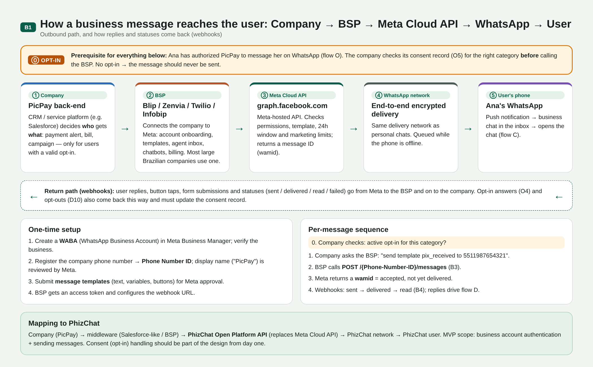</a><p class="cap"><b>B01.</b> Company → BSP → Meta Cloud API → WhatsApp → user, with opt-in as a prerequisite and the webhook return path</p></div>
</div>

### User sign-up

On WhatsApp, the account is the phone number, verified by SMS. There are no friend requests: anyone with the number can write. Businesses and family share **one inbox**, which is why business messaging is tightly controlled. Since 2026 WhatsApp offers usernames and business-scoped user IDs (BSUID) instead of the phone number, which lines up with the use of Open ID in this RFC.

<div class="shots phones">
<div class="shot"><a href="mocks/en/whatsapp/a02-phone-number.png" target="_blank" rel="noopener">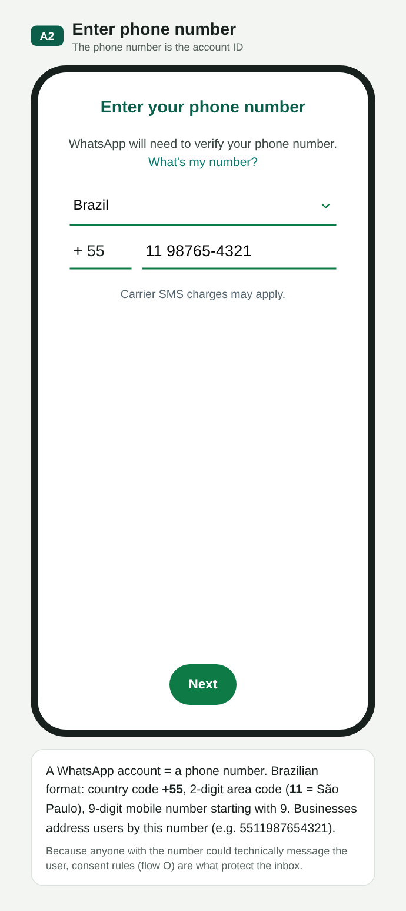</a><p class="cap"><b>A02.</b> Phone number = account identity</p></div>
<div class="shot"><a href="mocks/en/whatsapp/a10-chats-home.png" target="_blank" rel="noopener">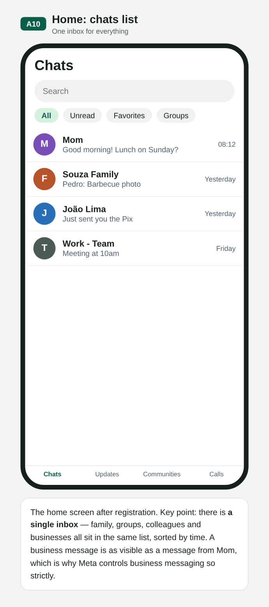</a><p class="cap"><b>A10.</b> One inbox for everything</p></div>
</div>

### User authorization (opt-in)

Before a business starts a conversation, the user must have authorized *that business*. There are four common ways: in the business's app (O1), at sign-up or checkout (O2), when the user writes first, which covers only that service conversation (O3), and by answering “yes” inside the chat (O4). Good practice is to split by purpose: authorizing account alerts does not authorize offers.

<div class="shots">
<div class="shot"><a href="mocks/en/whatsapp/o00-consent-lifecycle.png" target="_blank" rel="noopener">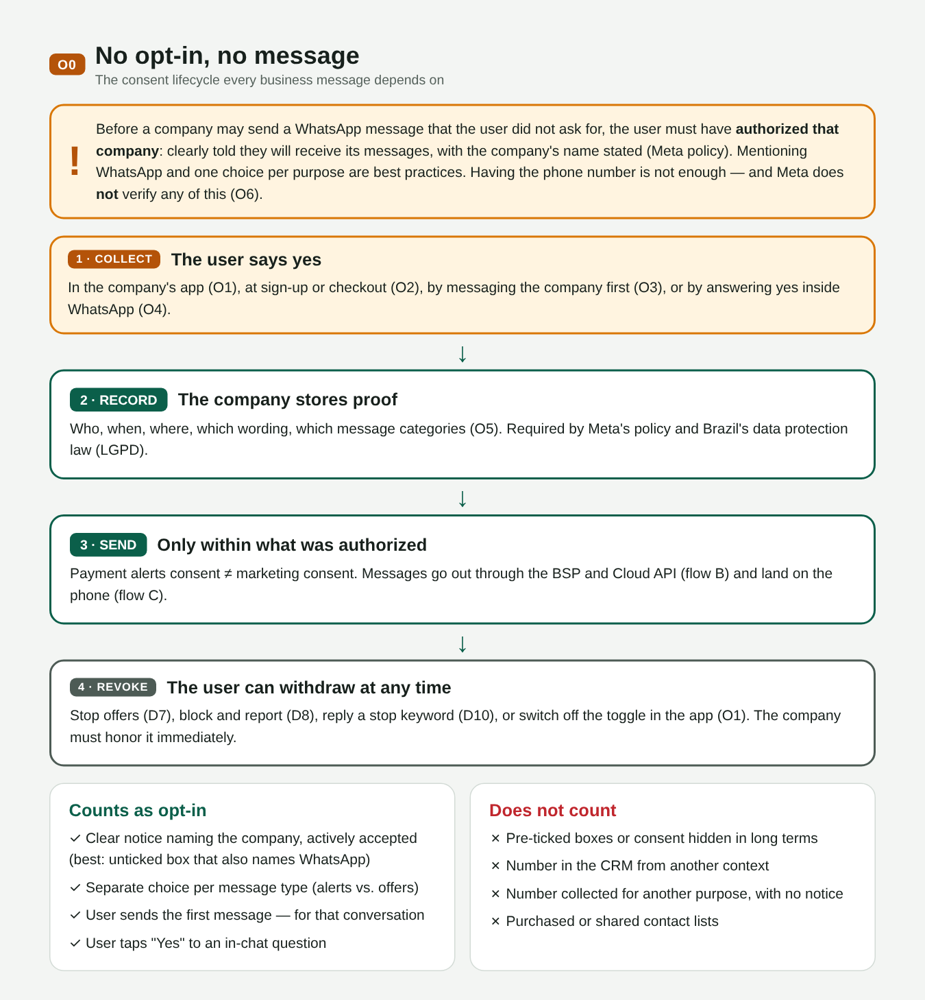</a><p class="cap"><b>O00.</b> Consent lifecycle: collect, record, send within scope, revoke</p></div>
</div>

<div class="shots phones">
<div class="shot"><a href="mocks/en/whatsapp/o01-optin-app.png" target="_blank" rel="noopener">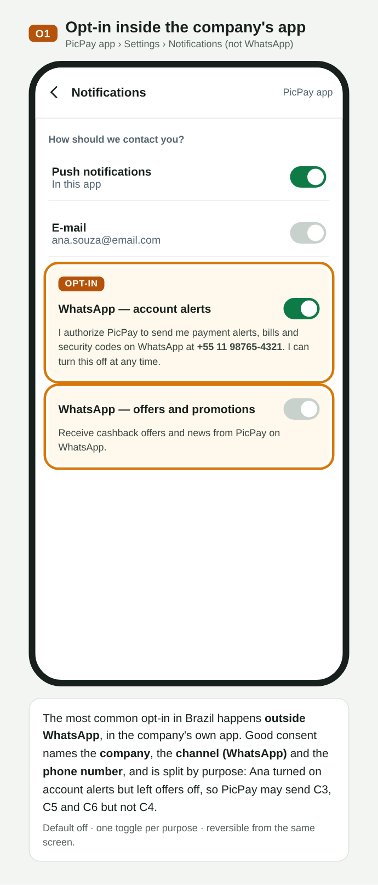</a><p class="cap"><b>O01.</b> Opt-in in the merchant's app, split by purpose</p></div>
<div class="shot"><a href="mocks/en/whatsapp/o02-optin-signup.png" target="_blank" rel="noopener">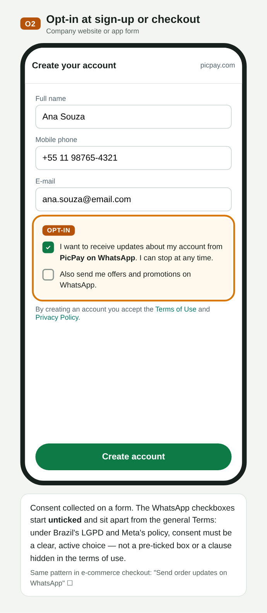</a><p class="cap"><b>O02.</b> Opt-in at sign-up, with unticked boxes</p></div>
<div class="shot"><a href="mocks/en/whatsapp/o03-user-starts.png" target="_blank" rel="noopener">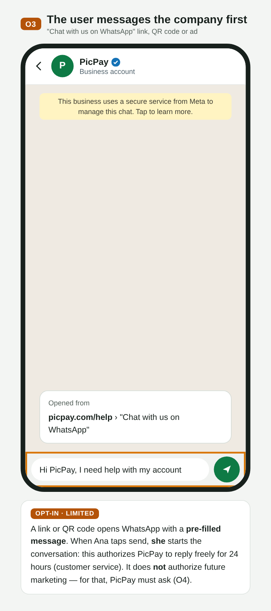</a><p class="cap"><b>O03.</b> The user writes first: authorizes only that service chat</p></div>
<div class="shot"><a href="mocks/en/whatsapp/o04-optin-in-chat.png" target="_blank" rel="noopener">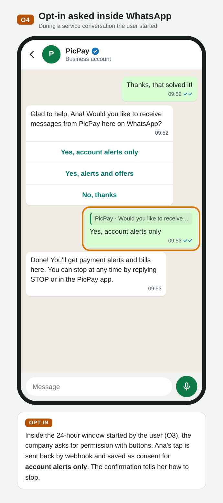</a><p class="cap"><b>O04.</b> Opt-in asked inside the chat, with buttons</p></div>
</div>

**Meta has the policy but does not verify the opt-in.** There is no field or endpoint to prove authorization; Meta trusts the business and only reacts afterwards, through blocks, reports and the quality rating. *Opt-out*, on the other hand, is enforced by the platform: blocking, “stop offers” and the marketing cap make sends fail. Even so, under Brazil's LGPD the business must prove consent and honor withdrawal, so the record (who, merchant, category, source, date, wording shown, revocation) is required in practice.

<div class="shots">
<div class="shot"><a href="mocks/en/whatsapp/o05-consent-record.png" target="_blank" rel="noopener">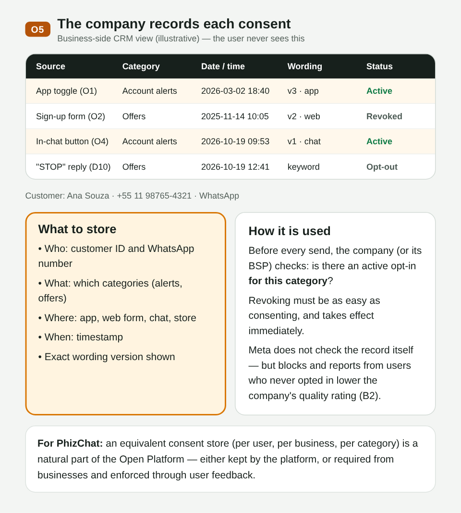</a><p class="cap"><b>O05.</b> Consent record on the merchant side</p></div>
<div class="shot"><a href="mocks/en/whatsapp/o06-who-verifies.png" target="_blank" rel="noopener">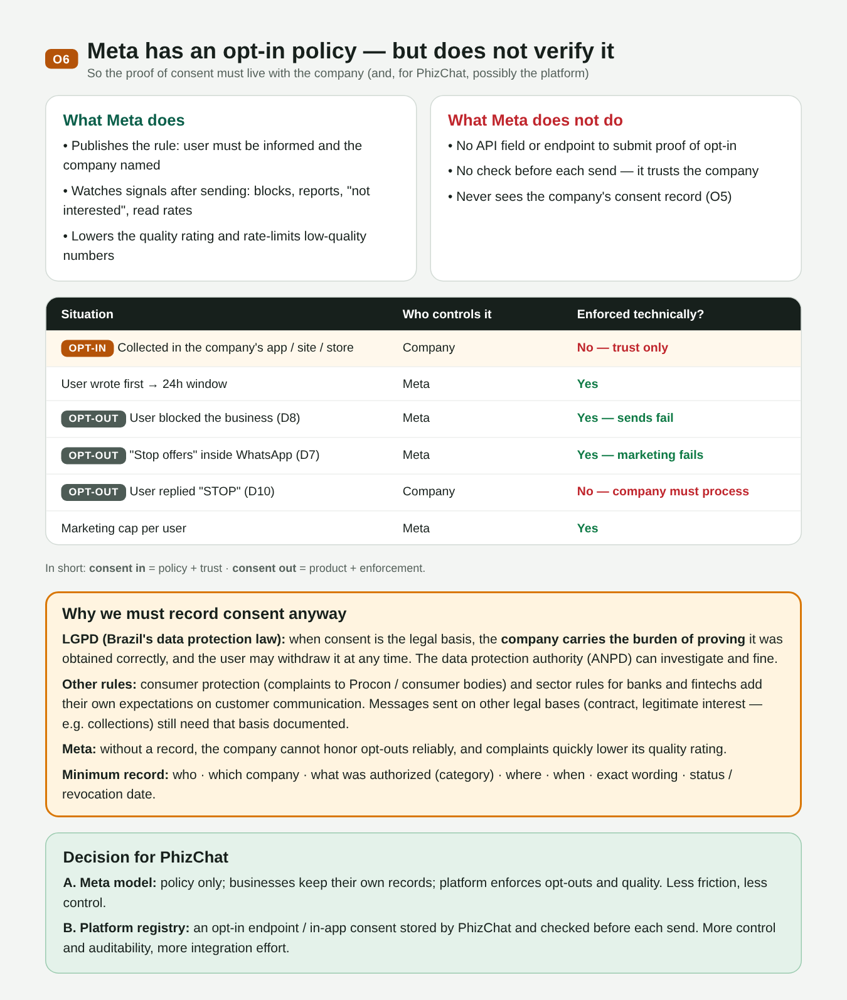</a><p class="cap"><b>O06.</b> Meta does not verify opt-in; opt-out is enforced by the platform; why record it anyway</p></div>
</div>

### What the user receives

Business-initiated messages use approved **templates** in four categories: utility (payments, bills), marketing, authentication (codes) and service. Each category depends on the matching opt-in.

<div class="shots phones">
<div class="shot"><a href="mocks/en/whatsapp/c01-notification.png" target="_blank" rel="noopener">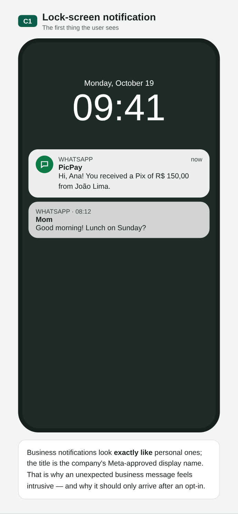</a><p class="cap"><b>C01.</b> Notification identical to a personal contact's</p></div>
<div class="shot"><a href="mocks/en/whatsapp/c02-chat-list.png" target="_blank" rel="noopener">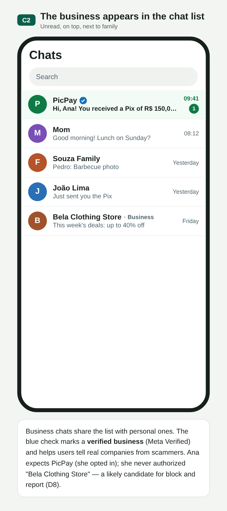</a><p class="cap"><b>C02.</b> Chat list: verified business account, unread and on top, next to family and friends</p></div>
<div class="shot"><a href="mocks/en/whatsapp/c03-utility.png" target="_blank" rel="noopener">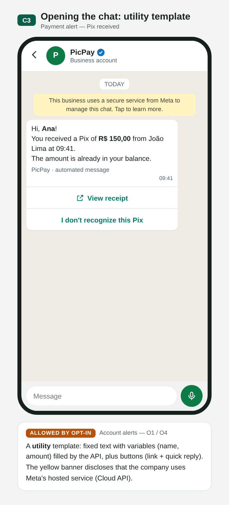</a><p class="cap"><b>C03.</b> Utility: Pix received, with buttons</p></div>
<div class="shot"><a href="mocks/en/whatsapp/c04-marketing.png" target="_blank" rel="noopener">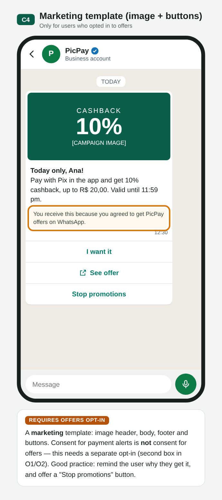</a><p class="cap"><b>C04.</b> Marketing: needs its own opt-in for offers</p></div>
<div class="shot"><a href="mocks/en/whatsapp/c05-authentication.png" target="_blank" rel="noopener">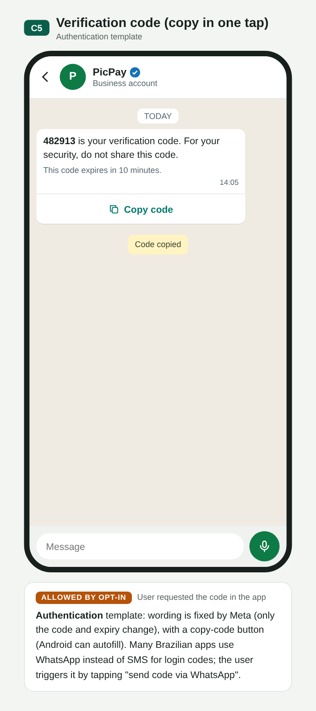</a><p class="cap"><b>C05.</b> Authentication: code with a copy button</p></div>
<div class="shot"><a href="mocks/en/whatsapp/c06-bill.png" target="_blank" rel="noopener">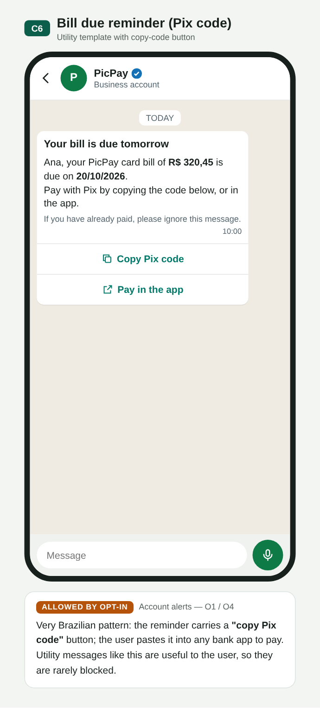</a><p class="cap"><b>C06.</b> Bill with a Pix copy-and-paste code</p></div>
</div>

### What the user can do

The user replies (text, buttons, list, form), checks the business profile or withdraws permission. Each action does, or does not, create an event for the business.

<div class="shots">
<div class="shot"><a href="mocks/en/whatsapp/d00-options-map.png" target="_blank" rel="noopener">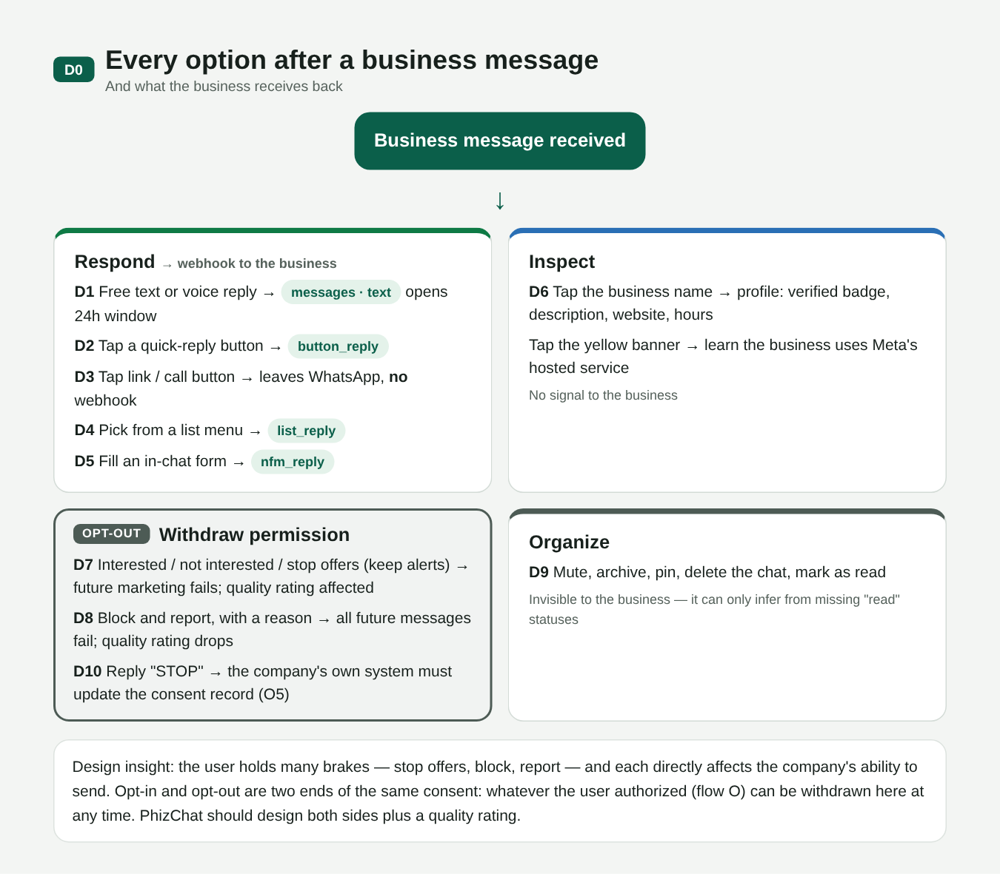</a><p class="cap"><b>D00.</b> Every user option and what the business receives back</p></div>
</div>

<div class="shots phones">
<div class="shot"><a href="mocks/en/whatsapp/d02-quick-reply.png" target="_blank" rel="noopener">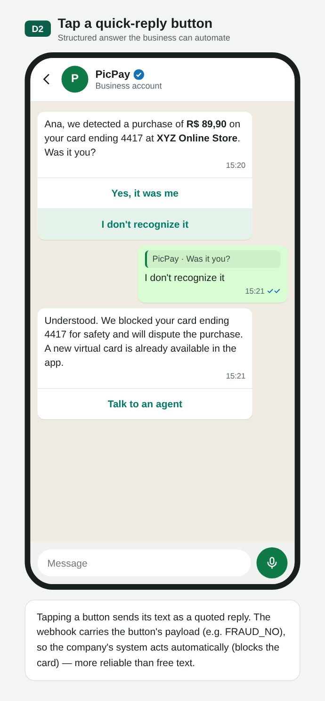</a><p class="cap"><b>D02.</b> Quick-reply button</p></div>
<div class="shot"><a href="mocks/en/whatsapp/d04-list.png" target="_blank" rel="noopener">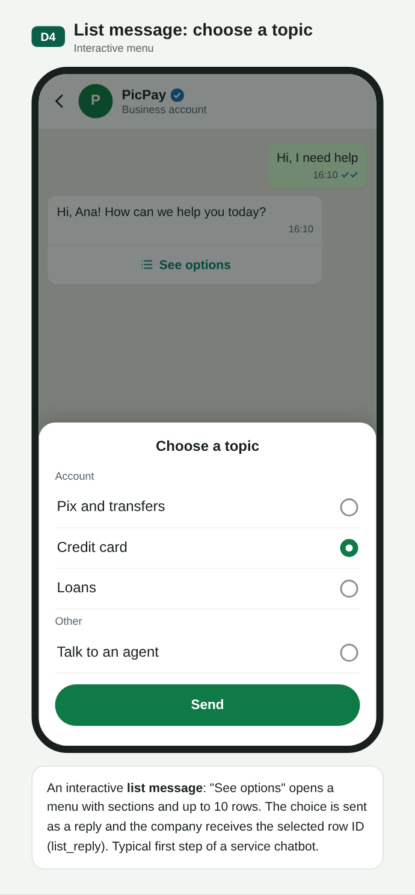</a><p class="cap"><b>D04.</b> List message</p></div>
<div class="shot"><a href="mocks/en/whatsapp/d05-flow.png" target="_blank" rel="noopener">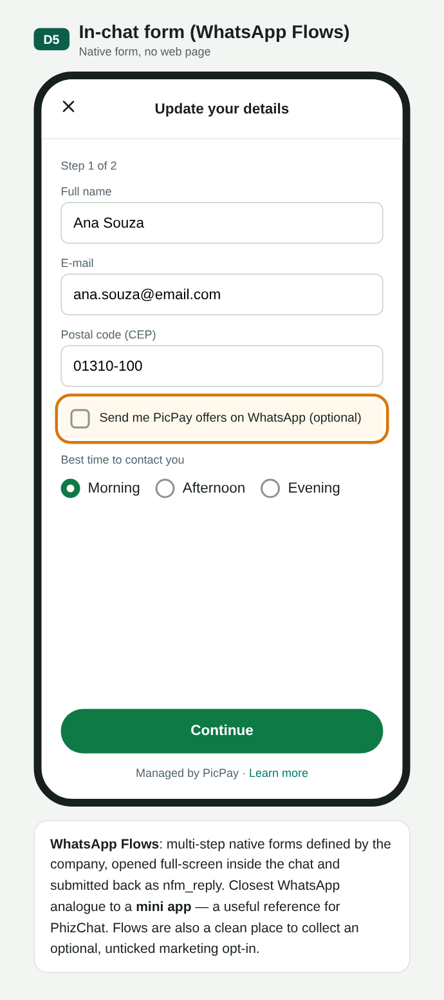</a><p class="cap"><b>D05.</b> In-chat form (Flows), close to a mini app</p></div>
<div class="shot"><a href="mocks/en/whatsapp/d07-stop-offers.png" target="_blank" rel="noopener">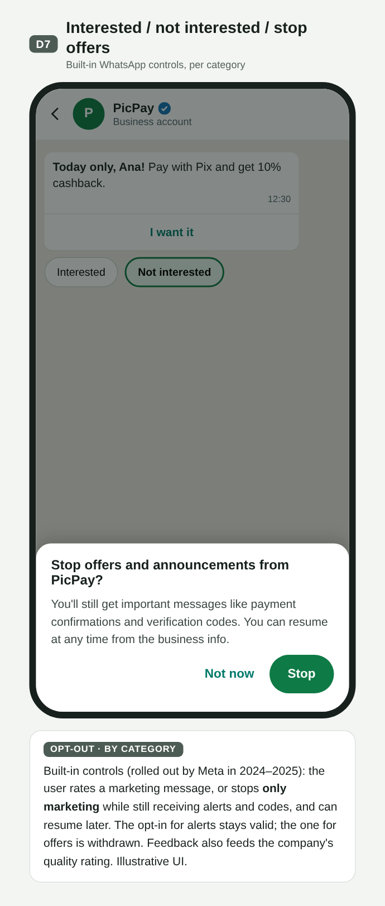</a><p class="cap"><b>D07.</b> Stop offers, keep alerts</p></div>
<div class="shot"><a href="mocks/en/whatsapp/d08-block-report.png" target="_blank" rel="noopener">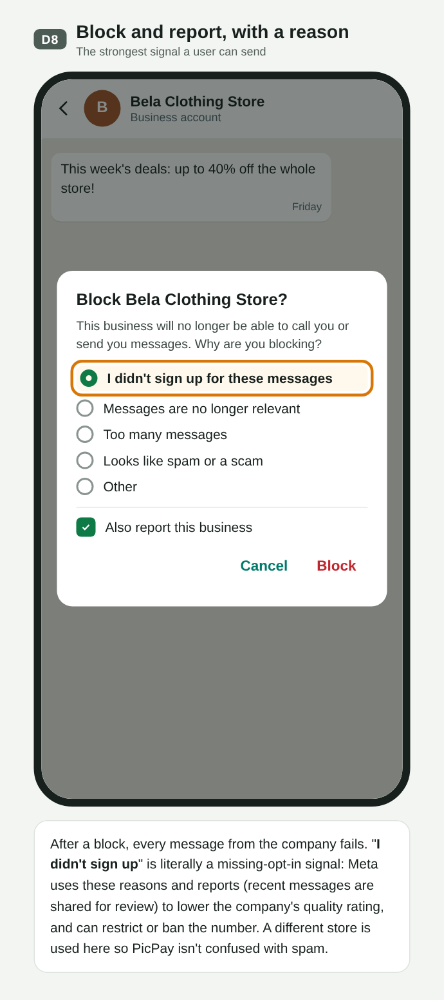</a><p class="cap"><b>D08.</b> Block and report, with a reason</p></div>
<div class="shot"><a href="mocks/en/whatsapp/d10-optout-keyword.png" target="_blank" rel="noopener">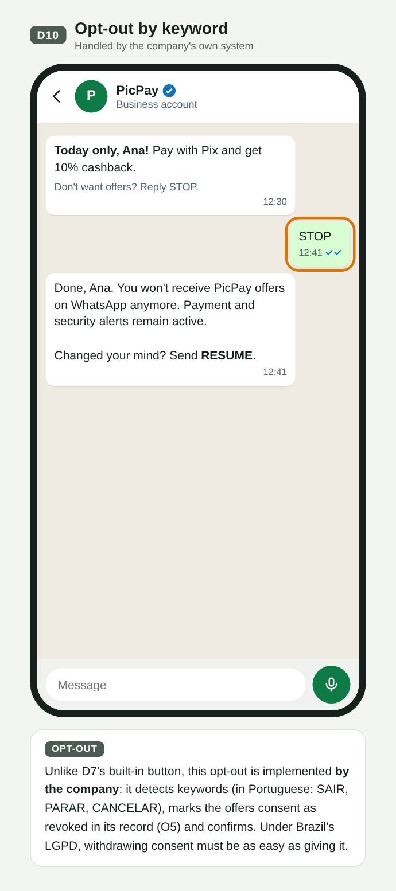</a><p class="cap"><b>D10.</b> Keyword opt-out, handled by the merchant</p></div>
</div>

| User action | On WhatsApp | On PHIZ |
|---|---|---|
| Replies with text or media | `messages` webhook; opens the 24 h window | `message` event (section 10) |
| Taps a button or list row | `button_reply` / `list_reply` | `message` event with the chosen id |
| Stops offers | Marketing sends fail | Proposal: the platform blocks the category for that Business Account (`ba_id`) |
| Blocks or reports | All sends fail; quality rating drops | Proposal: send error plus a quality signal (see Q3) |
| Mutes or archives | Invisible to the business | Same |

### What we take to PHIZ

- The identity the user sees, authorizes and blocks is the **Business Account** (`ba_id`): it receives the opt-in, the block and the quality rating. The Merchant ID remains the Open Platform account and creates the Developer ID, which owns the applications; each Business Account is created inside an application (section 06).
- Consent per Business Account and per category, with opt-out enforced by the platform (see Sending policy, section 09).
- User signals (block, report, stop offers) feeding the merchant's sending limits.
- In-chat forms (Flows) as a reference for mini apps.

## Opt-in in PhizChat: in the app and at the business {#phizoptin}

Section 03 showed that on WhatsApp opt-in almost always happens outside the app and Meta does not verify it. This section proposes how a user **authorizes** a business account in PhizChat, through two paths that end in the same opt-out controls:

- **Flow P — inside PhizChat:** the user accepts the business account in the app itself. The platform keeps the proof.
- **Flow Q — at the business, outside PhizChat:** the user authorized in the merchant's app, website or store, and the merchant starts the conversation.

::: note About the screens
They are illustrative proposals, with PicPay as the example merchant. The codes (P0…P8, Q0…Q5) follow the Design canvas. Click an image to open it at full size.
:::

### Flow P · Opt-in inside PhizChat

The user reaches the business account through an SMS or e-mail link, a QR code, the merchant's app or website, or in-app search. Without Phiz installed, they see an H5 page with only the profile and a download button; acceptance never happens outside the app. After installing and logging in, a deferred deep link takes them to the same chat, which opens **locked until Accept**. On Accept, PhizChat records the consent (the user’s Open ID, `ba_id`, date, entry point), sends the welcome template if there is one, and unlocks the chat.

<div class="shots">
<div class="shot"><a href="mocks/en/phizchat/p00-optin-map.png" target="_blank" rel="noopener">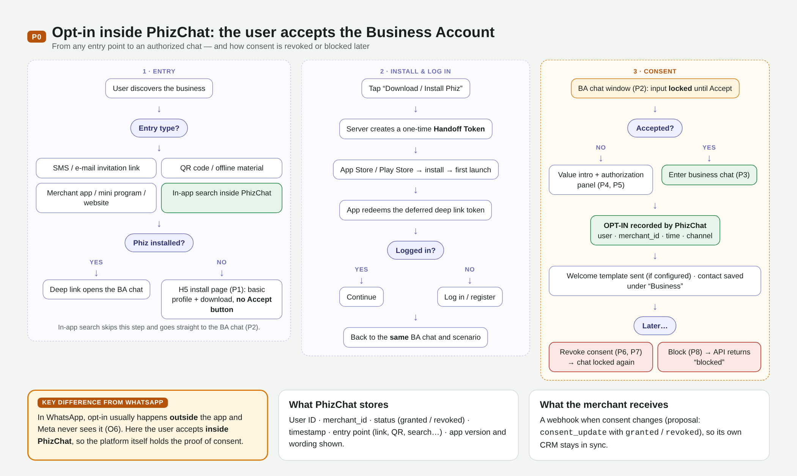</a><p class="cap"><b>P00.</b> Flow P map: entry points, install, login, acceptance and afterwards</p></div>
</div>

<div class="shots phones">
<div class="shot"><a href="mocks/en/phizchat/p01-h5-install.png" target="_blank" rel="noopener">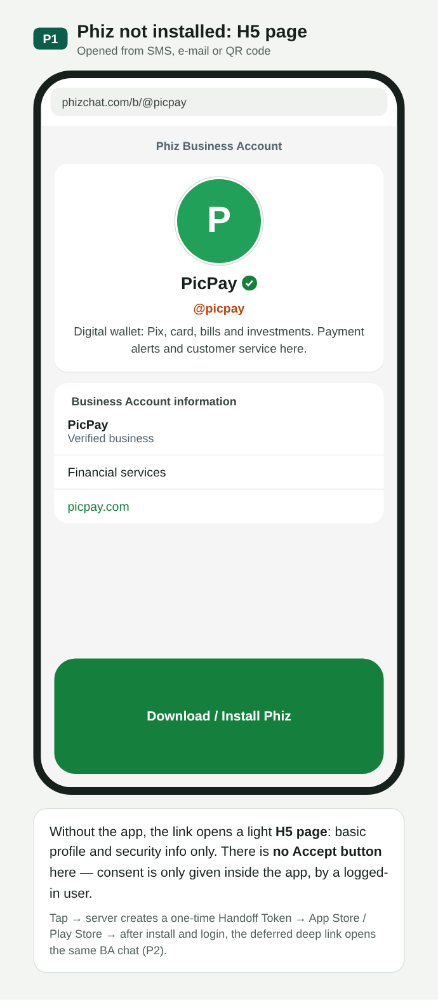</a><p class="cap"><b>P01.</b> Without the app: H5 page with profile and download, no Accept button</p></div>
<div class="shot"><a href="mocks/en/phizchat/p02-chat-locked.png" target="_blank" rel="noopener">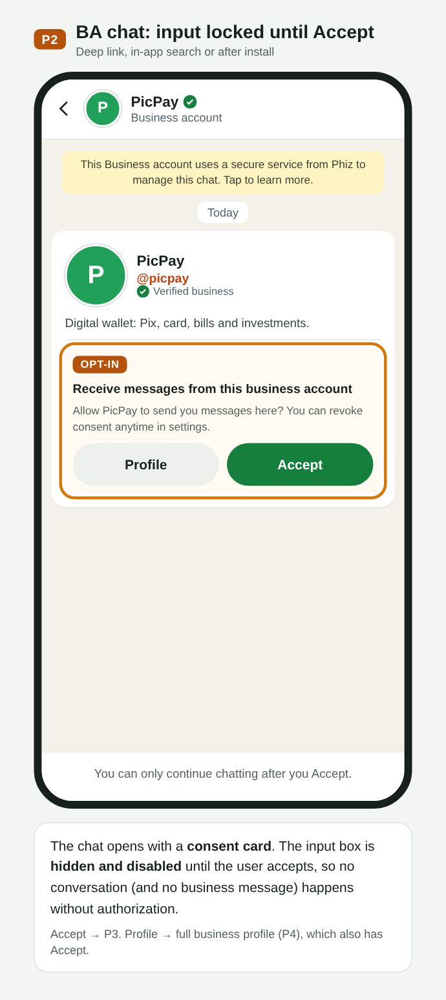</a><p class="cap"><b>P02.</b> BA chat with the consent card; input locked until Accept</p></div>
<div class="shot"><a href="mocks/en/phizchat/p03-accepted.png" target="_blank" rel="noopener">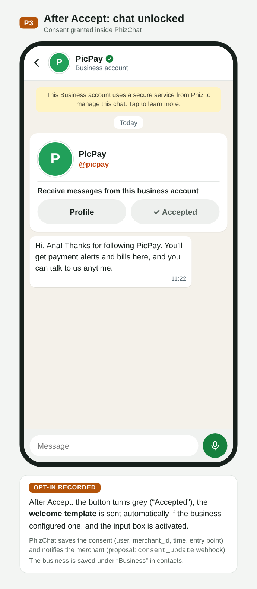</a><p class="cap"><b>P03.</b> After Accept: welcome message and chat unlocked</p></div>
<div class="shot"><a href="mocks/en/phizchat/p04-profile.png" target="_blank" rel="noopener">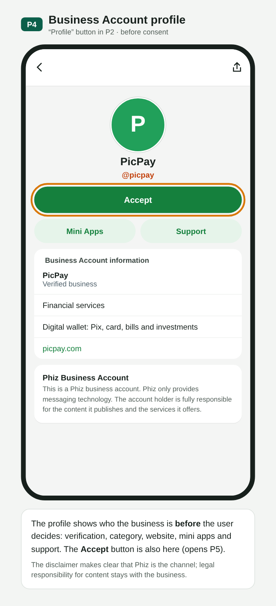</a><p class="cap"><b>P04.</b> Business profile before consent, also with Accept</p></div>
<div class="shot"><a href="mocks/en/phizchat/p05-consent-sheet.png" target="_blank" rel="noopener">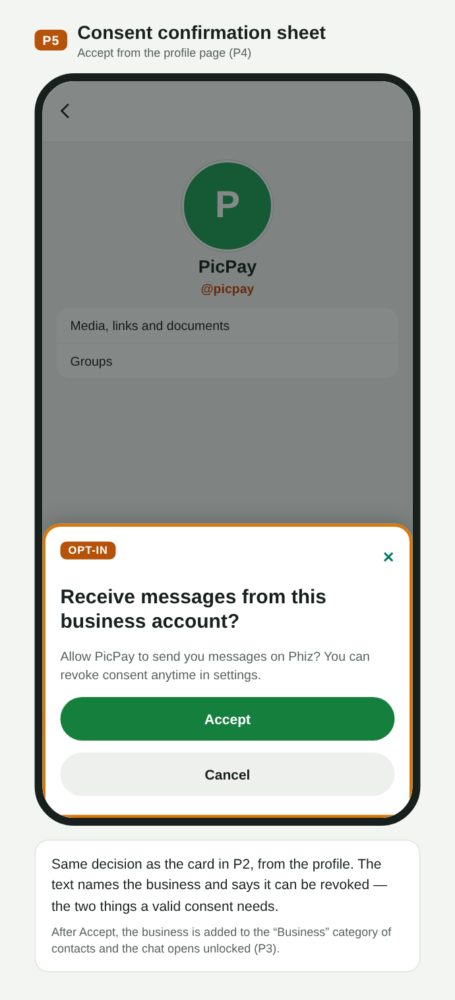</a><p class="cap"><b>P05.</b> Consent confirmation sheet</p></div>
</div>

After Accept, the profile shows the consent status and date. The user can **revoke** (the chat goes back to the locked state and can be authorized again) or **block** (reuses today's Block; the API still accepts calls but returns the blocked status).

<div class="shots phones">
<div class="shot"><a href="mocks/en/phizchat/p06-manage-consent.png" target="_blank" rel="noopener">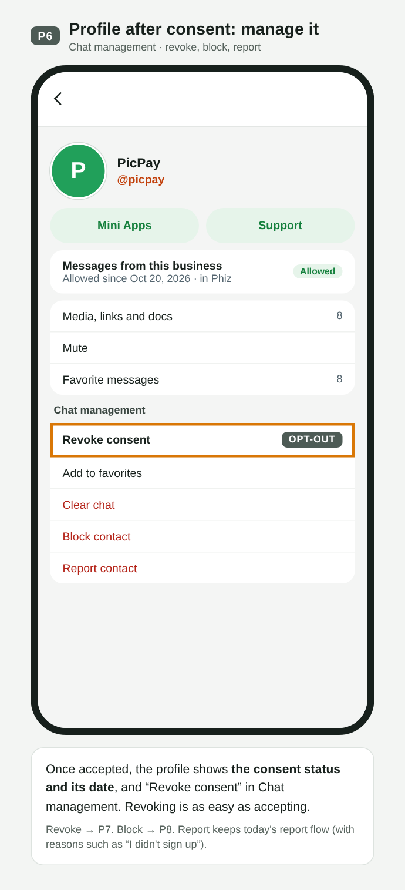</a><p class="cap"><b>P06.</b> Profile after consent: status, date and Revoke consent</p></div>
<div class="shot"><a href="mocks/en/phizchat/p07-revoke.png" target="_blank" rel="noopener">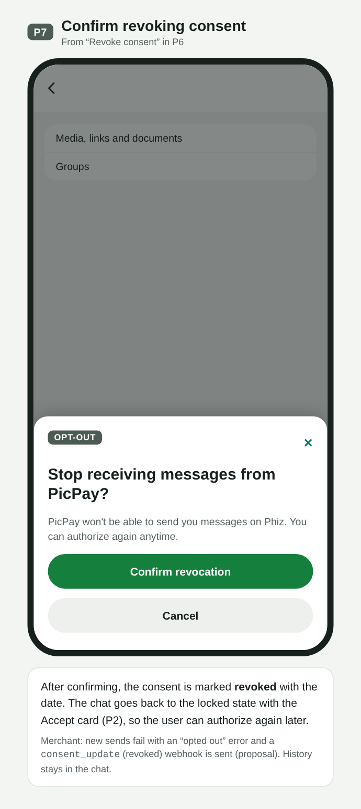</a><p class="cap"><b>P07.</b> Revocation confirmation; the chat is locked again</p></div>
<div class="shot"><a href="mocks/en/phizchat/p08-blocked.png" target="_blank" rel="noopener">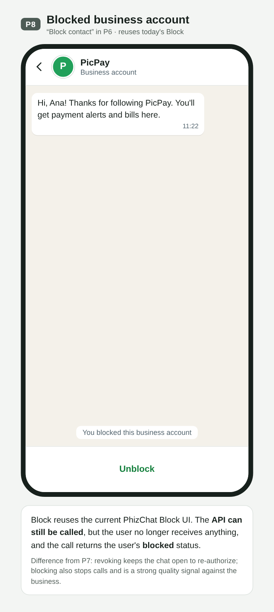</a><p class="cap"><b>P08.</b> Blocked business account: the API returns the blocked status</p></div>
</div>

### Flow Q · Opt-in collected by the business, outside PhizChat

Most Brazilian companies already collect consent in their own channels. In flow Q, the user turns on “messages on PhizChat” in the PicPay app; PicPay keeps the proof and sends a template through the API. The API checks that the recipient is a Phiz user and has not blocked or revoked; in model B it also checks for a registered consent for that category. In the app, the first message arrives with a **consent source card** (what was authorized, where and when), and the user can keep receiving, stop or report.

<div class="shots">
<div class="shot"><a href="mocks/en/phizchat/q00-business-optin-map.png" target="_blank" rel="noopener">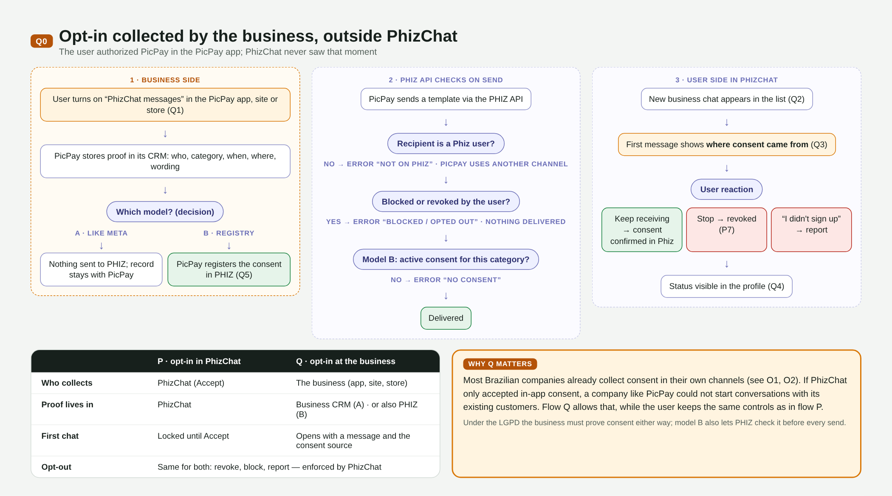</a><p class="cap"><b>Q00.</b> Flow Q map: business side, API checks and user side, with the P vs Q comparison</p></div>
</div>

<div class="shots phones">
<div class="shot"><a href="mocks/en/phizchat/q01-optin-merchant-app.png" target="_blank" rel="noopener">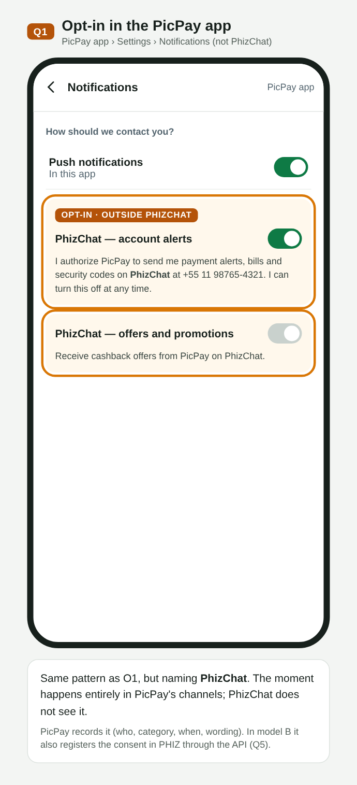</a><p class="cap"><b>Q01.</b> Opt-in in the PicPay app, naming PhizChat</p></div>
<div class="shot"><a href="mocks/en/phizchat/q02-first-message.png" target="_blank" rel="noopener">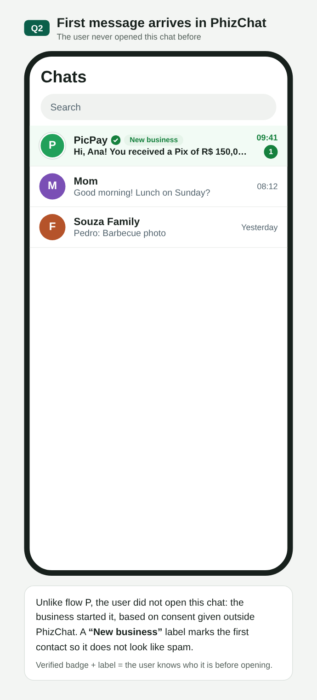</a><p class="cap"><b>Q02.</b> First message in the list, labeled New business</p></div>
<div class="shot"><a href="mocks/en/phizchat/q03-consent-source.png" target="_blank" rel="noopener">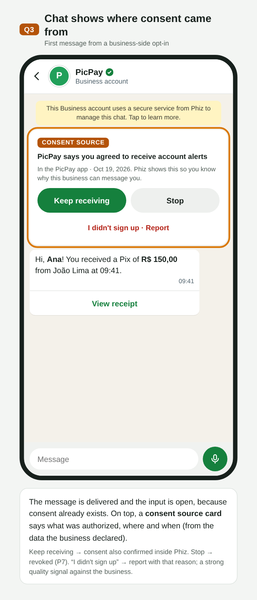</a><p class="cap"><b>Q03.</b> Consent source card: keep receiving, stop or report</p></div>
<div class="shot"><a href="mocks/en/phizchat/q04-consent-status.png" target="_blank" rel="noopener">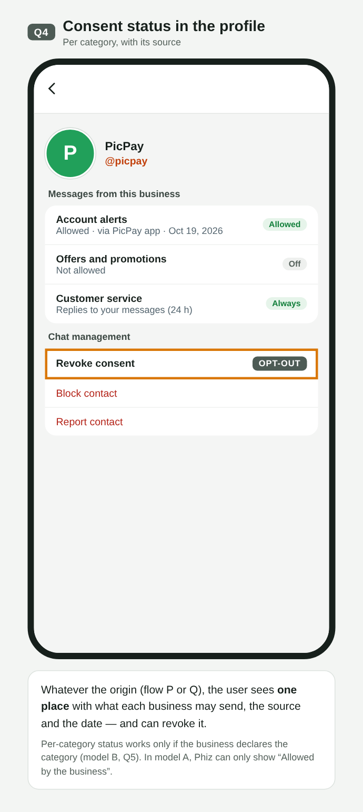</a><p class="cap"><b>Q04.</b> Consent status per category, with source and date</p></div>
</div>

<div class="shots">
<div class="shot"><a href="mocks/en/phizchat/q05-consent-api.png" target="_blank" rel="noopener">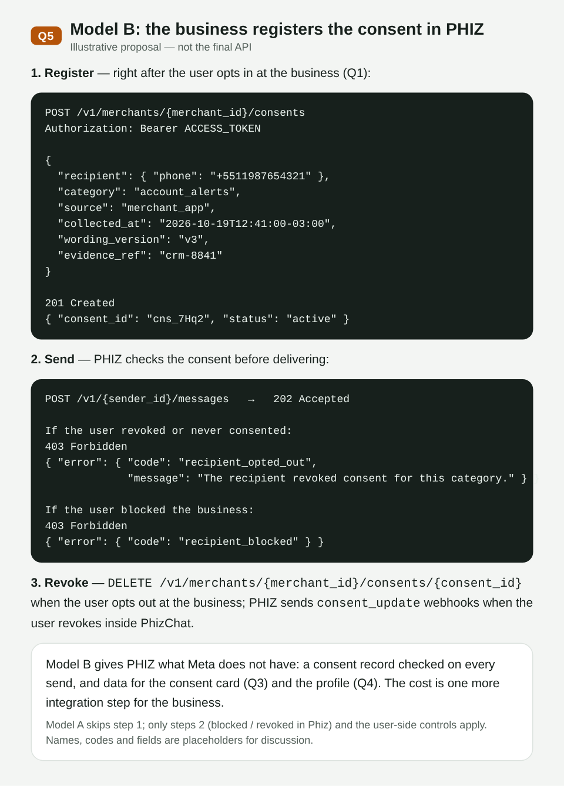</a><p class="cap"><b>Q05.</b> Model B: registering consent through the API and send errors (illustrative proposal)</p></div>
</div>

### P vs Q

|  | P · opt-in in PhizChat | Q · opt-in at the business |
|---|---|---|
| Who collects | PhizChat (Accept) | The merchant (app, website, store) |
| Proof lives in | PhizChat | Merchant CRM (model A) · also PHIZ (model B) |
| First chat | Locked until Accept | Opens with the message and the consent source |
| Opt-out | Same for both: revoke, block, report — enforced by PhizChat |  |

### Relation states with the user

The **PHZ-BM-0001** document (*Business Account Messaging*) proposes explicit states for the relation between the Business Account and the user. They fit flows P and Q and decide what can be sent:

| State | Meaning | Service | Marketing |
|---|---|---|---|
| `NO_RELATION` | Only the phone resolution exists | Only approved strong cases (for example, a verification code) | No |
| `USER_INITIATED` | The user wrote, scanned a QR code or opened a business entry point | Yes | Separate consent |
| `BUSINESS_RELATION` | Order, support, booking or a similar relation (flow Q) | Yes | Separate consent |
| `MARKETING_OPT_IN` | The user explicitly authorized marketing (flow P or Q) | Yes | Yes |
| `BLOCKED` / `UNSUBSCRIBED` | Blocked or unsubscribed by the user, or suppressed by the platform | Per policy | No |

The state is tied to the pair Business Account (`ba_id`) and user Open ID. It is not exposed by the API; a send only gets the outcome (accepted, or an error with a reason).

### User controls

| Action | Result |
|---|---|
| Mute | Turns off notifications and keeps the conversation |
| Block | Refuses future messages from that Business Account |
| Stop marketing | Turns off marketing without turning off required service notices |
| Report | Opens a complaint with evidence |
| About the business | Shows the verified entity, support and privacy policy |

A business conversation must look different from a chat between friends: verified name, why the message arrived, and easy access to block, report and unsubscribe.

### Open decisions

- **Model A vs B in flow Q** (see Q1): policy only, like Meta, or a consent registry in PHIZ checked on every send. The full consent source card (Q3) and per-category status (Q4) depend on model B.
- **Delivery before Accept in flow Q:** the proposal delivers the first message with the consent source card; the alternative is to lock the chat until Accept, as in flow P.
- **Consent categories** (account alerts, offers, codes) and what the app shows the user.
- **Technical names** — `/v1/{sender_id}/consents`, the `consent_update` webhook and the error codes — are placeholders for discussion.

## Goals and non-goals {#goals}

#### Goals

- Credentials tied to Developer Center **applications** instead of each channel. The Open Platform Merchant ID creates the Developer ID; under it, the merchant creates one **application** per external system (for example, one for Blip and another for Salesforce), each with its `client_id`, secret, scopes and its own **Business Accounts**. Channels can be released as optional senders.
- Standard OAuth 2.0 (client credentials), compatible with common libraries and platforms.
- Send messages to a **phone number or Open ID** and receive replies and statuses through a **signed webhook**.
- Structural compatibility with Meta's Cloud API so existing integrations migrate with little code.
- Publish the API specification in OpenAPI 3.1 format (the Swagger standard). It is a file that describes every route, field, response and webhook, and works as the agreement between the team that builds the API and those who integrate with it. With it, partners generate documentation and code and can test before delivery.

#### Out of scope for this RFC

- Templates, campaigns and segmentation (Marketing API, later phases).
- Per-conversation pricing and billing.
- Groups, voice and video calls.
- Official SDKs (may come later, generated from the OpenAPI spec).

## Domain model {#model}

The identity model follows the guidance of the PHIZ technical team. The `merchant_id` does **not** identify the sender: it is the Open Platform account, and one developer can have several applications, each with several Business Accounts.

| Identity | What it is | Where it shows up |
|---|---|---|
| **Merchant ID** | The merchant’s Open Platform account. When created, it creates a Developer ID in sync. | Open Platform |
| **Developer ID** | Developer identity and owner of the resources (applications, keys, subscriptions). It can be the merchant itself or a third party, such as Salesforce or a BSP. | Developer Center |
| **App ID** | Application: credentials (`client_id` and secret), scopes and isolation context. The user’s Open ID is different in each application. | Token, `/v1/apps/{app_id}` |
| **BA ID** | Business Account: the actual sender, which the user sees and authorizes. It is created inside an application and belongs only to it. Encryption and isolation are per BA. | PhizChat conversation, webhook `entry[].id` |
| **sender\_id** | External reference to the sender, used in the API and mapped to the BA ID. For a channel (optional), it is the channel ID. | `POST /v1/{sender_id}/messages` |
| **Open ID** | The user’s identifier inside one application. The phone number is exchanged for the Open ID, and the BA is bound to the Open ID, not to the number. | `to` with `to_type: open_id`; `from` in webhooks |

```mermaid Each application has its own Business Accounts. The user authorizes the BA and is identified by that application’s Open ID. Channels remain an optional sender.
flowchart LR
  M["Merchant ID<br/>Open Platform"] -- "creates in sync" --> D["Developer ID<br/>merchant or third party"]
  D --> A1["App ID · Blip<br/>client_id + secret"]
  D --> A2["App ID · Salesforce<br/>client_id + secret"]
  A1 --> B1["BA ID · Example Store<br/>sender_id"]
  A2 --> B2["BA ID · Example Store Deals<br/>sender_id"]
  A1 -. "optional channel<br/>sender_id = channel ID" .-> C["Channel 1231"]
  B1 --> U(("User<br/>Open ID per application"))
  B2 --> U
  C --> U
```

### Conversation types

Definition from the PHIZ product and technology team:

- **Public account session**: the general category of conversation; not shown to the user.
- **Business service session**: a sub-category of the public account session; not shown either.
- **Business Account**: a product type within the business service session, **shown to the user**, like WhatsApp’s business display. It is meant for businesses, governments and institutions.

To have a Business Account, the business creates its Open Platform account (Merchant ID), which creates the Developer ID; under it, it creates an application (App ID) and, in the application, the Business Account (BA ID). Both third-party calls (Salesforce, BSPs) and the user’s authorization to receive messages operate on the BA ID. The Business Account is a new conversation type: product and technology will refine its definition and the other types, preparing for future expansion (Q4).

::: risk Difference from PHZ-BM-0001
**PHZ-BM-0001** proposes a different hierarchy: `Organization → Business Account → App → Credential`. There the Business Account sits **above** the applications, several applications can send through it (the visible sender is still the BA), and the Business Account is a **Channel subtype** (`Channel.subtype = BUSINESS_ACCOUNT`). This RFC keeps the v1.6 model, defined with the PHIZ technical team: `Merchant ID → Developer ID → App ID → BA ID`, with each BA inside a single application and the channel as a separate, optional sender. Aligning the two documents is tracked in Q11 and Q12.
:::

| Topic | This RFC (v1.6) | PHZ-BM-0001 |
|---|---|---|
| Hierarchy | Merchant ID → Developer ID → App ID → BA ID | Organization → Business Account → App → Credential |
| Applications per BA | One (the BA belongs to the application) | Several (applications send on behalf of the BA) |
| What the BA is | Conversation type: public account › business service › Business Account | Product subtype of Channel |
| Channel | Optional sender, separate from the BA | The BA is a Channel; a channel ID alone never grants access |
| Conversation ID | Not defined | Short term: `channel:<id>` with `conversation_kind=BUSINESS_1_TO_1`, `business_channel_id` and `recipient_user_id`; long term: opaque server ID |
| User | Open ID per application | `recipient_user_id` |
| Audit | Application and Business Account | Organization, application and operator as separate subjects |

### Impact on the PhizChat app

**PHZ-BM-0001** lists what the app (Flutter) needs to change to show Business Account conversations. It applies to either hierarchy:

| Today in the app | What is missing |
|---|---|
| `ChannelInfo.type` | Explicit subtype for Business Account, with a compatible enum |
| `ChannelInfo.companyAuth` (boolean) | Verification state, level, validity and reason |
| `channel:<id>` conversation | Business Account conversation metadata and protection for old parsers |
| `StrangerChatHelper` | A separate business policy, not mixed with the friendship rule |
| `MessageReceiver` / `MessageSender` | Envelope with purpose, sender identity and the server’s decision |

### End-to-end flow

View for the engineering team: where a message travels from the business to the user, and how replies and statuses come back.

```mermaid Outbound: from the business to the user. The dashed line is the optional channel path.
flowchart LR
  PP["PicPay"] --> B1["BSP<br/>e.g. Blip"]
  AM["Ambar"] --> B2["BSP<br/>e.g. Salesforce"]
  B1 --> API["PHIZ Business API<br/>/gateway/business<br/>Auth · Messages · Webhooks"]
  B2 --> API
  API -- "1–3 · token, send and<br/>sender validation" --> MA
  subgraph OP["Developer Center"]
    MA["App · Business Account"]
    MA -- "4a · sender_id = BA ID<br/>default" --> DM["Business Account"]
    MA -. "4b · sender_id = channel ID<br/>optional" .-> CH["Channel"]
    CH --> CM["Channel Message"]
  end
  DM -- "5 · deliver" --> APP["Phiz App"]
  CM -- "5 · deliver" --> APP
  APP --> U(("User"))
```

#### Return: replies and statuses

```mermaid Inbound: user replies and message statuses reach the BSP through the webhook.
flowchart LR
  U(("User")) -- "replies, receives, reads" --> APP["Phiz App"]
  APP -- "6 · events" --> WH["PHIZ Business API<br/>Webhooks"]
  WH -- "signed webhook" --> BSP["BSP of the integration<br/>that owns the sender"]
  BSP --> EMP["Business"]
```

1. **Integration.** The business (for example PicPay or Ambar) uses a BSP for customer service. In the Developer Center, the merchant creates a Business Messaging application for that BSP and hands over the `client_id` and secret.
2. **Token.** The BSP calls `/oauth/token`. Auth checks the application in the Developer Center (secret, scopes and Business Accounts) and returns a 1-hour JWT.
3. **Send.** The BSP calls `POST /v1/{sender_id}/messages`. The API exchanges the phone number for the user’s Open ID, validates the token, scope, sender, opt-in policy and `Idempotency-Key`, answers `202` and queues the message. For media, the BSP first uploads the file to `POST /v1/{sender_id}/media` and uses the returned `id` or PHIZ link in the send.
4. **Routing.** With a Business Account `sender_id`, the message goes out as a Business Account conversation (default). With a channel ID it goes out as a Channel Message (optional).
5. **Delivery.** The Phiz App shows the message to the user and downloads media from PHIZ storage, through the link generated at upload.
6. **Return.** User replies and statuses (`sent`, `delivered`, `read`, `failed`) become events that the Webhooks service delivers, signed, to the application that owns the Business Account.

| Component | Responsibility | Status |
|---|---|---|
| BSP / business system | Calls the API, uploads media and receives the webhook. | External |
| PHIZ Business API · Auth | Issues and revokes JWTs; validates `client_id` and secret. | New |
| PHIZ Business API · Messages | Validates and accepts sends (`202`), applies idempotency and limits, queues and routes by `sender_id`. | New |
| PHIZ Business API · Media | Receives uploads, checks format and size, stores the file for a limited time and generates the `id` and PHIZ link used in the send. | New |
| PHIZ Business API · Webhooks | Consumes app events, signs them and delivers through the Developer Center’s event subscriptions, with its retries and history. | New |
| Open Platform · Developer Center | Existing. Stores organizations, apps, secrets (hashed), scopes and event subscriptions. The Business API adds each app’s Business Accounts. | Changed: credentials move from the channel to Developer ID applications |
| Business Account | Business service session shown to the user as the business; encryption and isolation per BA. | New (section 06, Q3) |
| Channel / Channel Message | Sending through the merchant's channel. | Existing |
| Phiz App | Shows messages, downloads media by PHIZ link and emits delivery, read and reply events. | Changed |

### Mapping to Meta's Cloud API

| Meta (WhatsApp Cloud API) | PHIZ (this proposal) |
|---|---|
| WhatsApp Business Account (WABA) | Developer ID · application (App ID) |
| Business phone number · `phone_number_id` | Business Account · `sender_id` mapped to the BA ID; optionally, a channel (channel ID) |
| Meta app + System User token | Developer app + OAuth client credentials |
| `wa_id` | `open_id` (per application) |
| `POST /{phone-number-id}/messages` | `POST /v1/{sender_id}/messages` |
| `POST /{phone-number-id}/media` · media by `id` or third-party `link` | `POST /v1/{sender_id}/media` · media only by `id` or PHIZ link; third-party links are not accepted |
| `object: whatsapp_business_account` | `object: phiz_business_account` |
| `X-Hub-Signature-256` | `X-Phiz-Signature-256` + `X-Phiz-Timestamp` |
| `hub.mode` / `hub.verify_token` / `hub.challenge` | Unchanged |

## Design principles {#principles}

- **Same shape as the Cloud API.** Send bodies, responses and webhooks follow Meta's structure. We diverge only for a clear gain in security (timestamp in the signature, media only through PHIZ storage) or clarity (`to_type`).
- HTTP status codes, a single error envelope and a `trace_id` in every error response.
- Sending is asynchronous and returns `202 Accepted`; the outcome arrives by webhook.
- **Idempotency.** The `Idempotency-Key` header prevents duplicate messages when a client retries.
- **Least privilege.** Each integration has scopes and a list of allowed senders.
- Versioning `/v1`. Compatible changes (new fields) ship in a standardized way; breaking changes require `/v2`.
- **No friendship is not anonymous.** Messaging people who are not friends needs no prior relation, but the business sender is always identifiable.
- **Platform suppression wins.** Blocks, unsubscribes and suppression take priority over any business permission.

## Authentication {#auth}

We use the OAuth 2.0 **client credentials** flow (RFC 6749 §4.4). The app exchanges `client_id` and `client_secret` for a 1-hour access token and sends it as `Authorization: Bearer` on every call. There is no refresh token: when the token expires, the app requests a new one.

In the Developer Center, the app, `appId` and `appSecret` are this section’s app, `client_id` and `client_secret`, and the platform’s `CLIENT_CREDENTIALS` grant is the flow described here (section 12).

::: endpoints
- POST `/oauth/token` — Issues an access token
- POST `/oauth/revoke` — Revokes a token (RFC 7009)
- GET `/v1/me` — Shows the token's application, Developer ID, scopes and senders
:::

```mermaid Close to expiry, the system requests a new token. There is no refresh token.
sequenceDiagram
  autonumber
  participant S as External system
  participant A as PHIZ Auth
  participant API as PHIZ API
  S->>A: POST /oauth/token (client_id, client_secret)
  A-->>S: 200 access_token (1 h), scopes
  S->>API: POST /v1/{sender_id}/messages · Bearer token
  API-->>S: 202 Accepted
```

### Request and response

```bash
# Base URL of this API: current PHIZ gateway + /gateway/business prefix (illustrative host)
PHIZ_API_BASE="https://gateway.phiz.chat/gateway/business"

curl -X POST "$PHIZ_API_BASE/oauth/token" \
  -H "Content-Type: application/x-www-form-urlencoded" \
  -d grant_type=client_credentials \
  -d client_id=app_2Fk81PzQ \
  -d client_secret="$PHIZ_CLIENT_SECRET" \
  -d "scope=messages:send messages:read"
```

```json
{
  "access_token": "eyJhbGciOiJFUzI1NiIsImtpZCI6InBoei0yMDI2LTEwIn0…",
  "token_type": "Bearer",
  "expires_in": 3600,
  "scope": "messages:send messages:read",
  "developer_id": "dev_suPb10cTzMQ"
}
```

The `/oauth/*` endpoints use the OAuth error format (RFC 6749 §5.2), which client libraries already understand:

```json
{
  "error": "invalid_client",
  "error_description": "Client authentication failed."
}
```

### Token format

Decision: the token is a JWT signed with ES256, keys published at `/.well-known/jwks.json`. The gateway validates tokens locally without a database lookup per call. Revoked tokens and rotated secrets go into a short-lived deny list (until the token's expiry). For integrators the token is opaque; the content below is informative.

```json
{
  "iss": "https://gateway.phiz.chat/gateway/business",
  "sub": "app_2Fk81PzQ",
  "aud": "phiz-business-api",
  "did": "dev_suPb10cTzMQ",
  "scope": "messages:send messages:read",
  "snd": [
    "ba_7Kq2M9xTpL",
    "1231"
  ],
  "env": "live",
  "iat": 1760527800,
  "exp": 1760531400,
  "jti": "tok_01JA9VQ4N2"
}
```

### Scopes

| Scope | Allows |
|---|---|
| `messages:send` | Send service messages, upload and manage media, and mark messages as read |
| `messages:read` | Query message status |
| `webhooks:manage` | Set up, test and replay the app's own webhook (Phase 2) |
| `account:read` | Read application, Business Account and channel data |
| `templates:manage` | Reserved for the Marketing API |
| `recipients:resolve` | Check whether a phone number can receive messages from the Business Account, without revealing registration (proposal, Q18) |
| `messages:send_marketing` | Send marketing messages; separate approval (reserved for the Marketing API) |

### Secrets and rotation

- Secrets carry an environment prefix (`phzsk_live_`, `phzsk_test_`) so leak scanners can recognise them.
- A secret is shown **only once**, at creation or rotation, and stored only as a hash (Argon2id).
- Each app can have **up to two active secrets**. When a new one is generated, the previous one stays valid for a chosen period (default 24 h, from 0 to 7 days), so the switch causes no downtime.
- The screen shows when each secret was last used, so you know whether the old one is still in use before revoking it.
- Allowed IP list per app and a 90-day rotation policy, both already available in the Developer Center.

### Prerequisite: verification

**PHZ-BM-0001** points out that today there is no account verification object: the `companyAuth` and `memberAuth` fields are not enough to authorize the API. The Developer Center already shows “Verified organization”, but the model below still needs confirmation (Q13). The proposal is that each level unlocks a set of scopes, published in a public matrix:

| Level | Can request | Not granted by default |
|---|---|---|
| `UNVERIFIED` | Nothing proactive | Resolution, service, marketing |
| `PERSON_VERIFIED` | Test, read and user-initiated replies | Bulk reach and marketing |
| `INDIVIDUAL_BUSINESS_VERIFIED` | Restricted service | Marketing and broad resolution |
| `BUSINESS_VERIFIED` | Service, templates and relation-bound resolution | Marketing |
| `BUSINESS_VERIFIED` + `MARKETING_APPROVED` | Marketing, subject to consent, template, opt-out and quota | Unlimited or cross-region access |

Verification is a state machine, not a boolean: `DRAFT → SUBMITTED → UNDER_REVIEW → VERIFIED`, with `NEEDS_INFO` and `REJECTED`, then `LIMITED → SUSPENDED → DISABLED`. Messaging has its own state: `NOT_ENABLED → SERVICE_ENABLED → MARKETING_REVIEW → MARKETING_ENABLED → PAUSED`. Verification alone does not enable marketing.

### Current vs proposed

| Aspect | Today | Proposal |
|---|---|---|
| Credential owner | Channel | Developer Center application (Developer ID) |
| Flow | `user_credentials` (custom) | `client_credentials` (RFC 6749) |
| Extra required fields | `description` | None |
| Lifetime | ~2 h + ~90-day refresh token | 1 h, no refresh token |
| Scopes | `channel` | Per capability + allowed senders |
| Rotation | Reset invalidates immediately | Two active secrets with overlap |
| Errors | HTTP 200 + `code` in the body | Real HTTP status + standard envelope |

## Sending messages {#messages}

::: endpoints
- POST `/v1/{sender_id}/messages` — Sends a message or marks one as read
- POST `/v1/{sender_id}/media` — Uploads a media file and returns its `id` and PHIZ link
- GET `/v1/media/{media_id}` — Media details: link, type, size and expiry
- DELETE `/v1/media/{media_id}` — Deletes the media before it expires
- GET `/v1/messages/{message_id}` — Latest known status (fallback)
- GET `/v1/apps/{app_id}/senders` — Business Accounts and channels of the application
- POST `/v1/{sender_id}/recipients/resolve` — Checks whether the phone can receive, without revealing registration (proposal, Q18)
:::

### Sender: a Business Account or a channel

The `sender_id` in the path defines on whose behalf the message is sent. It is an external reference to the sender and is **not** the `merchant_id`:

- **Business Account (default).** Use the Business Account’s `sender_id`, mapped to the BA ID, for example `ba_7Kq2M9xTpL`. The message appears in a **Business Account** conversation, shown to the user as the business, with no channel needed. Each Business Account belongs to a single application, which is the one that sends and receives through it.
- **A channel (optional).** Use the channel ID, for example `1231`. Useful for merchants that separate brands or departments into different channels. The message appears in the channel's **Channel Service** conversation, the same one Channel Bot uses.

Both work the same way in the API: same fields, same responses and same webhooks. In webhooks, `metadata.sender_type` shows which one was used and `metadata.conversation_type` carries the conversation type (`business_account` or `channel_service`).

### Recipient: phone number or Open ID

A Business Account always sends to the user’s **Open ID** in that application. Every PHIZ user has a valid, verified phone number, so the integrator can pass the phone number and PHIZ does the exchange. The `to` field holds the recipient and `to_type` says how to read it:

- `phone` (default): an E.164 phone number such as `+5511987654321`, including numbers from other countries. PHIZ exchanges the number for the user’s Open ID before sending.
- `open_id`: the user’s Open ID in this application, such as `oid_Qm7f2K9xT4Lw`. This is the identifier webhooks carry, so replies can use it directly.

The Business Account is bound to the user by Open ID, not by phone number: if the user changes number, the conversation continues with the same Open ID. The Open ID differs in each application, so it cannot be used to match users across applications.

If the phone number does not belong to a PHIZ account, or the user has blocked the sender, the API still answers `202` and the webhook reports `failed` with error `2104`. This keeps the API from being used to find out which numbers have a PHIZ account.

### Example: text to a phone number

```bash
# sender_id = BA ID: message from the Business Account (default), no channel needed
curl -X POST "$PHIZ_API_BASE/v1/ba_7Kq2M9xTpL/messages" \
  -H "Authorization: Bearer $PHIZ_TOKEN" \
  -H "Content-Type: application/json" \
  -H "Idempotency-Key: pedido-48213-envio" \
  -d '{
    "messaging_product": "phiz",
    "to": "+5511987654321",
    "to_type": "phone",
    "type": "text",
    "text": { "body": "Olá, Maria! Seu pedido #48213 foi enviado." },
    "biz_opaque_callback_data": "pedido=48213"
  }'
```

```json
{
  "messaging_product": "phiz",
  "contacts": [
    {
      "input": "+5511987654321",
      "open_id": null
    }
  ],
  "messages": [
    {
      "id": "pmid.01JA9VZ6T8R3",
      "message_status": "accepted"
    }
  ]
}
```

`contacts[].open_id` is filled only if the user is already bound to this Business Account. `messages[].id` is the key to match status webhooks.

### More examples

#### The same send, through a channel

```bash
# sender_id = 1231: same request, sent through the merchant's channel
curl -X POST "$PHIZ_API_BASE/v1/1231/messages" \
  -H "Authorization: Bearer $PHIZ_TOKEN" \
  -H "Content-Type: application/json" \
  -d '{ "to": "+5511987654321", "type": "text", "text": { "body": "Novidades da semana na Loja Exemplo - Ofertas" } }'
```

#### Text to a Open ID

```json
{
  "to": "oid_Qm7f2K9xT4Lw",
  "to_type": "open_id",
  "type": "text",
  "text": {
    "body": "Seu cupom chegou: PHIZ10"
  }
}
```

#### Media upload

```bash
# 1. Upload the file to PHIZ (multipart/form-data). Third-party URLs are not accepted when sending.
curl -X POST "$PHIZ_API_BASE/v1/ba_7Kq2M9xTpL/media" \
  -H "Authorization: Bearer $PHIZ_TOKEN" \
  -F messaging_product=phiz \
  -F type=application/pdf \
  -F file=@nota-fiscal-48213.pdf
```

```json
{
  "id": "pmed.01JB2K7Q9X",
  "link": "https://media.phiz.chat/biz/pmed.01JB2K7Q9X",
  "mime_type": "application/pdf",
  "file_size": 184320,
  "sha256": "9b1f…",
  "expires_at": "2026-11-19T14:00:00Z"
}
```

#### Audio by media `id`

```json
{
  "to": "+5511987654321",
  "type": "audio",
  "audio": {
    "id": "pmed.01JB2K4M7A"
  }
}
```

#### Video by PHIZ link, to a Open ID

```json
{
  "to": "oid_Qm7f2K9xT4Lw",
  "to_type": "open_id",
  "type": "video",
  "video": {
    "link": "https://media.phiz.chat/biz/pmed.01JB2K5V1C",
    "caption": "Como montar seu produto"
  }
}
```

#### Document with a file name

```json
{
  "to": "+5511987654321",
  "type": "document",
  "document": {
    "id": "pmed.01JB2K7Q9X",
    "filename": "nota-fiscal-48213.pdf",
    "caption": "Nota fiscal do pedido #48213"
  }
}
```

#### Reply buttons

```json
{
  "to": "+5511987654321",
  "type": "interactive",
  "interactive": {
    "type": "button",
    "body": {
      "text": "Confirma a entrega amanhã entre 9h e 12h?"
    },
    "action": {
      "buttons": [
        {
          "type": "reply",
          "reply": {
            "id": "confirmar",
            "title": "Confirmar"
          }
        },
        {
          "type": "reply",
          "reply": {
            "id": "reagendar",
            "title": "Reagendar"
          }
        }
      ]
    }
  }
}
```

#### Mark an inbound message as read

```json
{
  "messaging_product": "phiz",
  "status": "read",
  "message_id": "pmid.IN_01JA9W2C"
}
```

### Supported types

| type | Content | Phase |
|---|---|---|
| `text` | Up to 4,096 characters; optional `preview_url` | MVP |
| `image` | By `id` or PHIZ link (upload first); optional caption | MVP |
| `audio` | By `id` or PHIZ link (upload first); no caption | MVP |
| `video` | By `id` or PHIZ link (upload first); optional caption | MVP |
| `document` | By `id` or PHIZ link (upload first); optional caption and file name | MVP |

### Media: upload to PHIZ and temporary storage

All media goes through PHIZ storage. Sending takes two steps:

1. **Upload.** The BSP sends the file to `POST /v1/{sender_id}/media` (`multipart/form-data`). PHIZ checks format and size, stores the file and returns an `id` and a PHIZ `link`, with the expiry date in `expires_at`.
2. **Send.** In the message, the media object carries the `id` (recommended) or that `link`. The user's app downloads the file from PHIZ storage.

- **Only links generated by PHIZ.** In Phase 1 the API rejects third-party URLs (the merchant's or partner's CDN) with error `2302`. This way PHIZ guarantees the link is safe and the file stays reachable until delivery, and the app does not expose the user's IP to outside servers.
- **Temporary storage.** The file is kept only as long as sending and delivery need it: proposed 30 days from upload, like the Cloud API media `id` (see Q8). Within that period the same `id` can be used in many sends, for example the same PDF to many customers. After it, the `id` and the link stop working and new sends fail with `2303`. The merchant can delete it earlier with `DELETE /v1/media/{media_id}`.
- **Checked at upload.** Format and size are checked at upload, not at delivery: files outside the table below are rejected right away (`2304` and `2305`).
- **Scope.** Upload, lookup and deletion use the `messages:send` scope, and media can only be used by senders of the same application.

::: decision Decision (v1.3)
In Phase 1, media only by upload to PHIZ, with temporary storage; third-party links are not accepted. Allowing third-party URLs for specific customers, for example with an allow-list of domains, is left for a later phase. Agreed with Henry Wu in the comments on this section.
:::

::: decision Decision (v1.6)
Confirmed by the technical team: media formats and sizes can be set by this RFC (table below); in the first phase, files are uploaded and stored through the Business API; later, the ability to use third-party URLs is released per customer. Other rules follow the technical definition.
:::

| Type | Accepted formats | Max size |
|---|---|---|
| `image` | JPEG, PNG, WebP | 5 MB |
| `audio` | AAC, MP3, M4A, OGG (Opus), AMR | 16 MB |
| `video` | MP4 (H.264 + AAC), 3GP | 16 MB |
| `document` | PDF, DOC/DOCX, XLS/XLSX, PPT/PPTX, TXT, CSV | 100 MB |

<p class="cap">Formats and sizes the PHIZ app should accept, inspired by the Cloud API limits and set by this RFC. Conversion and compression are up to whoever sends the file; the upload rejects anything outside the table. In v1.6, the technical team confirmed that formats and sizes can be set by this RFC (see Q8).</p>

### Sending policy (consent)

Proposal inspired by WhatsApp (see section 03), with the opt-in flows detailed in section 04:

- **Starting a conversation requires opt-in** from the user for that Business Account (`ba_id`) and category: account alerts, offers or codes. Replying within 24 h of a user message needs no prior opt-in.
- Opt-in can be collected outside PHIZ (the merchant's app, website or store) or inside the PHIZ app.
- **Opt-out enforced by the platform:** if the user blocks the Business Account or stops offers, sends in that category fail with an error, without relying on the merchant.
- **Record required:** the merchant keeps proof of each consent (the user’s Open ID, `ba_id`, category, source, date, wording shown and revocation). Under the LGPD, whoever processes the data must prove consent and honor withdrawal.

::: risk Product decision
Meta has an opt-in policy but does not verify it: it trusts the merchant and reacts afterwards, through reports and the quality rating. We need to choose between **A**, the same model (policy plus a record kept by the merchant), and **B**, a consent registry in PHIZ, checked before every send. See Q1.
:::

### Categories, service window and templates

Based on **PHZ-BM-0001**, every message has a direction and a category, and service and marketing have separate permissions, consent, limits and review:

| Category | Use | When the business starts it |
|---|---|---|
| `AUTHENTICATION` | Verification and security codes | Approved template |
| `UTILITY` | Order, payment, delivery, refund, booking, support; tied to a source event | Approved template |
| `MARKETING` | Offers and campaigns | Approved template, explicit opt-in, local time and frequency cap (Marketing API) |
| `USER_REPLY` | Replies within the window opened by the user | Not applicable: only inside the window |

- **Service window.** When the user writes, a window opens in which the business replies with free text and media. Its length is set by policy (initial reference value: 24 h). Outside it, the business can only start a conversation with an approved template (error `2203`).
- **Templates.** Lifecycle `DRAFT → SUBMITTED → PENDING_REVIEW → APPROVED / REJECTED`, with `PAUSED`, `DISABLED` and version snapshots. A quality pause produces an explicit outcome (error `2204` and a `template_status` event).
- **No hidden promotion.** Service content must relate directly to the source event; marketing in a service category is rejected and counts against quality.
- **Phase 1.** **PHZ-BM-0001** limits the first phase to verified businesses and approved service messages. This RFC planned free text in Phase 1; alignment is tracked in Q14.

### Checks before sending

Accepting a message combines organization permission, scope, verification, environment, eligibility, suppression, purpose, template, quota and idempotency:

- Business Account state and eligibility for the category.
- Relation with the user or active marketing consent (see states in section 04).
- Approved, current and structurally valid template, when required.
- Recipient not blocked, unsubscribed, suppressed or over quota.
- Locale, quiet hours, region and high-risk sector rules (error `2205`).
- Limits per organization, Business Account, application, template, user and IP (error `2502`).

### Recipient resolution (proposal)

**PHZ-BM-0001** proposes a resolution endpoint separate from sending. Here it is `POST /v1/{sender_id}/recipients/resolve`, with the `recipients:resolve` scope. The response carries only `addressable`, `eligible` and a stable reason; never name, photo, friendship or whether the number is registered. It only makes sense for recipients with a relation to the Business Account, and is tracked in Q18.

### Idempotency

Send an `Idempotency-Key` with every message. The same key within 24 h returns the original response without sending again. The same key with a different body returns `409`. This makes retries after a timeout or a `5xx` safe.

## Webhooks {#webhooks}

Each app has one webhook subscription with a URL, a `verify_token` and a list of events. In the Developer Center it is registered under *Event subscriptions*: a subscription links one of the app’s events to a callback URL.

::: decision Decision (v1.5, to confirm)
In **Phase 1**, the partner registers the URL by themselves in **Event subscriptions**, in the Developer Center. This replaces the manual registration by PHIZ proposed in v1.4. Since the platform already offers retries, dead letters and replay, those safeguards are **reused** and are no longer Phase 2 work. What Phase 2 keeps is setup through the API. This needs to be confirmed with Henry Wu and the Developer Center team (Q9).
:::

### Setup in the Developer Center (Phase 1)

- The Developer Center’s event catalog gains `messages` and `message_status`, which the app chooses in *Event subscriptions › New subscription*, with the callback URL.
- The subscription can be activated, disabled and edited on the same screen, and changes produce an audit record and a notification.
- The event format, signature and handshake described below apply to both ways of configuring. What the platform already does today still needs to be confirmed (Q9).

### Setup through the API (Phase 2)

These endpoints are optional and left for Phase 2. In Phase 1, the partner uses the *Event subscriptions* screen.

::: endpoints
- PUT `/v1/apps/{app_id}/webhook` — Sets URL, verify\_token and events (Phase 2)
- GET `/v1/apps/{app_id}/webhook` — Settings and health (Phase 2)
- POST `/v1/apps/{app_id}/webhook/test` — Fires a signed test event (Phase 2)
- GET `/v1/apps/{app_id}/webhook/deliveries` — Delivery history, 72 h (Phase 2)
- POST `/v1/apps/{app_id}/webhook/deliveries/{id}/replay` — Replays a delivery (Phase 2)
:::

```bash
curl -X PUT "$PHIZ_API_BASE/v1/apps/app_2Fk81PzQ/webhook" \
  -H "Authorization: Bearer $PHIZ_TOKEN" \
  -H "Content-Type: application/json" \
  -d '{
    "url": "https://integracao.lojaexemplo.com.br/phiz/webhook",
    "verify_token": "um-texto-que-so-voce-conhece",
    "fields": ["messages", "message_status"]
  }'
```

<p class="cap">Example of the Phase 2 setup call.</p>

### Events

| field | When |
|---|---|
| `messages` | The user sent a message, tapped a button or reacted |
| `message_status` | A sent message changed to `sent`, `delivered`, `read` or `failed` |
| `sender_update` | A sender's status, quality or limit changed (merchant or channel) |
| `account_update` | The merchant account changed (verification, restriction) |

### URL verification

Before activating, PHIZ sends a `GET` to the URL with `hub.mode=subscribe`, `hub.verify_token` and `hub.challenge`. The server checks the token and answers 200 with the value of `hub.challenge`. It is the same handshake Meta uses.

### Signature

Every `POST` carries the headers below. The signature is an HMAC-SHA256 of `{X-Phiz-Timestamp}.{raw body}` using the app's **webhook secret**, which is separate from the client secret. Reject events whose timestamp is more than 5 minutes off. While the webhook secret is being rotated, the header carries two comma-separated signatures.

```http
POST /phiz/webhook HTTP/1.1
Host: integracao.lojaexemplo.com.br
Content-Type: application/json
User-Agent: PHIZ-Webhooks/1.0
X-Phiz-Delivery-Id: dlv_01JA9W2D7K
X-Phiz-Timestamp: 1760528527
X-Phiz-Signature-256: sha256=6f1c0e…
```

```javascript
// Express: verification handshake + signed events
import express from "express";
import crypto from "node:crypto";

const app = express();
app.use(express.raw({ type: "application/json" })); // keep the raw body for the HMAC

app.get("/phiz/webhook", (req, res) => {
  const ok = req.query["hub.mode"] === "subscribe" &&
             req.query["hub.verify_token"] === process.env.PHIZ_VERIFY_TOKEN;
  return ok ? res.status(200).send(req.query["hub.challenge"]) : res.sendStatus(403);
});

app.post("/phiz/webhook", (req, res) => {
  const ts = Number(req.get("X-Phiz-Timestamp"));
  if (Math.abs(Date.now() / 1000 - ts) > 300) return res.sendStatus(400);

  const expected = "sha256=" + crypto
    .createHmac("sha256", process.env.PHIZ_WEBHOOK_SECRET)
    .update(`${ts}.${req.body}`)
    .digest("hex");
  const received = (req.get("X-Phiz-Signature-256") || "").split(",");
  const valid = received.some(sig => sig.length === expected.length &&
    crypto.timingSafeEqual(Buffer.from(sig), Buffer.from(expected)));
  if (!valid) return res.sendStatus(401);

  queue.push({ deliveryId: req.get("X-Phiz-Delivery-Id"), event: JSON.parse(req.body) });
  res.sendStatus(200); // answer fast, process asynchronously
});
```

```python
# Flask: signature check
import hmac, hashlib, time, os
from flask import request, abort

def verify_phiz_signature() -> None:
    ts = int(request.headers["X-Phiz-Timestamp"])
    if abs(time.time() - ts) > 300:
        abort(400)
    msg = f"{ts}.".encode() + request.get_data()  # raw bytes, before JSON parsing
    expected = "sha256=" + hmac.new(os.environ["PHIZ_WEBHOOK_SECRET"].encode(), msg, hashlib.sha256).hexdigest()
    received = request.headers.get("X-Phiz-Signature-256", "").split(",")
    if not any(hmac.compare_digest(sig, expected) for sig in received):
        abort(401)
```

### Inbound message

```json
{
  "object": "phiz_business_account",
  "entry": [
    {
      "id": "ba_7Kq2M9xTpL",
      "changes": [
        {
          "field": "messages",
          "value": {
            "messaging_product": "phiz",
            "metadata": {
              "sender_id": "ba_7Kq2M9xTpL",
              "sender_type": "business_account",
              "conversation_type": "business_account",
              "display_name": "Loja Exemplo"
            },
            "contacts": [
              {
                "profile": {
                  "name": "Maria Souza"
                },
                "open_id": "oid_Qm7f2K9xT4Lw",
                "phone": "+5511987654321"
              }
            ],
            "messages": [
              {
                "from": "oid_Qm7f2K9xT4Lw",
                "id": "pmid.IN_01JA9W2C",
                "timestamp": "1760528527",
                "type": "text",
                "text": {
                  "body": "Quero reagendar a entrega"
                },
                "context": {
                  "id": "pmid.01JA9VZ6T8R3"
                }
              }
            ]
          }
        }
      ]
    }
  ]
}
```

### Inbound message with media

When the user sends an image, audio, video or document, the event carries a temporary `url` pointing to the file in the current chat storage. The messaging API does not copy or keep the media; download the file while the link is valid. Below is the `messages[]` item of a voice message:

```json
{
  "from": "oid_Qm7f2K9xT4Lw",
  "id": "pmid.IN_01JA9W7R",
  "timestamp": "1760528731",
  "type": "audio",
  "audio": {
    "url": "https://media.phiz.chat/in/9xT2…?expires=1760615131&sig=…",
    "mime_type": "audio/ogg; codecs=opus",
    "sha256": "3f9a…",
    "voice": true
  }
}
```

### Status of a sent message

```json
{
  "object": "phiz_business_account",
  "entry": [
    {
      "id": "ba_7Kq2M9xTpL",
      "changes": [
        {
          "field": "message_status",
          "value": {
            "messaging_product": "phiz",
            "metadata": {
              "sender_id": "ba_7Kq2M9xTpL",
              "sender_type": "business_account",
              "conversation_type": "business_account",
              "display_name": "Loja Exemplo"
            },
            "statuses": [
              {
                "id": "pmid.01JA9VZ6T8R3",
                "status": "delivered",
                "timestamp": "1760528410",
                "recipient_id": "oid_Qm7f2K9xT4Lw",
                "biz_opaque_callback_data": "pedido=48213",
                "conversation": {
                  "id": "conv_01JA9W",
                  "origin": {
                    "type": "service"
                  },
                  "expires_at": "1760614810"
                }
              }
            ]
          }
        }
      ]
    }
  ]
}
```

```json
{
  "object": "phiz_business_account",
  "entry": [
    {
      "id": "ba_7Kq2M9xTpL",
      "changes": [
        {
          "field": "message_status",
          "value": {
            "messaging_product": "phiz",
            "metadata": {
              "sender_id": "ba_7Kq2M9xTpL",
              "sender_type": "business_account",
              "conversation_type": "business_account",
              "display_name": "Loja Exemplo"
            },
            "statuses": [
              {
                "id": "pmid.01JA9X0QW1",
                "status": "failed",
                "timestamp": "1760528600",
                "recipient_id": "+5511900000000",
                "errors": [
                  {
                    "code": 2104,
                    "title": "recipient_not_reachable",
                    "message": "The phone number is not linked to a PHIZ account or blocked this sender.",
                    "href": "https://developers.phiz.chat/docs/errors#2104"
                  }
                ]
              }
            ]
          }
        }
      ]
    }
  ]
}
```

~~~mermaid Status lifecycle. `accepted` appears only in the API response and in `GET /v1/messages/{id}`; the others arrive by webhook.
stateDiagram-v2
  direction LR
  [*] --> accepted: API returns 202
  accepted --> sent: reached PHIZ servers
  sent --> delivered: reached the device
  delivered --> read: user opened it
  accepted --> failed
  sent --> failed
  read --> [*]
  failed --> [*]
~~~

### Delivery guarantees

**Phase 1.** The goal is to get the key points live and in use; the safeguards below come later.

- **Duplicates are possible.** The same event may arrive more than once; use `X-Phiz-Delivery-Id` to drop duplicates.
- **No ordering guarantee.** A `read` may arrive before `delivered`; order by `timestamp` and never move a status backwards.
- **Answer within 10 s** with a 2xx and process afterwards. Any other response, or a timeout, counts as a failure.
- For the status of sent messages, `GET /v1/messages/{message_id}` is the fallback if a webhook is lost.

::: risk Phase 1 risk
Delivery with retries, dead letters and replay comes from the Developer Center’s event subscriptions, and we still need to confirm that its policy (backoff, window, retention) meets what we propose below. Received messages still have no fallback lookup (see Q9).
:::

**Target policy.** The Developer Center already has retries, dead letters and replay. The policy below is the Business API goal: where the platform already meets it, we reuse it; the rest goes into Phase 2.

- **At least once.** Delivery with **retries** and exponential backoff (10 s, 30 s, 1 min, 5 min, 15 min, 1 h, then hourly) for up to 24 h.
- **Manual replay.** After the 24 h, the event stays available for replay for 72 h, together with the delivery history (`/webhook/deliveries`).
- **`failing` webhook.** If the URL keeps failing for 24 h, the webhook moves to `failing` and the merchant's administrators are notified.

### Explicit outcomes

Template pauses, Business Account downgrades, opt-outs, quality risk and expired windows always produce an explicit outcome: an error on the call or a webhook event (`message_status` with an error, `sender_update`, `template_status` and the proposed `consent_update`). There is never a silent retry or an automatic category change.

## Errors, limits and versions {#errors}

Outside `/oauth/*`, every error uses one envelope:

```json
{
  "error": {
    "code": 1003,
    "type": "invalid_parameter",
    "message": "Field 'to' must be E.164 when to_type is 'phone'.",
    "details": [
      {
        "field": "to",
        "issue": "format"
      }
    ],
    "trace_id": "trc_9f2c41ab"
  }
}
```

::: table num
| code | HTTP | type | Meaning |
|---|---|---|---|
| 1001 | 400 | invalid\_request | Malformed JSON or missing required field |
| 1003 | 400 | invalid\_parameter | Invalid value (see `details`) |
| 1101 | 401 | token\_expired | Token expired; request a new one |
| 1102 | 401 | invalid\_token | Invalid or revoked token |
| 1201 | 403 | insufficient\_scope | The token lacks the required scope |
| 1202 | 403 | sender\_not\_allowed | The integration is not allowed to use this sender |
| 1301 | 404 | not\_found | Resource does not exist or belongs to another merchant |
| 1401 | 409 | idempotency\_conflict | Same Idempotency-Key with a different body |
| 1501 | 429 | rate\_limited | Rate limit reached; honour `Retry-After` |
| 2104 | webhook | recipient\_not\_reachable | No PHIZ account for the number, or the user blocked the sender |
| 2201 | 422 | policy\_violation | Sending not allowed by the opt-in policy |
| 2202 | 422 | unsupported\_type | Message type not enabled for the sender |
| 2203 | 422 | service\_window\_closed | Outside the service window; use an approved template |
| 2204 | 422 | template\_not\_approved | Template missing, not approved, paused or disabled |
| 2205 | 422 | send\_window\_restricted | Quiet hours, region or sector rule prevents sending now |
| 2301 | webhook | media\_unavailable | The app could not download the media from PHIZ storage (media expired or deleted before delivery) |
| 2302 | 400 | media\_link\_not\_allowed | The `link` was not generated by PHIZ; upload the file and use the returned `id` or link |
| 2303 | 422 | media\_expired | The media `id` or link has expired, was deleted or belongs to another merchant |
| 2304 | 415 | unsupported\_media\_type | File format not accepted at upload |
| 2305 | 413 | media\_too\_large | File above the maximum size for its type |
| 2401 | 403 | sender\_disabled | Sender disabled or restricted |
| 2402 | 403 | verification\_required | Verification level not enough for the scope or category |
| 2501 | 429 | messaging\_limit\_reached | The sender's daily recipient limit was reached |
| 2502 | 429 | frequency\_capped | Frequency cap per user, template or application reached |
| 5000 | 500 | internal\_error | Internal error; retry with the same Idempotency-Key |
:::

### Limits (initial proposal)

| Resource | Limit |
|---|---|
| `/oauth/token` | 60 req/min per app |
| Sending messages | 80 msg/s per sender (adjustable by contract) |
| Other endpoints | 600 req/min per app |
| Unique recipients of business-initiated messages | Per-sender tiers: 1k → 10k → 100k → unlimited in 24 h, based on quality (Phase 2) |

```http
HTTP/1.1 429 Too Many Requests
Retry-After: 2
X-RateLimit-Limit: 80
X-RateLimit-Remaining: 0
X-RateLimit-Reset: 1760528529
```

### Environments

- **Production:** `https://{gateway}/gateway/business`
- **Sandbox:** `https://{test-gateway}/gateway/business`, in the test environment used today (Openapi-test), with one test sender per merchant and up to 5 registered recipients (like Meta's test number). `phzsk_test_` secrets only work here.

### Route prefix

The new API runs on the same gateway as the current API, separated by prefix:

- `/gateway/openapi/…`: the current API, kept during the migration.
- `/gateway/business/…`: this API (authentication, messages and webhooks).

With separate prefixes, each context has its own routing, authentication, limits and logs, and the legacy API can be shut down without affecting the new one. Every path in this document, such as `/oauth/token` and `/v1/{sender_id}/messages`, is relative to `https://{gateway}/gateway/business`. In the examples this address appears as `$PHIZ_API_BASE`.

### Audit and data

Every authorization and every rejection points to the business, the Business Account, the application, the operator, the template, the policy snapshot used for the send, the `trace_id` and the final state. Phone numbers appear in logs and metrics only as irreversible tokens. Events may arrive duplicated or out of order, but each message’s final state only moves forward. Legal review defines consent, retention, deletion, international transfer and service exceptions per jurisdiction (Q19).

## PHIZ Developer Center {#devarea}

The Business API developer setup **does not become a new area** in the merchant menu. It is built inside the **PHIZ Developer Center** that already exists (test environment: `developer-uat.phiz.chat`), with the same menu, the same screens for applications, keys, audit, event subscriptions and webhook, plus a new *Business Accounts* screen.

::: decision Decision (v1.5)
The experience designed in v1.4 for the Open Platform (overview, integrations, secrets, webhooks and senders) moves into the Developer Center. An integration becomes a **Business Messaging application**, permissions become the organization roles and the webhook uses *Event subscriptions*. “Channel › Development settings” will point to the Developer Center.
:::

Mockups in the Developer Center look, with sample values. Click an image to open it full size.

<div class="shots">
<div class="shot"><a href="mocks/en/dc16/01-painel.png" target="_blank" rel="noopener">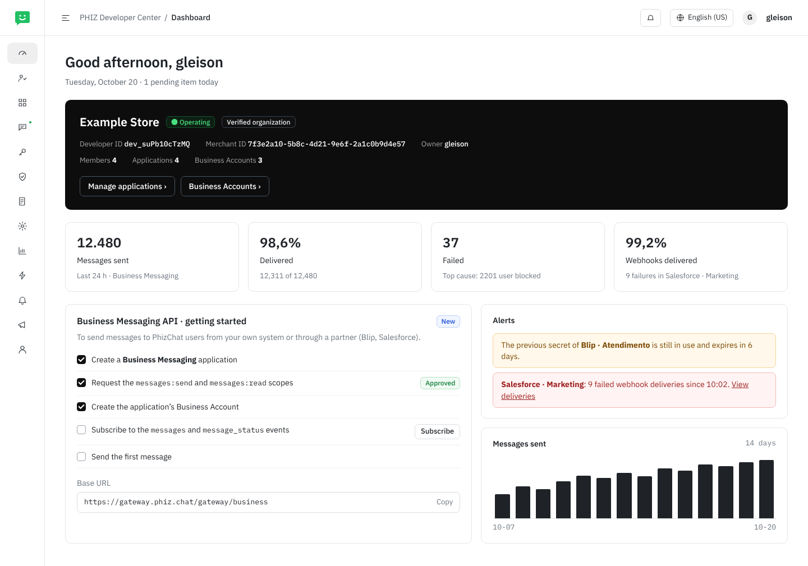</a><p class="cap"><b>Screen 1.</b> Dashboard: Developer ID, Merchant ID, message metrics, Business Messaging API getting started and alerts</p></div>
<div class="shot"><a href="mocks/en/dc16/02-nova-aplicacao.png" target="_blank" rel="noopener">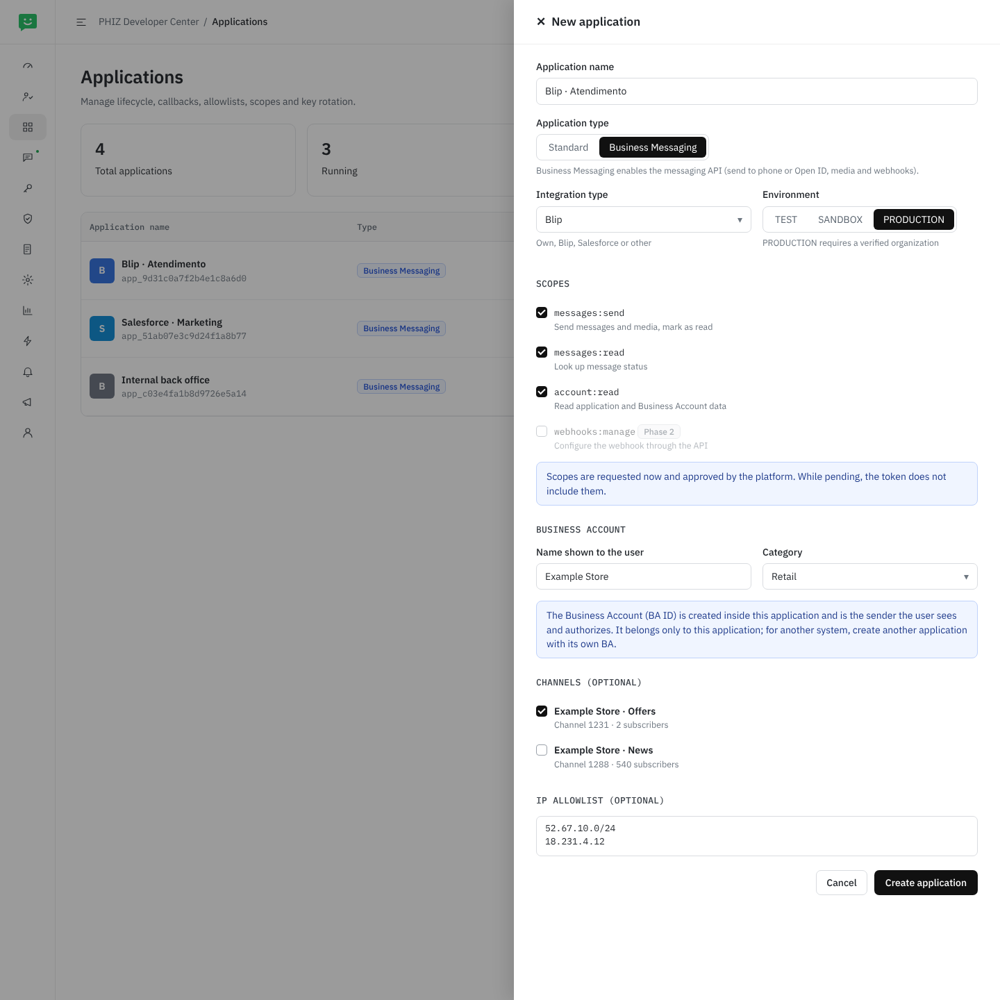</a><p class="cap"><b>Screen 2.</b> New application: Business Messaging type, integration type, environment, scopes with approval, the application’s Business Account, optional channels and IP allowlist</p></div>
<div class="shot"><a href="mocks/en/dc16/03-detalhe-aplicacao.png" target="_blank" rel="noopener">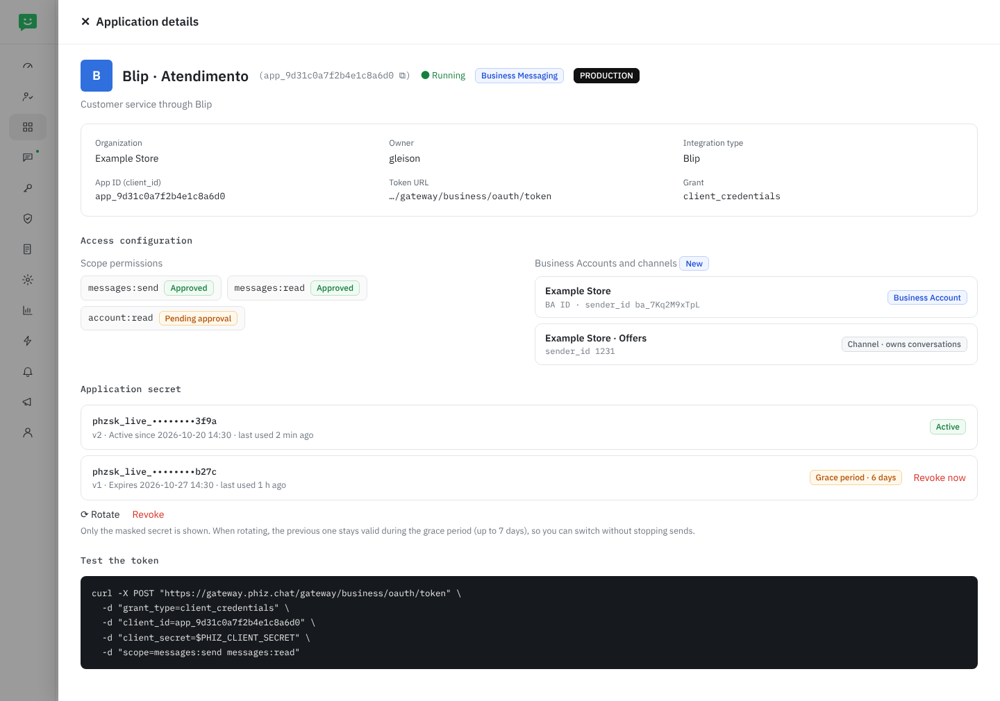</a><p class="cap"><b>Screen 3.</b> Application details: OAuth credentials, approved or pending scopes, Business Accounts and channels, and secrets with rotation</p></div>
<div class="shot"><a href="mocks/en/dc16/04-segredo-gerado.png" target="_blank" rel="noopener">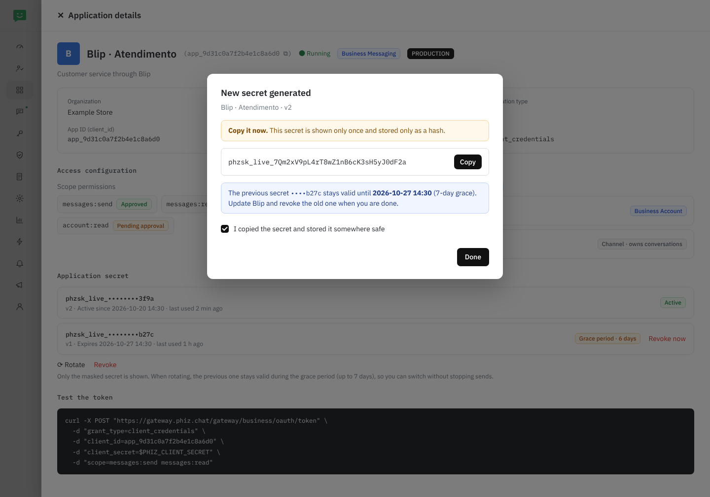</a><p class="cap"><b>Screen 4.</b> Secret generated, shown only once; the previous one stays valid during the grace period</p></div>
<div class="shot"><a href="mocks/en/dc16/05-assinaturas-eventos.png" target="_blank" rel="noopener">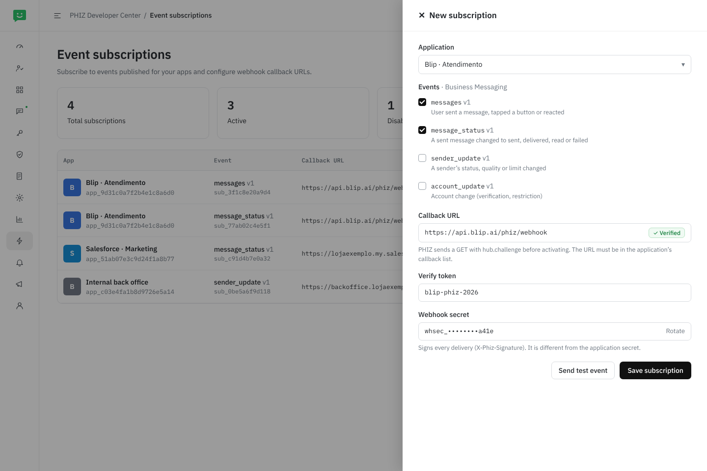</a><p class="cap"><b>Screen 5.</b> Event subscriptions: <code>messages</code> and <code>message_status</code> with a verified URL, verify token and webhook secret</p></div>
<div class="shot"><a href="mocks/en/dc16/06-webhook-entregas.png" target="_blank" rel="noopener">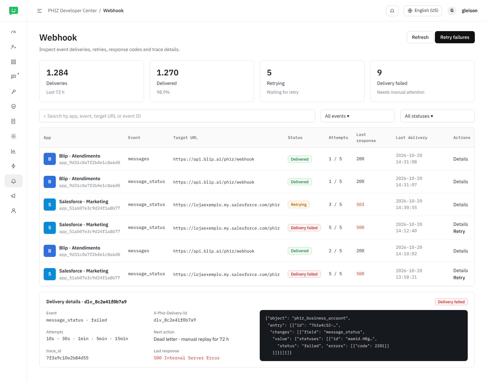</a><p class="cap"><b>Screen 6.</b> Webhook: deliveries, retries, last response, <code>trace_id</code>, retry failures and dead letter</p></div>
<div class="shot"><a href="mocks/en/dc16/07-business-accounts.png" target="_blank" rel="noopener">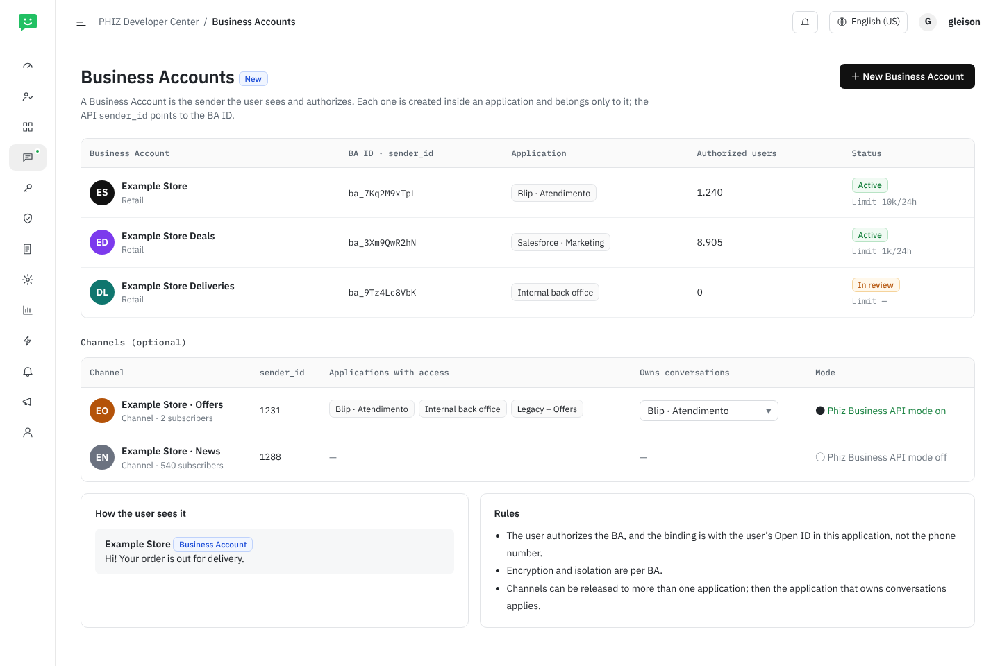</a><p class="cap"><b>Screen 7.</b> Business Accounts (new screen): BA ID, owning application and authorized users; optional channels with the application that owns conversations</p></div>
<div class="shot"><a href="mocks/en/dc16/08-aplicacoes-legadas.png" target="_blank" rel="noopener">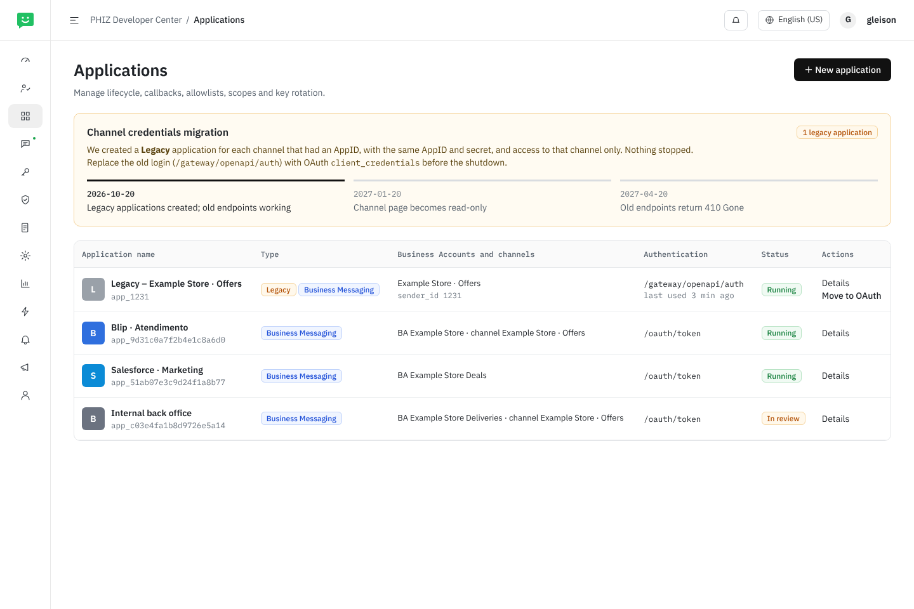</a><p class="cap"><b>Screen 8.</b> Applications with the channel credentials migration: Legacy application, dates and switch to OAuth</p></div>
</div>

### What changes in each menu

Each card is an item in the Developer Center side menu, with what the Business Messaging API changes in it and the screens above that show it.

<div class="screens">
  <div class="screen"><h5>Dashboard</h5><span class="path">Changes · Screen 1</span><ul><li>Message metrics: sent, delivered and failed in the last 24 h, and webhooks delivered</li><li>Business Messaging API getting started</li><li>Alerts for an old secret still in use and a failing webhook</li></ul></div>
  <div class="screen"><h5>Members</h5><span class="path">No change</span><ul><li>The OWNER, ADMIN, DEVELOPER and AUDITOR roles define who manages applications, secrets and subscriptions (Roles table)</li></ul></div>
  <div class="screen"><h5>Applications</h5><span class="path">Changes · Screens 2, 3, 4, 8</span><ul><li>New <em>Business Messaging</em> type, with integration type (own, Blip, Salesforce, other)</li><li>TEST, SANDBOX and PRODUCTION environments; in SANDBOX, a test sender, up to 5 recipients and <code>phzsk_test_</code> credentials</li><li>The application’s Business Accounts and optional channels</li><li>Secret with rotation, up to 7 days of grace and last use</li><li><em>Legacy</em> applications created from channels</li></ul></div>
  <div class="screen"><h5>Business Accounts</h5><span class="path">New · Screen 7</span><ul><li>Each application’s Business Accounts, with BA ID (<code>sender_id</code>), status, limit and authorized users</li><li>Each BA belongs to one application; encryption and isolation per BA</li><li>Optional channels: applications with access, application that owns conversations and “Phiz Business API” mode</li></ul></div>
  <div class="screen"><h5>Scope and API</h5><span class="path">Changes</span><ul><li>Publishes the Business API assets: messages, media, <code>/v1/me</code> and account</li><li>Registers the section 08 scopes; the platform approves requests</li></ul></div>
  <div class="screen"><h5>Allowlist</h5><span class="path">No change</span><ul><li>IPs allowed to call the API</li><li>Callback URLs accepted in event subscriptions</li></ul></div>
  <div class="screen"><h5>Keys and Certificates</h5><span class="path">No change</span><ul><li>The Business API does not use API keys (<code>X-Api-Key</code>) or certificates; only <code>Authorization: Bearer</code></li></ul></div>
  <div class="screen"><h5>API usage</h5><span class="path">Changes</span><ul><li>Approved, rejected and failed calls also for the Business API endpoints</li><li>Phase 2: per-request log with <code>trace_id</code></li></ul></div>
  <div class="screen"><h5>Event subscriptions</h5><span class="path">Changes · Screen 5</span><ul><li>New <code>messages</code>, <code>message_status</code>, <code>sender_update</code> and <code>account_update</code> events</li><li>URL verified with <code>hub.challenge</code>, verify token and webhook secret</li><li>Send a test event</li></ul></div>
  <div class="screen"><h5>Webhook</h5><span class="path">No change · Screen 6</span><ul><li>Same deliveries screen, now with the messaging events</li><li>Retries, dead letter and manual replay for 72 h</li></ul></div>
  <div class="screen"><h5>Audit and Notifications</h5><span class="path">No change</span><ul><li>Record and notify changes to secrets, scopes, Business Accounts and subscriptions</li><li>The <em>Secrets</em> and <em>Webhook</em> categories feed the Dashboard alerts</li></ul></div>
</div>

### Roles

The Developer Center already controls access through the organization roles set in *Members*; there are no new permissions. The table shows what each role does in the Business Messaging API screens. It is a proposal, to be confirmed against what each role allows today (Q10). Approving scopes is not an organization role: the platform approves them.

| Action | OWNER | ADMIN | DEVELOPER | AUDITOR |
|---|---|---|---|---|
| See applications, Business Accounts, subscriptions, deliveries, usage and audit (no secrets) | ✓ | ✓ | ✓ | ✓ |
| Create, edit and disable Business Messaging applications; request scopes | ✓ | ✓ | ✓ | — |
| Create and edit Business Accounts; choose the application that owns a channel’s conversations | ✓ | ✓ | ✓ | — |
| Turn on “Phiz Business API” mode for a channel | ✓ | ✓ | — | — |
| Generate, rotate and revoke secrets | ✓ | ✓ | — | — |
| Create and edit event subscriptions; send a test; retry deliveries | ✓ | ✓ | ✓ | — |
| Manage members and roles | ✓ | ✓ | — | — |

Creating, rotating or revoking a secret, changing scopes or Business Accounts and changing an event subscription produce a record in *Audit* and a notification to OWNER and ADMIN in the *Secrets* and *Webhook* categories.

**PHZ-BM-0001** also proposes an **Operator** role, which only sends approved templates within purpose and quota, and stresses that the Developer never receives the production secret. The Developer Center has no Operator today (Q16).

### Business Account and application

Each Business Account is created inside an application and belongs only to it. So only that application sends through it and receives its `messages` and `message_status` events, and the user’s Open ID is the one from that application. A business that uses Blip for customer service and Salesforce for campaigns creates one application for each, each with its own Business Account (Screen 7).

- **Shared channels.** A channel (optional sender) can be released to more than one application. In that case, the *Business Accounts* screen sets the **application that owns the channel’s conversations**: only it receives the `messages` event; the others can send and receive the `message_status` of what they sent.
- Changing the owner applies to the next incoming messages and is recorded in *Audit*.
- Using the same Business Account in two applications, or handing a conversation from one system to another (like Messenger’s handover), is left for later (Q6).

### Migration of channel credentials

Today each channel has its own AppID and secret, managed in *Channel › Development settings* in the Open Platform. The migration moves these credentials into the Developer Center without stopping any integration (Screen 8):

1. **Automatic creation.** For each channel with an AppID, we create a *Legacy – channel name* Business Messaging application in the merchant’s organization, with the same AppID as `appId`, the same secret (already stored) and access to that channel only, which it owns conversations for. The application lives under the merchant’s Developer ID, created in sync with the Merchant ID.
2. **Coexistence.** `/gateway/openapi/auth` and `/token/refresh` keep working. To use the new API, request a token at `/oauth/token` with the same AppID and secret. The channel page in the Open Platform shows a notice linking to the Developer Center, and the *Applications* screen shows the last use of the old login.
3. **Read-only.** After 3 months, the channel page no longer allows resetting the secret; secrets and rotation live only in the Developer Center.
4. **Shutdown.** After 6 months, and with old-login usage near zero, the old endpoints return `410 Gone`. OWNER and ADMIN get a notice in *Notifications* 30 days before.

## Partner integrations {#partners}

**In the MVP**, the merchant creates an app in the Developer Center and pastes the `client_id` and secret into Blip, Salesforce or their own system. Webhook URLs come from the partner, who registers them under *Event subscriptions* (section 10). Because the contracts follow the Cloud API, partners that already have a WhatsApp connector can reuse most of it.

**In a later phase** we create a *technology partner* program, equivalent to Meta's Embedded Signup:

- The partner registers a platform app with PHIZ.
- The merchant clicks “Connect with PHIZ” inside the partner's product and grants scopes and Business Accounts on a consent screen (OAuth 2.0 authorization code + PKCE).
- The partner receives tokens limited to that merchant and a single webhook for all its customers. The envelope's `entry[].id` identifies the Business Account, which is why the envelope has that structure from day one.

The Developer Center already supports authorization code and the `openId`/`unionId` mapping, which are the basis for that program.

In the identity model (section 06), the Developer ID can belong to the third party, such as Salesforce: the developer identity and resources are theirs, and the Business Accounts that merchants authorize live in their applications. How this fits with each merchant’s Merchant ID is still open (Q10).

## Path to the Marketing API {#marketing}

This RFC reserves the space the Marketing API will occupy, without implementing it:

- `type: template` for sending and the `templates:manage` scope already exist in the contract. Service templates (`UTILITY`, `AUTHENTICATION`) may come earlier, with the sending policy in section 09 (Q14); marketing templates stay with the Marketing API.
- Templates with approval: `/v1/{sender_id}/message_templates` and a `template_status` webhook event.
- Conversation categories (`conversation.origin.type`: `service`, `utility`, `marketing`), the basis for reporting and pricing.
- Per-sender opt-in and opt-out management, campaigns to segments and metrics at `/v1/{sender_id}/analytics`.
- Messaging limit tiers and a quality rating per sender, already present in the `Sender` resource.

## Delivery plan {#plan}

::: phases
##### PHASE 0 · FOUNDATION: Verification and rules

- Ownership: who sends on behalf of whom (Q11)
- Verification levels and a published level → scope matrix (Q13)
- Categories, service window and service templates (Q14)
- Internal allowlist of test recipients; no bulk resolution

##### PHASE 1 · MVP: Authenticate and send

- `/oauth/token`, `/oauth/revoke`, `/v1/me`
- Send `text`, `image`, `audio`, `video` and `document` to phone and Open ID
- Media upload (`/v1/{sender_id}/media`) with temporary storage; no third-party links
- Signed `messages` and `message_status` webhooks, with the URL registered by the partner under Event subscriptions
- Developer Center: Business Messaging app type, API assets and scopes, Business Accounts per app and events in the catalog
- Identity model: Developer ID, App ID, Business Account (BA ID) and Open ID; channels as optional senders
- Automatic migration of channel credentials

##### PHASE 2: Additions

- Webhook setup through the API (`PUT /v1/apps/{app_id}/webhook`, test and health)
- Adjustments to the retry and replay policy, if the platform’s does not meet section 10
- Per-request log with `trace_id` and message metrics
- Sandbox with test recipients
:::

### Launch acceptance criteria

Adapted from **PHZ-BM-0001**:

- Verification, Business Account creation and scope request and revocation tested end to end.
- The public level and scope matrix matches Developer Center approval, API decisions, error codes and documentation.
- Business conversations never become friendships or ordinary chats; phone numbers cannot be enumerated; production secrets never reach the client.
- Retry, reconnection, multi-device, block, opt-out and regional rule tests pass.
- Legal review completed for consent, retention, deletion, international processing and required service messages.

Dates will be set after this RFC is reviewed with the China team.

## Open questions {#questions}

::: questions
1. **Opt-in policy.** Section 09 proposes the policy (opt-in per merchant and category, opt-out enforced by the platform, record kept by the merchant). Still to decide: model A (like Meta, no verification) or B (a consent registry in PHIZ, for example `/v1/{sender_id}/consents`, checked on send); which categories exist; whether the PHIZ app shows users what they authorized; and how a user blocks or stops offers from a Business Account (see Q3). Validate the LGPD points with Legal. Applies to Business Account and Channel Service. The relation states and categories in sections 04 and 09 provide the basis for this decision.
2. **Sender IDs.** Answered in v1.6: the `merchant_id` does not identify the sender. The `sender_id` is an external reference mapped to the Business Account’s BA ID (section 06). For channels it is still the channel ID; still to decide whether it also gets an opaque ID, so the sequential ID is not exposed.
3. **Business Account conversation type.** Answered in v1.6: public account session › business service session › Business Account, the only one shown to the user, meant for businesses, governments and institutions and created through Merchant ID › Developer ID › App ID › BA ID (section 06). Still to define how the user blocks or mutes a Business Account in the app.
4. **Current conversation types.** Partly answered in v1.6: besides the Business Account there are other conversation types, and this delivery creates a new one. Product and technology will redefine and refine the definitions, preparing for future expansion. The final table of types and permissions is still missing.
5. **Phone numbers.** Answered in v1.6: every PHIZ user has a valid, verified phone number. The Business Account exchanges the phone number for the user’s Open ID and sends by Open ID; the BA is bound to the Open ID, so number changes and foreign numbers do not change the recipient (section 09).
6. **More than one application per Business Account.** In v1.6, each BA belongs to one application. Will we need to use the same BA from more than one system, or hand conversations between applications (bot → human agent), already in Phase 2?
7. **Existing Business Message API.** The AI Robot's “Phiz Business API” mode already has send and callback endpoints and seems to match Channel Service with Channel Bot. Does this RFC replace, extend or wrap that API?
8. **Media.** Partly answered in v1.6: formats and sizes can be set by this RFC (table in section 09); in the first phase, files are uploaded and stored through the Business API, and third-party URLs are released later, per customer; other rules follow the technical definition. Still to define: is 30 days right, or should it be shorter? After delivery, does media move to regular chat storage, or disappear from the history when it expires? How long does the `url` of inbound media stay valid?
9. **Webhook in Phase 1.** Proposed in v1.5: the partner registers the URL under *Event subscriptions* in the Developer Center, instead of the manual registration from v1.4. To confirm with Henry Wu: whether manual registration is still wanted for commercial reasons; whether the platform’s retry policy, delivery retention and replay meet section 10; whether the platform signs deliveries and accepts the Cloud API handshake and envelope; and how the partner recovers received messages that were lost, since only status has a lookup.
10. **Developer Center.** (a) The Merchant ID creates the Developer ID in sync (v1.6); still to confirm whether the Developer ID is the Developer Center Organization, how the merchant signs in to the console, and how the Developer ID works when it belongs to a third party such as Salesforce. (b) What are the token endpoint, lifetime and token format of the `CLIENT_CREDENTIALS` grant? (c) Do the Business API scopes follow the platform pattern (like `write:clips:publish`) or keep the section 08 names? PHZ-BM-0001 suggests a third pattern (`business.message.send.service`); we need a single one. (d) Who approves scope requests, and how fast? (e) What does each role (OWNER, ADMIN, DEVELOPER, AUDITOR) allow today for secrets and subscriptions? (f) Does the SANDBOX environment send simulated or real messages? (g) Which team builds the screens and extensions in section 12?
11. **RFC vs PHZ-BM-0001 hierarchy.** This RFC keeps `Merchant ID → Developer ID → App ID → BA ID` (one BA per application). PHZ-BM-0001 proposes `Organization → Business Account → App → Credential` (several applications per BA). Who decides and which one holds? If the RFC’s holds, PHZ-BM-0001 must be updated; if BM’s holds, sections 06, 09 and 12 change.
12. **Business Account as a Channel subtype.** Is the BA a conversation type (this RFC) or a `Channel.subtype` (PHZ-BM-0001)? Which conversation ID does the app use: `channel:<id>` with metadata in the short term and an opaque ID later?
13. **Verification.** The Developer Center shows “Verified organization”, but PHZ-BM-0001 says there is no verification object. What exists today, which levels do we adopt, who reviews, and does Phase 1 depend on it?
14. **Service templates and window.** In Phase 1, can the business start a conversation with free text (this RFC’s original proposal) or only with an approved template (PHZ-BM-0001)? How long is the service window and who approves templates?
15. **Routes.** Keep the Cloud API format (`/v1/{sender_id}/messages`) or adopt `/v1/business/messages`, as in PHZ-BM-0001?
16. **Operator role.** Should the Developer Center add an Operator role? Confirm that DEVELOPER never sees the production secret.
17. **Quiet hours, frequency and regional rules.** Which values, per region and sector, and where are they configured (Developer Center or platform)?
18. **Recipient resolution.** Is `/recipients/resolve` worth having? For which relation states, with what limit, and how do we make sure it cannot be used to enumerate phone numbers?
19. **Legal review.** Consent, retention, deletion, international transfer and service exceptions per jurisdiction (LGPD and markets outside Brazil).
:::

## OpenAPI reference {#openapi}

The OpenAPI 3.1 specification below covers every endpoint and webhook in this RFC, with descriptions in this language. “Try it out” is turned off because the API does not exist yet. Use “Copy OpenAPI” to take the YAML into Apifox, Postman or an SDK generator.
