## Resumo {#summary}

Este documento propõe uma API pública para que sistemas externos (Blip, Salesforce, CRMs ou sistemas próprios do comerciante) conversem com usuários PHIZ em nome de um comerciante. A proposta tem quatro partes:

- **Autenticação OAuth 2.0 (client credentials)** com credenciais emitidas para uma *aplicação* da Central do Desenvolvedor, sob o Developer ID do comerciante, e não mais para um canal.
- **Envio de mensagens** para um número de telefone (E.164) ou um Open ID, em nome de um **Business Account** (BA) criado na aplicação. Usar um canal como remetente é opcional.
- **Webhooks** assinados que entregam as mensagens recebidas dos usuários e cada mudança de status das mensagens enviadas.
- A **Central do Desenvolvedor PHIZ**, que já existe, onde o comerciante cadastra cada sistema externo que vai usar a API (por exemplo, Blip ou Salesforce) como um **app**. Cada app tem `client_id` e secret próprios, seus Business Accounts, assinaturas de eventos e histórico de entregas. Integrações não têm relação com Miniapps.

Os contratos de mensagem e webhook reproduzem a estrutura da Cloud API da Meta, trocando apenas os nomes do domínio. Quem já integra com o WhatsApp Business Platform adapta a integração mudando URLs, credenciais e alguns nomes de campo.

## Contexto: como funciona hoje {#context}

Levantamento feito na documentação atual (Apifox, módulo *Authentication*) e no Open Platform (`open.phiz.chat`).

### Autenticação atual

O token é obtido em `POST /gateway/openapi/auth` com `app_id`, `app_secret`, `description` (obrigatório) e `grant_type: "user_credentials"`. A resposta traz um access token de cerca de 2 horas e um refresh token de cerca de 90 dias, renovado em `POST /gateway/openapi/token/refresh`.

```http
POST /gateway/openapi/auth
Content-Type: application/json

{
  "app_id": "69c37cb1821121af34201f48",
  "app_secret": "94B18B920D19463C7264BD0BDE30C31…",
  "description": "push news",
  "grant_type": "user_credentials",
  "device_fingerprint": ""
}

200 OK
{
  "code": 200,
  "msg": "success",
  "data": {
    "scope": "channel",
    "status": "active",
    "access_token": "at_1770343926041_1Y3iz6XN…",
    "token_type": "Bearer",
    "expires_in": 7199,
    "refresh_token": "rt_1770343926041_mxc7RV9…",
    "access_token_expires_at": "2026-02-06T04:…",
    "refresh_token_expires_at": "2026-05-07T02:…",
    "created_at": "2026-02-05T10:15:23.672+00:00"
  },
  "success": true
}
```

### Onde ficam as credenciais

No Open Platform, cada canal tem a página *Canal › Configuração de Desenvolvimento* com **AppID** e **AppSecret**. O secret não é exibido e só pode ser *redefinido*. O canal também oferece, em *Robô de IA*, o modo de resposta **“Phiz Business API”**, que encaminha as conversas do canal para envio e callbacks de webhook da Business Message API.

No nível do comerciante já existem o **ID do Comerciante** (UUID), *Gerenciamento da equipe* com funções, membros e registro de operações. Esses três elementos servem de base para a nova área.

### O que muda com esta RFC

Cada linha mostra como funciona hoje, por que isso atrapalha, o que esta proposta coloca no lugar e um caso de uso concreto.

::: table changes
| Como é hoje | Por que atrapalha | Com esta RFC | Caso de uso |
|---|---|---|---|
| Para falar com o usuário pela API, o comerciante precisa de um canal. | Quem não tem canal, ou quer falar como a própria empresa, não consegue mandar mensagem direta ao usuário. | O comerciante envia pelo seu Business Account, exibido ao usuário como a empresa. Usar o canal passa a ser uma opção. | Uma farmácia sem canal avisa a cliente Maria, pelo telefone dela, que o pedido está pronto para retirada. A mensagem chega na conversa Business Account da farmácia. |
| Cada canal tem seu próprio AppID e secret. | Um comerciante com 5 canais administra 5 credenciais, e a Blip precisa de um token por canal. | Uma credencial por aplicação, na Central do Desenvolvedor, com o próprio Business Account e acesso aos canais escolhidos. | A Loja Exemplo tem 3 canais e usa a Blip. Hoje cadastra 3 AppIDs na Blip; com a RFC, cria uma aplicação “Blip” com o Business Account da loja e marca os 3 canais. |
| “Redefinir” invalida o secret na hora. | A integração fica fora do ar até alguém atualizar o secret no sistema externo. | Dois secrets válidos ao mesmo tempo: o novo entra e o antigo continua valendo por um período (padrão 24 h). | O secret do Salesforce apareceu num log. O time gera um novo, atualiza o Salesforce à tarde e revoga o antigo no fim do dia, sem nenhuma mensagem perdida. |
| O login usa `grant_type: user_credentials` e exige o campo `description`. | Ferramentas que já falam OAuth, como o Salesforce, não conseguem se conectar sem código sob medida. | OAuth 2.0 padrão (`client_credentials`), que essas ferramentas suportam de fábrica. | O administrador do Salesforce conecta a PHIZ em Named Credentials preenchendo só a URL do token, o client\_id e o secret, sem desenvolvedor. |
| Existe um refresh token válido por cerca de 90 dias. | É mais um segredo de longa duração para guardar, sem ganho numa integração entre servidores. | Token de 1 h, sem refresh token; quando expira, o sistema pede outro. | A Blip renova o token sozinha a cada hora com o mesmo client\_id e secret. Não existe refresh token que possa vencer num fim de semana e derrubar o atendimento. |
| A configuração do canal não tem tela para webhook, logs ou várias integrações. | O comerciante não consegue configurar o webhook nem descobrir sozinho por que uma integração parou. | Central do Desenvolvedor existente, estendida com apps separados para a Business API, assinaturas de eventos, histórico de entregas e logs. | As respostas dos clientes param de chegar na Blip. O comerciante abre o histórico de entregas, vê que o webhook responde erro 500 desde as 10h e, depois da correção, reenvia os eventos. |
:::

## Referência: a experiência no WhatsApp {#whatsapp}

Esta RFC replica no PHIZ o modelo da WhatsApp Business Platform. Para que todos (Brasil e China) tenham a mesma imagem do que estamos copiando, esta seção mostra a jornada de um usuário brasileiro no WhatsApp: como cria a conta, como **autoriza** uma empresa, como a mensagem chega e o que pode fazer com ela. Exemplo: comerciante PicPay, usuária Ana Souza, em São Paulo.

::: note Sobre as telas
São ilustrações, não a interface oficial do WhatsApp. O texto está em português, como o usuário vê no app. Os códigos (A2, O1, C3…) seguem o canvas de Design que deu origem a esta seção. Clique em uma imagem para abrir em tamanho real.
:::

### Caminho da mensagem

A empresa não fala direto com o WhatsApp: o sistema dela (CRM, atendimento) chama um **BSP** (Blip, Zenvia, Twilio, Infobip), que chama a **Cloud API** da Meta, que entrega no celular. Respostas, cliques e status voltam por webhook pelo mesmo caminho. No PHIZ, a **PHIZ Business Messaging API** ocupa o lugar da Cloud API, o Developer ID e a aplicação ocupam o lugar da WABA e o Business Account (BA ID) ocupa o lugar do número comercial (ver a equivalência na seção 06).

<div class="shots">
<div class="shot"><a href="mocks/pt/whatsapp/b01-architecture.png" target="_blank" rel="noopener">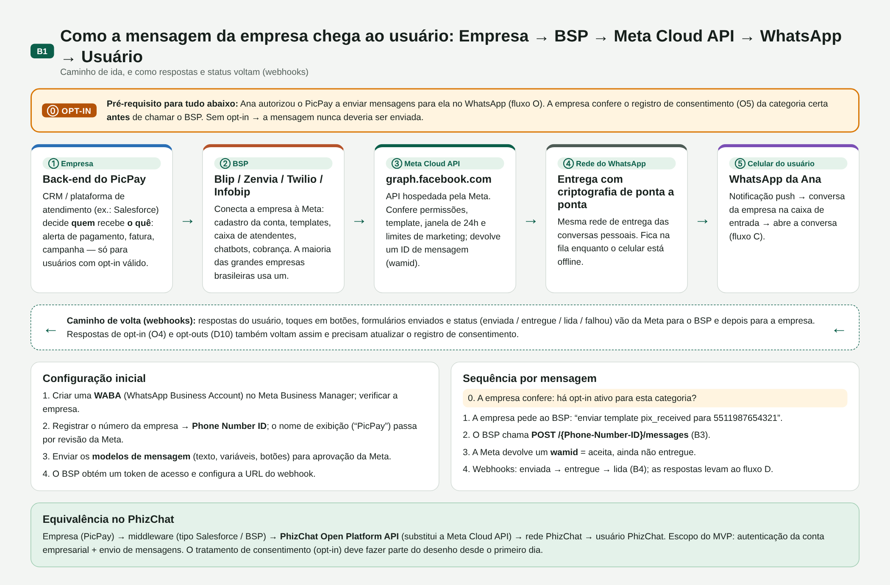</a><p class="cap"><b>B01.</b> Empresa → BSP → Meta Cloud API → WhatsApp → usuário, com o opt-in como pré-requisito e o caminho de volta por webhook</p></div>
</div>

### Cadastro do usuário

No WhatsApp, a conta é o número de telefone, verificado por SMS. Não existe pedido de amizade: quem tem o número consegue escrever. Empresas e família ficam na **mesma caixa de entrada**, por isso o controle sobre mensagens de empresas é rígido. Desde 2026 o WhatsApp oferece nomes de usuário e identificadores por empresa (BSUID) no lugar do telefone, o que conversa com o uso do Open ID nesta RFC.

<div class="shots phones">
<div class="shot"><a href="mocks/pt/whatsapp/a02-phone-number.png" target="_blank" rel="noopener">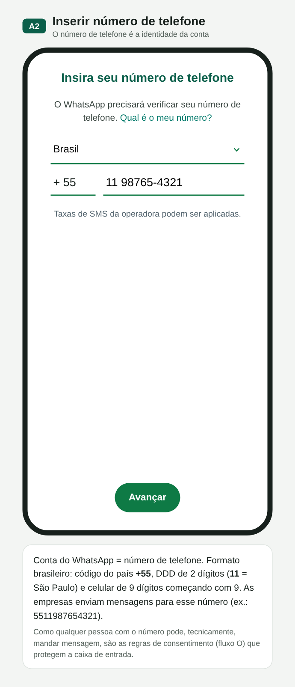</a><p class="cap"><b>A02.</b> Número de telefone = identidade da conta</p></div>
<div class="shot"><a href="mocks/pt/whatsapp/a10-chats-home.png" target="_blank" rel="noopener">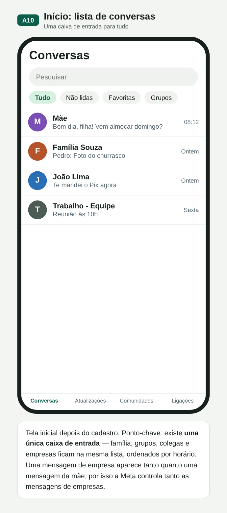</a><p class="cap"><b>A10.</b> Uma única caixa de entrada para tudo</p></div>
</div>

### Autorização do usuário (opt-in)

Antes de uma empresa iniciar uma conversa, o usuário precisa ter autorizado *aquela empresa*. Há quatro formas comuns: no app da empresa (O1), no cadastro ou checkout (O2), quando o próprio usuário escreve primeiro, o que vale só para aquele atendimento (O3), e respondendo “sim” dentro do chat (O4). A boa prática é separar por finalidade: autorizar alertas da conta não autoriza ofertas.

<div class="shots">
<div class="shot"><a href="mocks/pt/whatsapp/o00-consent-lifecycle.png" target="_blank" rel="noopener">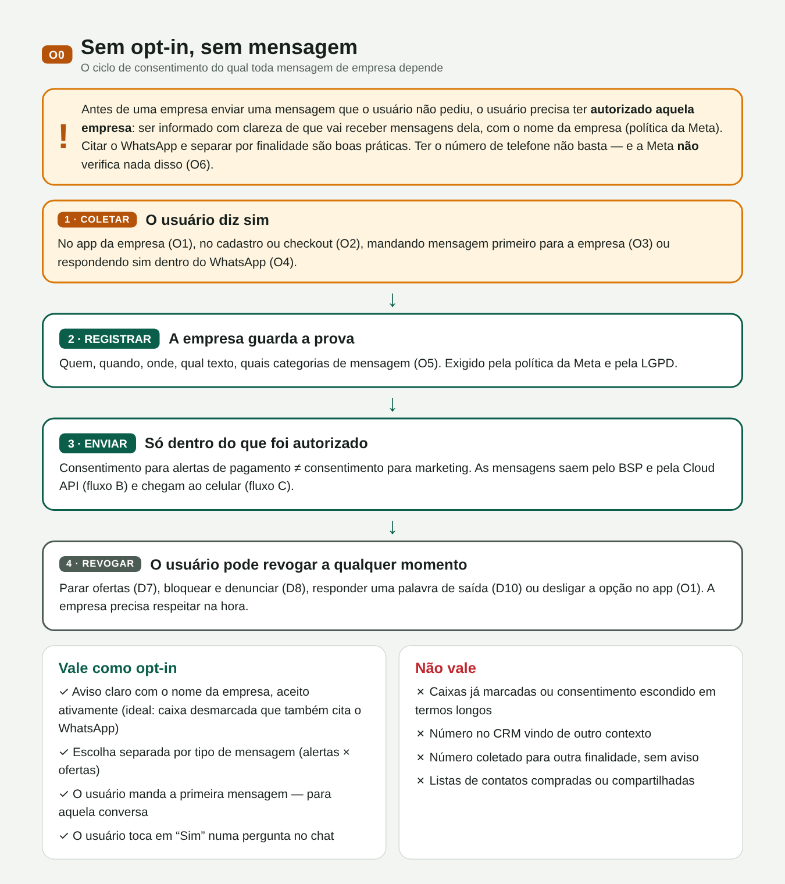</a><p class="cap"><b>O00.</b> Ciclo do consentimento: coletar, registrar, enviar dentro do escopo, revogar</p></div>
</div>

<div class="shots phones">
<div class="shot"><a href="mocks/pt/whatsapp/o01-optin-app.png" target="_blank" rel="noopener">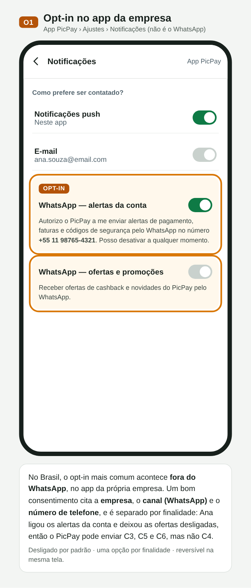</a><p class="cap"><b>O01.</b> Opt-in no app do comerciante, separado por finalidade</p></div>
<div class="shot"><a href="mocks/pt/whatsapp/o02-optin-signup.png" target="_blank" rel="noopener">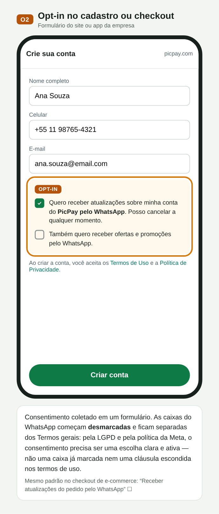</a><p class="cap"><b>O02.</b> Opt-in no cadastro, com caixas desmarcadas</p></div>
<div class="shot"><a href="mocks/pt/whatsapp/o03-user-starts.png" target="_blank" rel="noopener">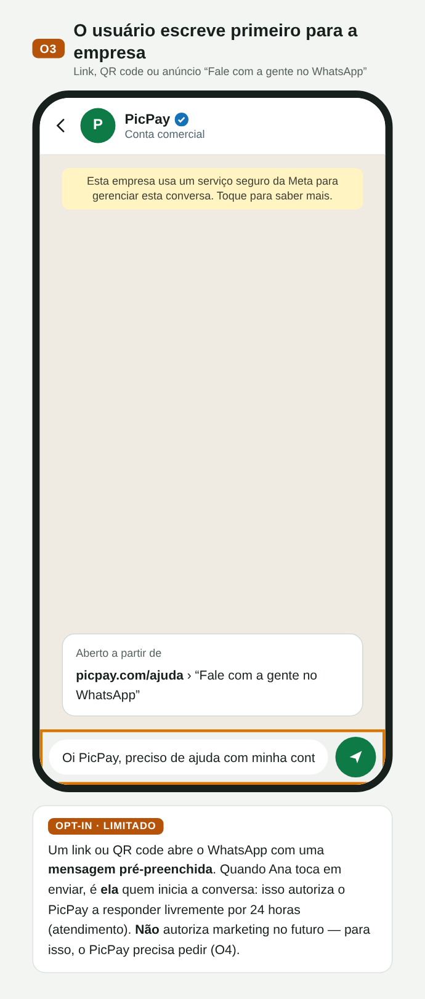</a><p class="cap"><b>O03.</b> O usuário escreve primeiro: autoriza só o atendimento</p></div>
<div class="shot"><a href="mocks/pt/whatsapp/o04-optin-in-chat.png" target="_blank" rel="noopener">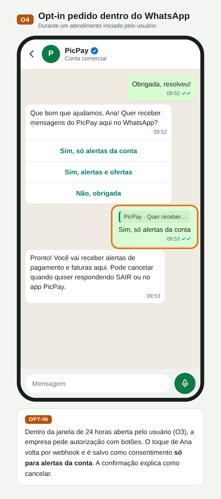</a><p class="cap"><b>O04.</b> Opt-in pedido dentro do chat, com botões</p></div>
</div>

**A Meta tem a política, mas não valida o opt-in.** Não há campo nem endpoint para comprovar a autorização; a Meta confia na empresa e só reage depois, por bloqueios, denúncias e nota de qualidade. Já o *opt-out* é aplicado pela plataforma: bloqueio, “parar ofertas” e limite de marketing fazem o envio falhar. Mesmo assim, pela LGPD cabe à empresa provar o consentimento e respeitar a revogação, então o registro (quem, comerciante, categoria, origem, data, texto exibido, revogação) é obrigatório na prática.

<div class="shots">
<div class="shot"><a href="mocks/pt/whatsapp/o05-consent-record.png" target="_blank" rel="noopener">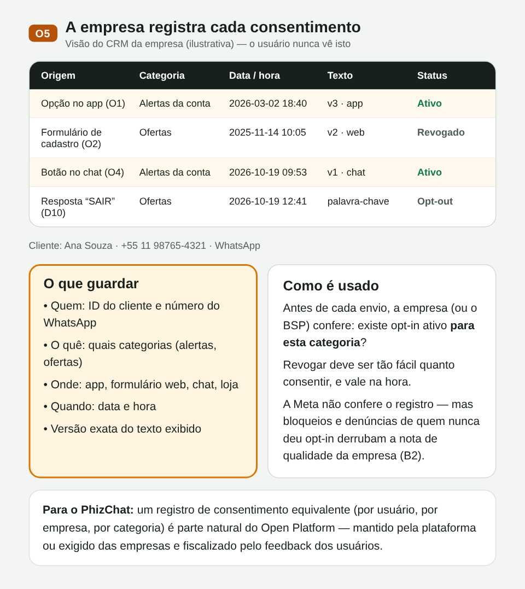</a><p class="cap"><b>O05.</b> Registro de consentimento do lado do comerciante</p></div>
<div class="shot"><a href="mocks/pt/whatsapp/o06-who-verifies.png" target="_blank" rel="noopener">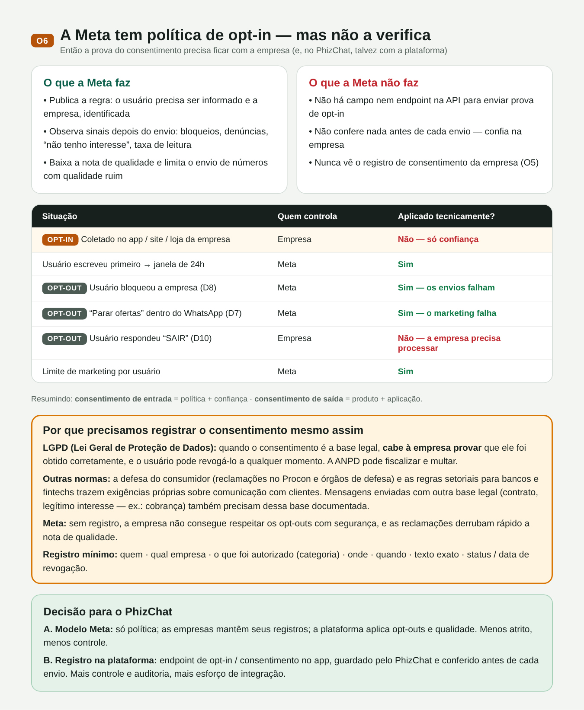</a><p class="cap"><b>O06.</b> A Meta não verifica o opt-in; o opt-out é aplicado pela plataforma; por que registrar mesmo assim</p></div>
</div>

### O que o usuário recebe

Mensagens iniciadas pela empresa usam **templates** aprovados, em quatro categorias: utilidade (pagamentos, contas), marketing, autenticação (códigos) e serviço. Cada categoria depende do opt-in correspondente.

<div class="shots phones">
<div class="shot"><a href="mocks/pt/whatsapp/c01-notification.png" target="_blank" rel="noopener">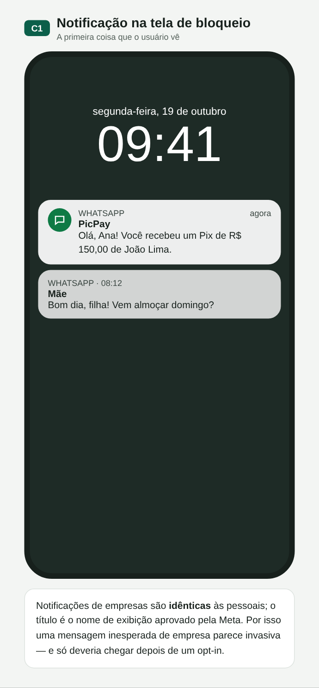</a><p class="cap"><b>C01.</b> Notificação igual à de um contato pessoal</p></div>
<div class="shot"><a href="mocks/pt/whatsapp/c02-chat-list.png" target="_blank" rel="noopener">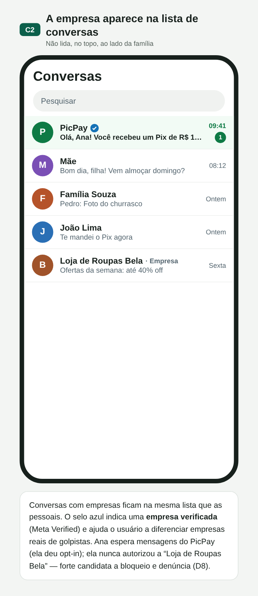</a><p class="cap"><b>C02.</b> Lista de conversas: conta comercial verificada, não lida e no topo, ao lado de família e amigos</p></div>
<div class="shot"><a href="mocks/pt/whatsapp/c03-utility.png" target="_blank" rel="noopener">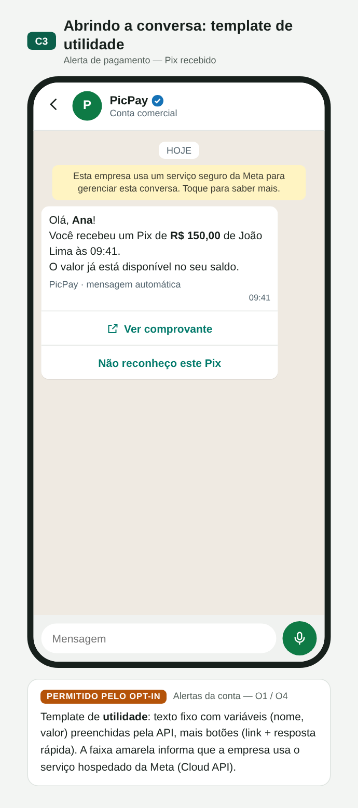</a><p class="cap"><b>C03.</b> Utilidade: Pix recebido, com botões</p></div>
<div class="shot"><a href="mocks/pt/whatsapp/c04-marketing.png" target="_blank" rel="noopener">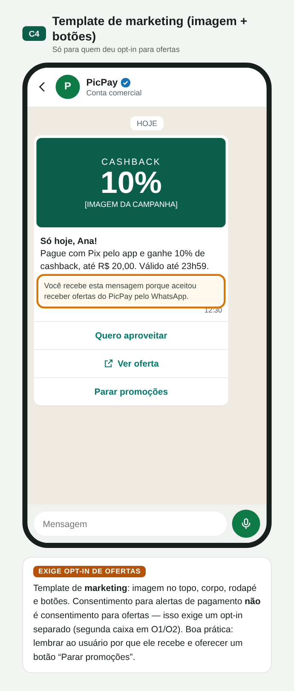</a><p class="cap"><b>C04.</b> Marketing: exige opt-in próprio para ofertas</p></div>
<div class="shot"><a href="mocks/pt/whatsapp/c05-authentication.png" target="_blank" rel="noopener">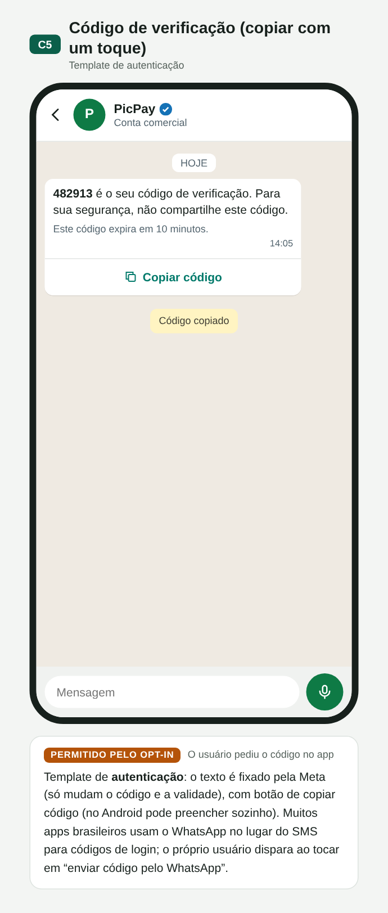</a><p class="cap"><b>C05.</b> Autenticação: código com botão de copiar</p></div>
<div class="shot"><a href="mocks/pt/whatsapp/c06-bill.png" target="_blank" rel="noopener">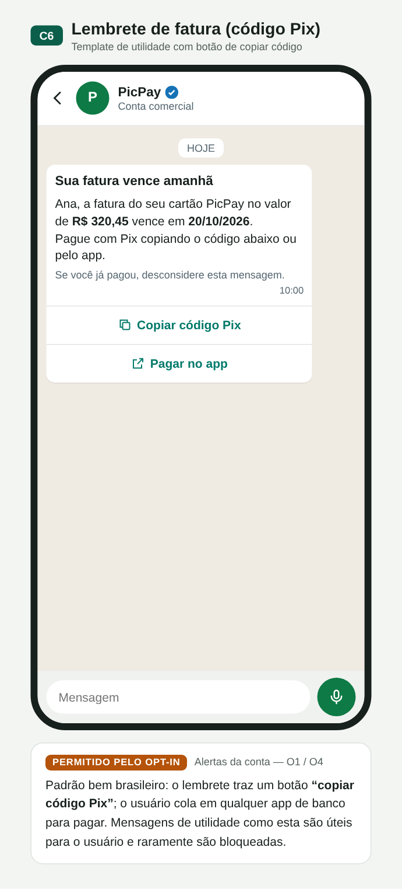</a><p class="cap"><b>C06.</b> Fatura com código Pix copia e cola</p></div>
</div>

### O que o usuário pode fazer

O usuário responde (texto, botões, lista, formulário), consulta o perfil da empresa ou retira a autorização. Cada ação gera, ou não, um evento para a empresa.

<div class="shots">
<div class="shot"><a href="mocks/pt/whatsapp/d00-options-map.png" target="_blank" rel="noopener">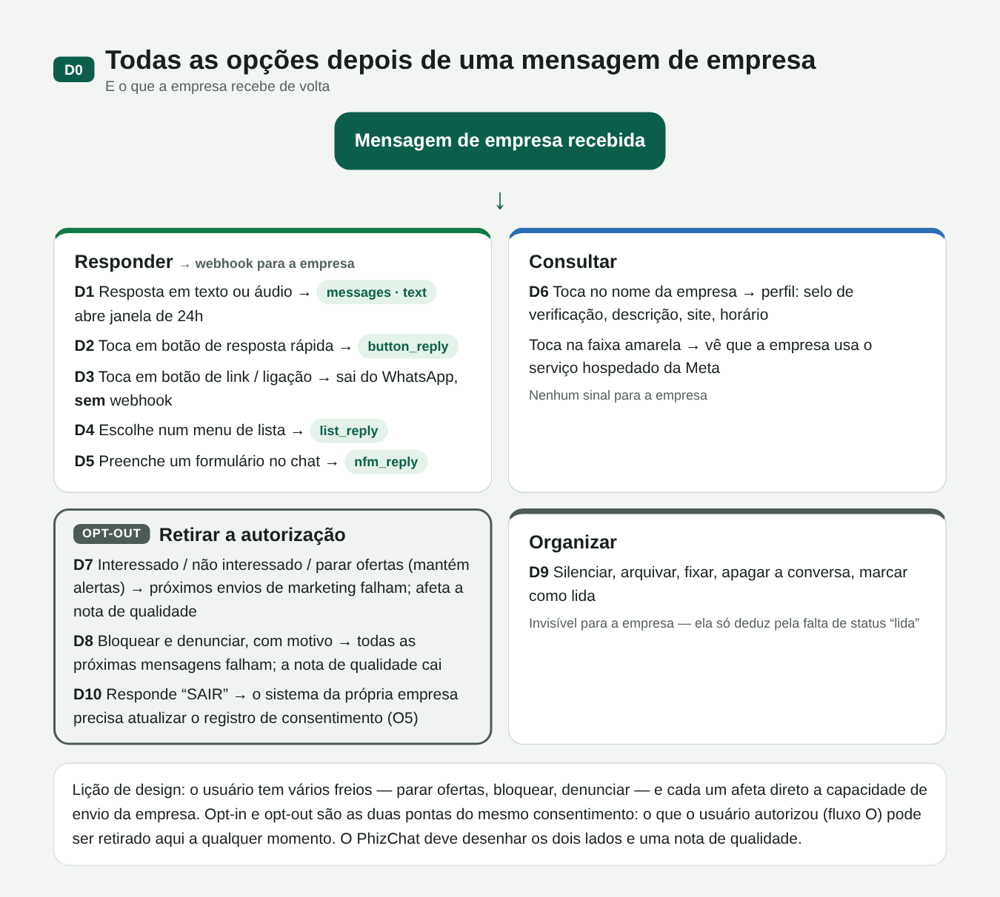</a><p class="cap"><b>D00.</b> Todas as opções do usuário e o que a empresa recebe de volta</p></div>
</div>

<div class="shots phones">
<div class="shot"><a href="mocks/pt/whatsapp/d02-quick-reply.png" target="_blank" rel="noopener">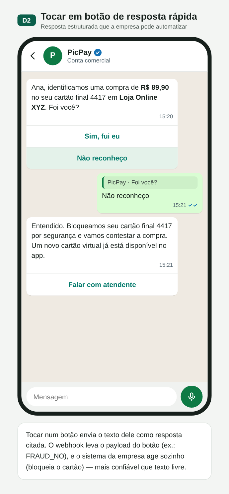</a><p class="cap"><b>D02.</b> Resposta rápida por botão</p></div>
<div class="shot"><a href="mocks/pt/whatsapp/d04-list.png" target="_blank" rel="noopener">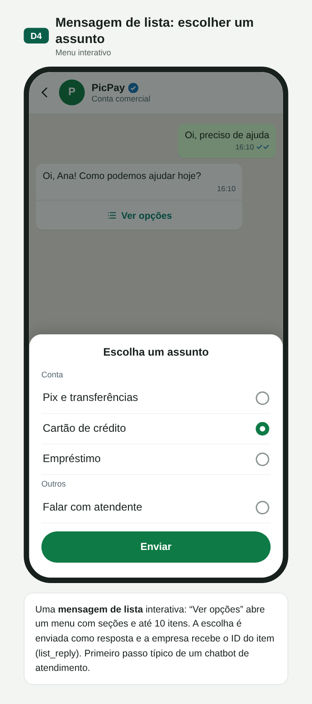</a><p class="cap"><b>D04.</b> Mensagem de lista</p></div>
<div class="shot"><a href="mocks/pt/whatsapp/d05-flow.png" target="_blank" rel="noopener">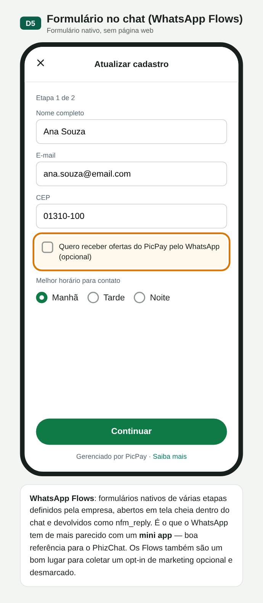</a><p class="cap"><b>D05.</b> Formulário dentro do chat (Flows), próximo de um mini app</p></div>
<div class="shot"><a href="mocks/pt/whatsapp/d07-stop-offers.png" target="_blank" rel="noopener">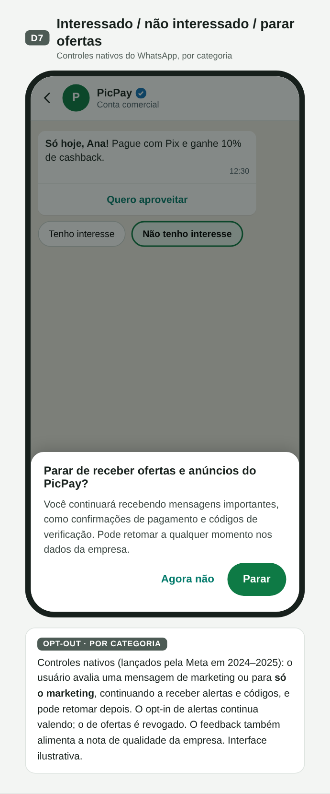</a><p class="cap"><b>D07.</b> Parar ofertas e manter alertas</p></div>
<div class="shot"><a href="mocks/pt/whatsapp/d08-block-report.png" target="_blank" rel="noopener">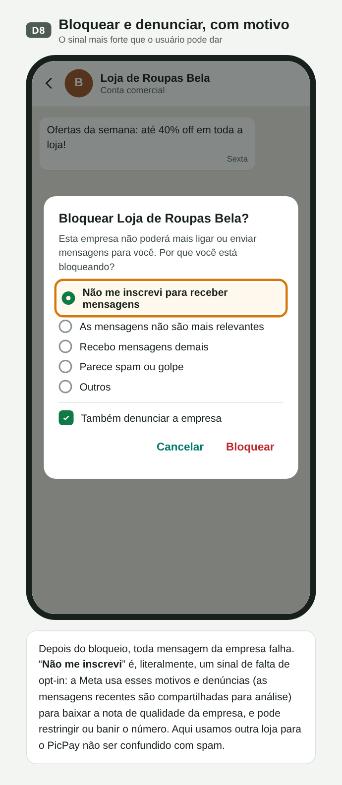</a><p class="cap"><b>D08.</b> Bloquear e denunciar, com motivo</p></div>
<div class="shot"><a href="mocks/pt/whatsapp/d10-optout-keyword.png" target="_blank" rel="noopener">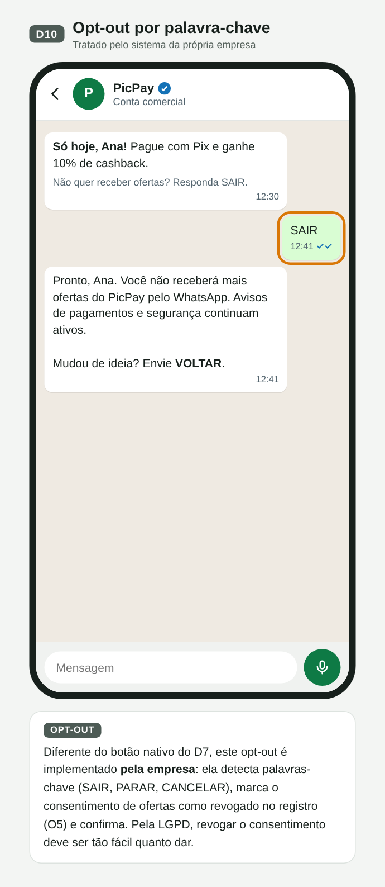</a><p class="cap"><b>D10.</b> Opt-out por palavra-chave, tratado pelo comerciante</p></div>
</div>

| Ação do usuário | No WhatsApp | No PHIZ |
|---|---|---|
| Responde com texto ou mídia | Webhook `messages`; abre janela de 24 h | Evento `message` (seção 10) |
| Toca em botão ou lista | `button_reply` / `list_reply` | Evento `message` com o id escolhido |
| Para ofertas | Envios de marketing falham | Proposta: a plataforma bloqueia a categoria para aquele Business Account (`ba_id`) |
| Bloqueia ou denuncia | Todos os envios falham; nota de qualidade cai | Proposta: erro no envio e sinal de qualidade (ver Q3) |
| Silencia ou arquiva | Invisível para a empresa | Igual |

### O que levamos para o PHIZ

- A identidade que o usuário vê, autoriza e bloqueia é o **Business Account** (`ba_id`): é ele que recebe o opt-in, o bloqueio e a nota de qualidade. O Merchant ID continua sendo a conta do Open Platform e gera o Developer ID, dono das aplicações; cada Business Account é criado dentro de uma aplicação (seção 06).
- Consentimento por Business Account e por categoria, com opt-out aplicado pela plataforma (ver Política de envio, seção 09).
- Sinais do usuário (bloquear, denunciar, parar ofertas) alimentando limites de envio do comerciante.
- Formulários dentro do chat (Flows) como referência para mini apps.

## Opt-in no PhizChat: no app e na empresa {#phizoptin}

A seção 03 mostrou que no WhatsApp o opt-in quase sempre acontece fora do app e que a Meta não o valida. Esta seção propõe como o usuário **autoriza** uma conta business no PhizChat, por dois caminhos que terminam nos mesmos controles de opt-out:

- **Fluxo P — dentro do PhizChat:** o usuário aceita a conta business no próprio app. A plataforma guarda a prova.
- **Fluxo Q — na empresa, fora do PhizChat:** o usuário autorizou no app, site ou loja do comerciante, e o comerciante inicia a conversa.

::: note Sobre as telas
São propostas ilustrativas, com o PicPay como comerciante de exemplo. Os códigos (P0…P8, Q0…Q5) seguem o canvas de Design. Clique em uma imagem para abrir em tamanho real.
:::

### Fluxo P · Opt-in dentro do PhizChat

O usuário chega à conta business por link de SMS ou e-mail, QR code, app ou site do comerciante, ou pela busca no app. Se não tem o Phiz, vê uma página H5 só com o perfil e o download; o aceite nunca acontece fora do app. Depois de instalar e entrar, um deep link diferido o leva ao mesmo chat, que abre **bloqueado até o aceite**. Ao aceitar, o PhizChat registra o consentimento (Open ID do usuário, `ba_id`, data, ponto de entrada), envia o template de boas-vindas, se houver, e libera o chat.

<div class="shots">
<div class="shot"><a href="mocks/pt/phizchat/p00-optin-map.png" target="_blank" rel="noopener">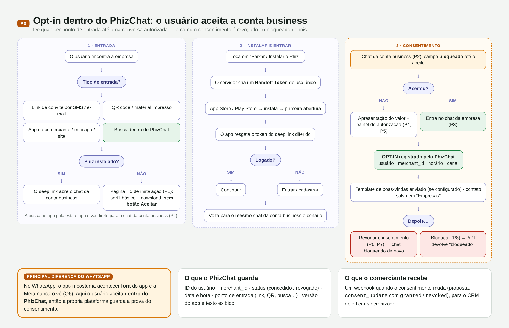</a><p class="cap"><b>P00.</b> Mapa do fluxo P: entradas, instalação, login, aceite e depois</p></div>
</div>

<div class="shots phones">
<div class="shot"><a href="mocks/pt/phizchat/p01-h5-install.png" target="_blank" rel="noopener">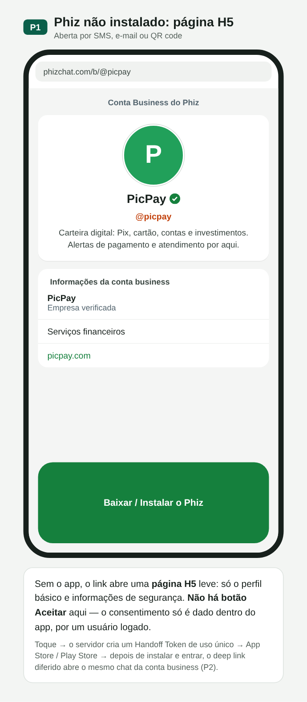</a><p class="cap"><b>P01.</b> Sem o app: página H5 com perfil e download, sem botão Aceitar</p></div>
<div class="shot"><a href="mocks/pt/phizchat/p02-chat-locked.png" target="_blank" rel="noopener">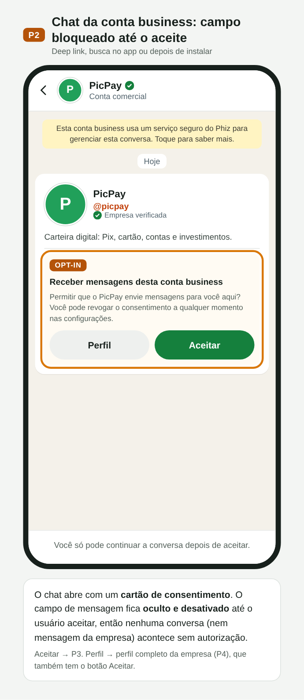</a><p class="cap"><b>P02.</b> Chat da conta business com o cartão de consentimento; campo bloqueado até o aceite</p></div>
<div class="shot"><a href="mocks/pt/phizchat/p03-accepted.png" target="_blank" rel="noopener">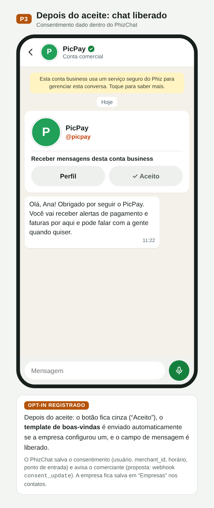</a><p class="cap"><b>P03.</b> Depois do aceite: boas-vindas e chat liberado</p></div>
<div class="shot"><a href="mocks/pt/phizchat/p04-profile.png" target="_blank" rel="noopener">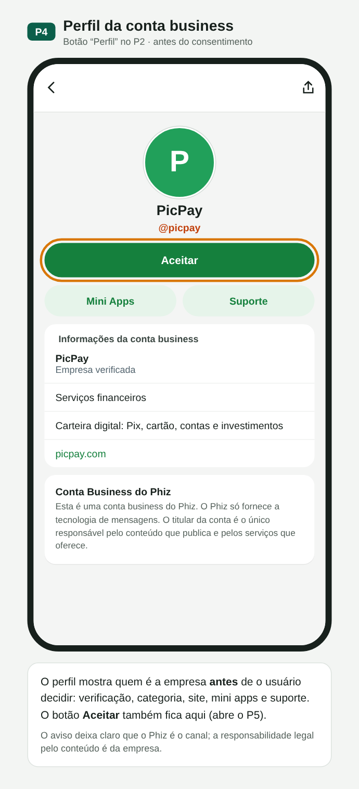</a><p class="cap"><b>P04.</b> Perfil da empresa antes do consentimento, também com Aceitar</p></div>
<div class="shot"><a href="mocks/pt/phizchat/p05-consent-sheet.png" target="_blank" rel="noopener">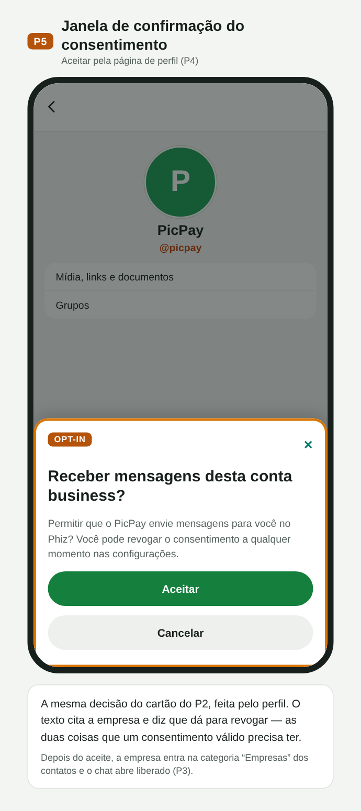</a><p class="cap"><b>P05.</b> Janela de confirmação do consentimento</p></div>
</div>

Depois do aceite, o perfil mostra o status e a data do consentimento. O usuário pode **revogar** (o chat volta ao estado bloqueado e pode ser autorizado de novo) ou **bloquear** (reaproveita o bloqueio atual; a API continua aceitando chamadas, mas devolve o status bloqueado).

<div class="shots phones">
<div class="shot"><a href="mocks/pt/phizchat/p06-manage-consent.png" target="_blank" rel="noopener">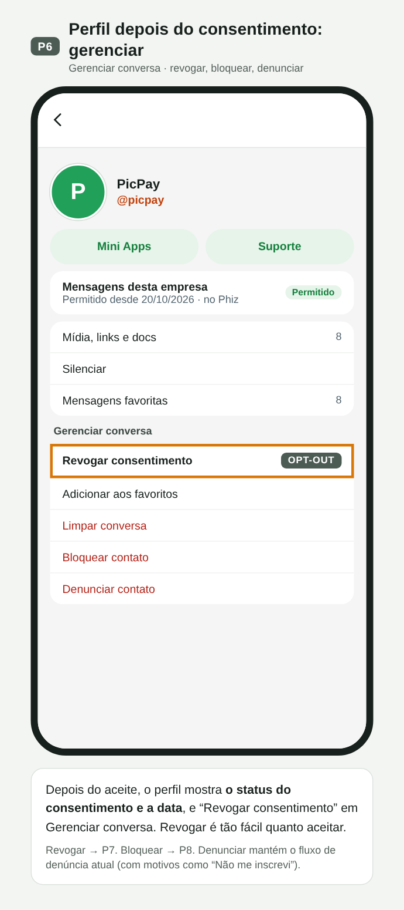</a><p class="cap"><b>P06.</b> Perfil depois do consentimento: status, data e Revogar consentimento</p></div>
<div class="shot"><a href="mocks/pt/phizchat/p07-revoke.png" target="_blank" rel="noopener">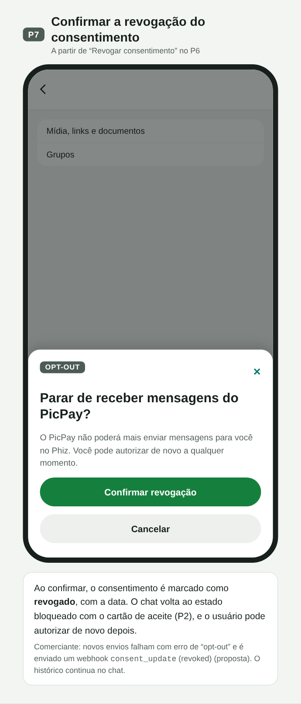</a><p class="cap"><b>P07.</b> Confirmação da revogação; o chat volta a ficar bloqueado</p></div>
<div class="shot"><a href="mocks/pt/phizchat/p08-blocked.png" target="_blank" rel="noopener">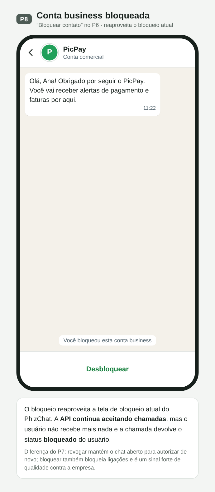</a><p class="cap"><b>P08.</b> Conta business bloqueada: a API devolve o status bloqueado</p></div>
</div>

### Fluxo Q · Opt-in coletado pela empresa, fora do PhizChat

A maioria das empresas brasileiras já coleta consentimento nos próprios canais. No fluxo Q, o usuário ativa “mensagens no PhizChat” no app do PicPay; o PicPay guarda a prova e envia o template pela API. A API confere se o destinatário é usuário do Phiz e se não bloqueou nem revogou; no modelo B, confere também se há consentimento registrado para aquela categoria. No app, a primeira mensagem chega com um **cartão de origem do consentimento** (o que foi autorizado, onde e quando), e o usuário pode continuar recebendo, parar ou denunciar.

<div class="shots">
<div class="shot"><a href="mocks/pt/phizchat/q00-business-optin-map.png" target="_blank" rel="noopener">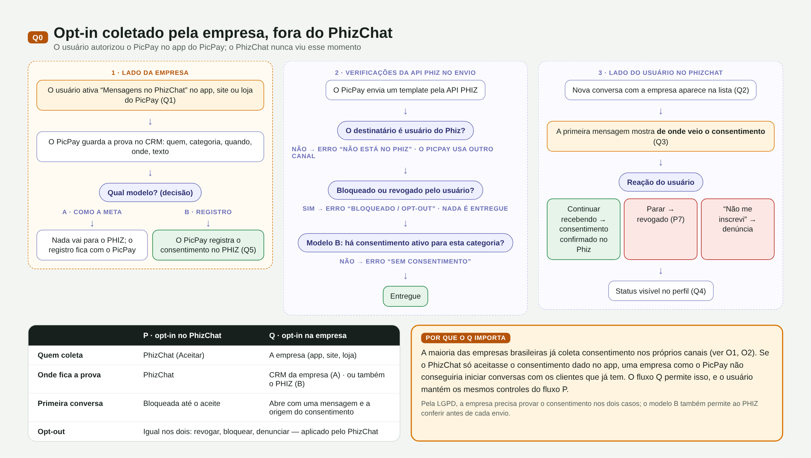</a><p class="cap"><b>Q00.</b> Mapa do fluxo Q: lado da empresa, verificações da API e lado do usuário, com a comparação P × Q</p></div>
</div>

<div class="shots phones">
<div class="shot"><a href="mocks/pt/phizchat/q01-optin-merchant-app.png" target="_blank" rel="noopener">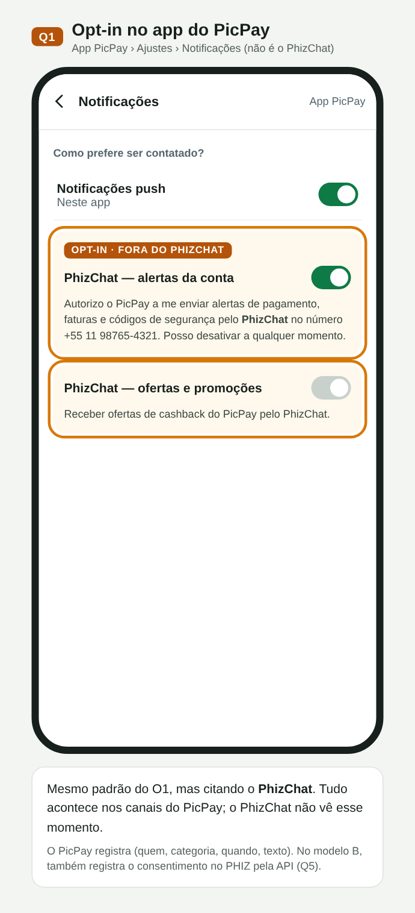</a><p class="cap"><b>Q01.</b> Opt-in no app do PicPay, citando o PhizChat</p></div>
<div class="shot"><a href="mocks/pt/phizchat/q02-first-message.png" target="_blank" rel="noopener">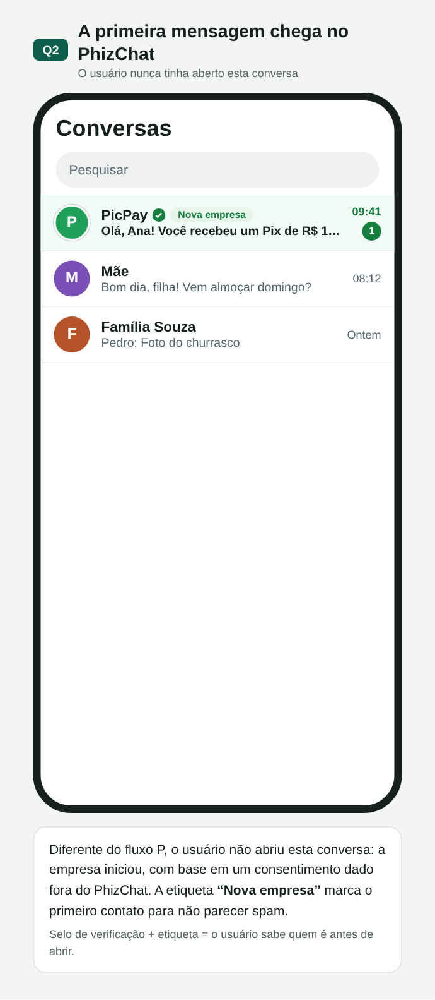</a><p class="cap"><b>Q02.</b> Primeira mensagem na lista, com a etiqueta Nova empresa</p></div>
<div class="shot"><a href="mocks/pt/phizchat/q03-consent-source.png" target="_blank" rel="noopener">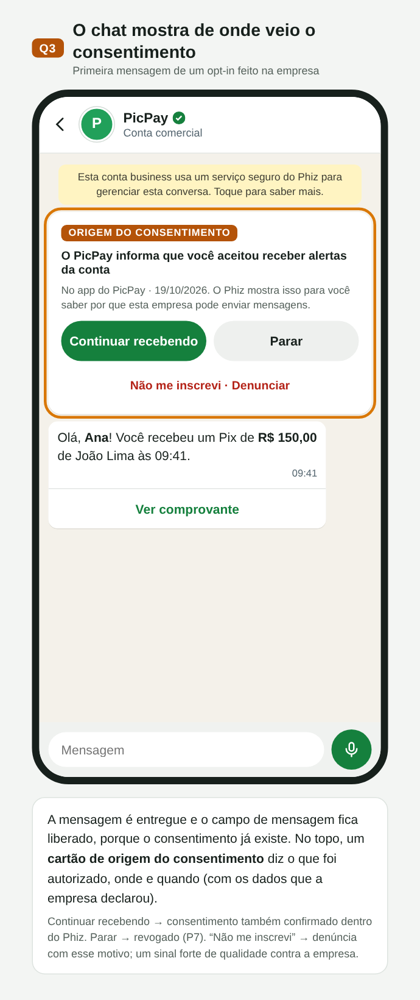</a><p class="cap"><b>Q03.</b> Cartão com a origem do consentimento: continuar, parar ou denunciar</p></div>
<div class="shot"><a href="mocks/pt/phizchat/q04-consent-status.png" target="_blank" rel="noopener">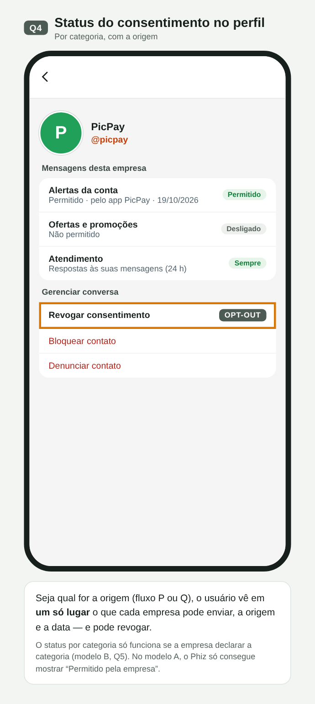</a><p class="cap"><b>Q04.</b> Status do consentimento por categoria, com origem e data</p></div>
</div>

<div class="shots">
<div class="shot"><a href="mocks/pt/phizchat/q05-consent-api.png" target="_blank" rel="noopener">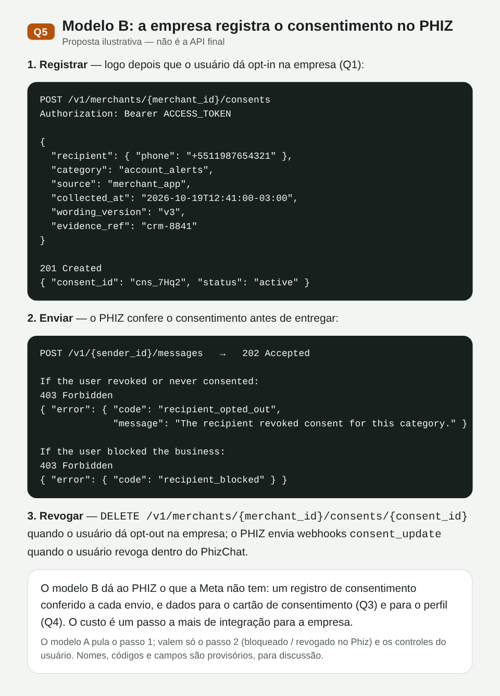</a><p class="cap"><b>Q05.</b> Modelo B: registro do consentimento na API e erros de envio (proposta ilustrativa)</p></div>
</div>

### P × Q

|  | P · opt-in no PhizChat | Q · opt-in na empresa |
|---|---|---|
| Quem coleta | PhizChat (Aceitar) | O comerciante (app, site, loja) |
| Onde fica a prova | PhizChat | CRM do comerciante (modelo A) · também no PHIZ (modelo B) |
| Primeira conversa | Bloqueada até o aceite | Abre com a mensagem e a origem do consentimento |
| Opt-out | Igual nos dois: revogar, bloquear, denunciar — aplicado pelo PhizChat |  |

### Estados da relação com o usuário

O documento **PHZ-BM-0001** (*Business Account Messaging*) propõe estados explícitos para a relação entre o Business Account e o usuário. Eles se encaixam nos fluxos P e Q e decidem o que pode ser enviado:

| Estado | Significado | Serviço | Marketing |
|---|---|---|---|
| `NO_RELATION` | Só existe a resolução do telefone | Só casos fortes aprovados (por exemplo, código de verificação) | Não |
| `USER_INITIATED` | O usuário escreveu, escaneou um QR ou abriu uma entrada da empresa | Sim | Consentimento separado |
| `BUSINESS_RELATION` | Pedido, suporte, agendamento ou relação parecida (fluxo Q) | Sim | Consentimento separado |
| `MARKETING_OPT_IN` | O usuário autorizou marketing de forma explícita (fluxo P ou Q) | Sim | Sim |
| `BLOCKED` / `UNSUBSCRIBED` | Bloqueio ou cancelamento pelo usuário, ou supressão pela plataforma | Conforme a política | Não |

O estado fica ligado ao par Business Account (`ba_id`) e Open ID do usuário. Ele não é exposto pela API; o envio só recebe o resultado (aceito ou erro com motivo).

### Controles do usuário

| Ação | Resultado |
|---|---|
| Silenciar | Desliga notificações e mantém a conversa |
| Bloquear | Recusa mensagens futuras desse Business Account |
| Cancelar marketing | Desliga marketing, sem desligar avisos de serviço necessários |
| Denunciar | Abre uma reclamação com evidências |
| Consultar a empresa | Mostra entidade verificada, suporte e política de privacidade |

A conversa empresarial precisa ser visualmente diferente de uma conversa entre amigos: nome verificado, por que a mensagem chegou e acesso fácil a bloquear, denunciar e cancelar.

### Decisões em aberto

- **Modelo A × B no fluxo Q** (ver Q1): só a política, como a Meta, ou registro de consentimento no PHIZ conferido a cada envio. O cartão de origem (Q3) e o status por categoria (Q4) completos dependem do modelo B.
- **Entrega antes do aceite no fluxo Q:** a proposta entrega a primeira mensagem com o cartão de origem; a alternativa é bloquear o chat até o aceite, como no fluxo P.
- **Categorias de consentimento** (alertas da conta, ofertas, códigos) e o que o app mostra ao usuário.
- **Nomes técnicos** — `/v1/{sender_id}/consents`, o webhook `consent_update` e os códigos de erro — são provisórios, para discussão.

## Objetivos e não-objetivos {#goals}

#### Objetivos

- Credenciais ligadas a **aplicações** da Central do Desenvolvedor, e não mais a cada canal. O Merchant ID do Open Platform gera o Developer ID; sob ele, o comerciante cria uma **aplicação** para cada sistema externo (por exemplo, uma para a Blip e outra para o Salesforce), cada uma com `client_id`, secret, escopos e seus **Business Accounts**. Canais podem ser liberados como remetentes opcionais.
- OAuth 2.0 padrão (client credentials), compatível com bibliotecas e plataformas de mercado.
- Enviar mensagens para **telefone ou Open ID** e receber respostas e status por **webhook assinado**.
- Compatibilidade estrutural com a Cloud API da Meta, para que integrações existentes migrem com pouco código.
- Publicar a especificação da API em formato OpenAPI 3.1 (o padrão do Swagger). É um arquivo que descreve todas as rotas, campos, respostas e webhooks, e funciona como acordo entre o time que constrói a API e quem integra com ela. Com ele, parceiros geram documentação e código e testam antes da entrega.

#### Fora do escopo desta RFC

- Templates, campanhas e segmentação (Marketing API, fases futuras).
- Preço e cobrança por conversa.
- Grupos, chamadas de voz e vídeo.
- SDKs oficiais (podem vir depois, gerados a partir do OpenAPI).

## Modelo de domínio {#model}

O modelo de identidades segue a orientação do time técnico da PHIZ. O `merchant_id` **não** identifica o remetente: ele é a conta do Open Platform, e sob um mesmo desenvolvedor pode haver várias aplicações, cada uma com vários Business Accounts.

| Identidade | O que é | Onde aparece |
|---|---|---|
| **Merchant ID** | Conta do comerciante no Open Platform. Ao ser criada, gera em sincronia um Developer ID. | Open Platform |
| **Developer ID** | Identidade do desenvolvedor e dono dos recursos (aplicações, chaves, assinaturas). Pode ser o próprio comerciante ou um terceiro, como o Salesforce ou um BSP. | Central do Desenvolvedor |
| **App ID** | Aplicação: credenciais (`client_id` e secret), escopos e contexto de isolamento. O Open ID do usuário é diferente em cada aplicação. | Token, `/v1/apps/{app_id}` |
| **BA ID** | Business Account: o remetente real, que o usuário vê e autoriza. É criado dentro de uma aplicação e pertence só a ela. Criptografia e isolamento são por BA. | Conversa no PhizChat, `entry[].id` dos webhooks |
| **sender\_id** | Referência externa ao remetente, usada na API e mapeada para o BA ID. Para um canal (opcional), é o ID do canal. | `POST /v1/{sender_id}/messages` |
| **Open ID** | Identificador do usuário dentro de uma aplicação. O telefone é trocado pelo Open ID, e o vínculo com o BA é feito pelo Open ID, não pelo número. | `to` com `to_type: open_id`; `from` nos webhooks |

```mermaid Cada aplicação tem seus Business Accounts. O usuário autoriza o BA e é identificado pelo Open ID daquela aplicação. Canais continuam como remetente opcional.
flowchart LR
  M["Merchant ID<br/>Open Platform"] -- "cria em sincronia" --> D["Developer ID<br/>comerciante ou terceiro"]
  D --> A1["App ID · Blip<br/>client_id + secret"]
  D --> A2["App ID · Salesforce<br/>client_id + secret"]
  A1 --> B1["BA ID · Loja Exemplo<br/>sender_id"]
  A2 --> B2["BA ID · Loja Exemplo Promoções<br/>sender_id"]
  A1 -. "canal opcional<br/>sender_id = ID do canal" .-> C["Canal 1231"]
  B1 --> U(("Usuário<br/>Open ID por aplicação"))
  B2 --> U
  C --> U
```

### Tipos de conversa

Definição do time de produto e tecnologia da PHIZ:

- **Conversa de conta pública**: categoria geral de conversa; não é exibida ao usuário.
- **Conversa de serviço empresarial**: subclassificação da conversa de conta pública; também não é exibida.
- **Business Account**: tipo de produto dentro da conversa de serviço empresarial, **exibido ao usuário**, como a identificação de empresa do WhatsApp. É voltado a empresas, governos e instituições.

Para ter um Business Account, a empresa cria a conta no Open Platform (Merchant ID), o que gera o Developer ID; sob ele cria uma aplicação (App ID) e, na aplicação, o Business Account (BA ID). Tanto as chamadas de terceiros (Salesforce, BSPs) quanto a autorização do usuário para receber mensagens são feitas sobre o BA ID. O Business Account é um tipo de conversa novo: produto e tecnologia vão refinar a definição dele e dos demais tipos, pensando em expansões futuras (Q4).

::: risk Diferença em relação ao PHZ-BM-0001
O **PHZ-BM-0001** propõe outra hierarquia: `Organization → Business Account → App → Credential`. Nele, o Business Account fica **acima** das aplicações, várias aplicações podem enviar por ele (o remetente visível continua sendo o BA) e o Business Account é um **subtipo de Channel** (`Channel.subtype = BUSINESS_ACCOUNT`). Esta RFC mantém o modelo da v1.6, definido com o time técnico da PHIZ: `Merchant ID → Developer ID → App ID → BA ID`, com cada BA dentro de uma única aplicação e o canal como remetente separado e opcional. O alinhamento entre os dois documentos está na Q11 e na Q12.
:::

| Ponto | Esta RFC (v1.6) | PHZ-BM-0001 |
|---|---|---|
| Hierarquia | Merchant ID → Developer ID → App ID → BA ID | Organization → Business Account → App → Credential |
| Aplicações por BA | Uma (o BA pertence à aplicação) | Várias (as aplicações enviam em nome do BA) |
| O que é o BA | Tipo de conversa: conta pública › serviço empresarial › Business Account | Subtipo de produto de Channel |
| Canal | Remetente opcional, separado do BA | O BA é um Channel; um ID de canal sozinho nunca autoriza acesso |
| ID da conversa | Não definido | Curto prazo: `channel:<id>` com `conversation_kind=BUSINESS_1_TO_1`, `business_channel_id` e `recipient_user_id`; longo prazo: ID opaco do servidor |
| Usuário | Open ID por aplicação | `recipient_user_id` |
| Auditoria | Aplicação e Business Account | Organização, aplicação e operador como sujeitos separados |

### Impacto no app PhizChat

O **PHZ-BM-0001** levantou o que o app (Flutter) precisa mudar para exibir conversas Business Account. Vale para qualquer uma das duas hierarquias:

| Hoje no app | O que falta |
|---|---|
| `ChannelInfo.type` | Subtipo explícito para Business Account, com enum compatível |
| `ChannelInfo.companyAuth` (booleano) | Estado, nível, validade e motivo da verificação |
| Conversa `channel:<id>` | Metadados de conversa Business Account e proteção dos parsers antigos |
| `StrangerChatHelper` | Política empresarial separada, sem misturar com a regra de amizade |
| `MessageReceiver` / `MessageSender` | Envelope com finalidade, identidade do remetente e decisão do servidor |

### Fluxo ponta a ponta

Visão para o time técnico: por onde a mensagem passa, da empresa até o usuário, e por onde voltam as respostas e os status.

```mermaid Ida: da empresa até o usuário. A linha tracejada é o caminho opcional pelo canal.
flowchart LR
  PP["PicPay"] --> B1["BSP<br/>ex.: Blip"]
  AM["Ambar"] --> B2["BSP<br/>ex.: Salesforce"]
  B1 --> API["PHIZ Business API<br/>/gateway/business<br/>Auth · Messages · Webhooks"]
  B2 --> API
  API -- "1–3 · token, envio e<br/>validação do remetente" --> MA
  subgraph OP["Central do Desenvolvedor"]
    MA["App · Business Account"]
    MA -- "4a · sender_id = BA ID<br/>padrão" --> DM["Business Account"]
    MA -. "4b · sender_id = ID do canal<br/>opcional" .-> CH["Channel"]
    CH --> CM["Channel Message"]
  end
  DM -- "5 · entrega" --> APP["Phiz App"]
  CM -- "5 · entrega" --> APP
  APP --> U(("Usuário"))
```

#### Retorno: respostas e status

```mermaid Volta: respostas do usuário e status das mensagens chegam ao BSP pelo webhook.
flowchart LR
  U(("Usuário")) -- "responde, recebe, lê" --> APP["Phiz App"]
  APP -- "6 · eventos" --> WH["PHIZ Business API<br/>Webhooks"]
  WH -- "webhook assinado" --> BSP["BSP da integração<br/>responsável pelo remetente"]
  BSP --> EMP["Empresa"]
```

1. **Integração.** A empresa (por exemplo, PicPay ou Ambar) usa um BSP para o atendimento. Na Central do Desenvolvedor, o comerciante cria uma aplicação Business Messaging para esse BSP e entrega o `client_id` e o secret.
2. **Token.** O BSP chama `/oauth/token`. O Auth confere a aplicação na Central do Desenvolvedor (secret, escopos e Business Accounts) e devolve um JWT de 1 h.
3. **Envio.** O BSP chama `POST /v1/{sender_id}/messages`. A API troca o telefone pelo Open ID do usuário, valida token, escopo, remetente, política de opt-in e `Idempotency-Key`, responde `202` e coloca a mensagem na fila. Para mídia, o BSP primeiro envia o arquivo para `POST /v1/{sender_id}/media` e usa no envio o `id` ou o link PHIZ devolvido.
4. **Roteamento.** Com o `sender_id` de um Business Account, a mensagem sai como conversa Business Account (padrão). Com o ID de um canal, segue como Channel Message (opcional).
5. **Entrega.** O Phiz App exibe a mensagem ao usuário e baixa a mídia do armazenamento da PHIZ, pelo link gerado no upload.
6. **Retorno.** Respostas do usuário e status (`sent`, `delivered`, `read`, `failed`) viram eventos que o serviço de Webhooks entrega, assinados, à aplicação dona do Business Account.

| Componente | Responsabilidade | Situação |
|---|---|---|
| BSP / sistema da empresa | Chama a API, envia as mídias por upload e recebe o webhook. | Externo |
| PHIZ Business API · Auth | Emite e revoga JWT; valida `client_id` e secret. | Novo |
| PHIZ Business API · Messages | Valida e aceita envios (`202`), aplica idempotência e limites, enfileira e roteia por `sender_id`. | Novo |
| PHIZ Business API · Media | Recebe o upload, valida formato e tamanho, guarda o arquivo por tempo limitado e gera o `id` e o link PHIZ usados no envio. | Novo |
| PHIZ Business API · Webhooks | Consome eventos do app, assina e entrega pelas assinaturas de eventos da Central do Desenvolvedor, com as retentativas e o histórico dele. | Novo |
| Open Platform · Central do Desenvolvedor | Existente. Guarda organizações, apps, secrets (hash), escopos e assinaturas de eventos. A Business API acrescenta os Business Accounts de cada app. | Alterado: credenciais saem do canal e vão para aplicações do Developer ID |
| Business Account | Conversa de serviço empresarial exibida ao usuário como a empresa; criptografia e isolamento por BA. | Novo (seção 06, Q3) |
| Channel / Channel Message | Envio pelo canal do comerciante. | Existente |
| Phiz App | Exibe mensagens, baixa mídia pelo link PHIZ e gera eventos de entrega, leitura e resposta. | Alterado |

### Equivalência com a Cloud API da Meta

| Meta (WhatsApp Cloud API) | PHIZ (esta proposta) |
|---|---|
| WhatsApp Business Account (WABA) | Developer ID · aplicação (App ID) |
| Número comercial · `phone_number_id` | Business Account · `sender_id` mapeado para o BA ID; opcionalmente, um canal (ID do canal) |
| App da Meta + token de System User | App de desenvolvedor + OAuth client credentials |
| `wa_id` | `open_id` (por aplicação) |
| `POST /{phone-number-id}/messages` | `POST /v1/{sender_id}/messages` |
| `POST /{phone-number-id}/media` · mídia por `id` ou `link` de terceiros | `POST /v1/{sender_id}/media` · mídia só por `id` ou link PHIZ; links de terceiros não são aceitos |
| `object: whatsapp_business_account` | `object: phiz_business_account` |
| `X-Hub-Signature-256` | `X-Phiz-Signature-256` + `X-Phiz-Timestamp` |
| `hub.mode` / `hub.verify_token` / `hub.challenge` | Iguais |

## Princípios de design {#principles}

- **Mesmo formato da Cloud API.** Corpos de envio, respostas e webhooks seguem a estrutura da Meta. Divergimos só onde há ganho claro de segurança (timestamp na assinatura, mídia só pelo armazenamento da PHIZ) ou de clareza (`to_type`).
- Status HTTP, um único envelope de erro e `trace_id` em toda resposta de erro.
- O envio é assíncrono e responde `202 Accepted`; o resultado chega pelo webhook.
- **Idempotência.** O cabeçalho `Idempotency-Key` evita mensagens duplicadas quando o cliente repete uma requisição.
- **Menor privilégio.** Cada integração tem escopos e uma lista de remetentes permitidos.
- Versionamento `/v1`. Mudanças compatíveis (campos novos) entram de maneira padronizada; mudanças incompatíveis exigem `/v2`.
- **Sem amizade não é anônimo.** Falar com quem não é amigo não exige relação prévia, mas o remetente empresarial é sempre identificável.
- **Supressão da plataforma vence.** Bloqueio, cancelamento e supressão têm prioridade sobre qualquer permissão da empresa.

## Autenticação {#auth}

Usamos o fluxo **client credentials** do OAuth 2.0 (RFC 6749 §4.4). O app troca `client_id` e `client_secret` por um access token de 1 hora e o envia em `Authorization: Bearer` em todas as chamadas. Não há refresh token: quando o token expira, o app pede outro.

Na Central do Desenvolvedor, o app, o `appId` e o `appSecret` são o app, o `client_id` e o `client_secret` desta seção, e o grant `CLIENT_CREDENTIALS` da plataforma é o fluxo descrito aqui (seção 12).

<div class="eps-wrap">
<div class="eps">
  <div class="ep"><span class="m m-post">POST</span><code class="p">/oauth/token</code><span class="d">Emite access token</span></div>
  <div class="ep"><span class="m m-post">POST</span><code class="p">/oauth/revoke</code><span class="d">Revoga um token (RFC 7009)</span></div>
  <div class="ep"><span class="m m-get">GET</span><code class="p">/v1/me</code><span class="d">Mostra aplicação, Developer ID, escopos e remetentes do token</span></div>
</div></div>

```mermaid Perto de expirar, o sistema pede outro token. Não há refresh token.
sequenceDiagram
  autonumber
  participant S as Sistema externo
  participant A as PHIZ Auth
  participant API as PHIZ API
  S->>A: POST /oauth/token (client_id, client_secret)
  A-->>S: 200 access_token (1 h), escopos
  S->>API: POST /v1/{sender_id}/messages · Bearer token
  API-->>S: 202 Accepted
```

### Requisição e resposta

```bash
# Base URL of this API: current PHIZ gateway + /gateway/business prefix (illustrative host)
PHIZ_API_BASE="https://gateway.phiz.chat/gateway/business"

curl -X POST "$PHIZ_API_BASE/oauth/token" \
  -H "Content-Type: application/x-www-form-urlencoded" \
  -d grant_type=client_credentials \
  -d client_id=app_2Fk81PzQ \
  -d client_secret="$PHIZ_CLIENT_SECRET" \
  -d "scope=messages:send messages:read"
```

```json
{
  "access_token": "eyJhbGciOiJFUzI1NiIsImtpZCI6InBoei0yMDI2LTEwIn0…",
  "token_type": "Bearer",
  "expires_in": 3600,
  "scope": "messages:send messages:read",
  "developer_id": "dev_suPb10cTzMQ"
}
```

Os endpoints `/oauth/*` usam o formato de erro do OAuth (RFC 6749 §5.2), que as bibliotecas já entendem:

```json
{
  "error": "invalid_client",
  "error_description": "Client authentication failed."
}
```

### Formato do token

Decisão: o token é um JWT assinado com ES256 e chave publicada em `/.well-known/jwks.json`. O gateway valida o token localmente, sem consulta ao banco a cada chamada. Revogações e secrets rotacionados entram numa lista de negação de curta duração (até a expiração do token). Para o integrador o token é opaco; o conteúdo abaixo é informativo.

```json
{
  "iss": "https://gateway.phiz.chat/gateway/business",
  "sub": "app_2Fk81PzQ",
  "aud": "phiz-business-api",
  "did": "dev_suPb10cTzMQ",
  "scope": "messages:send messages:read",
  "snd": [
    "ba_7Kq2M9xTpL",
    "1231"
  ],
  "env": "live",
  "iat": 1760527800,
  "exp": 1760531400,
  "jti": "tok_01JA9VQ4N2"
}
```

### Escopos

| Escopo | Permite |
|---|---|
| `messages:send` | Enviar mensagens de serviço, enviar e gerenciar mídias e marcar mensagens como lidas |
| `messages:read` | Consultar status de mensagens |
| `webhooks:manage` | Configurar, testar e reenviar o webhook do próprio app (Fase 2) |
| `account:read` | Ler dados da aplicação, dos Business Accounts e dos canais |
| `templates:manage` | Reservado para a Marketing API |
| `recipients:resolve` | Verificar se um telefone pode receber mensagens do Business Account, sem revelar cadastro (proposta, Q18) |
| `messages:send_marketing` | Enviar mensagens de marketing; aprovação separada (reservado para a Marketing API) |

### Secrets e rotação

- O secret tem prefixo de ambiente (`phzsk_live_`, `phzsk_test_`), o que ajuda scanners de vazamento a reconhecê-lo.
- É exibido **uma única vez**, na criação ou rotação, e guardado apenas como hash (Argon2id).
- Cada app pode ter **até dois secrets ativos**. Ao gerar um novo, o anterior continua válido pelo período escolhido (padrão 24 h, de 0 a 7 dias), permitindo trocar sem queda.
- A tela mostra o último uso de cada secret, para saber se o antigo ainda está em uso antes de revogá-lo.
- Lista de IPs permitidos por app e política de rotação de 90 dias, ambas já existentes na Central do Desenvolvedor.

### Pré-requisito: verificação

O **PHZ-BM-0001** aponta que hoje não existe um objeto de verificação de conta: os campos `companyAuth` e `memberAuth` não bastam para autorizar a API. A Central do Desenvolvedor já mostra “Organização verificada”, mas o modelo abaixo ainda precisa ser confirmado (Q13). A proposta é que cada nível libere um conjunto de escopos, publicado numa matriz pública:

| Nível | Pode solicitar | Não recebe por padrão |
|---|---|---|
| `UNVERIFIED` | Nada proativo | Resolução, serviço, marketing |
| `PERSON_VERIFIED` | Teste, leitura e respostas iniciadas pelo usuário | Envio em massa e marketing |
| `INDIVIDUAL_BUSINESS_VERIFIED` | Serviço restrito | Marketing e resolução ampla |
| `BUSINESS_VERIFIED` | Serviço, templates e resolução ligada à relação | Marketing |
| `BUSINESS_VERIFIED` + `MARKETING_APPROVED` | Marketing, sujeito a consentimento, template, opt-out e cota | Acesso ilimitado ou entre regiões |

A verificação é uma máquina de estados, não um booleano: `DRAFT → SUBMITTED → UNDER_REVIEW → VERIFIED`, com `NEEDS_INFO` e `REJECTED`, e depois `LIMITED → SUSPENDED → DISABLED`. As mensagens têm estado próprio: `NOT_ENABLED → SERVICE_ENABLED → MARKETING_REVIEW → MARKETING_ENABLED → PAUSED`. Verificação não libera marketing sozinha.

### Atual × proposto

| Aspecto | Hoje | Proposta |
|---|---|---|
| Dono da credencial | Canal | Aplicação da Central (Developer ID) |
| Fluxo | `user_credentials` (próprio) | `client_credentials` (RFC 6749) |
| Campos obrigatórios extras | `description` | Nenhum |
| Validade | ~2 h + refresh token ~90 dias | 1 h, sem refresh token |
| Escopos | `channel` | Por capacidade + remetentes permitidos |
| Rotação | Redefinir invalida na hora | Dois secrets ativos, com sobreposição |
| Erros | HTTP 200 + `code` no corpo | Status HTTP real + envelope padrão |

## Envio de mensagens {#messages}

::: endpoints
- POST `/v1/{sender_id}/messages` — Envia mensagem ou marca como lida
- POST `/v1/{sender_id}/media` — Envia um arquivo de mídia e devolve `id` e link PHIZ
- GET `/v1/media/{media_id}` — Dados da mídia: link, tipo, tamanho e validade
- DELETE `/v1/media/{media_id}` — Remove a mídia antes do prazo
- GET `/v1/messages/{message_id}` — Último status conhecido (contingência)
- GET `/v1/apps/{app_id}/senders` — Business Accounts e canais da aplicação
- POST `/v1/{sender_id}/recipients/resolve` — Verifica se o telefone pode receber, sem revelar cadastro (proposta, Q18)
:::

### Remetente: um Business Account ou um canal

O `sender_id` no caminho define em nome de quem a mensagem sai. Ele é uma referência externa ao remetente e **não** é o `merchant_id`:

- **Business Account (padrão).** Use o `sender_id` do Business Account, mapeado para o BA ID, por exemplo `ba_7Kq2M9xTpL`. A mensagem aparece numa conversa **Business Account**, exibida ao usuário como a empresa, e não depende de canal. Cada Business Account pertence a uma única aplicação, que é quem envia e recebe por ele.
- **Um canal (opcional).** Use o ID do canal, por exemplo `1231`. Útil para quem separa marcas ou áreas em canais diferentes. A mensagem aparece na conversa **Channel Service** do canal, a mesma usada pelo Channel Bot.

Os dois funcionam do mesmo jeito na API: mesmos campos, mesmas respostas e mesmos webhooks. Nos webhooks, `metadata.sender_type` indica qual foi usado e `metadata.conversation_type` traz o tipo de conversa (`business_account` ou `channel_service`).

### Destinatário: telefone ou Open ID

O Business Account envia sempre para o **Open ID** do usuário naquela aplicação. Todo usuário PHIZ tem um telefone válido e verificado, então o integrador pode informar o telefone e a PHIZ faz a troca. O campo `to` recebe o destinatário e `to_type` diz como interpretá-lo:

- `phone` (padrão): telefone em E.164, por exemplo `+5511987654321`, inclusive números de outros países. A PHIZ troca o número pelo Open ID do usuário antes do envio.
- `open_id`: o Open ID do usuário nesta aplicação, por exemplo `oid_Qm7f2K9xT4Lw`. É o identificador que chega nos webhooks, então respostas podem usá-lo diretamente.

O vínculo entre o Business Account e o usuário é feito pelo Open ID, e não pelo telefone: se o usuário trocar de número, a conversa continua com o mesmo Open ID. O Open ID é diferente em cada aplicação, então não serve para cruzar usuários entre aplicações.

Se o telefone não pertencer a uma conta PHIZ, ou o usuário tiver bloqueado o remetente, a API ainda responde `202` e o webhook informa `failed` com erro `2104`. Assim a API não serve para descobrir quais números têm conta na PHIZ.

### Exemplo: texto para telefone

```bash
# sender_id = BA ID: message from the Business Account (default), no channel needed
curl -X POST "$PHIZ_API_BASE/v1/ba_7Kq2M9xTpL/messages" \
  -H "Authorization: Bearer $PHIZ_TOKEN" \
  -H "Content-Type: application/json" \
  -H "Idempotency-Key: pedido-48213-envio" \
  -d '{
    "messaging_product": "phiz",
    "to": "+5511987654321",
    "to_type": "phone",
    "type": "text",
    "text": { "body": "Olá, Maria! Seu pedido #48213 foi enviado." },
    "biz_opaque_callback_data": "pedido=48213"
  }'
```

```json
{
  "messaging_product": "phiz",
  "contacts": [
    {
      "input": "+5511987654321",
      "open_id": null
    }
  ],
  "messages": [
    {
      "id": "pmid.01JA9VZ6T8R3",
      "message_status": "accepted"
    }
  ]
}
```

`contacts[].open_id` só vem preenchido se o usuário já tem vínculo com esse Business Account. `messages[].id` é a chave para relacionar os webhooks de status.

### Outros exemplos

#### O mesmo envio, saindo por um canal

```bash
# sender_id = 1231: same request, sent through the merchant's channel
curl -X POST "$PHIZ_API_BASE/v1/1231/messages" \
  -H "Authorization: Bearer $PHIZ_TOKEN" \
  -H "Content-Type: application/json" \
  -d '{ "to": "+5511987654321", "type": "text", "text": { "body": "Novidades da semana na Loja Exemplo - Ofertas" } }'
```

#### Texto para Open ID

```json
{
  "to": "oid_Qm7f2K9xT4Lw",
  "to_type": "open_id",
  "type": "text",
  "text": {
    "body": "Seu cupom chegou: PHIZ10"
  }
}
```

#### Upload de mídia

```bash
# 1. Upload the file to PHIZ (multipart/form-data). Third-party URLs are not accepted when sending.
curl -X POST "$PHIZ_API_BASE/v1/ba_7Kq2M9xTpL/media" \
  -H "Authorization: Bearer $PHIZ_TOKEN" \
  -F messaging_product=phiz \
  -F type=application/pdf \
  -F file=@nota-fiscal-48213.pdf
```

```json
{
  "id": "pmed.01JB2K7Q9X",
  "link": "https://media.phiz.chat/biz/pmed.01JB2K7Q9X",
  "mime_type": "application/pdf",
  "file_size": 184320,
  "sha256": "9b1f…",
  "expires_at": "2026-11-19T14:00:00Z"
}
```

#### Áudio pelo `id` da mídia

```json
{
  "to": "+5511987654321",
  "type": "audio",
  "audio": {
    "id": "pmed.01JB2K4M7A"
  }
}
```

#### Vídeo pelo link PHIZ, para Open ID

```json
{
  "to": "oid_Qm7f2K9xT4Lw",
  "to_type": "open_id",
  "type": "video",
  "video": {
    "link": "https://media.phiz.chat/biz/pmed.01JB2K5V1C",
    "caption": "Como montar seu produto"
  }
}
```

#### Documento com nome de arquivo

```json
{
  "to": "+5511987654321",
  "type": "document",
  "document": {
    "id": "pmed.01JB2K7Q9X",
    "filename": "nota-fiscal-48213.pdf",
    "caption": "Nota fiscal do pedido #48213"
  }
}
```

#### Botões de resposta

```json
{
  "to": "+5511987654321",
  "type": "interactive",
  "interactive": {
    "type": "button",
    "body": {
      "text": "Confirma a entrega amanhã entre 9h e 12h?"
    },
    "action": {
      "buttons": [
        {
          "type": "reply",
          "reply": {
            "id": "confirmar",
            "title": "Confirmar"
          }
        },
        {
          "type": "reply",
          "reply": {
            "id": "reagendar",
            "title": "Reagendar"
          }
        }
      ]
    }
  }
}
```

#### Marcar mensagem recebida como lida

```json
{
  "messaging_product": "phiz",
  "status": "read",
  "message_id": "pmid.IN_01JA9W2C"
}
```

### Tipos suportados

| type | Conteúdo | Fase |
|---|---|---|
| `text` | Até 4.096 caracteres; `preview_url` opcional | MVP |
| `image` | Por `id` ou link PHIZ (upload prévio); legenda opcional | MVP |
| `audio` | Por `id` ou link PHIZ (upload prévio); sem legenda | MVP |
| `video` | Por `id` ou link PHIZ (upload prévio); legenda opcional | MVP |
| `document` | Por `id` ou link PHIZ (upload prévio); legenda e nome do arquivo opcionais | MVP |

### Mídia: upload na PHIZ e armazenamento temporário

Toda mídia passa pelo armazenamento da PHIZ. O envio acontece em dois passos:

1. **Upload.** O BSP envia o arquivo para `POST /v1/{sender_id}/media` (`multipart/form-data`). A PHIZ confere formato e tamanho, guarda o arquivo e devolve um `id` e um `link` PHIZ, com a data de validade em `expires_at`.
2. **Envio.** Na mensagem, o objeto da mídia traz o `id` (recomendado) ou esse `link`. O app do usuário baixa o arquivo do armazenamento da PHIZ.

- **Só links gerados pela PHIZ.** Na Fase 1, a API recusa URLs de terceiros (CDN do comerciante ou do parceiro) com erro `2302`. Assim a PHIZ garante que o link é seguro e que o arquivo continua acessível até a entrega, e o app não expõe o IP do usuário a servidores externos.
- **Armazenamento temporário.** O arquivo fica guardado só pelo tempo necessário para o envio e a entrega: proposta de 30 dias a partir do upload, como o `id` de mídia da Cloud API (ver Q8). Durante esse prazo, o mesmo `id` pode ser usado em vários envios, por exemplo o mesmo PDF para muitos clientes. Depois dele, o `id` e o link deixam de valer e novos envios falham com `2303`. O comerciante pode apagar antes com `DELETE /v1/media/{media_id}`.
- **Validação no upload.** Formato e tamanho são checados no upload, e não na entrega: arquivos fora da tabela abaixo são recusados na hora (`2304` e `2305`).
- **Escopo.** Upload, consulta e remoção usam o escopo `messages:send`, e a mídia só pode ser usada por remetentes da mesma aplicação.

::: decision Decisão (v1.3)
Na Fase 1, mídia só por upload na PHIZ, com armazenamento temporário; links de terceiros não são aceitos. Liberar URLs de terceiros para clientes específicos, por exemplo com lista de domínios permitidos, fica para uma fase futura. Combinado com Henry Wu nos comentários desta seção.
:::

::: decision Decisão (v1.6)
Confirmado pelo time técnico: formatos e tamanhos de mídia podem ser definidos por esta RFC (tabela abaixo); na primeira fase, o arquivo é enviado e armazenado pela Business API; depois, a capacidade de usar URLs de terceiros é liberada conforme o cliente. Outras regras seguem a definição técnica.
:::

| Tipo | Formatos aceitos | Tamanho máximo |
|---|---|---|
| `image` | JPEG, PNG, WebP | 5 MB |
| `audio` | AAC, MP3, M4A, OGG (Opus), AMR | 16 MB |
| `video` | MP4 (H.264 + AAC), 3GP | 16 MB |
| `document` | PDF, DOC/DOCX, XLS/XLSX, PPT/PPTX, TXT, CSV | 100 MB |

<p class="cap">Formatos e tamanhos que o app PHIZ deve aceitar, inspirados nos limites da Cloud API e definidos por esta RFC. A conversão e a compressão ficam a cargo de quem envia o arquivo; o upload recusa o que estiver fora da tabela. Na v1.6, o time técnico confirmou que formatos e tamanhos podem ser definidos por esta RFC (ver Q8).</p>

### Política de envio (consentimento)

Proposta inspirada no WhatsApp (ver seção 03), com os fluxos de opt-in detalhados na seção 04:

- **Iniciar conversa exige opt-in** do usuário para aquele Business Account (`ba_id`) e categoria: alertas da conta, ofertas ou códigos. Responder em até 24 h depois de uma mensagem do usuário não exige opt-in prévio.
- O opt-in pode ser coletado fora do PHIZ (app, site ou loja do comerciante) ou dentro do app PHIZ.
- **Opt-out aplicado pela plataforma:** se o usuário bloqueia o Business Account ou para as ofertas, os envios daquela categoria falham com erro, sem depender do comerciante.
- **Registro obrigatório:** o comerciante guarda a prova de cada consentimento (Open ID do usuário, `ba_id`, categoria, origem, data, texto exibido e revogação). Pela LGPD, cabe a quem trata os dados provar o consentimento e respeitar a revogação.

::: risk Decisão de Produto
A Meta tem a política de opt-in mas não a valida: confia no comerciante e reage depois, por denúncias e nota de qualidade. Precisamos escolher entre **A**, o mesmo modelo (política mais registro no comerciante), e **B**, um registro de consentimento no PHIZ, verificado antes de cada envio. Ver Q1.
:::

### Categorias, janela de atendimento e templates

Com base no **PHZ-BM-0001**, cada mensagem tem uma direção e uma categoria, e serviço e marketing têm permissões, consentimento, limites e revisão separados:

| Categoria | Uso | Quando a empresa inicia |
|---|---|---|
| `AUTHENTICATION` | Códigos de verificação e segurança | Template aprovado |
| `UTILITY` | Pedido, pagamento, entrega, reembolso, agendamento, suporte; ligado a um evento de origem | Template aprovado |
| `MARKETING` | Ofertas e campanhas | Template aprovado, opt-in explícito, horário local e limite de frequência (Marketing API) |
| `USER_REPLY` | Respostas dentro da janela aberta pelo usuário | Não se aplica: só dentro da janela |

- **Janela de atendimento.** Quando o usuário escreve, abre-se uma janela em que a empresa responde com texto livre e mídia. A duração é configurável por política (valor inicial de referência: 24 h). Fora dela, a empresa só inicia conversa com template aprovado (erro `2203`).
- **Templates.** Ciclo `DRAFT → SUBMITTED → PENDING_REVIEW → APPROVED / REJECTED`, com `PAUSED`, `DISABLED` e snapshots de versão. A pausa por qualidade gera resultado explícito (erro `2204` e evento `template_status`).
- **Sem promoção disfarçada.** Conteúdo de serviço deve ter relação direta com o evento de origem; marketing em categoria de serviço é recusado e conta para a qualidade.
- **Fase 1.** O **PHZ-BM-0001** limita a primeira fase a empresas verificadas e mensagens de serviço aprovadas. Esta RFC previa texto livre na Fase 1; o alinhamento está na Q14.

### Verificações antes do envio

A decisão de aceitar uma mensagem combina permissão da organização, escopo, verificação, ambiente, elegibilidade, supressão, finalidade, template, cota e idempotência:

- Estado do Business Account e elegibilidade para a categoria.
- Relação com o usuário ou consentimento de marketing ativo (ver estados na seção 04).
- Template aprovado, vigente e estruturalmente válido, quando exigido.
- Destinatário não bloqueado, não descadastrado, não suprimido e dentro da cota.
- Localidade, horário silencioso, região e regras de setores de risco (erro `2205`).
- Limites por organização, Business Account, aplicação, template, usuário e IP (erro `2502`).

### Resolução de destinatário (proposta)

O **PHZ-BM-0001** propõe um endpoint de resolução separado do envio. Aqui ele fica como `POST /v1/{sender_id}/recipients/resolve`, com o escopo `recipients:resolve`. A resposta traz só `addressable`, `eligible` e um motivo estável; nunca nome, foto, amizade ou se o número tem cadastro. Só faz sentido para destinatários com relação com o Business Account, e entra na Q18.

### Idempotência

Envie `Idempotency-Key` em todo envio. A mesma chave em até 24 h devolve a resposta original sem reenviar. A mesma chave com corpo diferente devolve `409`. Isso torna seguros os retries após timeout ou erro `5xx`.

## Webhooks {#webhooks}

Cada app tem uma assinatura de webhook com URL, `verify_token` e lista de eventos. Na Central do Desenvolvedor, ela é registrada em *Assinaturas de eventos*: uma assinatura liga um evento do app a uma URL de retorno.

::: decision Decisão (v1.5, a confirmar)
Na **Fase 1**, o parceiro cadastra a URL sozinho em **Assinaturas de eventos**, na Central do Desenvolvedor. Isso substitui o cadastro manual pela PHIZ proposto na v1.4. Como a plataforma já oferece retentativas, dead letters e reenvio, essas proteções passam a ser **reaproveitadas** e deixam de ser trabalho da Fase 2. O que a Fase 2 mantém é a configuração por API. Precisa ser confirmado com Henry Wu e com o time da Central do Desenvolvedor (Q9).
:::

### Configuração na Central do Desenvolvedor (Fase 1)

- O catálogo de eventos da Central do Desenvolvedor ganha `messages` e `message_status`, que o app escolhe em *Assinaturas de eventos › Nova assinatura*, com a URL de retorno.
- A assinatura pode ser ativada, desativada e editada na própria tela, e as mudanças geram auditoria e notificação.
- O formato dos eventos, a assinatura e o handshake descritos abaixo valem para as duas formas de configuração. Falta confirmar o que a plataforma já faz hoje (Q9).

### Configuração por API (Fase 2)

Estes endpoints são opcionais e ficam para a Fase 2. Na Fase 1, o parceiro usa a tela *Assinaturas de eventos*.

::: endpoints
- PUT `/v1/apps/{app_id}/webhook` — Define URL, verify\_token e eventos (Fase 2)
- GET `/v1/apps/{app_id}/webhook` — Configuração e saúde (Fase 2)
- POST `/v1/apps/{app_id}/webhook/test` — Dispara evento de teste assinado (Fase 2)
- GET `/v1/apps/{app_id}/webhook/deliveries` — Histórico de entregas, 72 h (Fase 2)
- POST `/v1/apps/{app_id}/webhook/deliveries/{id}/replay` — Reenvia uma entrega (Fase 2)
:::

```bash
curl -X PUT "$PHIZ_API_BASE/v1/apps/app_2Fk81PzQ/webhook" \
  -H "Authorization: Bearer $PHIZ_TOKEN" \
  -H "Content-Type: application/json" \
  -d '{
    "url": "https://integracao.lojaexemplo.com.br/phiz/webhook",
    "verify_token": "um-texto-que-so-voce-conhece",
    "fields": ["messages", "message_status"]
  }'
```

<p class="cap">Exemplo da chamada de configuração da Fase 2.</p>

### Eventos

| field | Quando |
|---|---|
| `messages` | O usuário enviou mensagem, clicou num botão ou reagiu |
| `message_status` | Uma mensagem enviada mudou para `sent`, `delivered`, `read` ou `failed` |
| `sender_update` | Mudou o status, a qualidade ou o limite de um remetente (comerciante ou canal) |
| `account_update` | Mudança na conta de comerciante (verificação, restrição) |

### Verificação da URL

Antes de ativar, a PHIZ faz um `GET` na URL com `hub.mode=subscribe`, `hub.verify_token` e `hub.challenge`. O servidor confere o token e responde 200 com o valor de `hub.challenge`. É o mesmo handshake da Meta.

### Assinatura

Todo `POST` traz os cabeçalhos abaixo. A assinatura é um HMAC-SHA256 de `{X-Phiz-Timestamp}.{corpo bruto}` com o **webhook secret** do app, separado do client secret. Rejeite eventos com timestamp mais de 5 minutos fora do relógio. Durante a rotação do webhook secret, o cabeçalho traz duas assinaturas separadas por vírgula.

```http
POST /phiz/webhook HTTP/1.1
Host: integracao.lojaexemplo.com.br
Content-Type: application/json
User-Agent: PHIZ-Webhooks/1.0
X-Phiz-Delivery-Id: dlv_01JA9W2D7K
X-Phiz-Timestamp: 1760528527
X-Phiz-Signature-256: sha256=6f1c0e…
```

```javascript
// Express: verification handshake + signed events
import express from "express";
import crypto from "node:crypto";

const app = express();
app.use(express.raw({ type: "application/json" })); // keep the raw body for the HMAC

app.get("/phiz/webhook", (req, res) => {
  const ok = req.query["hub.mode"] === "subscribe" &&
             req.query["hub.verify_token"] === process.env.PHIZ_VERIFY_TOKEN;
  return ok ? res.status(200).send(req.query["hub.challenge"]) : res.sendStatus(403);
});

app.post("/phiz/webhook", (req, res) => {
  const ts = Number(req.get("X-Phiz-Timestamp"));
  if (Math.abs(Date.now() / 1000 - ts) > 300) return res.sendStatus(400);

  const expected = "sha256=" + crypto
    .createHmac("sha256", process.env.PHIZ_WEBHOOK_SECRET)
    .update(`${ts}.${req.body}`)
    .digest("hex");
  const received = (req.get("X-Phiz-Signature-256") || "").split(",");
  const valid = received.some(sig => sig.length === expected.length &&
    crypto.timingSafeEqual(Buffer.from(sig), Buffer.from(expected)));
  if (!valid) return res.sendStatus(401);

  queue.push({ deliveryId: req.get("X-Phiz-Delivery-Id"), event: JSON.parse(req.body) });
  res.sendStatus(200); // answer fast, process asynchronously
});
```

```python
# Flask: signature check
import hmac, hashlib, time, os
from flask import request, abort

def verify_phiz_signature() -> None:
    ts = int(request.headers["X-Phiz-Timestamp"])
    if abs(time.time() - ts) > 300:
        abort(400)
    msg = f"{ts}.".encode() + request.get_data()  # raw bytes, before JSON parsing
    expected = "sha256=" + hmac.new(os.environ["PHIZ_WEBHOOK_SECRET"].encode(), msg, hashlib.sha256).hexdigest()
    received = request.headers.get("X-Phiz-Signature-256", "").split(",")
    if not any(hmac.compare_digest(sig, expected) for sig in received):
        abort(401)
```

### Mensagem recebida

```json
{
  "object": "phiz_business_account",
  "entry": [
    {
      "id": "ba_7Kq2M9xTpL",
      "changes": [
        {
          "field": "messages",
          "value": {
            "messaging_product": "phiz",
            "metadata": {
              "sender_id": "ba_7Kq2M9xTpL",
              "sender_type": "business_account",
              "conversation_type": "business_account",
              "display_name": "Loja Exemplo"
            },
            "contacts": [
              {
                "profile": {
                  "name": "Maria Souza"
                },
                "open_id": "oid_Qm7f2K9xT4Lw",
                "phone": "+5511987654321"
              }
            ],
            "messages": [
              {
                "from": "oid_Qm7f2K9xT4Lw",
                "id": "pmid.IN_01JA9W2C",
                "timestamp": "1760528527",
                "type": "text",
                "text": {
                  "body": "Quero reagendar a entrega"
                },
                "context": {
                  "id": "pmid.01JA9VZ6T8R3"
                }
              }
            ]
          }
        }
      ]
    }
  ]
}
```

### Mensagem recebida com mídia

Quando o usuário envia imagem, áudio, vídeo ou documento, o evento traz um `url` temporário que aponta para o arquivo no armazenamento atual do chat. A API de mensagens não faz cópia nem guarda a mídia; baixe o arquivo enquanto o link estiver válido. Abaixo, o item `messages[]` de uma mensagem de voz:

```json
{
  "from": "oid_Qm7f2K9xT4Lw",
  "id": "pmid.IN_01JA9W7R",
  "timestamp": "1760528731",
  "type": "audio",
  "audio": {
    "url": "https://media.phiz.chat/in/9xT2…?expires=1760615131&sig=…",
    "mime_type": "audio/ogg; codecs=opus",
    "sha256": "3f9a…",
    "voice": true
  }
}
```

### Status de mensagem enviada

```json
{
  "object": "phiz_business_account",
  "entry": [
    {
      "id": "ba_7Kq2M9xTpL",
      "changes": [
        {
          "field": "message_status",
          "value": {
            "messaging_product": "phiz",
            "metadata": {
              "sender_id": "ba_7Kq2M9xTpL",
              "sender_type": "business_account",
              "conversation_type": "business_account",
              "display_name": "Loja Exemplo"
            },
            "statuses": [
              {
                "id": "pmid.01JA9VZ6T8R3",
                "status": "delivered",
                "timestamp": "1760528410",
                "recipient_id": "oid_Qm7f2K9xT4Lw",
                "biz_opaque_callback_data": "pedido=48213",
                "conversation": {
                  "id": "conv_01JA9W",
                  "origin": {
                    "type": "service"
                  },
                  "expires_at": "1760614810"
                }
              }
            ]
          }
        }
      ]
    }
  ]
}
```

```json
{
  "object": "phiz_business_account",
  "entry": [
    {
      "id": "ba_7Kq2M9xTpL",
      "changes": [
        {
          "field": "message_status",
          "value": {
            "messaging_product": "phiz",
            "metadata": {
              "sender_id": "ba_7Kq2M9xTpL",
              "sender_type": "business_account",
              "conversation_type": "business_account",
              "display_name": "Loja Exemplo"
            },
            "statuses": [
              {
                "id": "pmid.01JA9X0QW1",
                "status": "failed",
                "timestamp": "1760528600",
                "recipient_id": "+5511900000000",
                "errors": [
                  {
                    "code": 2104,
                    "title": "recipient_not_reachable",
                    "message": "The phone number is not linked to a PHIZ account or blocked this sender.",
                    "href": "https://developers.phiz.chat/docs/errors#2104"
                  }
                ]
              }
            ]
          }
        }
      ]
    }
  ]
}
```

~~~mermaid Ciclo de vida do status. `accepted` só aparece na resposta da API e no `GET /v1/messages/{id}`; os demais chegam por webhook.
stateDiagram-v2
  direction LR
  [*] --> accepted: 202 da API
  accepted --> sent: entregue ao servidor PHIZ
  sent --> delivered: chegou ao aparelho
  delivered --> read: usuário abriu
  accepted --> failed
  sent --> failed
  read --> [*]
  failed --> [*]
~~~

### Garantias de entrega

**Fase 1.** O objetivo é colocar no ar e usar os pontos principais; as proteções abaixo entram depois.

- **Duplicados são possíveis.** O mesmo evento pode chegar mais de uma vez; use `X-Phiz-Delivery-Id` para descartar duplicados.
- **Sem ordem garantida.** Um `read` pode chegar antes do `delivered`; ordene por `timestamp` e nunca regrida status.
- **Responda em até 10 s** com 2xx e processe depois. Qualquer outra resposta, ou timeout, conta como falha.
- Para status de mensagens enviadas, `GET /v1/messages/{message_id}` serve de contingência se um webhook se perder.

::: risk Risco da Fase 1
A entrega com retentativas, dead letters e reenvio vem das assinaturas de eventos da Central do Desenvolvedor, e falta confirmar se a política dela (backoff, janela, retenção) atende ao que propomos abaixo. Mensagens recebidas continuam sem consulta de contingência (ver Q9).
:::

**Política alvo.** A Central do Desenvolvedor já tem retentativas, dead letters e reenvio. A política abaixo é a meta da Business API: onde a plataforma já a cumpre, reaproveitamos; o restante entra na Fase 2.

- **Pelo menos uma vez.** Entrega com **retentativas** e backoff exponencial (10 s, 30 s, 1 min, 5 min, 15 min, 1 h e depois a cada hora) por até 24 h.
- **Reenvio manual.** Depois das 24 h, o evento fica disponível para reenvio por 72 h, com o histórico de entregas (`/webhook/deliveries`).
- **Webhook `failing`.** Se a URL falhar continuamente por 24 h, o webhook passa para `failing` e os administradores do comerciante recebem um aviso.

### Resultados explícitos

Pausa de template, rebaixamento do Business Account, opt-out, risco de qualidade e janela vencida geram resultado explícito: erro na chamada ou evento de webhook (`message_status` com erro, `sender_update`, `template_status` e o proposto `consent_update`). Nunca há retentativa silenciosa nem troca automática de categoria.

## Erros, limites e versões {#errors}

Fora de `/oauth/*`, todos os erros usam um envelope único:

```json
{
  "error": {
    "code": 1003,
    "type": "invalid_parameter",
    "message": "Field 'to' must be E.164 when to_type is 'phone'.",
    "details": [
      {
        "field": "to",
        "issue": "format"
      }
    ],
    "trace_id": "trc_9f2c41ab"
  }
}
```

::: table num
| code | HTTP | type | Significado |
|---|---|---|---|
| 1001 | 400 | invalid\_request | JSON malformado ou campo obrigatório ausente |
| 1003 | 400 | invalid\_parameter | Valor inválido (ver `details`) |
| 1101 | 401 | token\_expired | Token expirado; peça outro |
| 1102 | 401 | invalid\_token | Token inválido ou revogado |
| 1201 | 403 | insufficient\_scope | O token não tem o escopo necessário |
| 1202 | 403 | sender\_not\_allowed | A integração não tem permissão para esse remetente |
| 1301 | 404 | not\_found | Recurso inexistente ou de outro comerciante |
| 1401 | 409 | idempotency\_conflict | Mesma Idempotency-Key com corpo diferente |
| 1501 | 429 | rate\_limited | Limite de requisições; respeite `Retry-After` |
| 2104 | webhook | recipient\_not\_reachable | Telefone sem conta PHIZ ou usuário bloqueou o remetente |
| 2201 | 422 | policy\_violation | Envio não permitido pela política de opt-in |
| 2202 | 422 | unsupported\_type | Tipo de mensagem não habilitado para o remetente |
| 2203 | 422 | service\_window\_closed | Fora da janela de atendimento; use um template aprovado |
| 2204 | 422 | template\_not\_approved | Template inexistente, não aprovado, pausado ou desativado |
| 2205 | 422 | send\_window\_restricted | Horário silencioso, região ou regra de setor impede o envio agora |
| 2301 | webhook | media\_unavailable | O app não conseguiu baixar a mídia do armazenamento da PHIZ (mídia expirada ou removida antes da entrega) |
| 2302 | 400 | media\_link\_not\_allowed | O `link` não foi gerado pela PHIZ; faça o upload e use o `id` ou o link devolvido |
| 2303 | 422 | media\_expired | O `id` ou o link da mídia expirou, foi removido ou pertence a outro comerciante |
| 2304 | 415 | unsupported\_media\_type | Formato de arquivo não aceito no upload |
| 2305 | 413 | media\_too\_large | Arquivo acima do tamanho máximo do tipo |
| 2401 | 403 | sender\_disabled | Remetente desativado ou restrito |
| 2402 | 403 | verification\_required | Nível de verificação insuficiente para o escopo ou a categoria |
| 2501 | 429 | messaging\_limit\_reached | Limite diário de destinatários do remetente atingido |
| 2502 | 429 | frequency\_capped | Limite de frequência por usuário, template ou aplicação atingido |
| 5000 | 500 | internal\_error | Erro interno; repita com a mesma Idempotency-Key |
:::

### Limites (proposta inicial)

| Recurso | Limite |
|---|---|
| `/oauth/token` | 60 req/min por app |
| Envio de mensagens | 80 msg/s por remetente (ajustável por contrato) |
| Demais endpoints | 600 req/min por app |
| Destinatários únicos de mensagens iniciadas pela empresa | Faixas por remetente: 1 mil → 10 mil → 100 mil → ilimitado em 24 h, conforme qualidade (Fase 2) |

```http
HTTP/1.1 429 Too Many Requests
Retry-After: 2
X-RateLimit-Limit: 80
X-RateLimit-Remaining: 0
X-RateLimit-Reset: 1760528529
```

### Ambientes

- **Produção:** `https://{gateway}/gateway/business`
- **Sandbox:** `https://{gateway-de-teste}/gateway/business`, no ambiente de testes usado hoje (Openapi-test), com um remetente de teste por comerciante e até 5 destinatários cadastrados (como o número de teste da Meta). Secrets `phzsk_test_` só funcionam aqui.

### Prefixo de rotas

A nova API roda no mesmo gateway da API atual, separada por prefixo:

- `/gateway/openapi/…`: API atual, mantida durante a migração.
- `/gateway/business/…`: esta API (autenticação, mensagens e webhooks).

Com prefixos distintos, cada contexto tem roteamento, autenticação, limites e logs próprios, e o legado pode ser desligado sem afetar a nova API. Todos os caminhos deste documento, como `/oauth/token` e `/v1/{sender_id}/messages`, são relativos a `https://{gateway}/gateway/business`. Nos exemplos, esse endereço aparece como `$PHIZ_API_BASE`.

### Auditoria e dados

Cada autorização e cada recusa apontam para a empresa, o Business Account, a aplicação, o operador, o template, o snapshot da política usada no envio, o `trace_id` e o estado final. Telefones aparecem em logs e métricas só como token irreversível. Eventos podem chegar duplicados ou fora de ordem, mas o estado final de cada mensagem só avança. A revisão jurídica define consentimento, retenção, exclusão, transferência internacional e exceções de serviço por jurisdição (Q19).

## Central do Desenvolvedor PHIZ {#devarea}

A configuração de desenvolvedor da Business API **não vira uma área nova** no menu do comerciante. Ela é construída dentro da **Central do Desenvolvedor PHIZ** que já existe (ambiente de testes: `developer-uat.phiz.chat`), com o mesmo menu, as mesmas telas de aplicações, chaves, auditoria, assinaturas de eventos e webhook, e uma tela nova de *Business Accounts*.

::: decision Decisão (v1.5)
A experiência desenhada na v1.4 para o Open Platform (visão geral, integrações, segredos, webhooks e remetentes) migra para a Central do Desenvolvedor. Integração passa a ser uma **aplicação do tipo Business Messaging**, as permissões viram os papéis da organização e o webhook usa *Assinaturas de eventos*. “Canal › Configuração de Desenvolvimento” passa a apontar para a Central.
:::

Mockups no visual da Central do Desenvolvedor, com valores de exemplo. Clique em uma imagem para abrir em tamanho real.

<div class="shots">
<div class="shot"><a href="mocks/pt/dc16/01-painel.png" target="_blank" rel="noopener">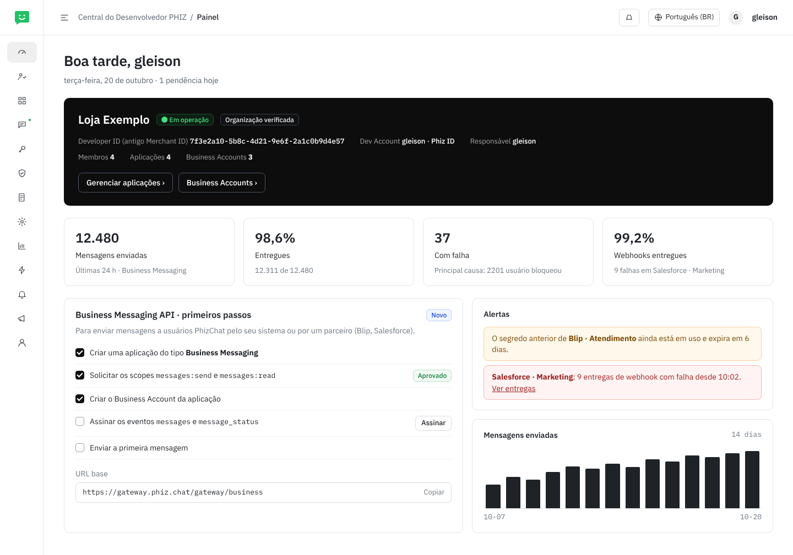</a><p class="cap"><b>Tela 1.</b> Painel: Developer ID, Merchant ID, métricas de mensagens, primeiros passos da Business Messaging API e alertas</p></div>
<div class="shot"><a href="mocks/pt/dc16/02-nova-aplicacao.png" target="_blank" rel="noopener">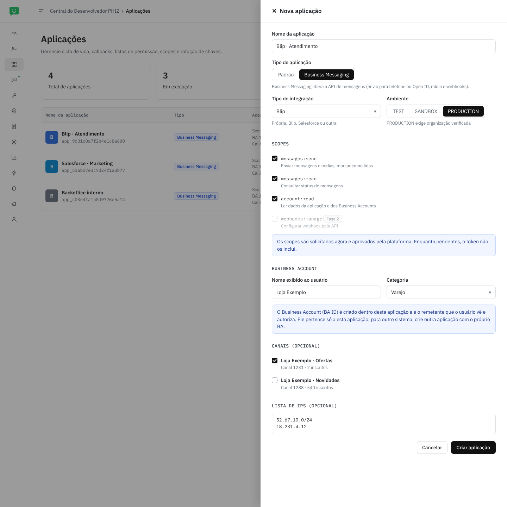</a><p class="cap"><b>Tela 2.</b> Nova aplicação: tipo Business Messaging, tipo de integração, ambiente, scopes com aprovação, Business Account da aplicação, canais opcionais e lista de IPs</p></div>
<div class="shot"><a href="mocks/pt/dc16/03-detalhe-aplicacao.png" target="_blank" rel="noopener">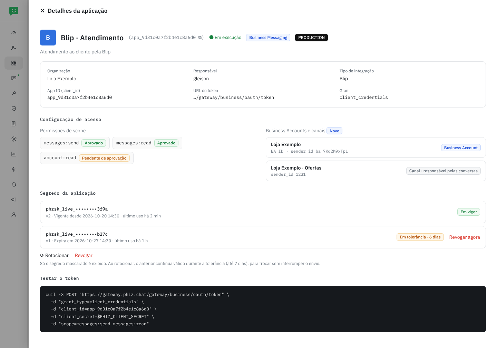</a><p class="cap"><b>Tela 3.</b> Detalhes da aplicação: credenciais OAuth, scopes aprovados ou pendentes, Business Accounts e canais, e segredos com rotação</p></div>
<div class="shot"><a href="mocks/pt/dc16/04-segredo-gerado.png" target="_blank" rel="noopener">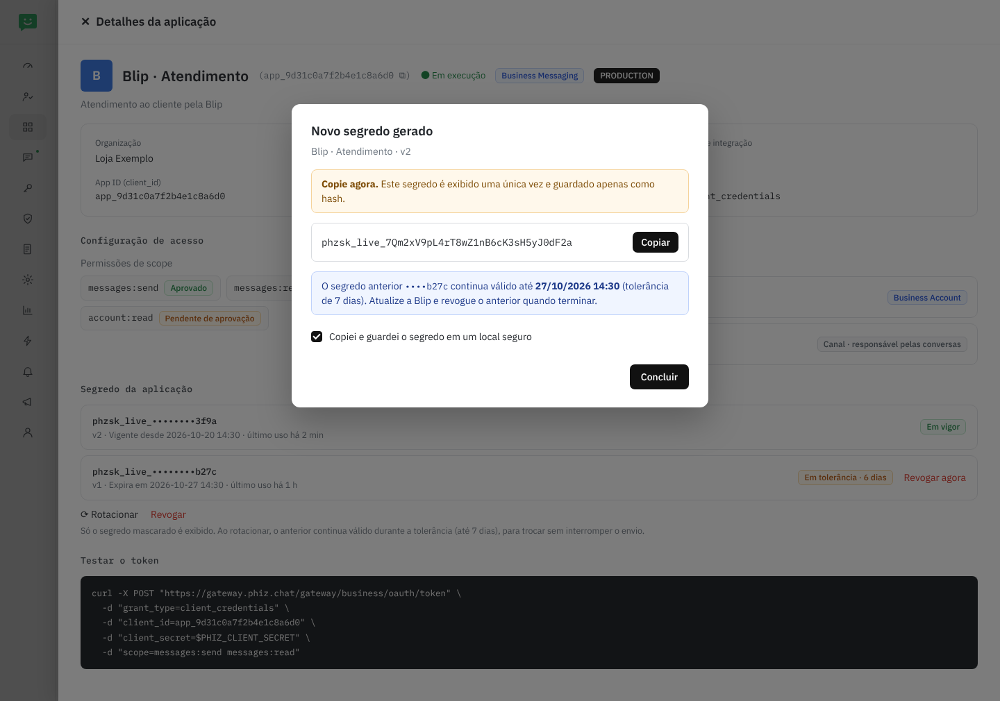</a><p class="cap"><b>Tela 4.</b> Segredo gerado, exibido uma única vez; o anterior continua válido durante a tolerância</p></div>
<div class="shot"><a href="mocks/pt/dc16/05-assinaturas-eventos.png" target="_blank" rel="noopener">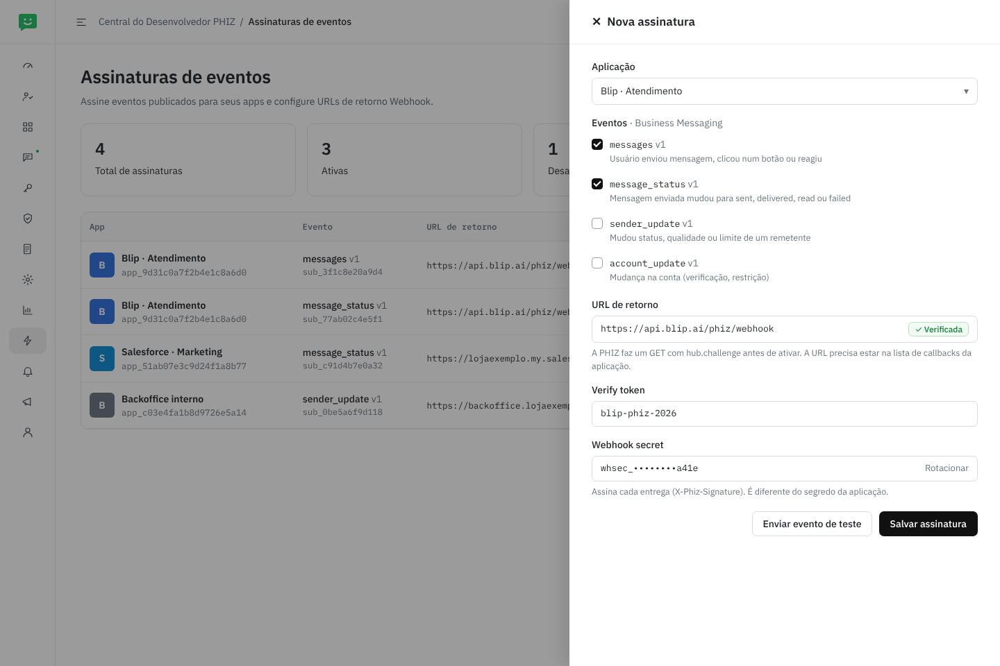</a><p class="cap"><b>Tela 5.</b> Assinaturas de eventos: <code>messages</code> e <code>message_status</code> com URL verificada, verify token e webhook secret</p></div>
<div class="shot"><a href="mocks/pt/dc16/06-webhook-entregas.png" target="_blank" rel="noopener">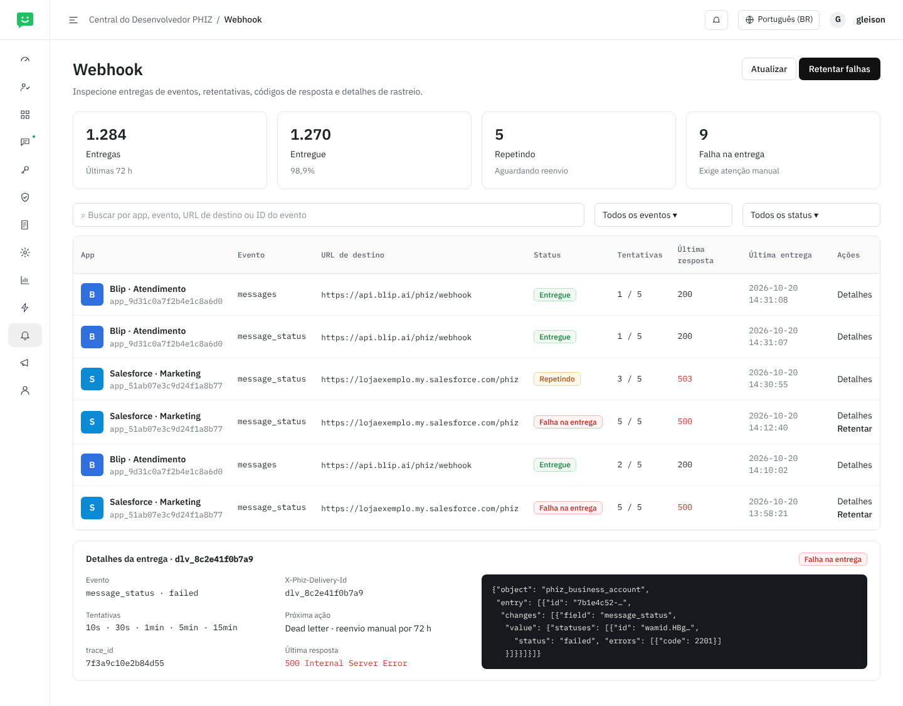</a><p class="cap"><b>Tela 6.</b> Webhook: entregas, retentativas, última resposta, <code>trace_id</code>, retentar falhas e dead letter</p></div>
<div class="shot"><a href="mocks/pt/dc16/07-business-accounts.png" target="_blank" rel="noopener">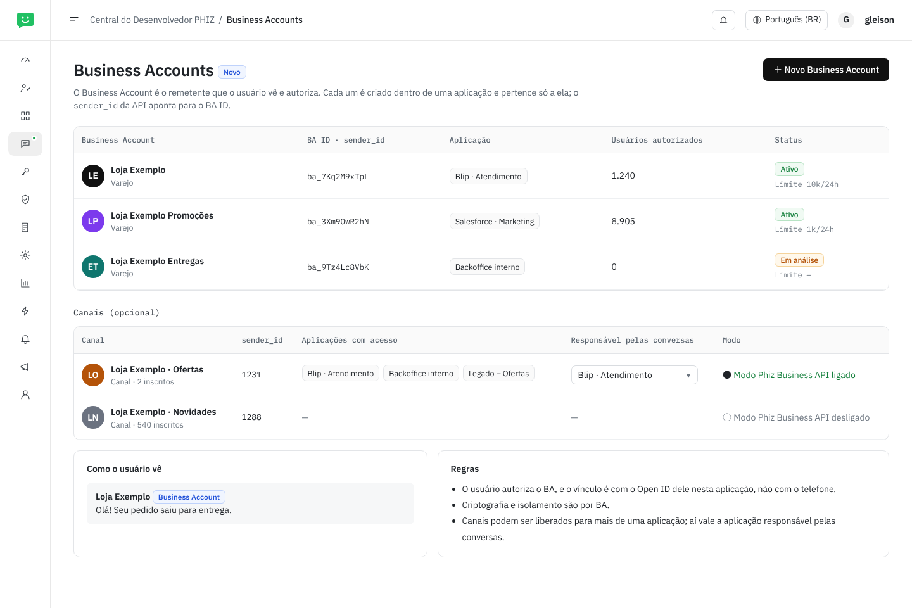</a><p class="cap"><b>Tela 7.</b> Business Accounts (tela nova): BA ID, aplicação dona e usuários autorizados; canais opcionais com a aplicação responsável pelas conversas</p></div>
<div class="shot"><a href="mocks/pt/dc16/08-aplicacoes-legadas.png" target="_blank" rel="noopener">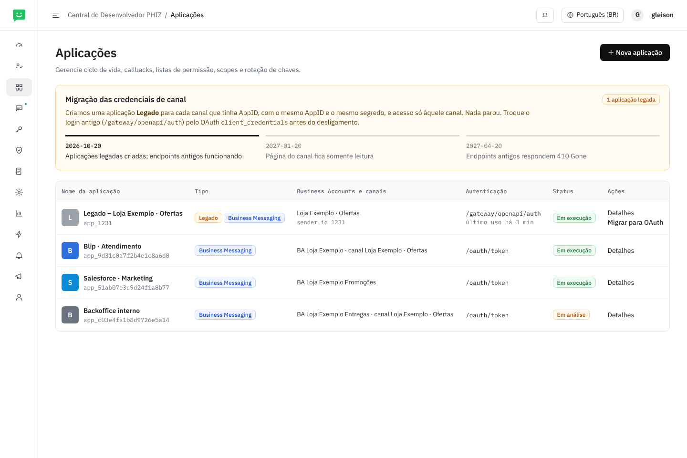</a><p class="cap"><b>Tela 8.</b> Aplicações com a migração das credenciais de canal: aplicação Legado, prazos e troca para OAuth</p></div>
</div>

### O que muda em cada menu

Cada cartão é um item do menu lateral da Central, com o que a Business Messaging API muda nele e as telas acima que o mostram.

<div class="screens">
  <div class="screen"><h5>Painel</h5><span class="path">Muda · Tela 1</span><ul><li>Métricas de mensagens: enviadas, entregues e com falha nas últimas 24 h, e webhooks entregues</li><li>Primeiros passos da Business Messaging API</li><li>Alertas de segredo antigo em uso e de webhook falhando</li></ul></div>
  <div class="screen"><h5>Membros</h5><span class="path">Sem mudança</span><ul><li>Os papéis OWNER, ADMIN, DEVELOPER e AUDITOR definem quem gerencia aplicações, segredos e assinaturas (tabela Papéis)</li></ul></div>
  <div class="screen"><h5>Aplicações</h5><span class="path">Muda · Telas 2, 3, 4, 8</span><ul><li>Novo tipo <em>Business Messaging</em>, com tipo de integração (própria, Blip, Salesforce, outra)</li><li>Ambientes TEST, SANDBOX e PRODUCTION; no SANDBOX, remetente de teste, até 5 destinatários e credenciais <code>phzsk_test_</code></li><li>Business Accounts da aplicação e canais opcionais</li><li>Segredo com rotação, tolerância de até 7 dias e último uso</li><li>Aplicações <em>Legado</em> criadas a partir dos canais</li></ul></div>
  <div class="screen"><h5>Business Accounts</h5><span class="path">Novo · Tela 7</span><ul><li>Business Accounts de cada aplicação, com BA ID (<code>sender_id</code>), status, limite e usuários autorizados</li><li>Cada BA pertence a uma aplicação; criptografia e isolamento por BA</li><li>Canais opcionais: aplicações com acesso, aplicação responsável pelas conversas e modo “Phiz Business API”</li></ul></div>
  <div class="screen"><h5>Scope e API</h5><span class="path">Muda</span><ul><li>Publica os ativos da Business API: mensagens, mídia, <code>/v1/me</code> e conta</li><li>Cadastra os scopes da seção 08; a plataforma aprova as solicitações</li></ul></div>
  <div class="screen"><h5>Lista de Permissão</h5><span class="path">Sem mudança</span><ul><li>IPs que podem chamar a API</li><li>URLs de callback aceitas nas assinaturas de eventos</li></ul></div>
  <div class="screen"><h5>Chaves e Certificados</h5><span class="path">Sem mudança</span><ul><li>A Business API não usa API keys (<code>X-Api-Key</code>) nem certificados; só <code>Authorization: Bearer</code></li></ul></div>
  <div class="screen"><h5>Uso de API</h5><span class="path">Muda</span><ul><li>Chamadas aprovadas, rejeitadas e com falha também para os endpoints da Business API</li><li>Fase 2: log por requisição com <code>trace_id</code></li></ul></div>
  <div class="screen"><h5>Assinaturas de eventos</h5><span class="path">Muda · Tela 5</span><ul><li>Novos eventos <code>messages</code>, <code>message_status</code>, <code>sender_update</code> e <code>account_update</code></li><li>URL verificada com <code>hub.challenge</code>, verify token e webhook secret</li><li>Enviar evento de teste</li></ul></div>
  <div class="screen"><h5>Webhook</h5><span class="path">Sem mudança · Tela 6</span><ul><li>Mesma tela de entregas, agora com os eventos de mensagens</li><li>Retentativas, dead letter e reenvio manual por 72 h</li></ul></div>
  <div class="screen"><h5>Auditoria e Notificações</h5><span class="path">Sem mudança</span><ul><li>Registram e avisam mudanças de segredos, scopes, Business Accounts e assinaturas</li><li>Categorias <em>Segredos</em> e <em>Webhook</em> alimentam os alertas do Painel</li></ul></div>
</div>

### Papéis

A Central já controla o acesso pelos papéis da organização, definidos em *Membros*; não há permissões novas. A tabela mostra o que cada papel faz nas telas da Business Messaging API. É uma proposta, a confirmar com o que cada papel permite hoje (Q10). Aprovar scopes não é papel da organização: quem aprova é a plataforma.

| Ação | OWNER | ADMIN | DEVELOPER | AUDITOR |
|---|---|---|---|---|
| Ver aplicações, Business Accounts, assinaturas, entregas, uso e auditoria (sem segredos) | ✓ | ✓ | ✓ | ✓ |
| Criar, editar e desativar aplicações Business Messaging; solicitar scopes | ✓ | ✓ | ✓ | — |
| Criar e editar Business Accounts; escolher a aplicação responsável por um canal | ✓ | ✓ | ✓ | — |
| Ligar o modo “Phiz Business API” de um canal | ✓ | ✓ | — | — |
| Gerar, rotacionar e revogar segredos | ✓ | ✓ | — | — |
| Criar e editar assinaturas de eventos; enviar teste; retentar entregas | ✓ | ✓ | ✓ | — |
| Gerenciar membros e papéis | ✓ | ✓ | — | — |

Criar, rotacionar ou revogar um segredo, mudar scopes ou Business Accounts e alterar uma assinatura de evento geram registro em *Auditoria* e notificação para OWNER e ADMIN nas categorias *Segredos* e *Webhook*.

O **PHZ-BM-0001** propõe ainda o papel **Operator**, que só envia templates aprovados dentro de finalidade e cota, e reforça que o Developer nunca recebe o secret de produção. A Central não tem Operator hoje (Q16).

### Business Account e aplicação

Cada Business Account é criado dentro de uma aplicação e pertence só a ela. Assim, só essa aplicação envia por ele e recebe os eventos `messages` e `message_status` dele, e o Open ID do usuário é o daquela aplicação. Uma empresa que usa a Blip no atendimento e o Salesforce em campanhas cria uma aplicação para cada um, cada uma com o seu Business Account (Tela 7).

- **Canais compartilhados.** Um canal (remetente opcional) pode ser liberado para mais de uma aplicação. Nesse caso, a tela *Business Accounts* define a **aplicação responsável pelas conversas** do canal: só ela recebe o evento `messages`; as outras podem enviar e recebem o `message_status` do que enviaram.
- Trocar a responsável vale para as próximas mensagens recebidas e fica registrado em *Auditoria*.
- Usar o mesmo Business Account em duas aplicações, ou passar a conversa de um sistema para outro (como o handover do Messenger), fica para depois (Q6).

### Migração das credenciais de canal

Hoje cada canal tem AppID e secret próprios, gerenciados em *Canal › Configuração de Desenvolvimento* no Open Platform. A migração leva essas credenciais para a Central sem parar nenhuma integração (Tela 8):

1. **Criação automática.** Para cada canal com AppID, criamos na organização do comerciante uma aplicação *Legado – nome do canal*, do tipo Business Messaging, com o mesmo AppID como `appId`, o mesmo secret (já armazenado) e acesso só àquele canal, que fica como responsável pelas conversas dele. A aplicação fica no Developer ID do comerciante, criado em sincronia com o Merchant ID.
2. **Convivência.** `/gateway/openapi/auth` e `/token/refresh` continuam funcionando. Para usar a nova API, basta pedir o token em `/oauth/token` com o mesmo AppID e secret. A página do canal no Open Platform mostra um aviso com link para a Central, e a tela *Aplicações* mostra o último uso do login antigo.
3. **Somente leitura.** Após 3 meses, a página do canal deixa de permitir redefinir o secret; segredos e rotação passam a ser só na Central.
4. **Desligamento.** Após 6 meses, e com o uso do login antigo perto de zero, os endpoints antigos respondem `410 Gone`. OWNER e ADMIN recebem aviso em *Notificações* 30 dias antes.

## Integração com parceiros {#partners}

**No MVP**, o comerciante cria um app na Central do Desenvolvedor e cola `client_id` e secret na Blip, no Salesforce ou no próprio sistema. As URLs de webhook vêm do parceiro, que as cadastra em *Assinaturas de eventos* (seção 10). Como os contratos seguem a Cloud API, parceiros que já têm conector de WhatsApp reaproveitam a maior parte dele.

**Numa fase seguinte**, criamos o programa de *parceiros de tecnologia*, equivalente ao Embedded Signup da Meta:

- O parceiro registra um app de plataforma na PHIZ.
- O comerciante clica em “Conectar com a PHIZ” dentro do parceiro e autoriza escopos e Business Accounts numa tela de consentimento (OAuth 2.0 authorization code + PKCE).
- O parceiro recebe tokens limitados àquele comerciante e um único webhook para todos os seus clientes. O campo `entry[].id` do envelope identifica o Business Account; por isso o envelope já nasce com essa estrutura.

A Central do Desenvolvedor já suporta authorization code e o mapeamento `openId`/`unionId`, que são a base desse programa.

No modelo de identidades (seção 06), o Developer ID pode pertencer ao terceiro, como o Salesforce: a identidade de desenvolvedor e os recursos são dele, e os Business Accounts que os comerciantes autorizam ficam nas aplicações dele. Como isso se combina com o Merchant ID de cada comerciante ainda está em aberto (Q10).

## Caminho para a Marketing API {#marketing}

Esta RFC reserva o espaço que a Marketing API vai ocupar, sem implementá-la:

- `type: template` no envio e o escopo `templates:manage` já existem no contrato. Templates de serviço (`UTILITY`, `AUTHENTICATION`) podem entrar antes, com a política de envio da seção 09 (Q14); templates de marketing ficam com a Marketing API.
- Templates com aprovação: `/v1/{sender_id}/message_templates` e evento de webhook `template_status`.
- Categorias de conversa (`conversation.origin.type`: `service`, `utility`, `marketing`), base para relatórios e preço.
- Gestão de opt-in e opt-out por remetente, campanhas para segmentos e métricas em `/v1/{sender_id}/analytics`.
- Faixas de limite de envio e nota de qualidade por remetente, já presentes no recurso `Sender`.

## Plano de entrega {#plan}

::: phases
##### FASE 0 · FUNDAÇÃO: Verificação e regras

- Titularidade: quem envia em nome de quem (Q11)
- Níveis de verificação e matriz nível → escopo publicada (Q13)
- Categorias, janela de atendimento e templates de serviço (Q14)
- Lista interna de destinatários de teste; sem resolução em massa

##### FASE 1 · MVP: Autenticar e enviar

- `/oauth/token`, `/oauth/revoke`, `/v1/me`
- Envio de `text`, `image`, `audio`, `video` e `document` para telefone e Open ID
- Upload de mídia (`/v1/{sender_id}/media`) com armazenamento temporário; sem links de terceiros
- Webhooks `messages` e `message_status` com assinatura, com a URL cadastrada pelo parceiro em Assinaturas de eventos
- Central do Desenvolvedor: tipo de app Business Messaging, ativos de API e escopos, Business Accounts por app e eventos no catálogo
- Modelo de identidades: Developer ID, App ID, Business Account (BA ID) e Open ID; canais como remetentes opcionais
- Migração automática das credenciais de canal

##### FASE 2: Complementos

- Configuração do webhook por API (`PUT /v1/apps/{app_id}/webhook`, teste e saúde)
- Ajustes na política de retentativas e reenvio, se a da plataforma não atender a seção 10
- Log por requisição com `trace_id` e métricas de mensagens
- Sandbox com destinatários de teste
:::

### Critérios de aceite para o lançamento

Adaptados do **PHZ-BM-0001**:

- Verificação, criação do Business Account e solicitação e revogação de escopos testadas de ponta a ponta.
- A matriz pública de níveis e escopos bate com a aprovação na Central, as decisões da API, os códigos de erro e a documentação.
- Conversas empresariais nunca viram amizade ou chat comum; telefones não podem ser enumerados; secrets de produção nunca chegam ao cliente.
- Testes de retentativa, reconexão, vários dispositivos, bloqueio, opt-out e regras regionais passam.
- Revisão jurídica concluída para consentimento, retenção, exclusão, processamento internacional e mensagens de serviço obrigatórias.

Datas serão definidas após a revisão desta RFC com o time da China.

## Questões em aberto {#questions}

::: questions
1. **Política de opt-in.** A seção 09 propõe a política (opt-in por comerciante e categoria, opt-out aplicado pela plataforma, registro no comerciante). Falta decidir: modelo A (como a Meta, sem validação) ou B (registro de consentimento no PHIZ, por exemplo `/v1/{sender_id}/consents`, verificado no envio); quais categorias existem; se o app PHIZ mostra ao usuário o que ele autorizou; e como o usuário bloqueia ou para ofertas de um Business Account (ver Q3). Validar os pontos de LGPD com o jurídico. Vale para Business Account e Channel Service. Os estados de relação e as categorias da seção 04 e da seção 09 dão a base para essa decisão.
2. **IDs de remetente.** Respondida na v1.6: o `merchant_id` não identifica o remetente. O `sender_id` é uma referência externa mapeada para o BA ID do Business Account (seção 06). Para canais, continua o ID do canal; falta decidir se ele também ganha um ID opaco, para não expor o ID sequencial.
3. **Tipo de conversa Business Account.** Respondida na v1.6: conversa de conta pública › conversa de serviço empresarial › Business Account, o único exibido ao usuário, voltado a empresas, governos e instituições e criado em Merchant ID › Developer ID › App ID › BA ID (seção 06). Falta definir como o usuário bloqueia ou silencia um Business Account no app.
4. **Tipos de conversa vigentes.** Respondida em parte na v1.6: além do Business Account existem outros tipos de conversa, e esta entrega cria um tipo novo. Produto e tecnologia vão redefinir e refinar as definições, preparando expansões futuras. Falta a tabela final de tipos e permissões.
5. **Telefones.** Respondida na v1.6: todos os usuários PHIZ têm telefone válido e verificado. O Business Account troca o telefone pelo Open ID do usuário e envia pelo Open ID; o vínculo do BA é com o Open ID, então trocas de número e números de outros países não mudam o destinatário (seção 09).
6. **Mais de uma aplicação por Business Account.** Na v1.6, cada BA pertence a uma aplicação. Vamos precisar usar o mesmo BA em mais de um sistema, ou passar a conversa entre aplicações (bot → atendente humano), já na Fase 2?
7. **Business Message API existente.** O modo “Phiz Business API” do Robô de IA já tem endpoints de envio e callback e parece corresponder ao Channel Service com Channel Bot. Esta RFC substitui, estende ou encapsula essa API?
8. **Mídia.** Respondida em parte na v1.6: formatos e tamanhos podem ser definidos por esta RFC (tabela da seção 09); na primeira fase, o arquivo é enviado e armazenado pela Business API, e URLs de terceiros são liberadas depois, conforme o cliente; outras regras seguem a definição técnica. Falta definir: o prazo de 30 dias serve, ou deve ser menor? Depois da entrega, a mídia passa para o armazenamento normal do chat, ou some do histórico quando expira? Por quanto tempo o `url` das mídias recebidas fica válido?
9. **Webhook na Fase 1.** Proposto na v1.5: o parceiro cadastra a URL em *Assinaturas de eventos* da Central do Desenvolvedor, no lugar do cadastro manual da v1.4. Falta confirmar com Henry Wu se o cadastro manual ainda é desejado por motivo comercial; se a política de retentativas, a retenção de entregas e o reenvio da plataforma atendem a seção 10; se a plataforma assina as entregas e aceita o handshake e o envelope da Cloud API; e como o parceiro recupera mensagens recebidas que se perderam, já que só o status tem consulta.
10. **Central do Desenvolvedor.** (a) O Merchant ID gera o Developer ID em sincronia (v1.6); falta confirmar se o Developer ID é a Organização da Central, como o comerciante entra no console e como fica o Developer ID quando ele pertence a um terceiro, como o Salesforce. (b) Qual é o endpoint de token, a validade e o formato do token do grant `CLIENT_CREDENTIALS`? (c) Os escopos da Business API seguem o padrão da plataforma (como `write:clips:publish`) ou mantêm os nomes da seção 08? O PHZ-BM-0001 sugere um terceiro padrão (`business.message.send.service`); precisamos de um só. (d) Quem aprova as solicitações de escopo e em quanto tempo? (e) O que cada papel (OWNER, ADMIN, DEVELOPER, AUDITOR) permite hoje em secrets e assinaturas? (f) O ambiente SANDBOX envia mensagens simuladas ou reais? (g) Qual time constrói as telas e extensões da seção 12?
11. **Hierarquia RFC × PHZ-BM-0001.** Esta RFC mantém `Merchant ID → Developer ID → App ID → BA ID` (um BA por aplicação). O PHZ-BM-0001 propõe `Organization → Business Account → App → Credential` (várias aplicações por BA). Quem decide e qual vale? Se ficar a da RFC, o PHZ-BM-0001 precisa ser atualizado; se ficar a do BM, as seções 06, 09 e 12 mudam.
12. **Business Account como subtipo de Channel.** O BA é um tipo de conversa (esta RFC) ou um `Channel.subtype` (PHZ-BM-0001)? Qual ID de conversa o app usa: `channel:<id>` com metadados no curto prazo e ID opaco depois?
13. **Verificação.** A Central mostra “Organização verificada”, mas o PHZ-BM-0001 diz que não há objeto de verificação. O que existe hoje, quais níveis adotar, quem revisa, e a Fase 1 depende disso?
14. **Templates de serviço e janela.** Na Fase 1, a empresa pode iniciar conversa com texto livre (proposta original desta RFC) ou só com template aprovado (PHZ-BM-0001)? Qual a duração da janela de atendimento e quem aprova templates?
15. **Rotas.** Manter o formato da Cloud API (`/v1/{sender_id}/messages`) ou adotar `/v1/business/messages`, como no PHZ-BM-0001?
16. **Papel Operator.** Criar o papel Operator na Central? Confirmar que DEVELOPER nunca vê o secret de produção.
17. **Horário silencioso, frequência e regras regionais.** Quais valores, por região e setor, e onde são configurados (Central ou plataforma)?
18. **Resolução de destinatário.** Vale ter `/recipients/resolve`? Para quais estados de relação, com qual limite, e como garantir que não sirva para enumerar telefones?
19. **Revisão jurídica.** Consentimento, retenção, exclusão, transferência internacional e exceções de serviço por jurisdição (LGPD e mercados fora do Brasil).
:::

## Referência OpenAPI {#openapi}

A especificação OpenAPI 3.1 abaixo cobre todos os endpoints e webhooks desta RFC, com descrições neste idioma. O botão “Try it out” está desligado porque a API ainda não existe. Use “Copiar OpenAPI” para levar o YAML para Apifox, Postman ou um gerador de SDK.
