## 概要 {#summary}

本文提出一套公开 API，使外部系统（Blip、Salesforce、各类 CRM 或商户自有系统）能够代表商户与 PHIZ 用户对话。方案包含四个部分：

- **OAuth 2.0 鉴权（客户端凭证模式）**，凭证签发给开发者中心的*应用*（隶属于商户的 Developer ID），不再绑定频道。
- **发送消息**：以应用下创建的 **Business Account**（BA）名义向手机号（E.164）或 Open ID 发送消息，是否通过频道发送为可选项。
- 带签名的 **Webhook**：推送用户发来的消息，以及已发送消息的每一次状态变化。
- 现有的 **PHIZ开发者中心**：商户将每个调用 API 的外部系统（如 Blip 或 Salesforce）登记为一个**应用**。每个应用拥有独立的 `client_id` 和密钥、自己的 Business Account、事件订阅及投递记录。集成与小程序（Miniapp）无关。

消息与 Webhook 的数据结构沿用 Meta Cloud API，仅替换领域名称。已对接 WhatsApp Business Platform 的系统，只需修改 URL、凭证和少量字段名即可适配。

## 背景：现状 {#context}

以下内容基于现有文档（Apifox 的 *Authentication* 模块）和开放平台（`open.phiz.chat`）。

### 现有鉴权方式

通过 `POST /gateway/openapi/auth` 获取令牌，参数为 `app_id`、`app_secret`、`description`（必填）和 `grant_type: "user_credentials"`。响应包含约 2 小时有效的访问令牌和约 90 天有效的刷新令牌，刷新接口为 `POST /gateway/openapi/token/refresh`。

```http
POST /gateway/openapi/auth
Content-Type: application/json

{
  "app_id": "69c37cb1821121af34201f48",
  "app_secret": "94B18B920D19463C7264BD0BDE30C31…",
  "description": "push news",
  "grant_type": "user_credentials",
  "device_fingerprint": ""
}

200 OK
{
  "code": 200,
  "msg": "success",
  "data": {
    "scope": "channel",
    "status": "active",
    "access_token": "at_1770343926041_1Y3iz6XN…",
    "token_type": "Bearer",
    "expires_in": 7199,
    "refresh_token": "rt_1770343926041_mxc7RV9…",
    "access_token_expires_at": "2026-02-06T04:…",
    "refresh_token_expires_at": "2026-05-07T02:…",
    "created_at": "2026-02-05T10:15:23.672+00:00"
  },
  "success": true
}
```

### 凭证所在位置

在开放平台中，每个频道都有 *频道 › 开发配置* 页面，显示 **AppID** 和 **AppSecret**。密钥不会明文显示，只能*重置*。频道的 *AI 机器人* 中还提供 **“Phiz Business API”** 回复模式，将频道会话交给 Business Message API 发送并通过 Webhook 回调。

商户层面已有**商户 ID**（UUID），以及包含角色、成员和操作记录的*团队管理*。新功能将以这三者为基础。

### 本 RFC 带来的变化

每一行分别说明现状、存在的问题、本方案的做法，以及一个具体使用场景。

::: table changes
| 现状 | 问题所在 | 本 RFC 的做法 | 使用场景 |
|---|---|---|---|
| 商户要通过 API 联系用户，必须拥有频道。 | 没有频道、或希望以企业本身身份沟通的商户，无法直接给用户发消息。 | 商户通过自己的 Business Account 发送，对用户以企业身份展示，频道变为可选项。 | 一家没有频道的药店通过手机号通知顾客 Maria 订单已可取货。消息出现在药店的 Business Account 会话中。 |
| 每个频道都有自己的 AppID 和密钥。 | 有 5 个频道的商户要管理 5 套凭证，Blip 需要为每个频道单独获取令牌。 | 每个应用一套凭证，位于开发者中心，拥有自己的 Business Account，并可使用选定的频道。 | Loja Exemplo 有 3 个频道并使用 Blip。现在要在 Blip 中录入 3 个 AppID；采用本 RFC 后，只需创建一个 “Blip” 应用，配置门店的 Business Account 并勾选这 3 个频道。 |
| “重置”会立即使密钥失效。 | 在外部系统更新密钥之前，集成一直不可用。 | 两个密钥可同时有效：新密钥生效后，旧密钥在一段时间内仍可用（默认 24 小时）。 | Salesforce 的密钥出现在日志中。团队生成新密钥，下午更新 Salesforce，当天结束时撤销旧密钥，没有丢失任何消息。 |
| 登录使用 `grant_type: user_credentials`，并要求填写 `description`。 | Salesforce 等原生支持 OAuth 的工具，必须写定制代码才能接入。 | 标准 OAuth 2.0（`client_credentials`），这些工具开箱即用。 | Salesforce 管理员在 Named Credentials 中只需填写令牌 URL、client\_id 和密钥即可连接 PHIZ，无需开发人员。 |
| 存在有效期约 90 天的刷新令牌。 | 多了一个需要保管的长期密钥，对服务端之间的集成没有好处。 | 1 小时令牌，不提供刷新令牌；过期后重新申请。 | Blip 每小时用同一组 client\_id 和密钥自动续期令牌，不会出现刷新令牌在周末过期、导致客服中断的情况。 |
| 频道配置中没有配置 Webhook、查看日志或管理多个集成的页面。 | 商户无法自行配置 Webhook，也无法自行排查集成为何中断。 | 沿用现有开发者中心，扩展出 Business API 的独立应用、事件订阅、投递记录和日志。 | 顾客回复不再进入 Blip。商户打开投递记录，发现 Webhook 从上午 10 点起一直返回 500，修复后重放这些事件。 |
:::

## 参考：WhatsApp 上的用户体验 {#whatsapp}

本 RFC 将 WhatsApp Business Platform 的模式引入 PHIZ。为了让巴西和中国团队对“我们要复刻的是什么”有相同的理解，本节展示一位巴西用户在 WhatsApp 上的完整旅程：如何注册账号、如何**授权**一家企业、消息如何到达，以及收到后能做什么。示例：商户 PicPay，用户 Ana Souza（圣保罗）。

::: note 关于画面
这些是示意图，并非 WhatsApp 官方界面。画面文字已译为中文（真实应用中用户看到的是葡萄牙语）。编号（A2、O1、C3…）与本节来源的设计画布一致。点击图片可查看原尺寸。
:::

### 消息路径

企业不直接对接 WhatsApp：企业系统（CRM、客服）调用 **BSP**（Blip、Zenvia、Twilio、Infobip），BSP 调用 Meta 的 **Cloud API**，再投递到用户手机。回复、点击和状态沿同一路径通过 Webhook 返回。在 PHIZ 中，**PHIZ 商家消息 API** 对应 Cloud API，Developer ID 与应用对应 WABA，Business Account（BA ID）对应企业号码（对照见第 06 节）。

<div class="shots">
<div class="shot"><a href="mocks/zh/whatsapp/b01-architecture.png" target="_blank" rel="noopener">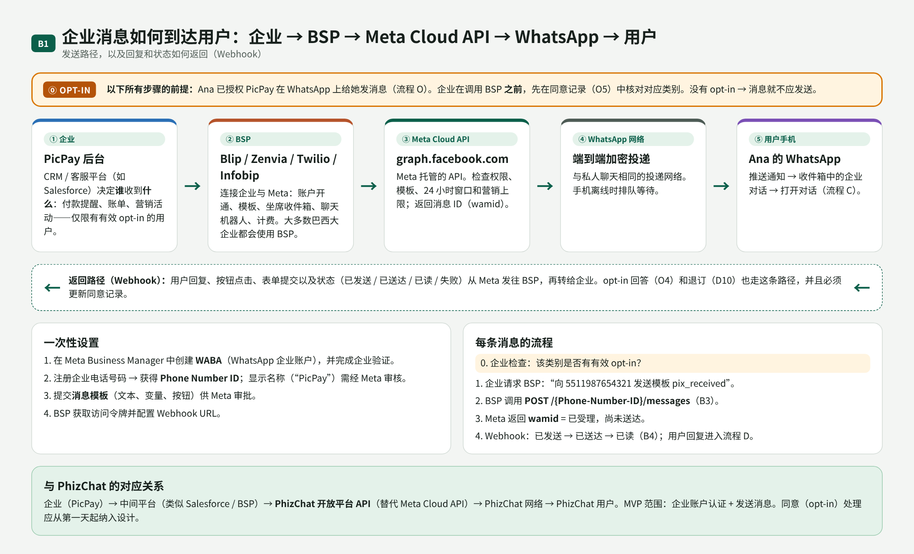</a><p class="cap"><b>B01.</b> 企业 → BSP → Meta Cloud API → WhatsApp → 用户；opt-in 是前提，Webhook 为返回路径</p></div>
</div>

### 用户注册

在 WhatsApp 上，账号就是经短信验证的手机号。没有好友申请：知道号码就能发消息。企业和家人在**同一个收件箱**里，因此企业消息受到严格管控。自 2026 年起，WhatsApp 提供用户名和企业范围用户 ID（BSUID）来替代手机号，这与本 RFC 中使用 Open ID 的思路一致。

<div class="shots phones">
<div class="shot"><a href="mocks/zh/whatsapp/a02-phone-number.png" target="_blank" rel="noopener">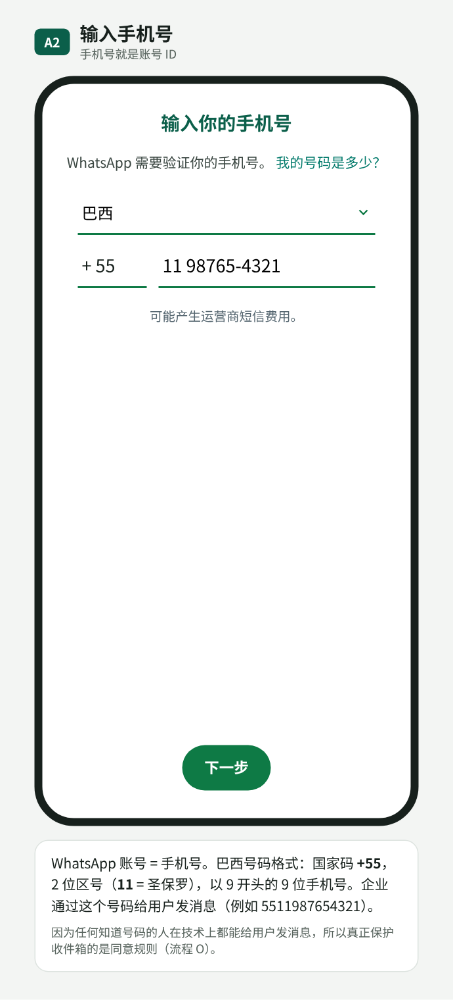</a><p class="cap"><b>A02.</b> 手机号即账号身份</p></div>
<div class="shot"><a href="mocks/zh/whatsapp/a10-chats-home.png" target="_blank" rel="noopener">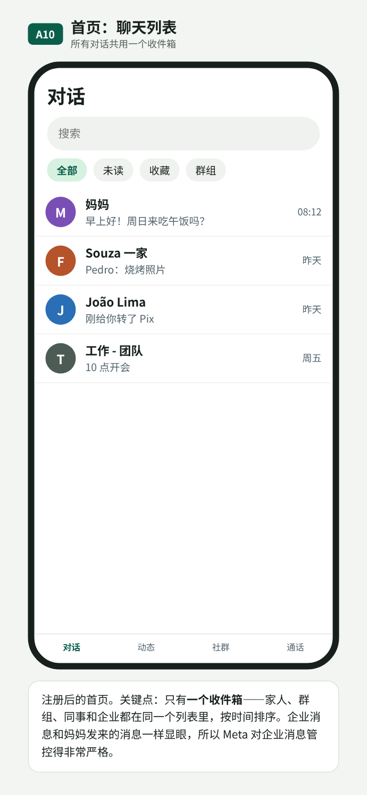</a><p class="cap"><b>A10.</b> 所有对话共用一个收件箱</p></div>
</div>

### 用户授权（opt-in）

企业主动发起会话之前，用户必须已授权*该企业*。常见方式有四种：在企业自己的 App 中（O1）、注册或结账时（O2）、用户先发消息，仅覆盖这次客服会话（O3），以及在聊天中回答“是”（O4）。最佳实践是按用途分开：同意账户提醒不等于同意营销优惠。

<div class="shots">
<div class="shot"><a href="mocks/zh/whatsapp/o00-consent-lifecycle.png" target="_blank" rel="noopener">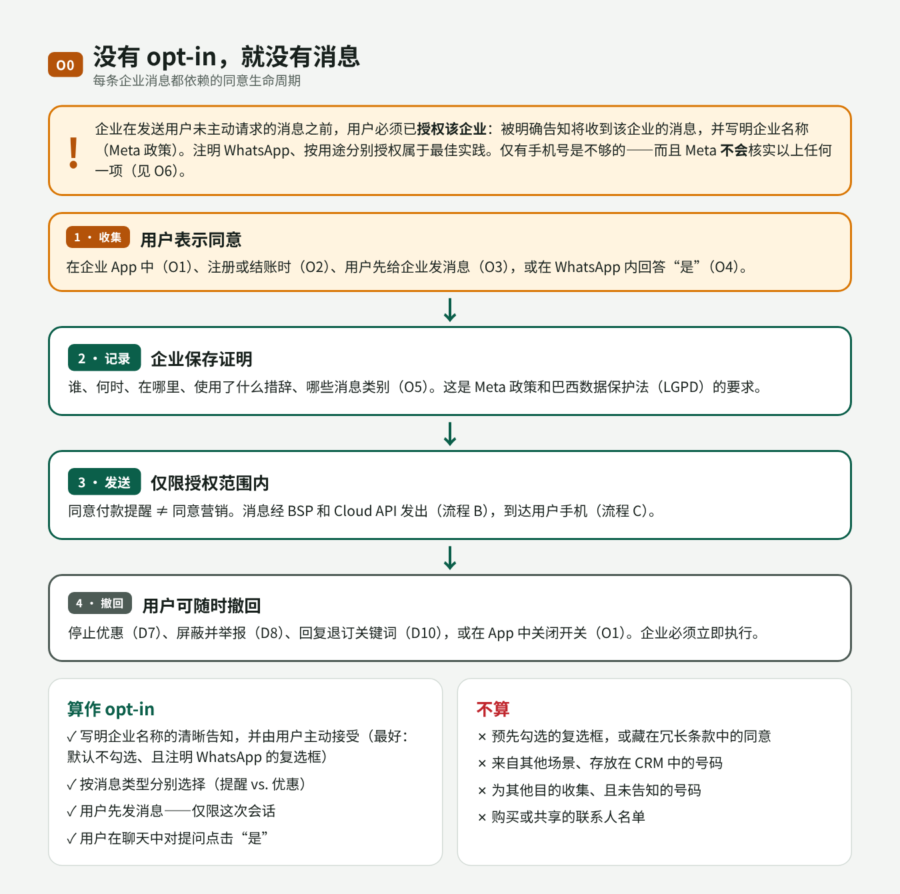</a><p class="cap"><b>O00.</b> 同意的生命周期：收集、记录、在授权范围内发送、撤回</p></div>
</div>

<div class="shots phones">
<div class="shot"><a href="mocks/zh/whatsapp/o01-optin-app.png" target="_blank" rel="noopener">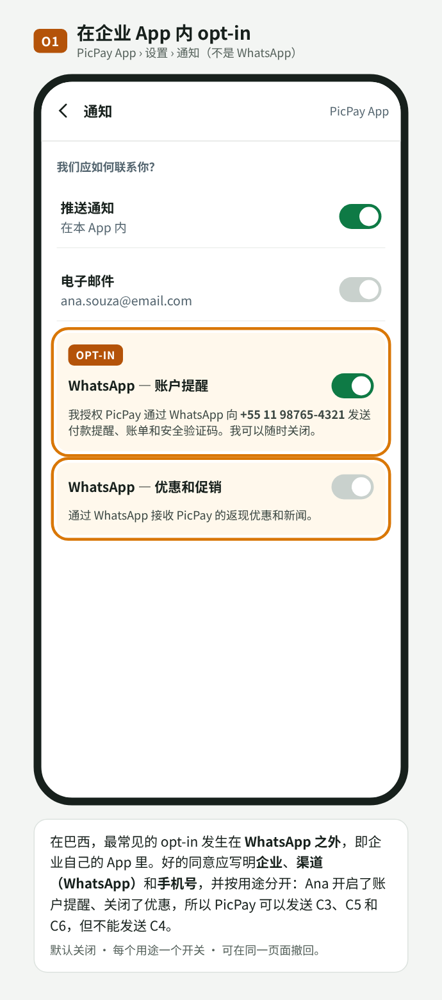</a><p class="cap"><b>O01.</b> 在商户 App 中 opt-in，按用途分开</p></div>
<div class="shot"><a href="mocks/zh/whatsapp/o02-optin-signup.png" target="_blank" rel="noopener">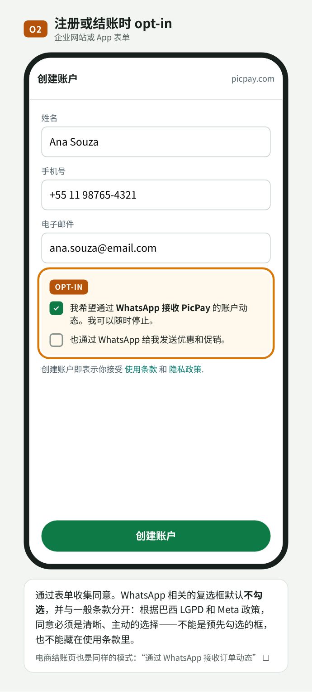</a><p class="cap"><b>O02.</b> 注册时 opt-in，复选框默认不勾选</p></div>
<div class="shot"><a href="mocks/zh/whatsapp/o03-user-starts.png" target="_blank" rel="noopener">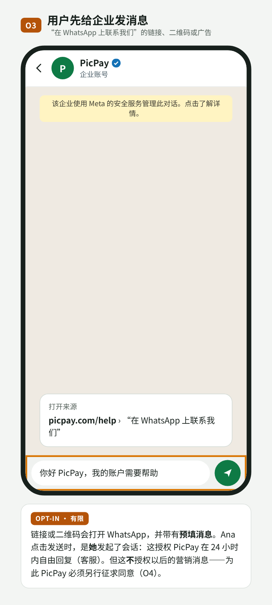</a><p class="cap"><b>O03.</b> 用户先发消息：仅授权本次客服</p></div>
<div class="shot"><a href="mocks/zh/whatsapp/o04-optin-in-chat.png" target="_blank" rel="noopener">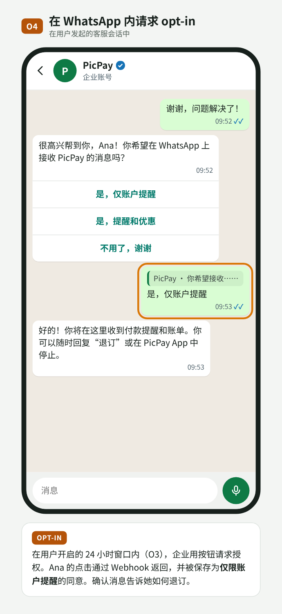</a><p class="cap"><b>O04.</b> 在聊天中用按钮请求 opt-in</p></div>
</div>

**Meta 有政策，但不验证 opt-in。**没有用于证明授权的字段或接口；Meta 信任企业，只在事后通过屏蔽、举报和质量评级作出反应。而 *opt-out* 由平台强制执行：屏蔽、“停止优惠”和营销上限都会使发送失败。尽管如此，根据巴西 LGPD，企业必须能证明已获得同意并尊重撤回，因此实际上必须保存记录（谁、商户、类别、来源、时间、展示的文案、撤回）。

<div class="shots">
<div class="shot"><a href="mocks/zh/whatsapp/o05-consent-record.png" target="_blank" rel="noopener">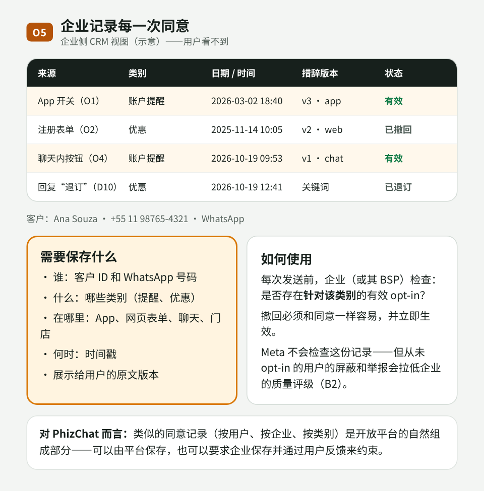</a><p class="cap"><b>O05.</b> 商户侧的同意记录</p></div>
<div class="shot"><a href="mocks/zh/whatsapp/o06-who-verifies.png" target="_blank" rel="noopener">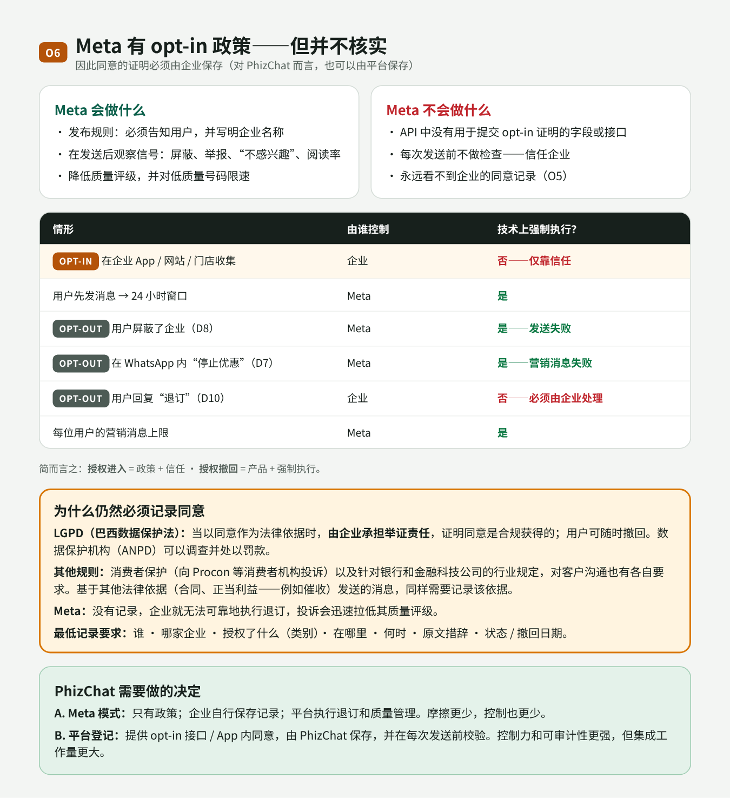</a><p class="cap"><b>O06.</b> Meta 不验证 opt-in；opt-out 由平台执行；为何仍需记录</p></div>
</div>

### 用户收到什么

企业主动发送的消息使用经审核的**模板**，分四类：交易通知（付款、账单）、营销、验证码和客服。每一类都依赖对应的 opt-in。

<div class="shots phones">
<div class="shot"><a href="mocks/zh/whatsapp/c01-notification.png" target="_blank" rel="noopener">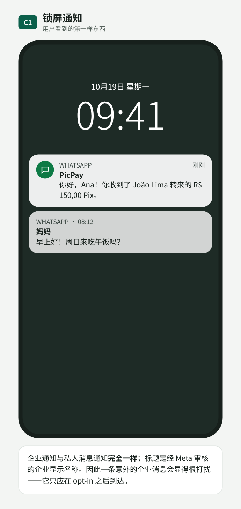</a><p class="cap"><b>C01.</b> 通知与私人联系人的通知完全相同</p></div>
<div class="shot"><a href="mocks/zh/whatsapp/c02-chat-list.png" target="_blank" rel="noopener">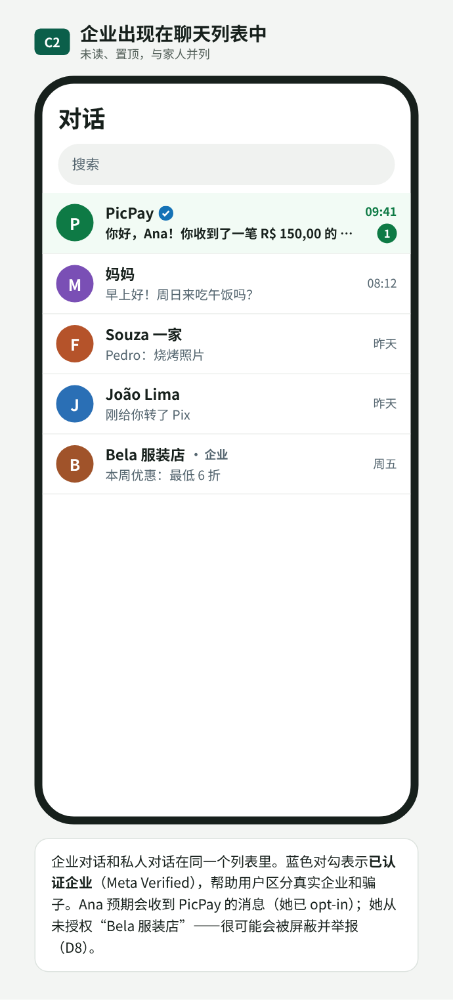</a><p class="cap"><b>C02.</b> 聊天列表：已认证的企业账号未读并置顶，与家人朋友的对话并列</p></div>
<div class="shot"><a href="mocks/zh/whatsapp/c03-utility.png" target="_blank" rel="noopener">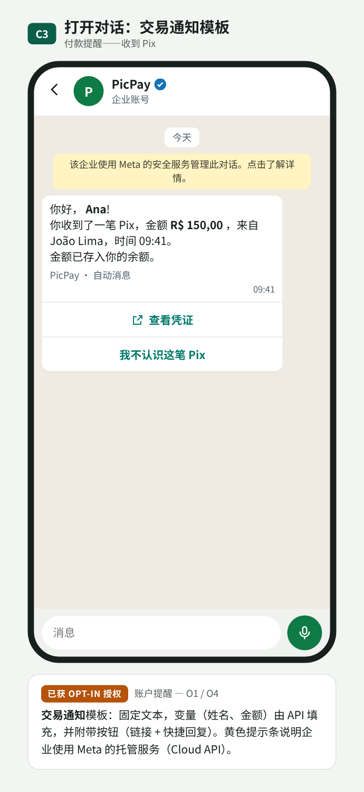</a><p class="cap"><b>C03.</b> 交易通知：收到 Pix，带按钮</p></div>
<div class="shot"><a href="mocks/zh/whatsapp/c04-marketing.png" target="_blank" rel="noopener">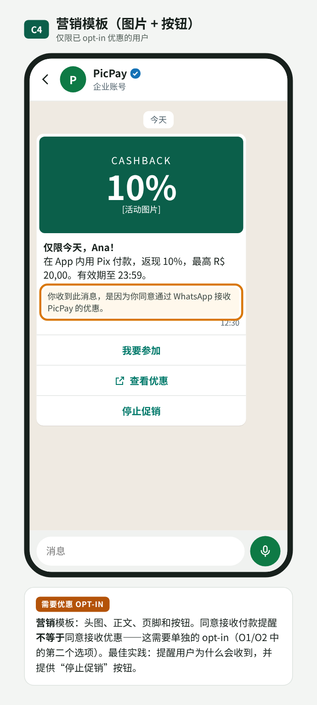</a><p class="cap"><b>C04.</b> 营销：需要单独的优惠 opt-in</p></div>
<div class="shot"><a href="mocks/zh/whatsapp/c05-authentication.png" target="_blank" rel="noopener">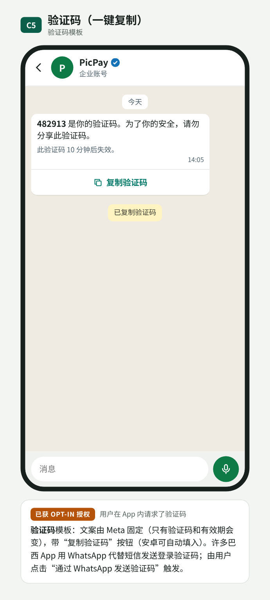</a><p class="cap"><b>C05.</b> 验证码：带复制按钮</p></div>
<div class="shot"><a href="mocks/zh/whatsapp/c06-bill.png" target="_blank" rel="noopener">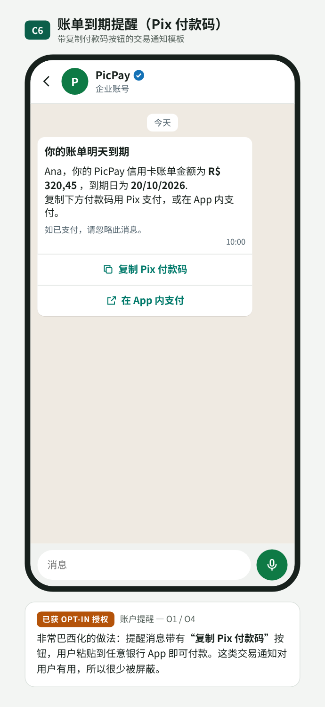</a><p class="cap"><b>C06.</b> 账单提醒，附 Pix 复制粘贴付款码</p></div>
</div>

### 用户能做什么

用户可以回复（文字、按钮、列表、表单）、查看企业资料，或撤回授权。每个操作可能会、也可能不会向企业产生事件。

<div class="shots">
<div class="shot"><a href="mocks/zh/whatsapp/d00-options-map.png" target="_blank" rel="noopener">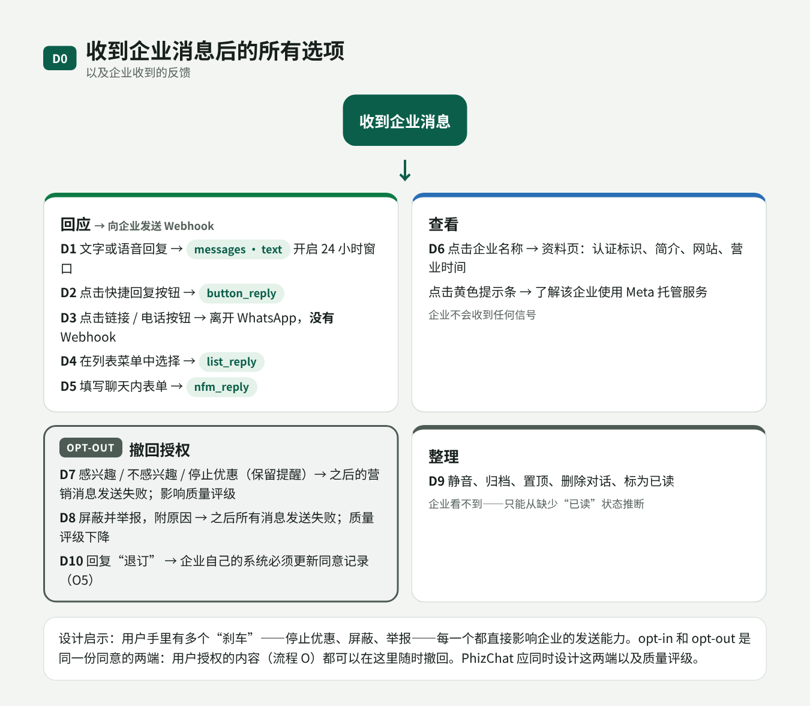</a><p class="cap"><b>D00.</b> 用户的所有选项，以及企业收到的反馈</p></div>
</div>

<div class="shots phones">
<div class="shot"><a href="mocks/zh/whatsapp/d02-quick-reply.png" target="_blank" rel="noopener">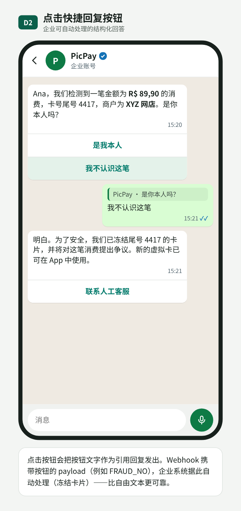</a><p class="cap"><b>D02.</b> 快捷回复按钮</p></div>
<div class="shot"><a href="mocks/zh/whatsapp/d04-list.png" target="_blank" rel="noopener">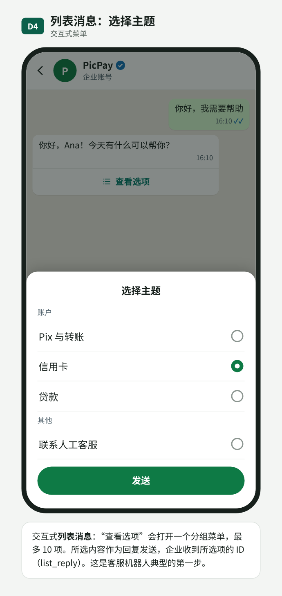</a><p class="cap"><b>D04.</b> 列表消息</p></div>
<div class="shot"><a href="mocks/zh/whatsapp/d05-flow.png" target="_blank" rel="noopener">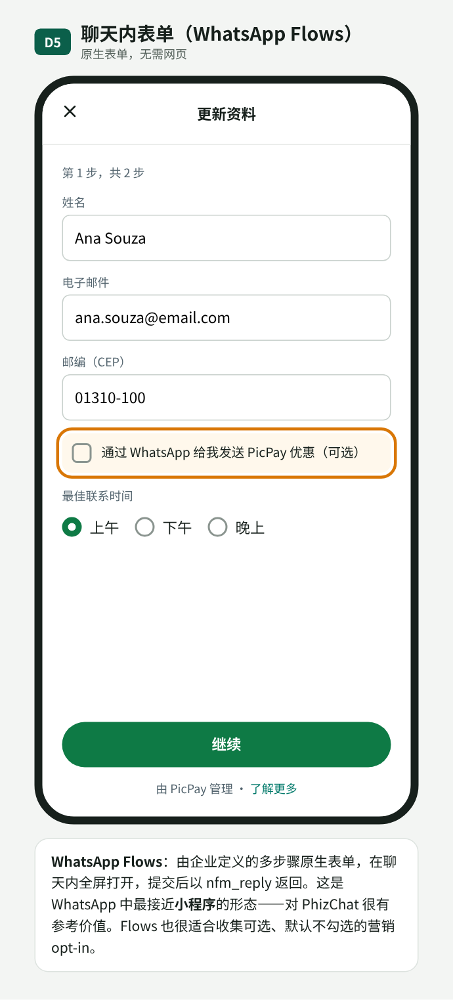</a><p class="cap"><b>D05.</b> 聊天内表单（Flows），接近小程序</p></div>
<div class="shot"><a href="mocks/zh/whatsapp/d07-stop-offers.png" target="_blank" rel="noopener">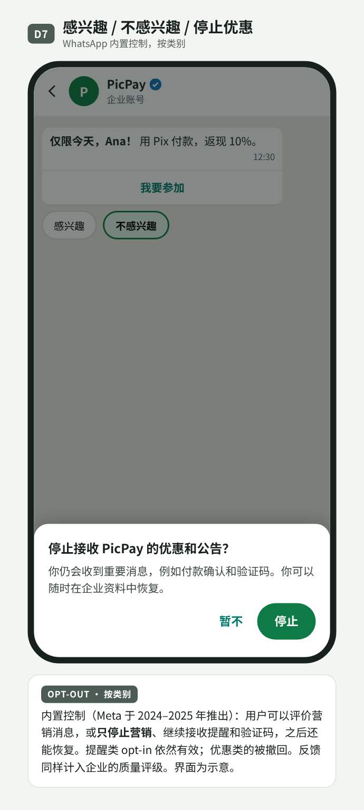</a><p class="cap"><b>D07.</b> 停止优惠，保留提醒</p></div>
<div class="shot"><a href="mocks/zh/whatsapp/d08-block-report.png" target="_blank" rel="noopener">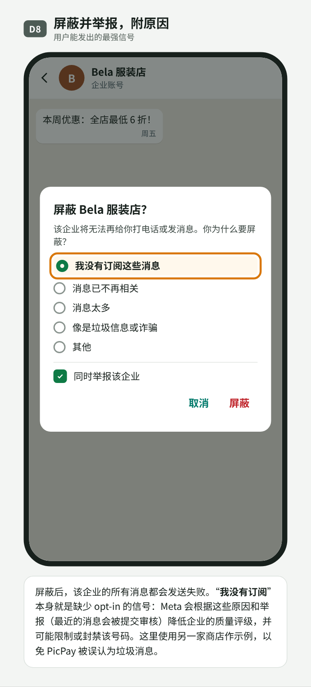</a><p class="cap"><b>D08.</b> 屏蔽并举报，附原因</p></div>
<div class="shot"><a href="mocks/zh/whatsapp/d10-optout-keyword.png" target="_blank" rel="noopener">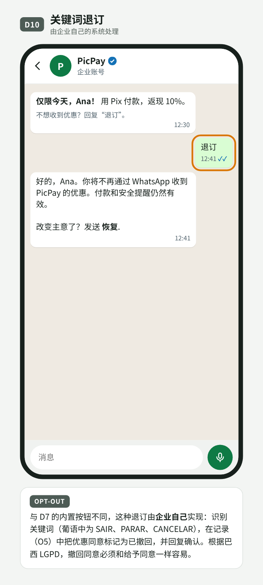</a><p class="cap"><b>D10.</b> 关键词退订，由商户处理</p></div>
</div>

| 用户操作 | WhatsApp | PHIZ |
|---|---|---|
| 回复文字或媒体 | `messages` Webhook；开启 24 小时窗口 | `message` 事件（第 10 节） |
| 点击按钮或列表项 | `button_reply` / `list_reply` | 带所选 id 的 `message` 事件 |
| 停止优惠 | 营销消息发送失败 | 提议：平台对该 Business Account（`ba_id`）屏蔽此类别 |
| 屏蔽或举报 | 所有发送失败；质量评级下降 | 提议：发送报错并产生质量信号（见 Q3） |
| 静音或归档 | 企业不可见 | 相同 |

### 对 PHIZ 的启示

- 用户看到、授权和屏蔽的身份是 **Business Account**（`ba_id`）：opt-in、屏蔽和质量评级都归属于它。Merchant ID 仍是开放平台账号，并同步生成拥有应用的 Developer ID；每个 Business Account 都在某个应用下创建（见第 06 节）。
- 按 Business Account、按类别管理同意，opt-out 由平台执行（见第 09 节发送策略）。
- 用户信号（屏蔽、举报、停止优惠）影响商户的发送额度。
- 聊天内表单（Flows）可作为小程序的参考。

## PhizChat 中的 opt-in：应用内与企业侧 {#phizoptin}

第 03 节说明了在 WhatsApp 上 opt-in 几乎都发生在应用之外，而且 Meta 并不核实。本节提议用户在 PhizChat 中如何**授权**企业账号，共有两条路径，最终都使用相同的退订控制：

- **流程 P——在 PhizChat 内：**用户在应用中直接接受企业账号，由平台保存证明。
- **流程 Q——在企业侧、PhizChat 之外：**用户在商户的 App、网站或门店中授权，由商户发起对话。

::: note 关于画面
这些是示意性提议，以 PicPay 作为示例商户。编号（P0…P8、Q0…Q5）与设计画布一致。点击图片可查看原尺寸。
:::

### 流程 P · 在 PhizChat 内 opt-in

用户通过短信或邮件链接、二维码、商户 App 或网站，或应用内搜索找到企业账号。未安装 Phiz 时，只会看到带资料和下载按钮的 H5 页面；接受永远不会在应用之外发生。安装并登录后，延迟深度链接把用户带回同一个对话，该对话在**接受之前保持锁定**。用户接受后，PhizChat 记录同意（用户 Open ID、`ba_id`、日期、入口），如有欢迎模板则发送，并解锁对话。

<div class="shots">
<div class="shot"><a href="mocks/zh/phizchat/p00-optin-map.png" target="_blank" rel="noopener">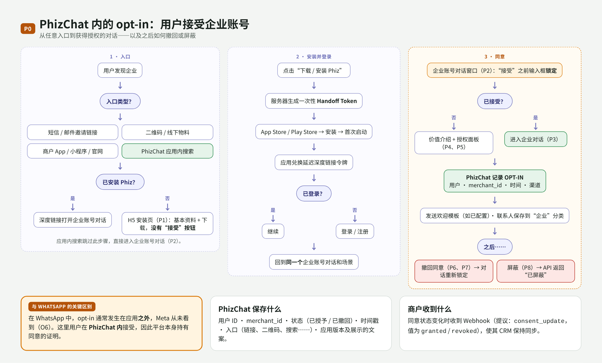</a><p class="cap"><b>P00.</b> 流程 P 总览：入口、安装、登录、接受及之后</p></div>
</div>

<div class="shots phones">
<div class="shot"><a href="mocks/zh/phizchat/p01-h5-install.png" target="_blank" rel="noopener">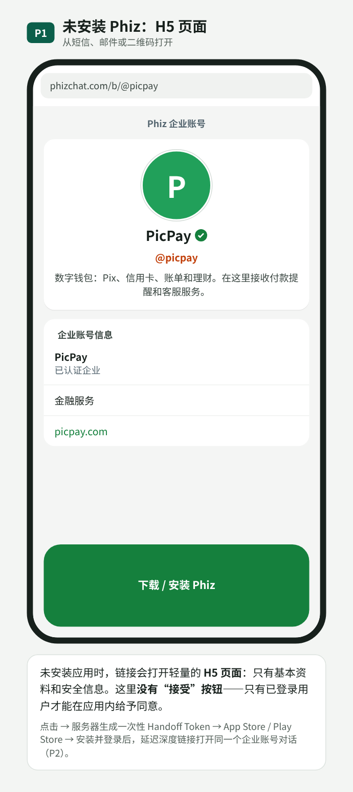</a><p class="cap"><b>P01.</b> 未安装应用：H5 页面只有资料和下载，没有“接受”按钮</p></div>
<div class="shot"><a href="mocks/zh/phizchat/p02-chat-locked.png" target="_blank" rel="noopener">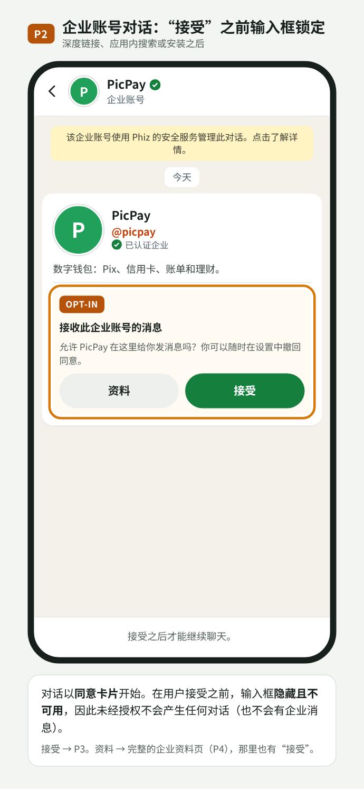</a><p class="cap"><b>P02.</b> 带同意卡片的企业账号对话；接受之前输入框锁定</p></div>
<div class="shot"><a href="mocks/zh/phizchat/p03-accepted.png" target="_blank" rel="noopener">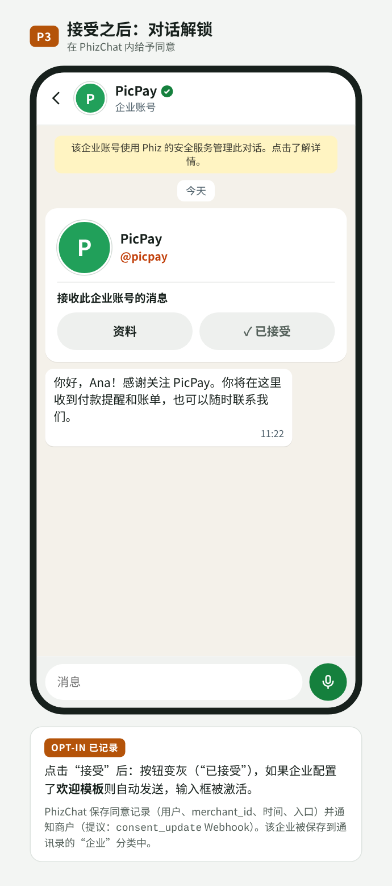</a><p class="cap"><b>P03.</b> 接受之后：欢迎消息，对话解锁</p></div>
<div class="shot"><a href="mocks/zh/phizchat/p04-profile.png" target="_blank" rel="noopener">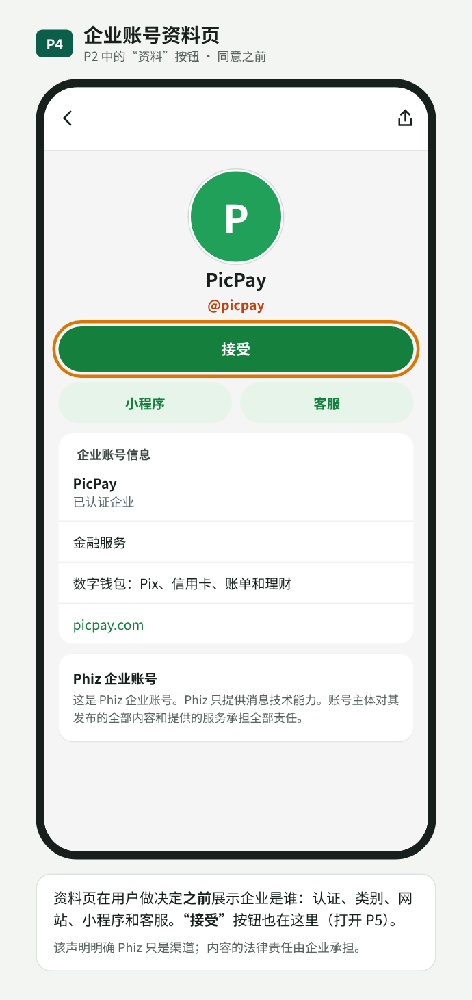</a><p class="cap"><b>P04.</b> 同意之前的企业资料页，同样提供“接受”</p></div>
<div class="shot"><a href="mocks/zh/phizchat/p05-consent-sheet.png" target="_blank" rel="noopener">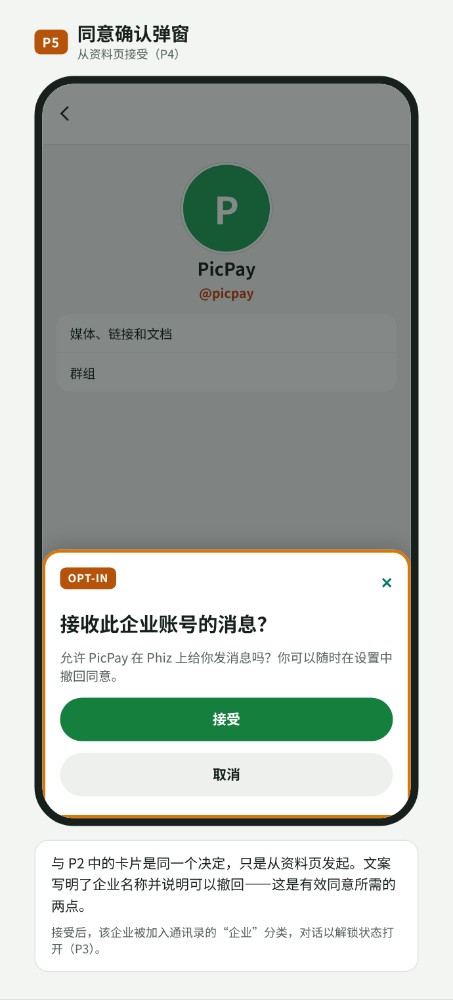</a><p class="cap"><b>P05.</b> 同意确认弹窗</p></div>
</div>

接受之后，资料页显示同意状态和日期。用户可以**撤回**（对话回到锁定状态，之后可以重新授权），或**屏蔽**（沿用现有屏蔽功能；API 仍可调用，但会返回已屏蔽状态）。

<div class="shots phones">
<div class="shot"><a href="mocks/zh/phizchat/p06-manage-consent.png" target="_blank" rel="noopener">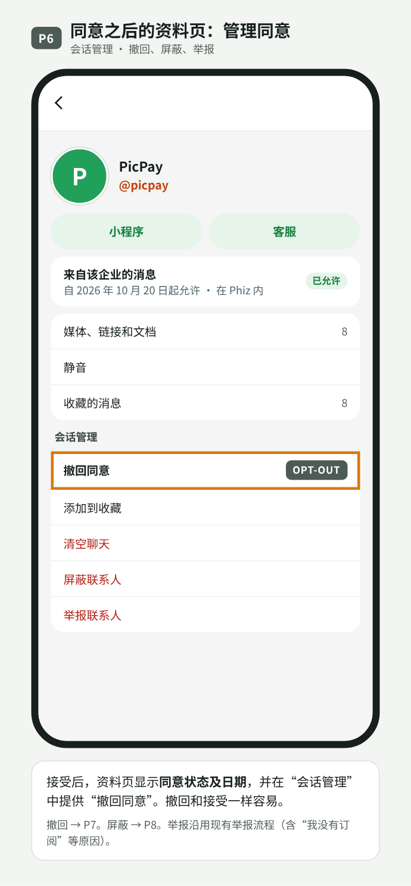</a><p class="cap"><b>P06.</b> 同意之后的资料页：状态、日期和“撤回同意”</p></div>
<div class="shot"><a href="mocks/zh/phizchat/p07-revoke.png" target="_blank" rel="noopener">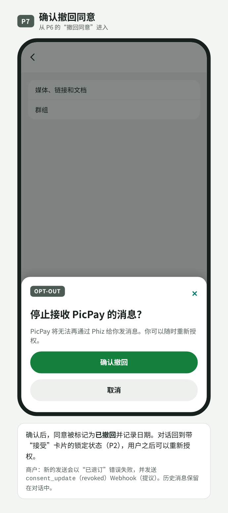</a><p class="cap"><b>P07.</b> 确认撤回；对话重新锁定</p></div>
<div class="shot"><a href="mocks/zh/phizchat/p08-blocked.png" target="_blank" rel="noopener">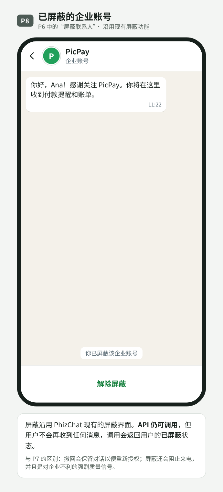</a><p class="cap"><b>P08.</b> 已屏蔽的企业账号：API 返回已屏蔽状态</p></div>
</div>

### 流程 Q · 企业在 PhizChat 之外收集的 opt-in

大多数巴西企业已经在自己的渠道中收集同意。在流程 Q 中，用户在 PicPay App 中开启“PhizChat 消息”；PicPay 保存证明，并通过 API 发送模板。API 检查收件人是否为 Phiz 用户、是否已屏蔽或撤回；在模式 B 中，还会检查该类别是否有已登记的同意。在应用中，第一条消息会附带**同意来源卡片**（授权了什么、在哪里、何时），用户可以继续接收、停止或举报。

<div class="shots">
<div class="shot"><a href="mocks/zh/phizchat/q00-business-optin-map.png" target="_blank" rel="noopener">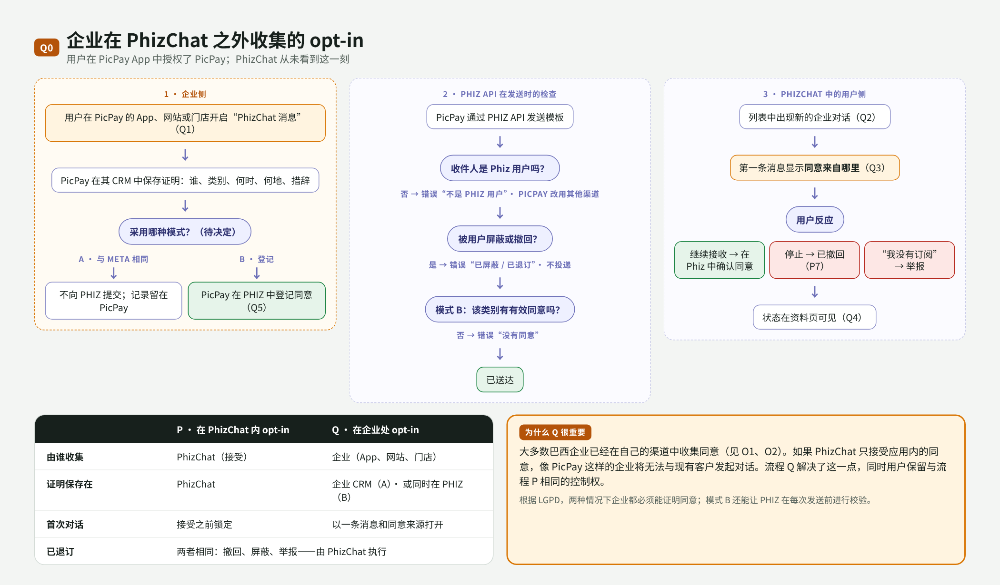</a><p class="cap"><b>Q00.</b> 流程 Q 总览：企业侧、API 检查和用户侧，以及 P 与 Q 的对比</p></div>
</div>

<div class="shots phones">
<div class="shot"><a href="mocks/zh/phizchat/q01-optin-merchant-app.png" target="_blank" rel="noopener">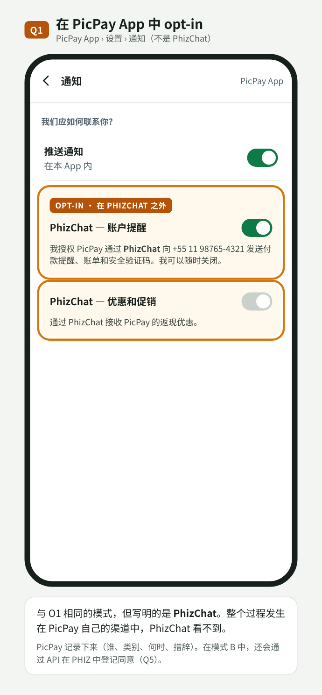</a><p class="cap"><b>Q01.</b> 在 PicPay App 中 opt-in，并写明 PhizChat</p></div>
<div class="shot"><a href="mocks/zh/phizchat/q02-first-message.png" target="_blank" rel="noopener">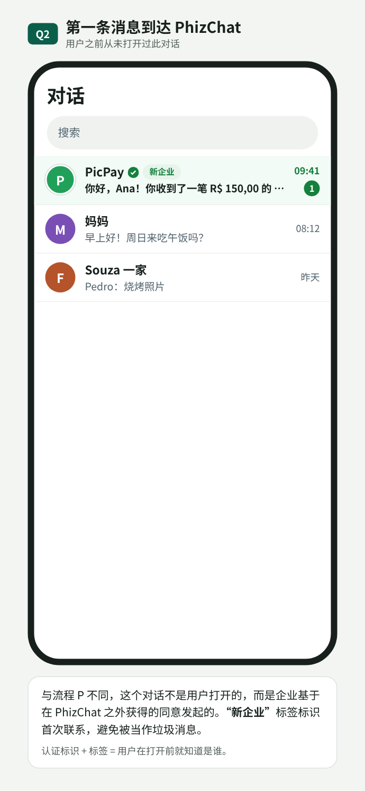</a><p class="cap"><b>Q02.</b> 列表中的第一条消息，带“新企业”标签</p></div>
<div class="shot"><a href="mocks/zh/phizchat/q03-consent-source.png" target="_blank" rel="noopener">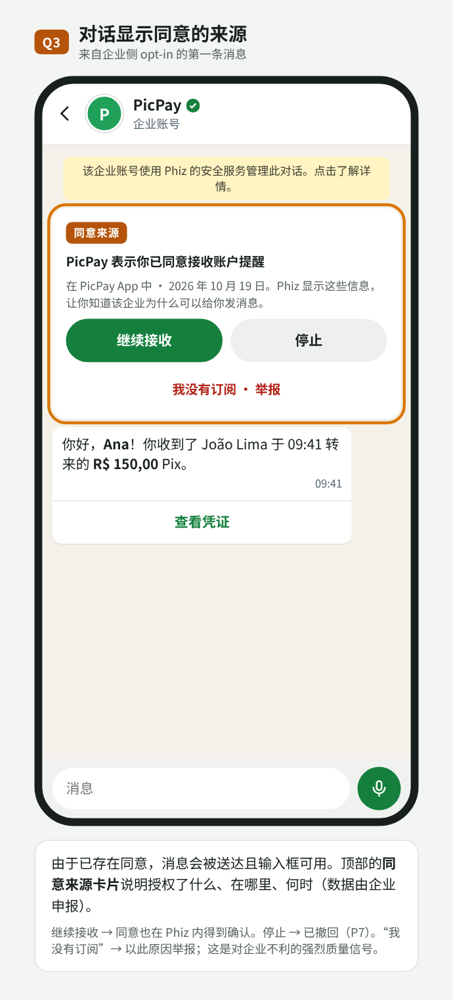</a><p class="cap"><b>Q03.</b> 同意来源卡片：继续接收、停止或举报</p></div>
<div class="shot"><a href="mocks/zh/phizchat/q04-consent-status.png" target="_blank" rel="noopener">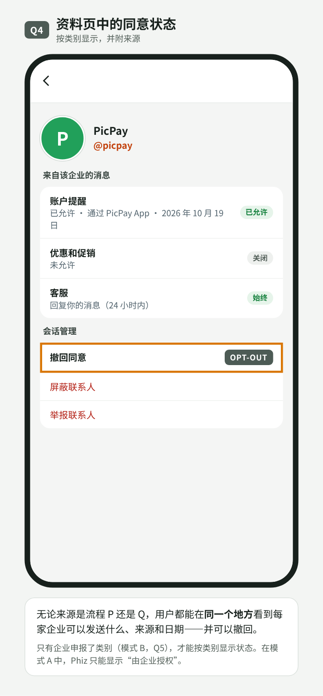</a><p class="cap"><b>Q04.</b> 按类别显示同意状态，含来源和日期</p></div>
</div>

<div class="shots">
<div class="shot"><a href="mocks/zh/phizchat/q05-consent-api.png" target="_blank" rel="noopener">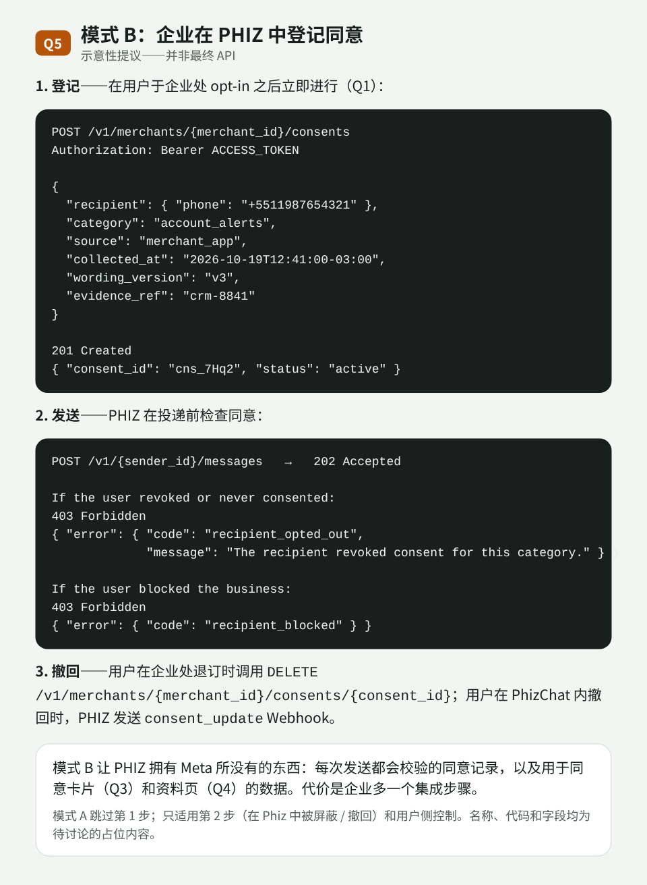</a><p class="cap"><b>Q05.</b> 模式 B：通过 API 登记同意及发送错误（示意性提议）</p></div>
</div>

### P 与 Q 对比

|  | P · 在 PhizChat 内 opt-in | Q · 在企业处 opt-in |
|---|---|---|
| 由谁收集 | PhizChat（接受） | 商户（App、网站、门店） |
| 证明保存在 | PhizChat | 商户 CRM（模式 A）· 同时在 PHIZ（模式 B） |
| 首次对话 | 接受之前锁定 | 以消息和同意来源打开 |
| 退订 | 两者相同：撤回、屏蔽、举报——由 PhizChat 执行 |  |

### 与用户的关系状态

**PHZ-BM-0001**（*Business Account Messaging*）文档为 Business Account 与用户之间的关系提出了明确的状态。它们与流程 P、Q 相对应，并决定可以发送什么：

| 状态 | 含义 | 服务 | 营销 |
|---|---|---|---|
| `NO_RELATION` | 只有手机号解析结果 | 仅限经批准的强场景（如验证码） | 否 |
| `USER_INITIATED` | 用户发起对话、扫码或打开企业入口 | 是 | 需单独同意 |
| `BUSINESS_RELATION` | 订单、客服、预约等类似关系（流程 Q） | 是 | 需单独同意 |
| `MARKETING_OPT_IN` | 用户明确授权营销（流程 P 或 Q） | 是 | 是 |
| `BLOCKED` / `UNSUBSCRIBED` | 用户屏蔽或退订，或平台抑制 | 按策略 | 否 |

状态绑定在 Business Account（`ba_id`）与用户 Open ID 这一对上。API 不对外暴露状态；发送只返回结果（受理，或带原因的错误）。

### 用户控制

| 操作 | 结果 |
|---|---|
| 静音 | 关闭通知，保留会话 |
| 屏蔽 | 拒收该 Business Account 的后续消息 |
| 退订营销 | 关闭营销消息，不影响必要的服务通知 |
| 举报 | 提交带证据的投诉 |
| 查看企业信息 | 展示已认证主体、客服和隐私政策 |

企业会话在视觉上必须与好友聊天区分开：显示认证名称、说明收到消息的原因，并便于屏蔽、举报和退订。

### 待决定事项

- **流程 Q 采用模式 A 还是 B**（见 Q1）：像 Meta 一样只有政策，还是在 PHIZ 中建立同意登记并在每次发送时校验。完整的同意来源卡片（Q3）和按类别显示的状态（Q4）依赖模式 B。
- **流程 Q 中接受之前是否投递：**本提议会投递第一条消息并显示同意来源卡片；另一种做法是像流程 P 一样，在接受之前锁定对话。
- **同意类别**（账户提醒、优惠、验证码）以及应用向用户展示什么。
- **技术命名**——`/v1/{sender_id}/consents`、`consent_update` Webhook 和错误码——均为待讨论的占位内容。

## 目标与非目标 {#goals}

#### 目标

- 凭证绑定开发者中心的**应用**，不再按频道签发。开放平台的 Merchant ID 同步生成 Developer ID；商户在其下为每个外部系统创建一个**应用**（例如 Blip 一个、Salesforce 一个），每个应用有自己的 `client_id`、密钥、范围和 **Business Account**。频道可作为可选发送方授权。
- 采用标准 OAuth 2.0（客户端凭证模式），兼容主流库和平台。
- 向**手机号或 Open ID** 发送消息，并通过**签名 Webhook** 接收回复和状态。
- 与 Meta Cloud API 结构兼容，现有集成只需少量改动即可迁移。
- 以 OpenAPI 3.1 格式（即 Swagger 标准）发布 API 规范。该文件描述全部路由、字段、响应和 Webhook，是 API 开发团队与集成方之间的约定。合作方可据此生成文档和代码，并在交付前进行测试。

#### 不在本 RFC 范围内

- 模板、营销活动和用户分群（Marketing API，后续阶段）。
- 按会话计费与结算。
- 群组、语音和视频通话。
- 官方 SDK（后续可基于 OpenAPI 生成）。

## 领域模型 {#model}

身份模型遵循 PHIZ 技术团队的建议。`merchant_id` **不**用于标识发送方：它是开放平台账号，同一开发者下可以有多个应用，每个应用下又可以有多个 Business Account。

| 身份 | 含义 | 出现位置 |
|---|---|---|
| **Merchant ID** | 商户在开放平台的账号，创建时同步生成 Developer ID。 | 开放平台 |
| **Developer ID** | 开发者身份及资源（应用、密钥、订阅）归属方。可以是商户本身，也可以是 Salesforce、BSP 等第三方。 | 开发者中心 |
| **App ID** | 应用：凭证（`client_id` 和密钥）、范围及隔离上下文。用户在每个应用下的 Open ID 不同。 | 令牌、`/v1/apps/{app_id}` |
| **BA ID** | Business Account：实际的发送方，也是用户看到并授权的对象。在应用下创建，且只属于该应用。加密与隔离以 BA 为单位。 | PhizChat 会话、Webhook 的 `entry[].id` |
| **sender\_id** | API 中使用的发送方外部引用，映射到 BA ID。频道（可选）时为频道 ID。 | `POST /v1/{sender_id}/messages` |
| **Open ID** | 用户在某个应用下的标识。手机号会换取 Open ID，BA 与用户的绑定基于 Open ID，而非手机号。 | `to` 配合 `to_type: open_id`；Webhook 中的 `from` |

```mermaid 每个应用有自己的 Business Account。用户授权的是 BA，并以该应用下的 Open ID 标识。频道仍是可选发送方。
flowchart LR
  M["Merchant ID<br/>开放平台"] -- "同步创建" --> D["Developer ID<br/>商户或第三方"]
  D --> A1["App ID · Blip<br/>client_id + 密钥"]
  D --> A2["App ID · Salesforce<br/>client_id + 密钥"]
  A1 --> B1["BA ID · 示例商店<br/>sender_id"]
  A2 --> B2["BA ID · 示例商店促销<br/>sender_id"]
  A1 -. "可选频道<br/>sender_id = 频道 ID" .-> C["频道 1231"]
  B1 --> U(("用户<br/>每个应用一个 Open ID"))
  B2 --> U
  C --> U
```

### 会话类型

PHIZ 产品与技术团队的定义：

- **公众号会话**：会话的总类别，不对外展示。
- **企业服务会话**：公众号会话的二级分类，同样不对外展示。
- **Business Account**：企业服务会话下的产品类型，**对外展示**，类似 WhatsApp 的企业标识展示，面向企业、政府和机构。

要拥有 Business Account，企业需先创建开放平台账号（Merchant ID），同步生成 Developer ID；在其下创建应用（App ID），再在应用下创建 Business Account（BA ID）。无论是 Salesforce、BSP 等第三方调用，还是用户授权接收 Business Account 消息，都基于 BA ID 进行。Business Account 是一种新的会话类型：产品和技术将重新打磨它及其他会话类型的定义，为后续扩展做准备（Q4）。

::: risk 与 PHZ-BM-0001 的差异
**PHZ-BM-0001** 提出了另一种层级：`Organization → Business Account → App → Credential`。其中 Business Account 位于应用**之上**，多个应用可以通过它发送（对用户可见的发送方仍是 BA），且 Business Account 是 **Channel 的子类型**（`Channel.subtype = BUSINESS_ACCOUNT`）。本 RFC 保留 v1.6 与 PHIZ 技术团队确定的模型：`Merchant ID → Developer ID → App ID → BA ID`，每个 BA 只属于一个应用，频道是独立的可选发送方。两份文档的对齐见 Q11 和 Q12。
:::

| 要点 | 本 RFC（v1.6） | PHZ-BM-0001 |
|---|---|---|
| 层级 | Merchant ID → Developer ID → App ID → BA ID | Organization → Business Account → App → Credential |
| 每个 BA 的应用数 | 一个（BA 属于应用） | 多个（应用代表 BA 发送） |
| BA 是什么 | 会话类型：公众号 › 企业服务 › Business Account | Channel 的产品子类型 |
| 频道 | 可选发送方，与 BA 分开 | BA 就是 Channel；仅凭频道 ID 不授予访问权限 |
| 会话 ID | 未定义 | 短期：`channel:<id>`，加 `conversation_kind=BUSINESS_1_TO_1`、`business_channel_id` 和 `recipient_user_id`；长期：服务端生成的不透明 ID |
| 用户 | 按应用的 Open ID | `recipient_user_id` |
| 审计 | 应用与 Business Account | 组织、应用和操作员作为独立主体 |

### 对 PhizChat App 的影响

**PHZ-BM-0001** 列出了 App（Flutter）为展示 Business Account 会话需要的改动，适用于两种层级：

| App 现状 | 需补充 |
|---|---|
| `ChannelInfo.type` | 为 Business Account 增加明确的子类型和兼容的枚举 |
| `ChannelInfo.companyAuth`（布尔值） | 认证状态、级别、有效期和原因 |
| `channel:<id>` 会话 | Business Account 会话元数据，并保护旧的解析逻辑 |
| `StrangerChatHelper` | 独立的企业策略，不与好友规则混用 |
| `MessageReceiver` / `MessageSender` | 包含用途、发送方身份和服务端决定的消息信封 |

### 端到端流程

面向技术团队：消息从企业到用户经过哪些环节，回复和状态又如何返回。

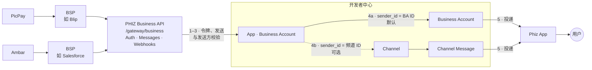

#### 返回：回复与状态

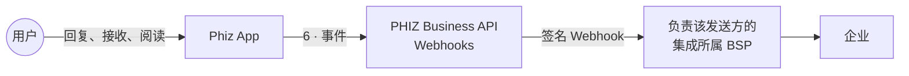

1. **集成。**企业（如 PicPay 或 Ambar）通过 BSP 提供客服。商户在开发者中心为该 BSP 创建 Business Messaging 应用，并提供 `client_id` 和密钥。
2. **令牌。**BSP 调用 `/oauth/token`。Auth 在开发者中心校验应用（密钥、范围和 Business Account），返回 1 小时有效的 JWT。
3. **发送。**BSP 调用 `POST /v1/{sender_id}/messages`。API 将手机号换取用户的 Open ID，校验令牌、范围、发送方、选择接收策略和 `Idempotency-Key`，返回 `202` 并将消息入队。如需发送媒体，BSP 先将文件上传到 `POST /v1/{sender_id}/media`，再在发送时使用返回的 `id` 或 PHIZ 链接。
4. **路由。**使用 Business Account 的 `sender_id` 时作为 Business Account 会话发送（默认）；使用频道 ID 时作为 Channel Message 发送（可选）。
5. **投递。**Phiz App 向用户展示消息，并通过上传时生成的链接从 PHIZ 存储下载媒体。
6. **返回。**用户回复和状态（`sent`、`delivered`、`read`、`failed`）生成事件，由 Webhooks 服务签名后投递给 Business Account 所属的应用。

| 组件 | 职责 | 状态 |
|---|---|---|
| BSP / 企业系统 | 调用 API，上传媒体，接收 Webhook。 | 外部 |
| PHIZ Business API · Auth | 签发和撤销 JWT；校验 `client_id` 和密钥。 | 新增 |
| PHIZ Business API · Messages | 校验并受理发送（`202`），处理幂等和限流，入队并按 `sender_id` 路由。 | 新增 |
| PHIZ Business API · Media | 接收上传，校验格式和大小，限时存储文件，并生成发送时使用的 `id` 和 PHIZ 链接。 | 新增 |
| PHIZ Business API · Webhooks | 消费 App 事件，签名后通过开发者中心的事件订阅投递，沿用其重试和记录。 | 新增 |
| Open Platform · Developer Center | 已有。存储组织、应用、密钥（哈希）、范围和事件订阅；Business API 新增各应用的 Business Account。 | 变更：凭证从频道迁移到 Developer ID 下的应用 |
| Business Account | 以企业身份对用户展示的企业服务会话；加密与隔离以 BA 为单位。 | 新增（见第 06 节、Q3） |
| Channel / Channel Message | 通过商户频道发送。 | 现有 |
| Phiz App | 展示消息，通过 PHIZ 链接下载媒体，产生送达、已读和回复事件。 | 变更 |

### 与 Meta Cloud API 的对应关系

| Meta（WhatsApp Cloud API） | PHIZ（本方案） |
|---|---|
| WhatsApp Business Account（WABA） | Developer ID · 应用（App ID） |
| 企业号码 · `phone_number_id` | Business Account · 映射到 BA ID 的 `sender_id`；也可选用频道（频道 ID） |
| Meta 应用 + System User 令牌 | 开发者应用 + OAuth 客户端凭证 |
| `wa_id` | `open_id`（按应用） |
| `POST /{phone-number-id}/messages` | `POST /v1/{sender_id}/messages` |
| `POST /{phone-number-id}/media` · 媒体可用 `id` 或第三方 `link` | `POST /v1/{sender_id}/media` · 媒体仅可用 `id` 或 PHIZ 链接；不接受第三方链接 |
| `object: whatsapp_business_account` | `object: phiz_business_account` |
| `X-Hub-Signature-256` | `X-Phiz-Signature-256` + `X-Phiz-Timestamp` |
| `hub.mode` / `hub.verify_token` / `hub.challenge` | 保持一致 |

## 设计原则 {#principles}

- **与 Cloud API 结构一致。**发送请求、响应和 Webhook 均沿用 Meta 的结构，只有在安全性（签名带时间戳、媒体只经由 PHIZ 存储）或清晰度（`to_type`）有明确收益时才有所不同。
- HTTP 状态码、统一的错误结构，所有错误响应都带 `trace_id`。
- 发送为异步处理，返回 `202 Accepted`，结果通过 Webhook 推送。
- **幂等。**`Idempotency-Key` 请求头可避免客户端重试导致重复消息。
- **最小授权。**每个集成都有范围和可用发送方列表。
- 版本号 `/v1`。兼容性变更（新增字段）按统一规范上线；不兼容变更需发布 `/v2`。
- **无需好友不等于匿名。**与非好友沟通不需要事先建立关系，但企业发送方始终可识别。
- **平台抑制优先。**屏蔽、退订和平台抑制优先于企业的任何权限。

## 鉴权 {#auth}

采用 OAuth 2.0 **客户端凭证模式**（RFC 6749 §4.4）。应用用 `client_id` 和 `client_secret` 换取 1 小时有效的访问令牌，并在每次调用时通过 `Authorization: Bearer` 传递。不提供刷新令牌：令牌过期后重新申请即可。

在开发者中心，应用、`appId` 和 `appSecret` 即本节的应用、`client_id` 和 `client_secret`，平台的 `CLIENT_CREDENTIALS` 授权类型就是这里描述的流程（见第 12 节）。

::: endpoints
- POST `/oauth/token` — 签发访问令牌
- POST `/oauth/revoke` — 撤销令牌（RFC 7009）
- GET `/v1/me` — 查看令牌对应的应用、Developer ID、范围和发送方
:::

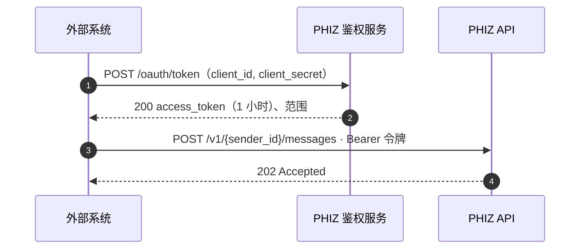

### 请求与响应

```bash
# Base URL of this API: current PHIZ gateway + /gateway/business prefix (illustrative host)
PHIZ_API_BASE="https://gateway.phiz.chat/gateway/business"

curl -X POST "$PHIZ_API_BASE/oauth/token" \
  -H "Content-Type: application/x-www-form-urlencoded" \
  -d grant_type=client_credentials \
  -d client_id=app_2Fk81PzQ \
  -d client_secret="$PHIZ_CLIENT_SECRET" \
  -d "scope=messages:send messages:read"
```

```json
{
  "access_token": "eyJhbGciOiJFUzI1NiIsImtpZCI6InBoei0yMDI2LTEwIn0…",
  "token_type": "Bearer",
  "expires_in": 3600,
  "scope": "messages:send messages:read",
  "developer_id": "dev_suPb10cTzMQ"
}
```

`/oauth/*` 接口使用 OAuth 标准错误格式（RFC 6749 §5.2），客户端库可直接识别：

```json
{
  "error": "invalid_client",
  "error_description": "Client authentication failed."
}
```

### 令牌格式

决定：令牌采用 ES256 签名的 JWT，公钥发布在 `/.well-known/jwks.json`。网关在本地校验令牌，无需每次调用都查询数据库。被撤销的令牌和已轮换的密钥会进入短期拒绝列表（直到令牌过期）。对集成方而言令牌是不透明的，以下内容仅供参考。

```json
{
  "iss": "https://gateway.phiz.chat/gateway/business",
  "sub": "app_2Fk81PzQ",
  "aud": "phiz-business-api",
  "did": "dev_suPb10cTzMQ",
  "scope": "messages:send messages:read",
  "snd": [
    "ba_7Kq2M9xTpL",
    "1231"
  ],
  "env": "live",
  "iat": 1760527800,
  "exp": 1760531400,
  "jti": "tok_01JA9VQ4N2"
}
```

### 范围（scope）

| 范围 | 允许的操作 |
|---|---|
| `messages:send` | 发送服务消息、上传和管理媒体、标记已读 |
| `messages:read` | 查询消息状态 |
| `webhooks:manage` | 配置、测试和重放本应用的 Webhook（第 2 阶段） |
| `account:read` | 读取应用、Business Account 和频道信息 |
| `templates:manage` | 预留给 Marketing API |
| `recipients:resolve` | 判断某手机号能否接收该 Business Account 的消息，不暴露注册情况（提议，Q18） |
| `messages:send_marketing` | 发送营销消息；单独审批（预留给 Marketing API） |

### 密钥与轮换

- 密钥带环境前缀（`phzsk_live_`、`phzsk_test_`），便于泄露扫描工具识别。
- 密钥**仅在创建或轮换时显示一次**，服务端只保存哈希（Argon2id）。
- 每个应用**最多可有两个有效密钥**。生成新密钥后，旧密钥在设定时间内仍然有效（默认 24 小时，可设 0 至 7 天），切换过程不中断。
- 页面显示每个密钥的最近使用时间，便于确认旧密钥已停用后再撤销。
- 按应用设置 IP 白名单以及 90 天轮换策略，二者开发者中心均已具备。

### 前提：认证

**PHZ-BM-0001** 指出，目前系统中没有账号认证对象：`companyAuth` 和 `memberAuth` 字段不足以授权 API。开发者中心已显示“已认证组织”，但下述模型仍需确认（Q13）。提议每个级别开放一组范围，并以公开矩阵发布：

| 级别 | 可申请 | 默认不授予 |
|---|---|---|
| `UNVERIFIED` | 无主动能力 | 解析、服务、营销 |
| `PERSON_VERIFIED` | 测试、读取和用户发起后的回复 | 批量触达和营销 |
| `INDIVIDUAL_BUSINESS_VERIFIED` | 受限的服务消息 | 营销和大范围解析 |
| `BUSINESS_VERIFIED` | 服务、模板和基于关系的解析 | 营销 |
| `BUSINESS_VERIFIED` + `MARKETING_APPROVED` | 营销，受同意、模板、退订和配额约束 | 无限或跨区域访问 |

认证是状态机而不是布尔值：`DRAFT → SUBMITTED → UNDER_REVIEW → VERIFIED`，含 `NEEDS_INFO` 和 `REJECTED`，之后可能 `LIMITED → SUSPENDED → DISABLED`。消息能力有独立状态：`NOT_ENABLED → SERVICE_ENABLED → MARKETING_REVIEW → MARKETING_ENABLED → PAUSED`。仅有认证不会开放营销。

### 现状与方案对比

| 方面 | 现状 | 方案 |
|---|---|---|
| 凭证归属 | 频道 | 开发者中心应用（Developer ID） |
| 授权流程 | `user_credentials`（自定义） | `client_credentials`（RFC 6749） |
| 额外必填字段 | `description` | 无 |
| 有效期 | 约 2 小时 + 约 90 天刷新令牌 | 1 小时，无刷新令牌 |
| 范围 | `channel` | 按能力划分 + 可用发送方 |
| 轮换 | 重置后立即失效 | 两个有效密钥，平滑过渡 |
| 错误 | HTTP 200 + 正文中的 `code` | 真实 HTTP 状态 + 统一错误结构 |

## 发送消息 {#messages}

::: endpoints
- POST `/v1/{sender_id}/messages` — 发送消息或标记已读
- POST `/v1/{sender_id}/media` — 上传媒体文件，返回 `id` 和 PHIZ 链接
- GET `/v1/media/{media_id}` — 媒体信息：链接、类型、大小和有效期
- DELETE `/v1/media/{media_id}` — 在到期前删除媒体
- GET `/v1/messages/{message_id}` — 最新已知状态（兜底）
- GET `/v1/apps/{app_id}/senders` — 应用的 Business Account 与频道
- POST `/v1/{sender_id}/recipients/resolve` — 判断手机号能否接收，不暴露注册情况（提议，Q18）
:::

### 发送方：Business Account 或频道

路径中的 `sender_id` 决定消息以谁的名义发出。它是发送方的外部引用，**不是** `merchant_id`：

- **Business Account（默认）。**使用 Business Account 的 `sender_id`（映射到 BA ID），例如 `ba_7Kq2M9xTpL`。消息出现在以企业身份对用户展示的 **Business Account** 会话中，无需频道。每个 Business Account 只属于一个应用，由该应用通过它收发消息。
- **频道（可选）。**使用频道 ID，例如 `1231`。适合按品牌或部门划分频道的商户。消息出现在该频道的 **Channel Service** 会话中，与 Channel Bot 使用的会话相同。

两者在 API 中的用法完全相同：字段、响应和 Webhook 一致。Webhook 中的 `metadata.sender_type` 标明使用的是哪一种，`metadata.conversation_type` 标明会话类型（`business_account` 或 `channel_service`）。

### 接收方：手机号或 Open ID

Business Account 始终向用户在该应用下的 **Open ID** 发送。所有 PHIZ 用户都有有效且已验证的手机号，因此集成方可以传入手机号，由 PHIZ 完成换取。`to` 字段填写接收方，`to_type` 指明其类型：

- `phone`（默认）：E.164 格式手机号，例如 `+5511987654321`，包括境外号码。PHIZ 在发送前将号码换取为用户的 Open ID。
- `open_id`：用户在本应用下的 Open ID，例如 `oid_Qm7f2K9xT4Lw`。Webhook 中携带的就是这个标识，回复时可直接使用。

Business Account 与用户的绑定基于 Open ID，而不是手机号：用户换号后，会话仍对应同一个 Open ID。Open ID 在每个应用下不同，不能用于跨应用关联用户。

如果手机号没有对应的 PHIZ 账号，或用户屏蔽了该发送方，API 仍返回 `202`，Webhook 会推送 `failed` 和错误码 `2104`。这样可以防止通过 API 探测哪些号码注册了 PHIZ。

### 示例：向手机号发送文本

```bash
# sender_id = BA ID: message from the Business Account (default), no channel needed
curl -X POST "$PHIZ_API_BASE/v1/ba_7Kq2M9xTpL/messages" \
  -H "Authorization: Bearer $PHIZ_TOKEN" \
  -H "Content-Type: application/json" \
  -H "Idempotency-Key: pedido-48213-envio" \
  -d '{
    "messaging_product": "phiz",
    "to": "+5511987654321",
    "to_type": "phone",
    "type": "text",
    "text": { "body": "Olá, Maria! Seu pedido #48213 foi enviado." },
    "biz_opaque_callback_data": "pedido=48213"
  }'
```

```json
{
  "messaging_product": "phiz",
  "contacts": [
    {
      "input": "+5511987654321",
      "open_id": null
    }
  ],
  "messages": [
    {
      "id": "pmid.01JA9VZ6T8R3",
      "message_status": "accepted"
    }
  ]
}
```

只有当用户已与该 Business Account 建立绑定关系时，`contacts[].open_id` 才会有值。`messages[].id` 用于关联状态 Webhook。

### 更多示例

#### 同样的消息，通过频道发送

```bash
# sender_id = 1231: same request, sent through the merchant's channel
curl -X POST "$PHIZ_API_BASE/v1/1231/messages" \
  -H "Authorization: Bearer $PHIZ_TOKEN" \
  -H "Content-Type: application/json" \
  -d '{ "to": "+5511987654321", "type": "text", "text": { "body": "Novidades da semana na Loja Exemplo - Ofertas" } }'
```

#### 向 Open ID 发送文本

```json
{
  "to": "oid_Qm7f2K9xT4Lw",
  "to_type": "open_id",
  "type": "text",
  "text": {
    "body": "Seu cupom chegou: PHIZ10"
  }
}
```

#### 上传媒体

```bash
# 1. Upload the file to PHIZ (multipart/form-data). Third-party URLs are not accepted when sending.
curl -X POST "$PHIZ_API_BASE/v1/ba_7Kq2M9xTpL/media" \
  -H "Authorization: Bearer $PHIZ_TOKEN" \
  -F messaging_product=phiz \
  -F type=application/pdf \
  -F file=@nota-fiscal-48213.pdf
```

```json
{
  "id": "pmed.01JB2K7Q9X",
  "link": "https://media.phiz.chat/biz/pmed.01JB2K7Q9X",
  "mime_type": "application/pdf",
  "file_size": 184320,
  "sha256": "9b1f…",
  "expires_at": "2026-11-19T14:00:00Z"
}
```

#### 通过媒体 `id` 发送音频

```json
{
  "to": "+5511987654321",
  "type": "audio",
  "audio": {
    "id": "pmed.01JB2K4M7A"
  }
}
```

#### 通过 PHIZ 链接向 Open ID 发送视频

```json
{
  "to": "oid_Qm7f2K9xT4Lw",
  "to_type": "open_id",
  "type": "video",
  "video": {
    "link": "https://media.phiz.chat/biz/pmed.01JB2K5V1C",
    "caption": "Como montar seu produto"
  }
}
```

#### 带文件名的文档

```json
{
  "to": "+5511987654321",
  "type": "document",
  "document": {
    "id": "pmed.01JB2K7Q9X",
    "filename": "nota-fiscal-48213.pdf",
    "caption": "Nota fiscal do pedido #48213"
  }
}
```

#### 快捷回复按钮

```json
{
  "to": "+5511987654321",
  "type": "interactive",
  "interactive": {
    "type": "button",
    "body": {
      "text": "Confirma a entrega amanhã entre 9h e 12h?"
    },
    "action": {
      "buttons": [
        {
          "type": "reply",
          "reply": {
            "id": "confirmar",
            "title": "Confirmar"
          }
        },
        {
          "type": "reply",
          "reply": {
            "id": "reagendar",
            "title": "Reagendar"
          }
        }
      ]
    }
  }
}
```

#### 将收到的消息标记为已读

```json
{
  "messaging_product": "phiz",
  "status": "read",
  "message_id": "pmid.IN_01JA9W2C"
}
```

### 支持的消息类型

| type | 内容 | 阶段 |
|---|---|---|
| `text` | 最多 4,096 个字符；可选 `preview_url` | MVP |
| `image` | 通过 `id` 或 PHIZ 链接（需先上传）；可选说明文字 | MVP |
| `audio` | 通过 `id` 或 PHIZ 链接（需先上传）；不支持说明文字 | MVP |
| `video` | 通过 `id` 或 PHIZ 链接（需先上传）；可选说明文字 | MVP |
| `document` | 通过 `id` 或 PHIZ 链接（需先上传）；可选说明文字和文件名 | MVP |

### 媒体：上传至 PHIZ 并临时存储

所有媒体都经由 PHIZ 存储，发送分两步：

1. **上传。**BSP 将文件发送到 `POST /v1/{sender_id}/media`（`multipart/form-data`）。PHIZ 校验格式和大小，存储文件，返回 `id` 和 PHIZ `link`，有效期见 `expires_at`。
2. **发送。**消息中的媒体对象携带 `id`（推荐）或该 `link`，用户 App 从 PHIZ 存储下载文件。

- **只接受 PHIZ 生成的链接。**第 1 阶段 API 拒绝第三方 URL（商户或合作方的 CDN），返回错误 `2302`。这样 PHIZ 能保证链接安全、文件在投递前持续可读取，App 也不会向外部服务器暴露用户 IP。
- **临时存储。**文件只保存到完成发送和投递所需的时间：建议自上传起 30 天，与 Cloud API 的媒体 `id` 相同（见 Q8）。有效期内同一个 `id` 可用于多次发送，例如将同一份 PDF 发给多位客户。到期后 `id` 和链接失效，新的发送会返回 `2303`。商户也可通过 `DELETE /v1/media/{media_id}` 提前删除。
- **上传时校验。**格式和大小在上传时校验，而不是在投递时：不符合下表的文件会被立即拒绝（`2304` 和 `2305`）。
- **权限范围。**上传、查询和删除使用 `messages:send` 范围，媒体只能由同一应用下的发送方使用。

::: decision 决定（v1.3）
第 1 阶段媒体只能上传至 PHIZ 并临时存储，不接受第三方链接。为特定客户开放第三方 URL（例如通过域名白名单）留待后续阶段。已与 Henry Wu 在本节评论中达成一致。
:::

::: decision 决定（v1.6）
技术团队已确认：媒体格式和大小可由本 RFC 定义（见下表）；第一阶段文件通过 Business API 提交并存储，之后再按客户逐步开放第三方 URL。其他规则以技术定义为准。
:::

| 类型 | 支持格式 | 大小上限 |
|---|---|---|
| `image` | JPEG、PNG、WebP | 5 MB |
| `audio` | AAC、MP3、M4A、OGG（Opus）、AMR | 16 MB |
| `video` | MP4（H.264 + AAC）、3GP | 16 MB |
| `document` | PDF、DOC/DOCX、XLS/XLSX、PPT/PPTX、TXT、CSV | 100 MB |

<p class="cap">PHIZ App 应支持的格式和大小，参考 Cloud API 的限制，由本 RFC 定义。格式转换和压缩由文件发送方负责；上传时会拒绝不符合下表的文件。v1.6 中技术团队已确认格式和大小可由本 RFC 定义（见 Q8）。</p>

### 发送策略（同意）

参考 WhatsApp 的提议（见第 03 节），opt-in 流程详见第 04 节：

- **主动发起会话需要 opt-in**：用户需针对该 Business Account（`ba_id`）和类别（账户提醒、优惠或验证码）授权。用户发消息后 24 小时内回复，无需事先 opt-in。
- opt-in 可以在 PHIZ 之外收集（商户的 App、网站或门店），也可以在 PHIZ App 内收集。
- **opt-out 由平台执行**：用户屏蔽 Business Account 或停止优惠后，该类别的发送直接报错失败，不依赖商户处理。
- **必须保存记录**：商户为每次同意保存证明（用户 Open ID、`ba_id`、类别、来源、时间、展示的文案及撤回）。根据 LGPD，数据处理方须证明已获得同意并尊重撤回。

::: risk 待产品决定
Meta 有 opt-in 政策但不做验证：它信任商户，事后通过举报和质量评级作出反应。我们需要在 **A**（相同模式：政策 + 商户自行记录）和 **B**（在 PHIZ 中建立同意登记，并在每次发送前校验）之间做出选择。见 Q1。
:::

### 消息类别、服务窗口与模板

参考 **PHZ-BM-0001**，每条消息都有方向和类别；服务与营销的权限、同意、限额和审核相互独立：

| 类别 | 用途 | 企业主动发起时 |
|---|---|---|
| `AUTHENTICATION` | 验证码与安全通知 | 需已批准模板 |
| `UTILITY` | 订单、支付、配送、退款、预约、客服；须关联源事件 | 需已批准模板 |
| `MARKETING` | 优惠与活动 | 需已批准模板、明确 opt-in、当地时间和频次限制（Marketing API） |
| `USER_REPLY` | 用户开启窗口内的回复 | 不适用：仅限窗口内 |

- **服务窗口。**用户发消息后开启窗口，企业可在窗口内用自由文本和媒体回复。窗口时长由策略配置（初始参考值 24 小时）。窗口外企业只能用已批准模板发起会话（错误码 `2203`）。
- **模板。**生命周期 `DRAFT → SUBMITTED → PENDING_REVIEW → APPROVED / REJECTED`，支持 `PAUSED`、`DISABLED` 和版本快照。因质量暂停时返回明确结果（错误码 `2204` 和 `template_status` 事件）。
- **不得夹带推广。**服务内容必须与源事件直接相关；在服务类别中夹带营销会被拒绝，并计入质量。
- **第 1 阶段。****PHZ-BM-0001** 将第一阶段限定为已认证企业和已批准的服务消息。本 RFC 原计划第 1 阶段支持自由文本；对齐见 Q14。

### 发送前校验

是否受理一条消息，综合考虑组织权限、范围、认证、环境、资格、抑制、用途、模板、配额和幂等：

- Business Account 状态及该类别的资格。
- 与用户的关系或有效的营销同意（状态见第 04 节）。
- 需要时，模板已批准、在有效期内且结构正确。
- 接收方未屏蔽、未退订、未被抑制且未超配额。
- 地区、静默时段、区域和高风险行业规则（错误码 `2205`）。
- 按组织、Business Account、应用、模板、用户和 IP 的限额（错误码 `2502`）。

### 接收方解析（提议）

**PHZ-BM-0001** 提议设置独立于发送的解析接口。本 RFC 中为 `POST /v1/{sender_id}/recipients/resolve`，使用 `recipients:resolve` 范围。响应只包含 `addressable`、`eligible` 和稳定的原因码；绝不返回姓名、头像、好友关系或号码是否注册。仅适用于与该 Business Account 有关系的接收方，见 Q18。

### 幂等

每次发送都应携带 `Idempotency-Key`。24 小时内使用相同的键会直接返回原始响应，不会重复发送；相同的键配不同的请求体则返回 `409`。因此在超时或 `5xx` 后重试是安全的。

## Webhook {#webhooks}

每个应用有一个 Webhook 订阅，包含 URL、`verify_token` 和事件列表。在开发者中心，它登记在*事件订阅*中：一条订阅把应用的某个事件与一个回调 URL 关联起来。

::: decision 决定（v1.5，待确认）
**第 1 阶段：**合作方在开发者中心的**事件订阅**中自行登记 URL。这取代了 v1.4 提出的由 PHIZ 手工登记。由于平台已提供重试、死信和重放，这些保障改为**沿用**，不再是第 2 阶段的工作。第 2 阶段保留的是通过 API 配置。需与 Henry Wu 和开发者中心团队确认（Q9）。
:::

### 第 1 阶段：在开发者中心配置

- 开发者中心的事件目录新增 `messages` 和 `message_status`，应用在*事件订阅 › 新建订阅*中选择，并填写回调 URL。
- 订阅可在同一页面启用、停用和编辑，修改会产生审计记录和通知。
- 下文的事件格式、签名和握手适用于两种配置方式。平台目前已具备哪些能力仍需确认（Q9）。

### 通过 API 配置（第 2 阶段）

以下接口为可选项，留待第 2 阶段。第 1 阶段合作方使用*事件订阅*页面。

::: endpoints
- PUT `/v1/apps/{app_id}/webhook` — 设置 URL、verify\_token 和事件（第 2 阶段）
- GET `/v1/apps/{app_id}/webhook` — 配置与健康状态（第 2 阶段）
- POST `/v1/apps/{app_id}/webhook/test` — 推送带签名的测试事件（第 2 阶段）
- GET `/v1/apps/{app_id}/webhook/deliveries` — 投递记录，72 小时（第 2 阶段）
- POST `/v1/apps/{app_id}/webhook/deliveries/{id}/replay` — 重放某次投递（第 2 阶段）
:::

```bash
curl -X PUT "$PHIZ_API_BASE/v1/apps/app_2Fk81PzQ/webhook" \
  -H "Authorization: Bearer $PHIZ_TOKEN" \
  -H "Content-Type: application/json" \
  -d '{
    "url": "https://integracao.lojaexemplo.com.br/phiz/webhook",
    "verify_token": "um-texto-que-so-voce-conhece",
    "fields": ["messages", "message_status"]
  }'
```

<p class="cap">第 2 阶段的配置调用示例。</p>

### 事件

| field | 触发时机 |
|---|---|
| `messages` | 用户发送消息、点击按钮或回应表情 |
| `message_status` | 已发送消息变为 `sent`、`delivered`、`read` 或 `failed` |
| `sender_update` | 发送方（商户或频道）的状态、质量或额度发生变化 |
| `account_update` | 商户账号发生变化（认证、限制） |

### URL 验证

启用前，PHIZ 会向 URL 发起 `GET` 请求，携带 `hub.mode=subscribe`、`hub.verify_token` 和 `hub.challenge`。服务器校验令牌后返回 200，正文为 `hub.challenge` 的值。与 Meta 的握手方式相同。

### 签名

每个 `POST` 都带有以下请求头。签名是使用应用 **webhook secret**（独立于 client secret）对 `{X-Phiz-Timestamp}.{原始请求体}` 计算的 HMAC-SHA256。时间戳偏差超过 5 分钟的事件应拒绝。轮换 webhook secret 期间，请求头会包含以逗号分隔的两个签名。

```http
POST /phiz/webhook HTTP/1.1
Host: integracao.lojaexemplo.com.br
Content-Type: application/json
User-Agent: PHIZ-Webhooks/1.0
X-Phiz-Delivery-Id: dlv_01JA9W2D7K
X-Phiz-Timestamp: 1760528527
X-Phiz-Signature-256: sha256=6f1c0e…
```

```javascript
// Express: verification handshake + signed events
import express from "express";
import crypto from "node:crypto";

const app = express();
app.use(express.raw({ type: "application/json" })); // keep the raw body for the HMAC

app.get("/phiz/webhook", (req, res) => {
  const ok = req.query["hub.mode"] === "subscribe" &&
             req.query["hub.verify_token"] === process.env.PHIZ_VERIFY_TOKEN;
  return ok ? res.status(200).send(req.query["hub.challenge"]) : res.sendStatus(403);
});

app.post("/phiz/webhook", (req, res) => {
  const ts = Number(req.get("X-Phiz-Timestamp"));
  if (Math.abs(Date.now() / 1000 - ts) > 300) return res.sendStatus(400);

  const expected = "sha256=" + crypto
    .createHmac("sha256", process.env.PHIZ_WEBHOOK_SECRET)
    .update(`${ts}.${req.body}`)
    .digest("hex");
  const received = (req.get("X-Phiz-Signature-256") || "").split(",");
  const valid = received.some(sig => sig.length === expected.length &&
    crypto.timingSafeEqual(Buffer.from(sig), Buffer.from(expected)));
  if (!valid) return res.sendStatus(401);

  queue.push({ deliveryId: req.get("X-Phiz-Delivery-Id"), event: JSON.parse(req.body) });
  res.sendStatus(200); // answer fast, process asynchronously
});
```

```python
# Flask: signature check
import hmac, hashlib, time, os
from flask import request, abort

def verify_phiz_signature() -> None:
    ts = int(request.headers["X-Phiz-Timestamp"])
    if abs(time.time() - ts) > 300:
        abort(400)
    msg = f"{ts}.".encode() + request.get_data()  # raw bytes, before JSON parsing
    expected = "sha256=" + hmac.new(os.environ["PHIZ_WEBHOOK_SECRET"].encode(), msg, hashlib.sha256).hexdigest()
    received = request.headers.get("X-Phiz-Signature-256", "").split(",")
    if not any(hmac.compare_digest(sig, expected) for sig in received):
        abort(401)
```

### 收到的消息

```json
{
  "object": "phiz_business_account",
  "entry": [
    {
      "id": "ba_7Kq2M9xTpL",
      "changes": [
        {
          "field": "messages",
          "value": {
            "messaging_product": "phiz",
            "metadata": {
              "sender_id": "ba_7Kq2M9xTpL",
              "sender_type": "business_account",
              "conversation_type": "business_account",
              "display_name": "Loja Exemplo"
            },
            "contacts": [
              {
                "profile": {
                  "name": "Maria Souza"
                },
                "open_id": "oid_Qm7f2K9xT4Lw",
                "phone": "+5511987654321"
              }
            ],
            "messages": [
              {
                "from": "oid_Qm7f2K9xT4Lw",
                "id": "pmid.IN_01JA9W2C",
                "timestamp": "1760528527",
                "type": "text",
                "text": {
                  "body": "Quero reagendar a entrega"
                },
                "context": {
                  "id": "pmid.01JA9VZ6T8R3"
                }
              }
            ]
          }
        }
      ]
    }
  ]
}
```

### 收到的媒体消息

用户发送图片、音频、视频或文档时，事件中包含一个指向现有聊天存储中该文件的临时 `url`。消息 API 不复制也不保存媒体，请在链接有效期内下载。下面是一条语音消息的 `messages[]` 条目：

```json
{
  "from": "oid_Qm7f2K9xT4Lw",
  "id": "pmid.IN_01JA9W7R",
  "timestamp": "1760528731",
  "type": "audio",
  "audio": {
    "url": "https://media.phiz.chat/in/9xT2…?expires=1760615131&sig=…",
    "mime_type": "audio/ogg; codecs=opus",
    "sha256": "3f9a…",
    "voice": true
  }
}
```

### 已发送消息的状态

```json
{
  "object": "phiz_business_account",
  "entry": [
    {
      "id": "ba_7Kq2M9xTpL",
      "changes": [
        {
          "field": "message_status",
          "value": {
            "messaging_product": "phiz",
            "metadata": {
              "sender_id": "ba_7Kq2M9xTpL",
              "sender_type": "business_account",
              "conversation_type": "business_account",
              "display_name": "Loja Exemplo"
            },
            "statuses": [
              {
                "id": "pmid.01JA9VZ6T8R3",
                "status": "delivered",
                "timestamp": "1760528410",
                "recipient_id": "oid_Qm7f2K9xT4Lw",
                "biz_opaque_callback_data": "pedido=48213",
                "conversation": {
                  "id": "conv_01JA9W",
                  "origin": {
                    "type": "service"
                  },
                  "expires_at": "1760614810"
                }
              }
            ]
          }
        }
      ]
    }
  ]
}
```

```json
{
  "object": "phiz_business_account",
  "entry": [
    {
      "id": "ba_7Kq2M9xTpL",
      "changes": [
        {
          "field": "message_status",
          "value": {
            "messaging_product": "phiz",
            "metadata": {
              "sender_id": "ba_7Kq2M9xTpL",
              "sender_type": "business_account",
              "conversation_type": "business_account",
              "display_name": "Loja Exemplo"
            },
            "statuses": [
              {
                "id": "pmid.01JA9X0QW1",
                "status": "failed",
                "timestamp": "1760528600",
                "recipient_id": "+5511900000000",
                "errors": [
                  {
                    "code": 2104,
                    "title": "recipient_not_reachable",
                    "message": "The phone number is not linked to a PHIZ account or blocked this sender.",
                    "href": "https://developers.phiz.chat/docs/errors#2104"
                  }
                ]
              }
            ]
          }
        }
      ]
    }
  ]
}
```

~~~mermaid 状态生命周期。`accepted` 只出现在 API 响应和 `GET /v1/messages/{id}` 中，其余状态通过 Webhook 推送。
stateDiagram-v2
  direction LR
  [*] --> accepted: API 返回 202
  accepted --> sent: 已到达 PHIZ 服务器
  sent --> delivered: 已到达设备
  delivered --> read: 用户已打开
  accepted --> failed
  sent --> failed
  read --> [*]
  failed --> [*]
~~~

### 投递保证

**第 1 阶段。**目标是让关键节点上线并可用；下列保障机制在后续阶段实现。

- **可能重复。**同一事件可能多次到达，请用 `X-Phiz-Delivery-Id` 去重。
- **不保证顺序。**`read` 可能早于 `delivered` 到达；请按 `timestamp` 排序，状态不可回退。
- **10 秒内返回** 2xx，再异步处理。其他响应或超时均视为失败。
- 已发送消息的状态，如果 Webhook 丢失，可用 `GET /v1/messages/{message_id}` 兜底查询。

::: risk 第 1 阶段风险
带重试、死信和重放的投递来自开发者中心的事件订阅，其策略（退避、窗口、保留期）是否满足下文提议仍需确认。收到的消息仍没有兜底查询（见 Q9）。
:::

**目标策略。**开发者中心已具备重试、死信和重放。下列策略是 Business API 的目标：平台已满足的部分直接沿用，其余放入第 2 阶段。

- **至少一次。**带**重试**的投递，采用指数退避（10 秒、30 秒、1 分钟、5 分钟、15 分钟、1 小时，之后每小时一次），最长 24 小时。
- **手动重放。**24 小时之后，事件在 72 小时内可手动重放，并提供投递记录（`/webhook/deliveries`）。
- **`failing` 状态。**若 URL 连续 24 小时失败，Webhook 状态变为 `failing`，并通知商户管理员。

### 明确的结果

模板暂停、Business Account 降级、退订、质量风险和窗口过期，都会产生明确的结果：调用返回错误，或推送 Webhook 事件（带错误的 `message_status`、`sender_update`、`template_status` 以及提议中的 `consent_update`）。绝不会静默重试或自动更换类别。

## 错误、限额与版本 {#errors}

除 `/oauth/*` 外，所有错误使用统一结构：

```json
{
  "error": {
    "code": 1003,
    "type": "invalid_parameter",
    "message": "Field 'to' must be E.164 when to_type is 'phone'.",
    "details": [
      {
        "field": "to",
        "issue": "format"
      }
    ],
    "trace_id": "trc_9f2c41ab"
  }
}
```

::: table num
| code | HTTP | type | 含义 |
|---|---|---|---|
| 1001 | 400 | invalid\_request | JSON 格式错误或缺少必填字段 |
| 1003 | 400 | invalid\_parameter | 参数值无效（见 `details`） |
| 1101 | 401 | token\_expired | 令牌已过期，请重新申请 |
| 1102 | 401 | invalid\_token | 令牌无效或已撤销 |
| 1201 | 403 | insufficient\_scope | 令牌缺少所需范围 |
| 1202 | 403 | sender\_not\_allowed | 集成无权使用该发送方 |
| 1301 | 404 | not\_found | 资源不存在或属于其他商户 |
| 1401 | 409 | idempotency\_conflict | 相同 Idempotency-Key 但请求体不同 |
| 1501 | 429 | rate\_limited | 超出速率限制，请遵循 `Retry-After` |
| 2104 | webhook | recipient\_not\_reachable | 号码无 PHIZ 账号，或用户屏蔽了发送方 |
| 2201 | 422 | policy\_violation | 选择接收（opt-in）策略不允许此次发送 |
| 2202 | 422 | unsupported\_type | 该发送方未开通此消息类型 |
| 2203 | 422 | service\_window\_closed | 不在服务窗口内；请使用已批准模板 |
| 2204 | 422 | template\_not\_approved | 模板不存在、未批准、已暂停或已停用 |
| 2205 | 422 | send\_window\_restricted | 静默时段、区域或行业规则导致当前不能发送 |
| 2301 | webhook | media\_unavailable | App 无法从 PHIZ 存储下载媒体（媒体在投递前已过期或被删除） |
| 2302 | 400 | media\_link\_not\_allowed | `link` 不是由 PHIZ 生成的；请先上传，再使用返回的 `id` 或链接 |
| 2303 | 422 | media\_expired | 媒体 `id` 或链接已过期、已删除或属于其他商户 |
| 2304 | 415 | unsupported\_media\_type | 上传的文件格式不受支持 |
| 2305 | 413 | media\_too\_large | 文件超过该类型的大小上限 |
| 2401 | 403 | sender\_disabled | 发送方已停用或受限 |
| 2402 | 403 | verification\_required | 认证级别不足以使用该范围或类别 |
| 2501 | 429 | messaging\_limit\_reached | 发送方当日接收方额度已用完 |
| 2502 | 429 | frequency\_capped | 已达到按用户、模板或应用的频次上限 |
| 5000 | 500 | internal\_error | 内部错误，请使用相同 Idempotency-Key 重试 |
:::

### 限额（初步建议）

| 资源 | 限额 |
|---|---|
| `/oauth/token` | 每个应用 60 次/分钟 |
| 发送消息 | 每个发送方 80 条/秒（可按合同调整） |
| 其他接口 | 每个应用 600 次/分钟 |
| 企业主动消息的唯一接收方 | 按发送方分级：24 小时内 1 千 → 1 万 → 10 万 → 不限，依质量评级调整（第 2 阶段） |

```http
HTTP/1.1 429 Too Many Requests
Retry-After: 2
X-RateLimit-Limit: 80
X-RateLimit-Remaining: 0
X-RateLimit-Reset: 1760528529
```

### 环境

- **生产环境：**`https://{gateway}/gateway/business`
- **沙箱环境：**`https://{测试网关}/gateway/business`，即目前使用的测试环境（Openapi-test），每个商户一个测试发送方，最多登记 5 个测试接收方（类似 Meta 的测试号码）。`phzsk_test_` 密钥仅在此可用。

### 路由前缀

新 API 与现有 API 部署在同一网关上，通过前缀区分：

- `/gateway/openapi/…`：现有 API，迁移期间保留。
- `/gateway/business/…`：本 API（鉴权、消息和 Webhook）。

前缀分开后，两个上下文各自拥有独立的路由、鉴权、限额和日志，旧接口下线也不会影响新 API。本文中的所有路径（如 `/oauth/token` 和 `/v1/{sender_id}/messages`）均相对于 `https://{gateway}/gateway/business`。示例中该地址写作 `$PHIZ_API_BASE`。

### 审计与数据

每次授权和拒绝都要关联企业、Business Account、应用、操作员、模板、发送时使用的策略快照、`trace_id` 和最终状态。手机号在日志和指标中只以不可逆令牌出现。事件可能重复或乱序，但每条消息的最终状态只会单调前进。法务评审需按司法辖区明确同意、保留、删除、跨境传输和服务例外（Q19）。

## PHIZ开发者中心 {#devarea}

Business API 的开发者配置**不会成为商户菜单中的新区域**，而是建在已有的 **PHIZ开发者中心**内（测试环境：`developer-uat.phiz.chat`）：沿用相同的菜单，以及应用、密钥、审计、事件订阅和 Webhook 页面，并新增 *Business Accounts* 页面。

::: decision 决定（v1.5）
v1.4 为开放平台设计的体验（概览、集成、密钥、Webhook 和发送方）迁移至开发者中心。集成改为 **Business Messaging 类型的应用**，权限改为组织角色，Webhook 使用*事件订阅*。“频道 › 开发配置”改为指向开发者中心。
:::

采用开发者中心视觉风格的原型，数据为示例。点击图片可查看原图。

<div class="shots">
<div class="shot"><a href="mocks/zh/dc16/01-painel.png" target="_blank" rel="noopener">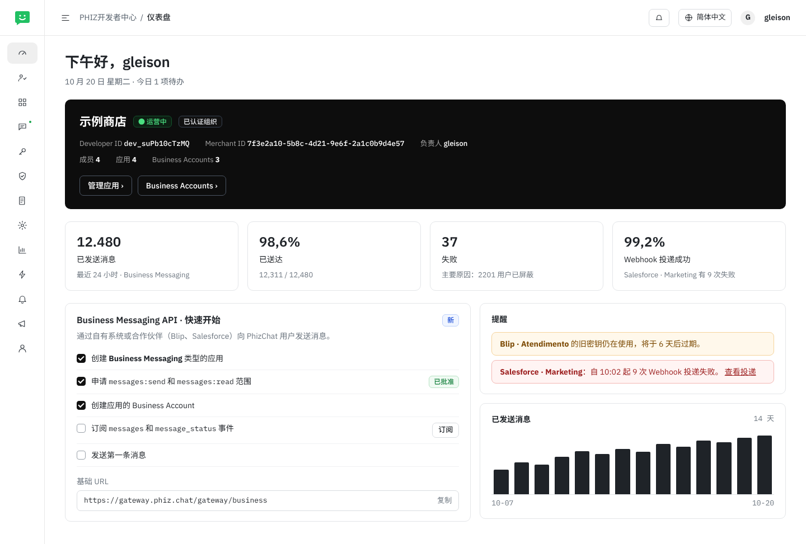</a><p class="cap"><b>页面 1.</b> 仪表盘：Developer ID、Merchant ID、消息指标、Business Messaging API 快速开始和提醒</p></div>
<div class="shot"><a href="mocks/zh/dc16/02-nova-aplicacao.png" target="_blank" rel="noopener">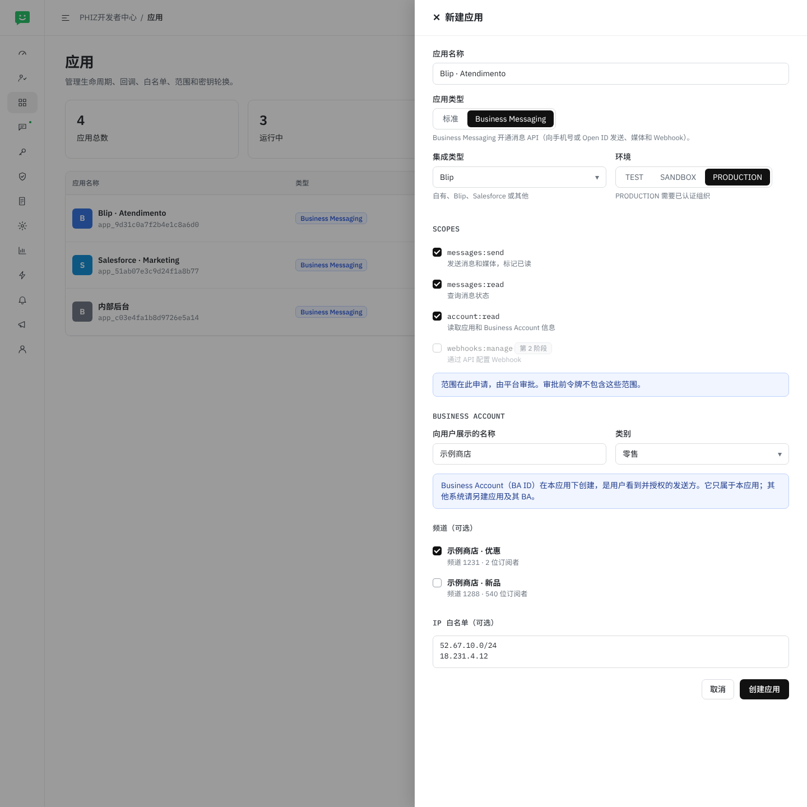</a><p class="cap"><b>页面 2.</b> 新建应用：Business Messaging 类型、集成类型、环境、需审批的范围、应用的 Business Account、可选频道和 IP 白名单</p></div>
<div class="shot"><a href="mocks/zh/dc16/03-detalhe-aplicacao.png" target="_blank" rel="noopener">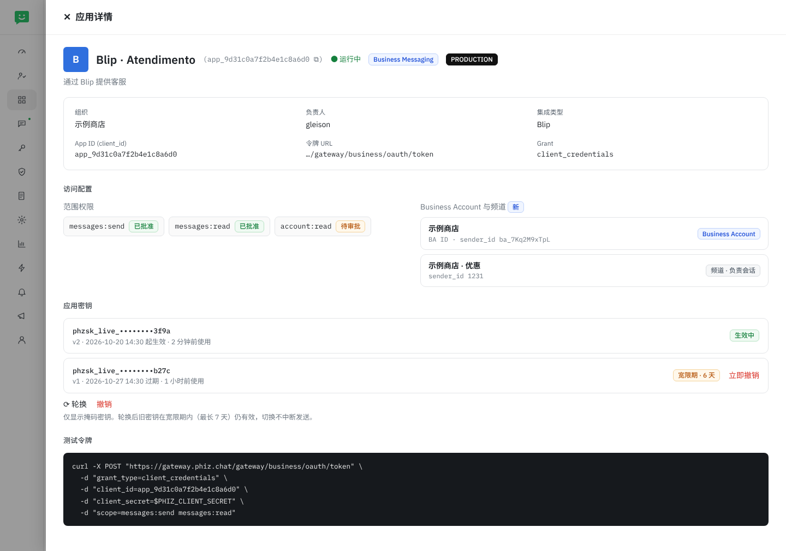</a><p class="cap"><b>页面 3.</b> 应用详情：OAuth 凭证、已批准或待审批的范围、Business Account 与频道，以及可轮换的密钥</p></div>
<div class="shot"><a href="mocks/zh/dc16/04-segredo-gerado.png" target="_blank" rel="noopener">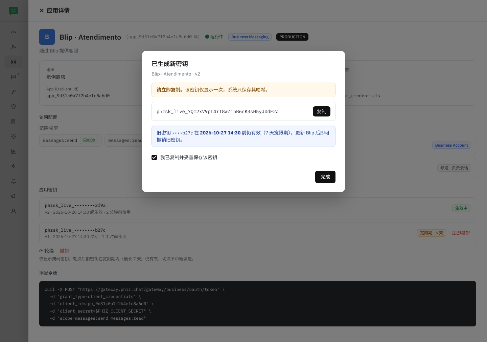</a><p class="cap"><b>页面 4.</b> 新密钥仅显示一次；旧密钥在宽限期内仍有效</p></div>
<div class="shot"><a href="mocks/zh/dc16/05-assinaturas-eventos.png" target="_blank" rel="noopener">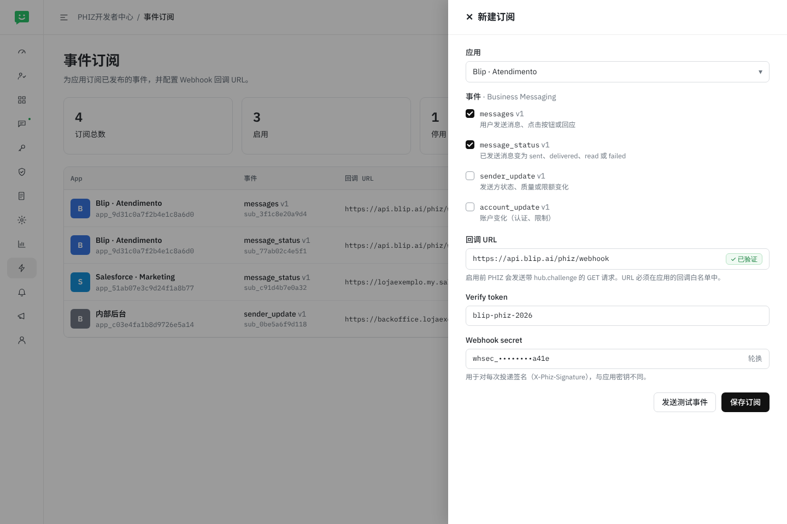</a><p class="cap"><b>页面 5.</b> 事件订阅：<code>messages</code> 和 <code>message_status</code>，含已验证的 URL、verify token 和 webhook secret</p></div>
<div class="shot"><a href="mocks/zh/dc16/06-webhook-entregas.png" target="_blank" rel="noopener">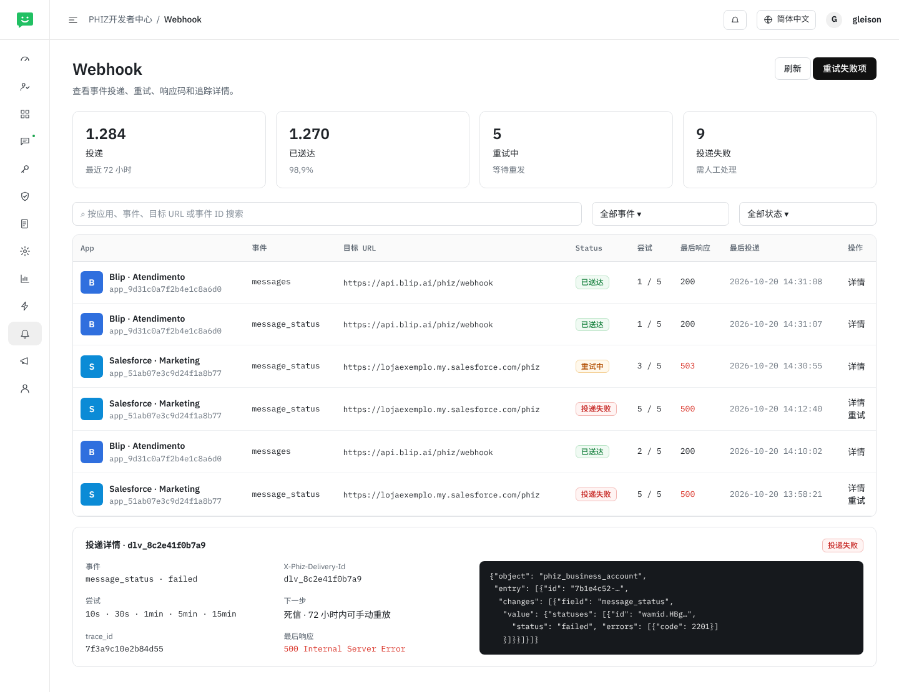</a><p class="cap"><b>页面 6.</b> Webhook：投递、重试、最后响应、<code>trace_id</code>、失败重试和死信</p></div>
<div class="shot"><a href="mocks/zh/dc16/07-business-accounts.png" target="_blank" rel="noopener">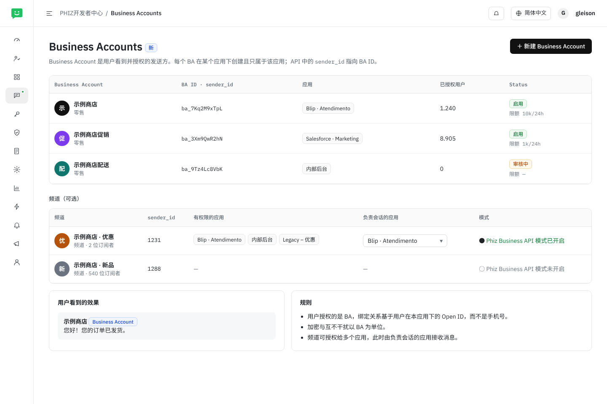</a><p class="cap"><b>页面 7.</b> Business Accounts（新页面）：BA ID、所属应用和已授权用户；可选频道及负责会话的应用</p></div>
<div class="shot"><a href="mocks/zh/dc16/08-aplicacoes-legadas.png" target="_blank" rel="noopener">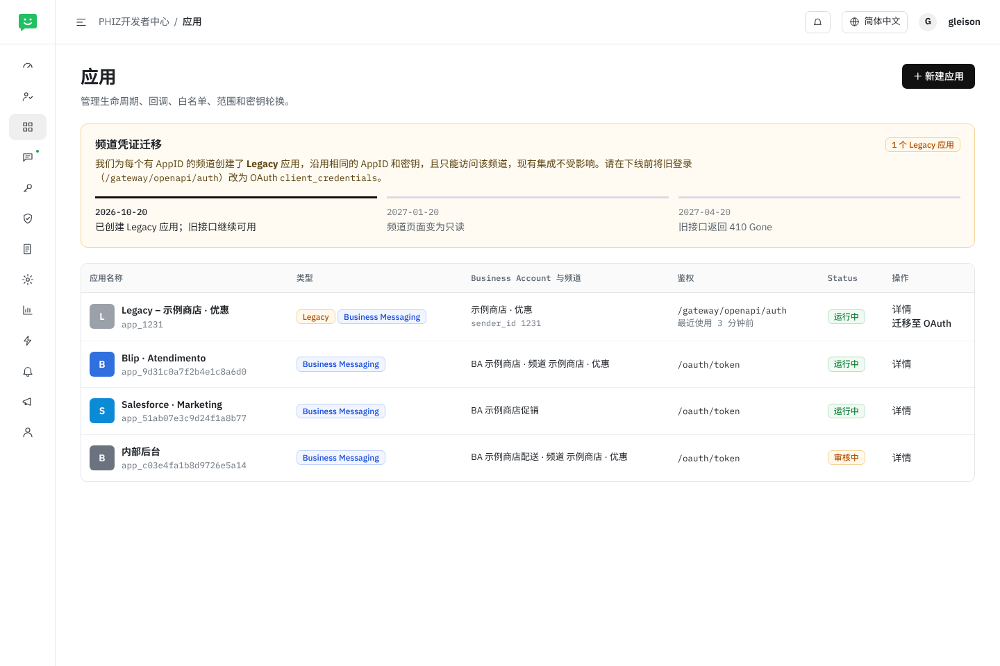</a><p class="cap"><b>页面 8.</b> 应用页面中的频道凭证迁移：Legacy 应用、时间节点和切换至 OAuth</p></div>
</div>

### 各菜单的变化

每张卡片对应开发者中心侧边菜单中的一项，说明 Business Messaging API 带来的变化，以及上方展示它的页面。

<div class="screens">
  <div class="screen"><h5>仪表盘</h5><span class="path">有变化 · 页面 1</span><ul><li>消息指标：最近 24 小时已发送、已送达和失败的消息，以及 Webhook 投递情况</li><li>Business Messaging API 快速开始</li><li>旧密钥仍在使用、Webhook 失败的提醒</li></ul></div>
  <div class="screen"><h5>成员</h5><span class="path">无变化</span><ul><li>OWNER、ADMIN、DEVELOPER、AUDITOR 角色决定谁可以管理应用、密钥和订阅（见“角色”表）</li></ul></div>
  <div class="screen"><h5>应用</h5><span class="path">有变化 · 页面 2, 3, 4, 8</span><ul><li>新增 <em>Business Messaging</em> 类型及集成类型（自有、Blip、Salesforce、其他）</li><li>TEST、SANDBOX、PRODUCTION 环境；SANDBOX 中有测试发送方、最多 5 个接收方和 <code>phzsk_test_</code> 凭证</li><li>应用的 Business Account 及可选频道</li><li>可轮换密钥、最长 7 天宽限期及最近使用时间</li><li>由频道生成的 <em>Legacy</em> 应用</li></ul></div>
  <div class="screen"><h5>Business Accounts</h5><span class="path">新增 · 页面 7</span><ul><li>各应用的 Business Account，含 BA ID（<code>sender_id</code>）、状态、限额和已授权用户</li><li>每个 BA 只属于一个应用；加密与隔离以 BA 为单位</li><li>可选频道：有权限的应用、负责会话的应用和“Phiz Business API”模式</li></ul></div>
  <div class="screen"><h5>Scope 与 API</h5><span class="path">有变化</span><ul><li>发布 Business API 资产：消息、媒体、<code>/v1/me</code> 和账户</li><li>登记第 08 节的范围，由平台审批申请</li></ul></div>
  <div class="screen"><h5>白名单</h5><span class="path">无变化</span><ul><li>允许调用 API 的 IP</li><li>事件订阅可用的回调 URL</li></ul></div>
  <div class="screen"><h5>密钥与证书</h5><span class="path">无变化</span><ul><li>Business API 不使用 API Key（<code>X-Api-Key</code>）和证书，只使用 <code>Authorization: Bearer</code></li></ul></div>
  <div class="screen"><h5>API 用量</h5><span class="path">有变化</span><ul><li>同样统计 Business API 接口的通过、拒绝和失败调用</li><li>第 2 阶段：带 <code>trace_id</code> 的逐请求日志</li></ul></div>
  <div class="screen"><h5>事件订阅</h5><span class="path">有变化 · 页面 5</span><ul><li>新增 <code>messages</code>、<code>message_status</code>、<code>sender_update</code> 和 <code>account_update</code> 事件</li><li>用 <code>hub.challenge</code> 验证 URL，配置 verify token 和 webhook secret</li><li>发送测试事件</li></ul></div>
  <div class="screen"><h5>Webhook</h5><span class="path">无变化 · 页面 6</span><ul><li>同一投递页面，增加消息类事件</li><li>重试、死信以及 72 小时内手动重放</li></ul></div>
  <div class="screen"><h5>审计与通知</h5><span class="path">无变化</span><ul><li>记录并通知密钥、范围、Business Account 和订阅的变更</li><li><em>密钥</em>和 <em>Webhook</em> 类别为仪表盘提醒提供数据</li></ul></div>
</div>

### 角色

开发者中心已通过*成员*中设置的组织角色控制访问，不新增权限。下表说明各角色在 Business Messaging API 相关页面中能做什么。这是提议，需对照各角色目前的权限确认（Q10）。范围审批不属于组织角色，由平台负责。

| 操作 | OWNER | ADMIN | DEVELOPER | AUDITOR |
|---|---|---|---|---|
| 查看应用、Business Account、订阅、投递、用量和审计（不含密钥） | ✓ | ✓ | ✓ | ✓ |
| 创建、编辑、停用 Business Messaging 应用；申请范围 | ✓ | ✓ | ✓ | — |
| 创建、编辑 Business Account；为频道选择负责会话的应用 | ✓ | ✓ | ✓ | — |
| 为频道开启“Phiz Business API”模式 | ✓ | ✓ | — | — |
| 生成、轮换、撤销密钥 | ✓ | ✓ | — | — |
| 创建、编辑事件订阅；发送测试；重试投递 | ✓ | ✓ | ✓ | — |
| 管理成员和角色 | ✓ | ✓ | — | — |

创建、轮换或撤销密钥，修改范围或 Business Account，修改事件订阅，都会在*审计*中留下记录，并在*密钥*和 *Webhook* 类别中通知 OWNER 和 ADMIN。

**PHZ-BM-0001** 还提议增加 **Operator** 角色：只能在用途和配额范围内发送已批准模板；并强调 Developer 永远不会拿到生产环境密钥。开发者中心目前没有 Operator 角色（Q16）。

### Business Account 与应用

每个 Business Account 在某个应用下创建，且只属于该应用。因此只有该应用能通过它发送并接收其 `messages` 和 `message_status` 事件，用户的 Open ID 也是该应用下的。同时用 Blip 做客服、用 Salesforce 做营销的企业，需要为二者各建一个应用，各自拥有自己的 Business Account（页面 7）。

- **共享频道。**频道（可选发送方）可授权给多个应用。此时在 *Business Accounts* 页面指定该频道的**负责会话应用**：只有它会收到 `messages` 事件；其他应用可以发送，并收到自己所发消息的 `message_status`。
- 更换负责应用对之后收到的消息生效，并记录在*审计*中。
- 在两个应用中使用同一个 Business Account，或在系统之间移交会话（类似 Messenger 的 handover），留待以后（Q6）。

### 频道凭证迁移

目前每个频道在开放平台的*频道 › 开发配置*中有独立的 AppID 和密钥。迁移会把这些凭证转入开发者中心，且不中断任何集成（页面 8）：

1. **自动创建。**对每个带 AppID 的频道，在商户组织下创建一个 Business Messaging 类型的 *Legacy – 频道名* 应用，使用相同的 AppID 作为 `appId`、相同的密钥（已存储），只能访问该频道，并作为该频道的负责会话应用。应用位于商户的 Developer ID 下，该 ID 与 Merchant ID 同步创建。
2. **并行期。**`/gateway/openapi/auth` 和 `/token/refresh` 继续可用。要使用新 API，只需用相同的 AppID 和密钥调用 `/oauth/token`。开放平台的频道页面显示指向开发者中心的提示，*应用*页面显示旧登录方式的最近使用时间。
3. **只读。**3 个月后，频道页面不再允许重置密钥；密钥和轮换只在开发者中心管理。
4. **下线。**6 个月后，在旧登录用量接近零时，旧接口返回 `410 Gone`。下线前 30 天在*通知*中提醒 OWNER 和 ADMIN。

## 合作伙伴集成 {#partners}

**MVP 阶段**，商户在开发者中心创建应用，把 `client_id` 和密钥填入 Blip、Salesforce 或自有系统，Webhook URL 由合作方在*事件订阅*中自行登记（第 10 节）。由于契约沿用 Cloud API，已有 WhatsApp 连接器的合作方可以复用大部分实现。

**后续阶段**推出*技术合作伙伴*计划，对应 Meta 的 Embedded Signup：

- 合作伙伴在 PHIZ 注册平台应用。
- 商户在合作方产品中点击 “连接 PHIZ”，在授权页面确认范围和 Business Account（OAuth 2.0 授权码模式 + PKCE）。
- 合作伙伴获得仅限该商户的令牌，并用一个 Webhook 接收所有客户的事件。外层结构中的 `entry[].id` 标识 Business Account，因此该结构从一开始就这样设计。

开发者中心已支持 authorization code 和 `openId`/`unionId` 映射，这是该计划的基础。

按照身份模型（第 06 节），Developer ID 可以属于 Salesforce 等第三方：开发者身份和资源归第三方所有，商户授权的 Business Account 位于其应用下。这与各商户 Merchant ID 的关系仍待确定（Q10）。

## 通往 Marketing API {#marketing}

本 RFC 为 Marketing API 预留空间，但不做实现：

- 契约中已包含发送用的 `type: template` 和 `templates:manage` 范围。服务模板（`UTILITY`、`AUTHENTICATION`）可以提前上线，遵循第 09 节的发送策略（Q14）；营销模板仍归 Marketing API。
- 需审核的模板：`/v1/{sender_id}/message_templates`，以及 `template_status` Webhook 事件。
- 会话类别（`conversation.origin.type`：`service`、`utility`、`marketing`），作为报表与计费的基础。
- 按发送方管理选择接收与退订，面向分群的营销活动，以及 `/v1/{sender_id}/analytics` 指标。
- 按发送方的发送额度分级和质量评级，已体现在 `Sender` 资源中。

## 交付计划 {#plan}

::: phases
##### 第 0 阶段 · 基础： 认证与规则

- 归属：谁代表谁发送（Q11）
- 认证级别及公开的级别 → 范围矩阵（Q13）
- 消息类别、服务窗口和服务模板（Q14）
- 内部测试接收方白名单；不做批量解析

##### 第 1 阶段 · MVP： 鉴权与发送

- `/oauth/token`、`/oauth/revoke`、`/v1/me`
- 向手机号和 Open ID 发送 `text`、`image`、`audio`、`video` 和 `document`
- 媒体上传（`/v1/{sender_id}/media`）并临时存储；不支持第三方链接
- 带签名的 `messages` 和 `message_status` Webhook，URL 由合作方在事件订阅中自行登记
- 开发者中心：Business Messaging 应用类型、API 资产与范围、按应用的 Business Account、事件目录中的事件
- 身份模型：Developer ID、App ID、Business Account（BA ID）和 Open ID；频道作为可选发送方
- 频道凭证自动迁移

##### 第 2 阶段： 补充项

- 通过 API 配置 Webhook（`PUT /v1/apps/{app_id}/webhook`、测试和健康状态）
- 若平台策略不满足第 10 节，则调整重试与重放策略
- 带 `trace_id` 的逐请求日志和消息指标
- 带测试接收方的沙箱
:::

### 上线验收标准

参考 **PHZ-BM-0001**：

- 认证、Business Account 创建以及范围申请与撤销完成端到端测试。
- 公开的级别与范围矩阵与开发者中心审批、API 决策、错误码和文档一致。
- 企业会话绝不会变成好友或普通聊天；手机号不可被枚举；生产密钥绝不下发到客户端。
- 重试、重连、多设备、屏蔽、退订和区域规则测试通过。
- 完成法务评审，覆盖同意、保留、删除、跨境处理和必要的服务消息。

具体时间将在与中国团队评审本 RFC 后确定。

## 待讨论问题 {#questions}

::: questions
1. **选择接收（opt-in）策略。**第 09 节已给出策略提议（按商户和类别 opt-in、平台执行 opt-out、商户保存记录）。仍需决定：模式 A（与 Meta 相同，不验证）还是 B（在 PHIZ 中建立同意登记，例如 `/v1/{sender_id}/consents`，发送时校验）；有哪些类别；PHIZ App 是否向用户展示其授权内容；以及用户如何屏蔽 Business Account 或停止其优惠（见 Q3）。LGPD 相关要点需与法务确认。适用于 Business Account 和 Channel Service。第 04 节和第 09 节的关系状态与消息类别可作为该决策的基础。
2. **发送方 ID。**v1.6 已答复：`merchant_id` 不用于标识发送方。`sender_id` 是映射到 Business Account 的 BA ID 的外部引用（见第 06 节）。频道仍使用频道 ID；是否也为频道分配不透明 ID 以免暴露自增 ID，仍待决定。
3. **Business Account 会话类型。**v1.6 已答复：公众号会话 › 企业服务会话 › Business Account，只有 Business Account 对外展示，面向企业、政府和机构，按 Merchant ID › Developer ID › App ID › BA ID 创建（见第 06 节）。仍需明确用户如何在 App 中屏蔽或静音 Business Account。
4. **现有会话类型。**v1.6 部分答复：除 Business Account 外还有其他会话类型，本次开发的是一种新会话类型。产品和技术将重新定义并打磨相关定义，为后续扩展做准备。仍缺少最终的类型与权限表。
5. **手机号。**v1.6 已答复：所有 PHIZ 用户都有有效且已验证的手机号。Business Account 用手机号换取用户的 Open ID，再通过 Open ID 发送；BA 绑定的是 Open ID，因此换号或境外号码不会改变接收方（见第 09 节）。
6. **一个 Business Account 对应多个应用。**v1.6 中每个 BA 只属于一个应用。第 2 阶段是否就需要在多个系统中使用同一个 BA，或在应用之间移交会话（机器人 → 人工客服）？
7. **现有 Business Message API。**AI 机器人的 “Phiz Business API” 模式已有发送和回调接口，似乎对应带 Channel Bot 的 Channel Service。本 RFC 是替代、扩展还是封装这套 API？
8. **媒体。**v1.6 部分答复：格式和大小可由本 RFC 定义（见第 09 节表格）；第一阶段文件通过 Business API 提交并存储，之后按客户逐步开放第三方 URL；其他规则以技术定义为准。仍需确定：30 天是否合适，还是应更短？投递后媒体是转入常规聊天存储，还是到期后从历史中消失？收到的媒体 `url` 有效期多长？
9. **第 1 阶段的 Webhook。**v1.5 提议：合作方在开发者中心的*事件订阅*中自行登记 URL，取代 v1.4 的手工登记。需与 Henry Wu 确认：是否仍因商务原因需要手工登记；平台的重试策略、投递保留期和重放是否满足第 10 节；平台是否对投递签名，并接受 Cloud API 的握手和信封格式；以及合作方如何找回丢失的收到消息（目前只有状态可查询）。
10. **开发者中心。**(a) Merchant ID 会同步生成 Developer ID（v1.6）；仍需确认 Developer ID 是否即开发者中心的组织、商户如何登录控制台，以及 Developer ID 属于 Salesforce 等第三方时如何处理。(b) `CLIENT_CREDENTIALS` 授权的令牌端点、有效期和令牌格式是什么？(c) Business API 的范围是沿用平台命名方式（如 `write:clips:publish`），还是保留第 08 节的名称？PHZ-BM-0001 又提出了第三种命名（`business.message.send.service`）；需要统一为一种。(d) 谁审批范围申请，需要多久？(e) 各角色（OWNER、ADMIN、DEVELOPER、AUDITOR）目前对密钥和订阅有哪些权限？(f) SANDBOX 环境发送的是模拟消息还是真实消息？(g) 由哪个团队开发第 12 节中的页面和扩展？
11. **RFC 与 PHZ-BM-0001 的层级。**本 RFC 保留 `Merchant ID → Developer ID → App ID → BA ID`（每个应用一个 BA）。PHZ-BM-0001 提出 `Organization → Business Account → App → Credential`（一个 BA 对应多个应用）。由谁决定、以哪个为准？若以 RFC 为准，需更新 PHZ-BM-0001；若以 BM 为准，第 06、09、12 节需调整。
12. **Business Account 作为 Channel 子类型。**BA 是会话类型（本 RFC）还是 `Channel.subtype`（PHZ-BM-0001）？App 使用哪种会话 ID：短期用 `channel:<id>` 加元数据，之后改为不透明 ID？
13. **认证。**开发者中心显示“已认证组织”，但 PHZ-BM-0001 称系统没有认证对象。目前实际有什么、采用哪些级别、由谁审核，第 1 阶段是否依赖它？
14. **服务模板与窗口。**第 1 阶段企业能否用自由文本发起会话（本 RFC 原方案），还是只能用已批准模板（PHZ-BM-0001）？服务窗口时长多少，由谁审批模板？
15. **路由。**保持 Cloud API 风格（`/v1/{sender_id}/messages`），还是采用 PHZ-BM-0001 的 `/v1/business/messages`？
16. **Operator 角色。**开发者中心是否新增 Operator 角色？确认 DEVELOPER 永远看不到生产密钥。
17. **静默时段、频次与区域规则。**按区域和行业取什么值，在哪里配置（开发者中心还是平台）？
18. **接收方解析。**是否需要 `/recipients/resolve`？适用于哪些关系状态、限额多少，如何确保不能用来枚举手机号？
19. **法务评审。**按司法辖区（LGPD 及巴西以外市场）明确同意、保留、删除、跨境传输和服务例外。
:::

## OpenAPI 参考 {#openapi}

下方 OpenAPI 3.1 规范覆盖本 RFC 的全部接口和 Webhook，描述为当前语言。由于 API 尚未上线，“Try it out” 已关闭。可通过 “复制 OpenAPI” 将 YAML 导入 Apifox、Postman 或 SDK 生成器。
