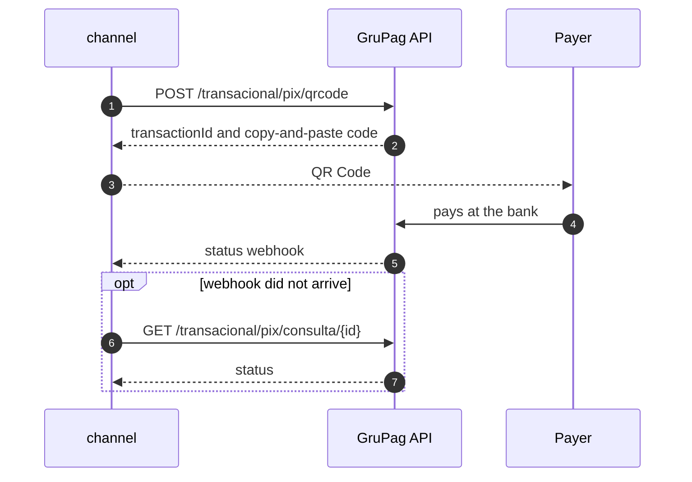

## Summary {#summary}

CredPay has published a new API, documented in the GruPag portal (`api2.grupag.com.br`). Today we talk to CredPay through **eight integrations** in two services, with **four different logins**. This RFC proposes:

- **A new adapter in `phiz-microwd-channel`**, next to the old one, with its own service codes and API Key authentication.
- **Replacing the CredPay client in `phiz-pay-card-vault`** with the new card contract.
- **A cutover driven by the `route_cfg` table**, which operators already edit in the internal panel. Each operation switches path with one configuration row and switches back the same way, with no deploy.
- **Five phases**, starting with PIX, the simplest flow. 3DS becomes mandatory for cards and sets the final deadline, because CredPay will switch off the old structure without 3DS.

The RFC also lists what the new API **does not cover**: card terminals (TEF), statements for reconciliation, bank transfers and listings. Those operations stay on the old integration until CredPay answers the [open questions](#questions).

::: decision Deadline set by CredPay
PHIZ is the only client still on the old structure, without 3DS. So that operations do not stop, CredPay will bring up a temporary bridge for that path by 2026-10-30. The date the bridge is switched off depends on our estimate for the full migration with 3DS, which CredPay expects by 2026-10-23.
:::

::: stats
- **8** CredPay integrations today
- **4 → 1** authentication methods
- **31** current routes mapped
- **4** operations with no equivalent
:::

## Context: how it works today {#context}

CredPay handles cards (checkout, saved cards, pre-authorization, 3DS), PIX by QR Code and the merchants' card terminals. No app-facing service talks to it directly: the request goes down the service chain to the channel, which is the only service that knows CredPay, together with the card vault.

```mermaid Dashed lines are configuration reads. The panel is not part of the payment: it sets the rules before and shows the result after.
flowchart LR
  APP["phiz-flutter<br/>app"] --> AS["microwd-appserver<br/>app API"]
  AS --> BA["microwd-backapply<br/>picks the route"]
  BA --> CH["microwd-channel<br/>talks to providers"]
  CH --> CP[("CredPay<br/>4 APIs")]
  CH --> CV["pay-card-vault<br/>card vault"]
  CV --> CP
  IF["phiz-inner-front<br/>panel"] --> IN["phiz-inner"]
  IN --> DB[("route_cfg<br/>road_info")]
  DB -. "reads the route" .-> BA
  DB -. "reads the URL" .-> CH
```

### How an operation reaches CredPay

1. **backapply** looks up `route_cfg` for the transaction type, payment method and card BIN (`RoadRouteServiceImpl.getRouteByTranPayAcct`). The route says which provider and which service code handle it.
2. **channel** receives the code (for example `B21`, payment with a saved card) and runs the Spring service registered under that name.
3. The service reads the provider base URL from `road_info` and calls CredPay.

::: decision Why this matters for the migration
Because the path is chosen by data, not by code, the new path can ship to production switched off and be turned on per merchant and per operation. Rolling back means changing the row again.
:::

## Current integrations {#inventory}

Inventory taken from the code of `phiz-microwd-channel` and `phiz-pay-card-vault`.

| # | Integration | Where | Login | Service codes |
|---|---|---|---|---|
| 1 | Checkout and saved cards | `CheckOutTokenServiceImpl`, `CheckOutOperationServiceImpl`, `credPayRefactor/` | `POST /AuthCredPay` | B20–B25, B02, B03, Z519, Z520, Z523 |
| 2 | Pre-authorization | `PreAuthService` | checkout's | B26, B27, B28 |
| 3 | PIX, QR and bank transfer | `service/credpay/` | `POST /oauth/token` | B10–B13 |
| 4 | Card with 3DS | `ThreeDomainSecurePaymentService` | `autenticacao/gerar-token` | B61–B70 |
| 5 | Card terminal (TEF) | `TefService` | checkout's | B47, B48 |
| 6 | Reconciliation | `SynChannelDataService`, `Credpay*ReconciliationJob` | `/AuthCredPay/`, hard-coded URL | jobs |
| 7 | Vault tokenization | card-vault: `CredpagamentosClient` | `POST /AuthCredPay` | — |
| 8 | Card verification | card-vault: `CredpayClient` | `/v1/autenticacao/gerar-token` | — |

::: risk To confirm in Phase 0
The code shows what *can* be called. Which codes are live in production depends on `route_cfg`, which has not been queried yet. That inventory is the first implementation step.
:::

## The new API {#newapi}

The documentation lives in the GruPag portal (login required) and has four parts: Access and API Key, PIX APIs, Card Purchase API and Simulation API.

```mermaid Four logins, each with a token, cache and renewal, become one fixed key sent on every call.
flowchart LR
  subgraph HOJE["Today"]
    direction TB
    A1["/AuthCredPay<br/>checkout · TEF · vault"]
    A2["/oauth/token<br/>PIX"]
    A3["autenticacao/gerar-token<br/>3DS"]
    A4["api-services /AuthCredPay<br/>reconciliation"]
  end
  subgraph NOVO["GruPag API"]
    K["Authorization: Bearer gpk_…<br/>Cliente-Id: company"]
  end
  HOJE ==> NOVO
```

### General rules

| Topic | How it works |
|---|---|
| Base URL | `https://api2-homolog.grupag.com.br` (staging) and `https://api2.grupag.com.br` (production) |
| Authentication | API Key `gpk_…` in `Authorization: Bearer`. One per portal user, no expiry and no renewal. Regenerating it invalidates the previous one immediately. |
| Company | The `Cliente-Id` header picks the linked company. Without it, the user's main company is used. **It must be the same on every call of a flow.** |
| Amounts | Card: cents as a string (`"15000"`). PIX: reais as a decimal (`15.00`). Simulation: cents as an integer. |
| Idempotency | Card: by `orderId`; two concurrent calls return 409. PIX: the same amount within a short window returns 409. |
| Responses | The envelope varies by family (`details`, `data` or root fields). Errors always use `{message}`. 502: no destination. 504: provider did not answer. |
| Staging key | CredPay checks that the PHIZ client is enabled, with the right fees, in staging. After that a token button appears in the GruPag portal; the key generated there (`gpk_…`) goes as `Bearer` on every call. |
| Rate limit | Per client, not per route. Default of 1 transaction per second, adjusted to the operation declared at onboarding (average ticket, daily volume, monthly revenue). One-off peaks, such as campaigns or bill due dates, are released on request, with a justification. |
| Confirmation | Card: the response of the call itself carries the result, no webhook. PIX: status-change webhook. For both, the transaction can be looked up by ID. |
| Tokenization | Multi-acquirer: CredPay tokenizes the card with every acquirer at once and returns a single token. If one acquirer fails, another is tried automatically. The token lives in CredPay's vault, which keeps only the first 6 and last 4 digits; raw card data is not stored. |

```http
# Today: four different logins, each with its own token and renewal
POST {road_info.url}/AuthCredPay            # checkout, pre-auth, TEF, card-vault
POST {road_info.url}/oauth/token            # PIX and bank transfer
POST {road_info.url}autenticacao/gerar-token # 3DS (platform API)
POST https://api-services.credpay.com.br/AuthCredPay/   # reconciliation (hard-coded URL)
```

```bash
# New: one API Key (gpk_...) on every call, no login, no renewal
curl -X GET "https://api2-homolog.grupag.com.br/v1/pagamento/consulta/nit?nit=$NIT" \
  -H "Authorization: Bearer $GRUPAG_API_KEY" \
  -H "Cliente-Id: $CLIENTE_ID"   # same value on every call of the flow
```

### Available features outside the scope

CredPay confirmed features that no PHIZ client uses today. They are recorded here so they can be added quickly when there is demand.

| Feature | How it works |
|---|---|
| Recurring billing | Enabled per business segment. Suited to gyms, phone plans and subscriptions. Not recommended for product delivery, because the amount is not held. |
| Fixed split | The balance is held at CredPay. The client tells it through the API which suppliers to pay out to and when (15, 20 or 30 days). |
| Dynamic split | Variable amounts, driven by the API. Pays out only to suppliers registered and authorized beforehand by the business owner. |
| Payout | The account holder is always a company (CNPJ); a split recipient can be an individual (CPF) if registered. Money goes straight to the declared bank account, at any bank, with no pooled account. |

## Goals and non-goals {#goals}

#### Goals

- Move card, saved card, 3DS, pre-authorization and PIX to the new API without losing any operation that is live today.
- Replace the four logins and `CredPayAuthTask` with an API Key kept in the secrets vault.
- Switch each operation on and off by configuration, per merchant, with no deploy.
- Keep amount and status conversions in a single adapter.
- Delete every CVV stored today and keep only the CredPay token from now on (see [section 10](#breaking)).

#### Out of scope

- Using the Simulation API to show installments and fees in the app. A possible improvement, not a migration requirement.
- TEF, reconciliation and bank transfers, while the new API has no equivalent.
- Other providers (Pinbank, Cronos, Afro).
- Recurring billing and split. The API offers both, but no PHIZ client uses them today (see [section 04](#newapi)).

## Route-by-route mapping {#mapping}

<div class="legend"><span><span class="st eq">equivalent</span> same operation, format changes</span><span><span class="st ch">changes</span> different rule or flow</span><span><span class="st new">new</span> did not exist</span><span><span class="st gap">no equivalent</span> stays on the old API</span></div>

### Saved card and checkout

::: table map
| Today | New API | Status | What changes |
|---|---|---|---|
| POST /Tokenizacao/CriarToken<br>B20 · Z519 | POST /v1/pagamento/cartao/adicionar | <span class="st ch">changes</span> | Requires `authorizerId`. CredPay said tokenization is multi-acquirer, with a single token; confirm in staging whether credit and debit still need separate tokens. Store the `customerId`. |
| GET /Tokenizacao/Obter/{id} | POST /v1/pagamento/cartao/buscar | <span class="st ch">changes</span> | Returns only the status (`ATV` or `INA`). |
| GET /Tokenizacao/Listar | — | <span class="st gap">no equivalent</span> | See [Gaps](#gaps). |
| POST /Tokenizacao/Excluir/{id}<br>B24 · Z520 | DELETE /v1/pagamento/cartao/remover | <span class="st eq">equivalent</span> | DELETE with a `{token, customer}` body. |
| POST /Tokenizacao/Pagar<br>B21 · B02 | POST /v1/pagamento | <span class="st ch">changes</span> | Cents as a string; `orderId` required and idempotent; returns the `nit`, the new transaction key. |
| POST /Tokenizacao/Cancelar/{transacaoId}/{referenceId}<br>B25 · B03 | DELETE /v1/pagamento/cancelar | <span class="st ch">changes</span> | `{nit, amount}` body, partial allowed. Refunds only until 23:59 on the capture day. |
| GET /Consulta/TransactionId/{id}<br>GET /Consulta/NumeroInterno/{n}<br>B22 · Z523 | GET /v1/pagamento/consulta/nit?nit= | <span class="st ch">changes</span> | By `nit` only. No lookup by internal number or `orderId`. |
| GET /Consulta/Subdominio/Datas/{ini}/{fim} | — | <span class="st gap">no equivalent</span> | Used for reconciliation. |
:::

```json
{
  "nomeDoCliente": "JOAO DA SILVA",
  "documento": "12345678901",
  "quantidadeDeParcelas": 1,
  "valorInicial": 150.0,
  "token": "TOKEN_DO_CARTAO",
  "numeroInterno": "PED-4711",
  "subDominioId": 1234,
  "lojaId": 1
}
```

```json
{
  "merchantChargeId": "20260901010707410895669",
  "orderId": "PED-4711",
  "installments": "1",
  "authorizerId": "2",
  "amount": "15000",
  "typeTransaction": "C",
  "card": {
    "token": "crd_d6dc9c299d15…"
  }
}
```

<p class="cap">The same saved-card payment, before and after. The amount goes from reais to cents, and the internal number becomes <code>orderId</code>.</p>

### Pre-authorization

::: table map
| Today | New API | Status | What changes |
|---|---|---|---|
| POST /Transacao/Autorizar<br>B26 | POST /v1/pagamento/preautorizacao | <span class="st eq">equivalent</span> | Same body as payment; starts as `AUTORIZADO`. |
| POST /Transacao/Capturar/{transacaoId}/{referenceId}/{valor}<br>B27 | POST /v1/pagamento/preautorizacao/liquidar | <span class="st eq">equivalent</span> | `{nit, amount}` body; partial capture allowed. |
| POST /Transacao/Cancelar/{transacaoId}/{referenceId}<br>POST /Transacao/Cancelar/Parcial<br>B28 | DELETE /v1/pagamento/cancelar | <span class="st eq">equivalent</span> | One endpoint; the amount decides whether it is partial. Voiding a hold has no time limit. |
:::

### Card with 3DS

::: table map
| Today | New API | Status | What changes |
|---|---|---|---|
| cartao/adicionar/<br>B62 | POST /v1/pagamento/cartao/adicionar | <span class="st ch">changes</span> | Same as saved card. |
| cartao/validar/ · 3ds/checar/<br>B61 · B69 | POST /v1/pagamento/cartao/buscar | <span class="st ch">changes</span> | Confirm whether "validar" does more than check the status today. |
| pagamento/cartao/3ds/configurar/<br>B63 | POST /v1/pagamento/3ds/autenticacao<br>POST /v1/pagamento/3ds/configuracao | <span class="st ch">changes</span> | Becomes two calls. The first creates the `merchantChargeId`. |
| pagamento/cartao/3ds/desafio/<br>B64 | browser steps | <span class="st ch">changes</span> | 3DS Method and challenge are forms posted by the payer's browser. See [section 07](#card-flow). |
| pagamento/cartao/3ds/checar/desafio/<br>B65 | GET /v1/pagamento/3ds/consultar3DS | <span class="st eq">equivalent</span> | Approved when `eci` and `authentication.value` are present. |
| pagamento/cartao/3ds/cobrar/<br>B66 | POST /v1/pagamento + merchantChargeId | <span class="st ch">changes</span> | The authentication lasts 15 minutes and is consumed by the charge. |
| pagamento/cartao/3ds/preautorizada/cobrar/<br>B67 | POST /v1/pagamento/preautorizacao (+ /liquidar) | <span class="st eq">equivalent</span> | — |
| pagamento/cartao/3ds/cancelar/<br>B68 | DELETE /v1/pagamento/cancelar | <span class="st ch">changes</span> | 23:59 rule. |
| pagamento/cartao/3ds/consultar/ | GET /v1/pagamento/consulta/nit | <span class="st eq">equivalent</span> | — |
:::

### PIX

::: table map
| Today | New API | Status | What changes |
|---|---|---|---|
| POST /api/generate-qrcodes<br>B10 | POST /transacional/pix/qrcode | <span class="st eq">equivalent</span> | Reais as a decimal. Synchronous, up to 30 s. Expires in 3 min (instant) or up to 1 h (standard). |
| GET /api/find-qrcode/{id}<br>B11 | GET /transacional/pix/consulta/{transactionId} | <span class="st eq">equivalent</span> | Paid when the status is `CONFIRMADO`. A status webhook exists; polling stays as a fallback. |
| POST /api/bank-transfers<br>B12 | — | <span class="st gap">no equivalent</span> | — |
| POST /api/list-transactions<br>B13 | — | <span class="st gap">no equivalent</span> | — |
| — | POST /transacional/pix/cancelamento/{transactionId} | <span class="st new">new</span> | According to CredPay, until 23:59 on the day of the operation; after that, a support ticket with manual review. The docs say 24 h. See [section 14](#questions). |
| — | POST /transacional/pix/disputa | <span class="st new">new</span> | Admin profile only. Candidate for a panel screen. |
:::

### Card vault

::: table map
| Today | New API | Status | What changes |
|---|---|---|---|
| POST /Tokenizacao/CriarToken | POST /v1/pagamento/cartao/adicionar | <span class="st ch">changes</span> | Requires `authorizerId`. |
| GET /Tokenizacao/ObterDadosToken/{token} | POST /v1/pagamento/cartao/buscar | <span class="st ch">changes</span> | Status only. Confirm whether the vault uses any other field of that response. |
| POST /Tokenizacao/Excluir/Token/{token} | DELETE /v1/pagamento/cartao/remover | <span class="st eq">equivalent</span> | — |
| POST /v1/pagamento (verification) | POST /v1/pagamento | <span class="st eq">equivalent</span> | Same path; base URL and authentication change, and `orderId` becomes required. |
:::

## New card flow with 3DS {#card-flow}

The biggest flow change is in 3DS. Today backapply returns a ready-made URL (`certifyUrl`, in `CardCertifyServiceImpl`) and the front end just opens it. With the new API, two steps run **in the payer's browser**, and the front end has to build and post the forms.

According to CredPay, the first version of this transparent checkout was delivered in October 2025, because we did not want to embed their 3DS iframe, and it was never implemented. The current version is the second one. Also according to CredPay, our code calls the transaction API directly today, without going through 3DS, which only works on the old structure. In the new model, 3DS is mandatory before the transaction and has three steps:

1. **Setup.** Registers the transaction (card code, brand, amount) and receives the data to run the browser fingerprint.
2. **Enrollment and challenge.** Sends the additional data (address, Merchant ID and others) and waits for the result, with or without a challenge.
3. **Lookup and payment.** If authentication passed, sends the payment with the generated hash (`merchantChargeId`).

~~~mermaid The same `Cliente-Id` must go on every call to the GruPag API in this flow. If one call misses it, the payment answers "3DS not found".
sequenceDiagram
  autonumber
  participant F as Payer front end
  participant BA as backapply
  participant CH as channel
  participant G as GruPag API
  participant E as Issuing bank
  BA->>CH: start 3DS for the order
  CH->>G: POST /3ds/autenticacao
  G-->>CH: merchantChargeId and threeDsMethod
  CH-->>BA: 3DS Method data
  BA-->>F: data for the browser
  F->>E: 3DS Method in a hidden iframe
  BA->>CH: authenticate with browser data
  CH->>G: POST /3ds/configuracao
  G-->>CH: frictionless or challenge
  F->>E: challenge with creq, if any
  CH->>G: GET /3ds/consultar3DS
  G-->>CH: eci and CAVV
  CH->>G: POST /v1/pagamento with merchantChargeId
  G-->>CH: nit and status CONFIRMADO
~~~

::: risk Front-end impact
We still need to identify which front end opens the `certifyUrl` today (the app or a web form). It has to collect real browser data (screen, time zone, user agent), post the 3DS Method in a hidden iframe and show the challenge in a 400×650 iframe.
:::

::: decision CredPay support
CredPay offers hands-on sessions to build the requests together with the team, and a sample HTML page to test the fingerprint. The direct support channel stays open until go-live.
:::

## New PIX flow {#pix-flow}

PIX barely changes shape: generate, then wait for confirmation, now by webhook, with polling as a fallback. What is new is the refund with a time rule, and disputes.



```mermaid Status of a PIX charge in the new API. Disputes are decided by an Admin user, which calls for a screen in the internal panel. The time limit still needs confirming: the docs say 24 h; in the meeting, CredPay said until 23:59 on the day of the operation, because from midnight it runs reconciliation, credits and debits, and after that the path is a support ticket with manual review (see [section 14](#questions)).
stateDiagram-v2
  [*] --> GERADO
  GERADO --> CONFIRMADO: payment
  GERADO --> EXPIRADO: expired
  CONFIRMADO --> ESTORNANDO: refund in time
  ESTORNANDO --> ESTORNADO
  CONFIRMADO --> DISPUTA: refund too late
  DISPUTA --> CANCELANDO: admin approves
  CANCELANDO --> CANCELADO
  DISPUTA --> PAGO: admin denies
```

```bash
curl -X POST "https://api2-homolog.grupag.com.br/transacional/pix/qrcode" \
  -H "Authorization: Bearer $GRUPAG_API_KEY" \
  -H "Content-Type: application/json" \
  -d '{ "amount": 15.00, "description": "Pedido PED-12345", "expirationSeconds": 3600 }'
# 200 → { "transactionId": "a1b2…", "status": "GERADO", "pixCopyAndPaste": "000201…", "destination": "TRANSACIONAL-PIX-SICREDI" }
```

::: decision QR Code validity
There are two formats. **Instant** expires in 3 minutes. **Standard** lasts up to 1 hour and is recommended for high volume, because Banco do Brasil, Caixa and Santander can take up to 30 minutes to respond.
:::

## Gaps {#gaps}

These operations are not in the new documentation. They stay on the current integration until CredPay names a replacement.

| Operation | Used today for | Impact if switched off |
|---|---|---|
| TEF terminal: `/Pdv/CriarOperacao`, `/Pdv/GetOperacao` | In-person sales (B47, B48) | <span class="no">CredPay POS sales stop.</span> |
| Statement: `/Movimentacao/Analitico`, `/Consulta/Subdominio/Datas` | Daily reconciliation | <span class="no">Reconciliation can no longer check this provider.</span> |
| Bank transfer: `/api/bank-transfers` | B12 | <span class="part">Transfers through this provider stop.</span> |
| Listings: `/Tokenizacao/Listar`, `/api/list-transactions` | Lookup and sync | <span class="part">We rely only on our own records.</span> |

Webhooks and recurring billing left this list in v1.1: CredPay confirmed they exist (see [section 04](#newapi)).

## Breaking changes {#breaking}

| Change | Today | New API | What to do |
|---|---|---|---|
| **Card tokens** | Created in `/Tokenizacao/CriarToken` | Not valid, and there is no migration. New multi-acquirer token. | Start from zero: saved cards are registered again in the new model. See the instructions below. |
| **CVV** | CVVs are stored in our database | No raw card data stays at PHIZ | Delete every CVV. See the instructions below. |
| **Amounts** | Reais as `BigDecimal` (`valorInicial`) | Card in cents (string); PIX in reais | Convert in a single place in the adapter. |
| **Identifiers** | `transacaoId`, `referenceId`, `numeroInterno` | `nit`, `merchantChargeId`, `customerId` | New columns on orders and cards. |
| **Refund window** | No documented limit | Card: until 23:59 that day. PIX: until 23:59 that day, according to CredPay; after that, a ticket with manual review. | Handle in the app and panel; a routine for refunds outside the API. |
| **Company** | `subDominioId`, `lojaId` | `Cliente-Id` header | Map each merchant; resolve once per order and reuse. |
| **3DS** | Ready-made URL | Browser forms | Change the front end. |
| **Status** | Checkout labels | `CONFIRMADO`, `AUTORIZADO`, `PENDENTE`, `NEGADO`… | Conversion table in the adapter. |

```java
// Single conversion point in the channel's GruPag adapter
static String toCents(BigDecimal reais) {           // card: cents as a string
    return reais.setScale(2, RoundingMode.UNNECESSARY).movePointRight(2).toPlainString();
}
static BigDecimal toPixReais(BigDecimal reais) {      // PIX: reais as a decimal
    return reais.setScale(2, RoundingMode.UNNECESSARY);
}
```

### Instructions for the development team: CVV and tokens

::: risk Required before the card cutover
There is no migration of tokens or card data from the old model to the new one. The data starts from zero.
:::

1. **Delete every CVV** already stored, in every table and in every environment. Do not keep CVVs in any form: not encrypted, not in logs, not in caches.
2. **Do not migrate the old tokens.** Cards saved under the old model are no longer used with the new API.
3. **Tokenize every new card through CredPay** (`POST /v1/pagamento/cartao/adicionar`). Store only the token, the `customerId` and the first 6 and last 4 digits.
4. **The CVV only travels** in the request to CredPay itself and is discarded right after.
5. **Every card payment goes through 3DS** (setup, challenge, lookup) before `POST /v1/pagamento`. Calling the transaction directly only works on the legacy bridge, which will be switched off.
6. **Deliver evidence:** the list of tables and columns that held CVVs and the result of the deletion, for review by the Brazil team.

## Technical proposal {#design}

### A new provider, next to the old one

Instead of changing the current services, the channel gets a new adapter (`service/grupag/`) with **its own service codes** and a `road_info` entry pointing to `api2.grupag.com.br`. Both paths coexist; the route decides which one is used.

~~~mermaid Switching an operation means editing `route_cfg` in the panel. Rolling back means undoing the edit.
flowchart LR
  BA["backapply"] --> RC{"route_cfg<br/>per merchant<br/>and operation"}
  RC -- "old code" --> OLD["Current CredPay services<br/>B10 · B21 · B61 …"]
  RC -- "new code" --> NEW["GruPag adapter<br/>new codes"]
  OLD --> CP[("Current CredPay APIs")]
  NEW --> GP[("api2.grupag.com.br")]
  OP["Operator in the panel"] -. "edits the row<br/>to switch or roll back" .-> RC
~~~

### Changes per repository

| Repository | Change |
|---|---|
| `phiz-microwd-channel` | HTTP client with API Key and `Cliente-Id`; card, 3DS, pre-authorization and PIX adapters; amount and status conversion; registration of the new codes. |
| `phiz-pay-card-vault` | Replace `CredpagamentosClient` and `CredpayClient` with the new contract, behind configuration. Delete stored CVVs and stop writing them. |
| `phiz-microwd-backapply` | Store `nit`, `merchantChargeId` and `customerId`; adapt `CardCertifyServiceImpl` to the new 3DS; handle the refund window. |
| `phiz-microwd-common` | New columns on the order and card entities. |
| `phiz-inner` and `phiz-inner-front` | Register the codes and the `road_info` entry; PIX dispute screen. |
| 3DS front end | 3DS Method and challenge in the browser. |

::: decision Credential
The API Key does not expire, but regenerating it kills the previous one without notice. It lives in each environment's secrets vault, never in code or in plain text in `road_info`, and is rotated in an agreed window.
:::

```bash
# Full or partial refund (card). Only until 23:59 on the capture day (Brasília time).
curl -X DELETE "https://api2-homolog.grupag.com.br/v1/pagamento/cancelar" \
  -H "Authorization: Bearer $GRUPAG_API_KEY" \
  -H "Content-Type: application/json" \
  -d '{ "nit": "pag_59c416ca3552…", "amount": "5000" }'
```

## Migration plan {#rollout}

::: phases
##### PHASE 0: Preparation

- Inventory live CredPay codes in `route_cfg`
- Staging key, once fees are enabled
- Timeline estimate to CredPay by Oct 23
- CVV deletion

##### PHASE 1: PIX

- Generate QR and poll
- One test merchant
- Refund and dispute

##### PHASE 2: Card without 3DS

- Multi-acquirer tokenization, payment, cancellation, lookup
- Card vault
- Staging only: in production, cards switch together with 3DS

##### PHASE 3: 3DS

- New flow in the channel
- Front-end change
- Allows the legacy bridge to be switched off

##### PHASE 4: Pre-authorization

- Hold, capture, void

##### PHASE 5: Decommission

- Remove old codes
- Remove `CredPayAuthTask` and old clients
- TEF and reconciliation stay until there is a replacement
:::

### In every phase

1. Contract tests in staging, using CredPay's Postman collection as the reference.
2. One pilot merchant in production, switched by route.
3. Watch approval rate, 4xx/5xx errors per code and response time, compared with the old path.
4. Switch the remaining merchants in batches.

### Agreed dates

| Date | What |
|---|---|
| 2026-10-23 | PHIZ sends CredPay the timeline estimate for the full migration with 3DS. |
| 2026-10-30 | CredPay brings up the legacy bridge without 3DS, so operations do not stop. |
| To be set | Bridge switch-off, based on our estimate. By then, cards with 3DS must be in production. |

The other dates come out of Phase 0, once we know what is live.

## Risks {#risks}

| Risk | Mitigation |
|---|---|
| Users lose their saved cards, because old tokens do not migrate | Ask users to register the card again on their next payment, and warn them in the app before the cutover. |
| `Cliente-Id` changes mid-flow | Resolve once per order, store and reuse; automated test of the full 3DS flow. |
| Unit mix-up (reais vs cents) | One conversion point, with contract tests per endpoint. |
| Refund rejected after 23:59 | Warn in the app and panel; a routine for refunds outside the API. |
| Reconciliation with no data source | Keep the old statement until there is a replacement. |
| Staging pointing at production | The card vault defaults to the production base today because the sandbox was broken. With the new API, require the staging base outside production. |
| Legacy bridge switched off before 3DS is in production | A realistic estimate by Oct 23; treat 3DS as the critical path. |
| A CVV left behind in some table, log or backup | List of where CVVs were stored and evidence of deletion, reviewed by the Brazil team. |
| Peak above the limit (1 transaction per second by default) | Declare the real volume at onboarding and request a release before campaigns. |

## Open questions for CredPay {#questions}

The technical meeting with CredPay answered five of the eight questions in v1.0.

| Question | CredPay's answer |
|---|---|
| Do old tokens work in the new API? | <span class="no">No.</span> There is no migration: reset and start from zero on the multi-acquirer model. |
| Webhooks | <span class="yes">Yes, for PIX.</span> Cards answer in the call itself; both can be looked up by ID. |
| Recurring billing | <span class="yes">Available</span>, enabled per business segment. |
| Limits | Per client: 1 transaction per second by default, adjustable at onboarding and on request. |
| Timeline | PHIZ is the last client on the old structure. The bridge without 3DS will be ready by 2026-10-30; the switch-off date comes from our estimate, due by 2026-10-23. |

### Still open

::: questions
1. **Gaps.** What replaces TEF, statements, bank transfers and transaction listings?
2. **Simulation.** Is `hashSimulacao` checked on payment? The simulation page says yes; the card page says it is accepted and ignored.
3. **Companies.** How should our merchants map to `Cliente-Id`: one key per environment with all of them linked, or one key per merchant?
4. **PIX refund.** In the meeting the rule was until 23:59 that day, then a ticket. The docs say an immediate refund within 24 h and a dispute after that. Which one applies, and does the dispute route remain?
5. **Multi-acquirer token.** If the token is the same for every acquirer, is `authorizerId` still required? Do credit and debit still need separate tokens?
6. **Bridge switch-off.** Final date, to be agreed after our estimate.
:::

## References {#refs}

- GruPag documentation (login required): Access and API Key, PIX APIs, Card Purchase API, Simulation API.
- Technical meeting with CredPay on the new API (October 2026): 3DS, tokenization, PIX, split, webhooks, recurring billing and limits.
- channel: `CheckOutTokenServiceImpl`, `CheckOutOperationServiceImpl`, `PreAuthService`, `service/credpay/impl/*`, `ThreeDomainSecurePaymentService`, `TefService`, `SynChannelDataService`, `ApiCodeConstant`.
- card-vault: `CredpagamentosClient`, `CredpayClient`, `application.yaml`.
- backapply: `RoadRouteServiceImpl`, `CardCertifyServiceImpl`.
