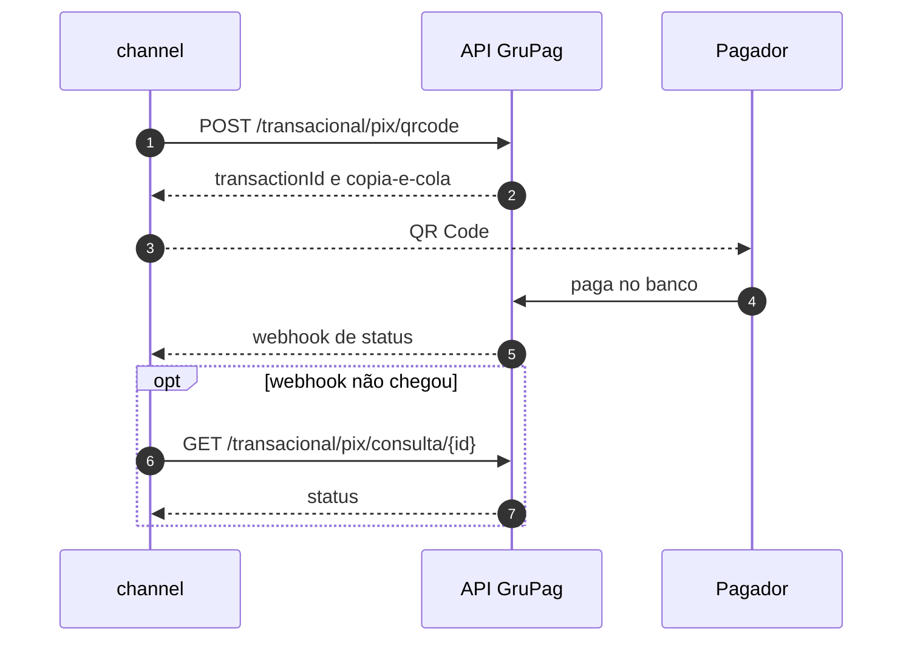

## Resumo {#summary}

A CredPay publicou uma API nova, documentada no portal GruPag (`api2.grupag.com.br`). Hoje falamos com a CredPay por **oito integrações** em dois serviços, com **quatro formas de login**. Esta RFC propõe:

- **Um adaptador novo no `phiz-microwd-channel`**, ao lado do antigo, com códigos de serviço próprios e autenticação por API Key.
- **A troca do cliente CredPay no `phiz-pay-card-vault`** pelo contrato novo de cartão.
- **Virada controlada pela tabela `route_cfg`**, que o operador já edita no painel interno. Cada operação muda de caminho com uma linha de configuração e volta da mesma forma, sem deploy.
- **Cinco fases**, começando pelo PIX, que é o fluxo mais simples. O 3DS passa a ser obrigatório no cartão e define o prazo final, porque a CredPay vai desligar a estrutura antiga sem 3DS.

A RFC também lista o que a API nova **não cobre**: maquininha (TEF), extrato para conciliação, transferência bancária e listagens. Essas operações ficam na integração antiga até a CredPay responder às [perguntas em aberto](#questions).

::: decision Prazo definido pela CredPay
A PHIZ é o único cliente que ainda usa a estrutura antiga, sem 3DS. Para as operações não pararem, a CredPay coloca no ar até 30/10/2026 uma ponte temporária para esse caminho. A data de desligamento da ponte depende da nossa estimativa para a migração completa com 3DS, que a CredPay espera receber até 23/10/2026.
:::

::: stats
- **8** integrações CredPay hoje
- **4 → 1** formas de autenticação
- **31** rotas atuais mapeadas
- **4** operações sem equivalente
:::

## Contexto: como funciona hoje {#context}

A CredPay atende cartão (checkout, cartão salvo, pré-autorização, 3DS), PIX por QR Code e a maquininha dos comerciantes. Nenhum serviço do app fala com ela diretamente: o pedido passa pela cadeia de serviços até o channel, que é o único que conhece a CredPay, junto com o cofre de cartões.

```mermaid Linhas tracejadas são leituras de configuração. O painel não participa do pagamento: define as regras antes e mostra o resultado depois.
flowchart LR
  APP["phiz-flutter<br/>app"] --> AS["microwd-appserver<br/>API do app"]
  AS --> BA["microwd-backapply<br/>escolhe a rota"]
  BA --> CH["microwd-channel<br/>fala com os canais"]
  CH --> CP[("CredPay<br/>4 APIs")]
  CH --> CV["pay-card-vault<br/>cofre de cartões"]
  CV --> CP
  IF["phiz-inner-front<br/>painel"] --> IN["phiz-inner"]
  IN --> DB[("route_cfg<br/>road_info")]
  DB -. "lê a rota" .-> BA
  DB -. "lê a URL" .-> CH
```

### Como uma operação chega à CredPay

1. O **backapply** procura em `route_cfg` a rota para o tipo de transação, a forma de pagamento e o BIN do cartão (`RoadRouteServiceImpl.getRouteByTranPayAcct`). A rota diz qual canal e qual código de serviço atendem.
2. O **channel** recebe o código (por exemplo `B21`, pagamento com cartão salvo) e executa o serviço Spring registrado com esse nome.
3. O serviço busca a URL base do canal em `road_info` e chama a CredPay.

::: decision Por que isso importa para a migração
Como a escolha do caminho mora em dados, e não em código, dá para colocar o caminho novo em produção desligado e ligá-lo por comerciante e por operação. Voltar atrás é trocar a linha de novo.
:::

## Integrações atuais {#inventory}

Levantamento no código do `phiz-microwd-channel` e do `phiz-pay-card-vault`.

| # | Integração | Onde está | Login | Códigos de serviço |
|---|---|---|---|---|
| 1 | Checkout e cartão salvo | `CheckOutTokenServiceImpl`, `CheckOutOperationServiceImpl`, `credPayRefactor/` | `POST /AuthCredPay` | B20–B25, B02, B03, Z519, Z520, Z523 |
| 2 | Pré-autorização | `PreAuthService` | o do checkout | B26, B27, B28 |
| 3 | PIX, QR e transferência | `service/credpay/` | `POST /oauth/token` | B10–B13 |
| 4 | Cartão com 3DS | `ThreeDomainSecurePaymentService` | `autenticacao/gerar-token` | B61–B70 |
| 5 | Maquininha (TEF) | `TefService` | o do checkout | B47, B48 |
| 6 | Conciliação | `SynChannelDataService`, `Credpay*ReconciliationJob` | `/AuthCredPay/`, URL fixa | jobs |
| 7 | Tokenização do cofre | card-vault: `CredpagamentosClient` | `POST /AuthCredPay` | — |
| 8 | Validação de cartão | card-vault: `CredpayClient` | `/v1/autenticacao/gerar-token` | — |

::: risk A confirmar na Fase 0
O código mostra o que *pode* ser chamado. Quais códigos estão ativos em produção depende de `route_cfg`, que ainda não foi consultada. Esse levantamento é o primeiro passo da implementação.
:::

## A API nova {#newapi}

A documentação fica no portal GruPag (exige login) e tem quatro partes: Acesso e API Key, APIs PIX, API Compra com Cartão e API de Simulação.

```mermaid Quatro logins com token, cache e renovação viram uma chave fixa enviada em toda chamada.
flowchart LR
  subgraph HOJE["Hoje"]
    direction TB
    A1["/AuthCredPay<br/>checkout · TEF · cofre"]
    A2["/oauth/token<br/>PIX"]
    A3["autenticacao/gerar-token<br/>3DS"]
    A4["api-services /AuthCredPay<br/>conciliação"]
  end
  subgraph NOVO["API GruPag"]
    K["Authorization: Bearer gpk_…<br/>Cliente-Id: empresa"]
  end
  HOJE ==> NOVO
```

### Regras gerais

| Tema | Como funciona |
|---|---|
| Base | `https://api2-homolog.grupag.com.br` (homologação) e `https://api2.grupag.com.br` (produção) |
| Autenticação | API Key `gpk_…` no header `Authorization: Bearer`. Uma por usuário do portal, sem validade e sem renovação. Regenerar invalida a anterior na hora. |
| Empresa | Header `Cliente-Id` escolhe a empresa vinculada. Sem ele, vale a empresa principal. **Precisa ser igual em todas as chamadas do fluxo.** |
| Valores | Cartão: centavos em string (`"15000"`). PIX: reais em decimal (`15.00`). Simulação: centavos em inteiro. |
| Idempotência | Cartão: pelo `orderId`, e duas chamadas simultâneas dão 409. PIX: mesmo valor numa janela curta dá 409. |
| Respostas | O envelope muda por família (`details`, `data` ou campos na raiz). Erro sempre com `{message}`. 502: sem destino. 504: provedor não respondeu. |
| Chave de homologação | A CredPay confere se o cliente PHIZ está habilitado, com as taxas certas, em homologação. Depois disso aparece o botão de token no portal GruPag; a chave gerada ali (`gpk_…`) vai como `Bearer` em todas as chamadas. |
| Limite de requisições | Por cliente, não por rota. Padrão de 1 transação por segundo, ajustado pela operação declarada no cadastro (ticket médio, volume diário, faturamento mensal). Picos pontuais, como campanhas ou dias de vencimento, são liberados a pedido, com justificativa. |
| Confirmação | Cartão: a resposta da própria chamada já traz o resultado, sem webhook. PIX: webhook de mudança de status. Para os dois, há consulta da transação por ID. |
| Tokenização | Multiadquirente: a CredPay tokeniza o cartão em todas as adquirentes ao mesmo tempo e devolve um token único. Se uma adquirente falha, outra é tentada automaticamente. O token fica no cofre da CredPay, que guarda só os 6 primeiros e os 4 últimos dígitos; dado bruto de cartão não é armazenado. |

```http
# Today: four different logins, each with its own token and renewal
POST {road_info.url}/AuthCredPay            # checkout, pre-auth, TEF, card-vault
POST {road_info.url}/oauth/token            # PIX and bank transfer
POST {road_info.url}autenticacao/gerar-token # 3DS (platform API)
POST https://api-services.credpay.com.br/AuthCredPay/   # reconciliation (hard-coded URL)
```

```bash
# New: one API Key (gpk_...) on every call, no login, no renewal
curl -X GET "https://api2-homolog.grupag.com.br/v1/pagamento/consulta/nit?nit=$NIT" \
  -H "Authorization: Bearer $GRUPAG_API_KEY" \
  -H "Cliente-Id: $CLIENTE_ID"   # same value on every call of the flow
```

### Recursos disponíveis fora do escopo

A CredPay confirmou recursos que nenhum cliente PHIZ usa hoje. Ficam registrados para entrarem rápido quando houver demanda.

| Recurso | Como funciona |
|---|---|
| Recorrência | Habilitada por segmento de atividade. Indicada para academias, planos de telefonia e assinaturas. Não é recomendada para entrega de produto, porque o valor não fica reservado. |
| Split fixo | O saldo fica retido na CredPay. O cliente indica por API para quais fornecedores repassar e em qual prazo (15, 20 ou 30 dias). |
| Split dinâmico | Valores variáveis, comandados por API. Só repassa para fornecedores credenciados e autorizados antes pelo dono do negócio. |
| Repasse | O responsável é sempre PJ; o recebedor do split pode ser PF, desde que cadastrado. O dinheiro cai direto no domicílio bancário declarado, em qualquer banco, sem conta bolsão. |

## Objetivos e fora de escopo {#goals}

#### Objetivos

- Levar cartão, cartão salvo, 3DS, pré-autorização e PIX para a API nova, sem perder nenhuma operação que hoje está ativa.
- Trocar os quatro logins e o `CredPayAuthTask` por uma API Key guardada no cofre de segredos.
- Virar e desvirar cada operação por configuração, por comerciante, sem deploy.
- Concentrar conversões de valor e de status num único adaptador.
- Apagar todos os CVVs guardados hoje e passar a guardar só o token da CredPay (ver [seção 10](#breaking)).

#### Fora do escopo

- Usar a API de Simulação para mostrar parcelas e taxas no app. É uma melhoria possível, não um requisito da migração.
- TEF, conciliação e transferência bancária, enquanto não houver equivalente na API nova.
- Outros canais (Pinbank, Cronos, Afro).
- Recorrência e split. A API oferece os dois, mas nenhum cliente PHIZ usa hoje (ver [seção 04](#newapi)).

## Mapeamento rota a rota {#mapping}

<div class="legend"><span><span class="st eq">equivalente</span> mesma operação, ajuste de formato</span><span><span class="st ch">muda</span> regra ou fluxo diferente</span><span><span class="st new">novo</span> não existia</span><span><span class="st gap">sem equivalente</span> fica no antigo</span></div>

### Cartão salvo e checkout

::: table map
| Hoje | API nova | Situação | O que muda |
|---|---|---|---|
| POST /Tokenizacao/CriarToken<br>B20 · Z519 | POST /v1/pagamento/cartao/adicionar | <span class="st ch">muda</span> | Exige `authorizerId`. A CredPay informou que a tokenização é multiadquirente, com um token único; confirmar em homologação se crédito e débito ainda pedem tokens separados. Guardar o `customerId`. |
| GET /Tokenizacao/Obter/{id} | POST /v1/pagamento/cartao/buscar | <span class="st ch">muda</span> | Devolve só o status (`ATV` ou `INA`). |
| GET /Tokenizacao/Listar | — | <span class="st gap">sem equivalente</span> | Ver [Lacunas](#gaps). |
| POST /Tokenizacao/Excluir/{id}<br>B24 · Z520 | DELETE /v1/pagamento/cartao/remover | <span class="st eq">equivalente</span> | DELETE com corpo `{token, customer}`. |
| POST /Tokenizacao/Pagar<br>B21 · B02 | POST /v1/pagamento | <span class="st ch">muda</span> | Centavos em string; `orderId` obrigatório e idempotente; devolve o `nit`, nova chave da transação. |
| POST /Tokenizacao/Cancelar/{transacaoId}/{referenceId}<br>B25 · B03 | DELETE /v1/pagamento/cancelar | <span class="st ch">muda</span> | Corpo `{nit, amount}`, aceita parcial. Estorno só até 23:59 do dia da captura. |
| GET /Consulta/TransactionId/{id}<br>GET /Consulta/NumeroInterno/{n}<br>B22 · Z523 | GET /v1/pagamento/consulta/nit?nit= | <span class="st ch">muda</span> | Só por `nit`. Não há busca por número interno nem por `orderId`. |
| GET /Consulta/Subdominio/Datas/{ini}/{fim} | — | <span class="st gap">sem equivalente</span> | Usado na conciliação. |
:::

```json
{
  "nomeDoCliente": "JOAO DA SILVA",
  "documento": "12345678901",
  "quantidadeDeParcelas": 1,
  "valorInicial": 150.0,
  "token": "TOKEN_DO_CARTAO",
  "numeroInterno": "PED-4711",
  "subDominioId": 1234,
  "lojaId": 1
}
```

```json
{
  "merchantChargeId": "20260901010707410895669",
  "orderId": "PED-4711",
  "installments": "1",
  "authorizerId": "2",
  "amount": "15000",
  "typeTransaction": "C",
  "card": {
    "token": "crd_d6dc9c299d15…"
  }
}
```

<p class="cap">Mesmo pagamento com cartão salvo, antes e depois. O valor passa de reais para centavos, e o número interno vira <code>orderId</code>.</p>

### Pré-autorização

::: table map
| Hoje | API nova | Situação | O que muda |
|---|---|---|---|
| POST /Transacao/Autorizar<br>B26 | POST /v1/pagamento/preautorizacao | <span class="st eq">equivalente</span> | Mesmo corpo do pagamento; nasce `AUTORIZADO`. |
| POST /Transacao/Capturar/{transacaoId}/{referenceId}/{valor}<br>B27 | POST /v1/pagamento/preautorizacao/liquidar | <span class="st eq">equivalente</span> | Corpo `{nit, amount}`; aceita captura parcial. |
| POST /Transacao/Cancelar/{transacaoId}/{referenceId}<br>POST /Transacao/Cancelar/Parcial<br>B28 | DELETE /v1/pagamento/cancelar | <span class="st eq">equivalente</span> | Um endpoint; o valor define se é parcial. Desfazer reserva não tem limite de horário. |
:::

### Cartão com 3DS

::: table map
| Hoje | API nova | Situação | O que muda |
|---|---|---|---|
| cartao/adicionar/<br>B62 | POST /v1/pagamento/cartao/adicionar | <span class="st ch">muda</span> | Como no cartão salvo. |
| cartao/validar/ · 3ds/checar/<br>B61 · B69 | POST /v1/pagamento/cartao/buscar | <span class="st ch">muda</span> | Confirmar se "validar" faz hoje mais do que checar status. |
| pagamento/cartao/3ds/configurar/<br>B63 | POST /v1/pagamento/3ds/autenticacao<br>POST /v1/pagamento/3ds/configuracao | <span class="st ch">muda</span> | Vira duas chamadas. A primeira gera o `merchantChargeId`. |
| pagamento/cartao/3ds/desafio/<br>B64 | passos no navegador | <span class="st ch">muda</span> | 3DS Method e desafio são formulários enviados pelo navegador do pagador. Ver [seção 07](#card-flow). |
| pagamento/cartao/3ds/checar/desafio/<br>B65 | GET /v1/pagamento/3ds/consultar3DS | <span class="st eq">equivalente</span> | Aprovado quando vêm `eci` e `authentication.value`. |
| pagamento/cartao/3ds/cobrar/<br>B66 | POST /v1/pagamento + merchantChargeId | <span class="st ch">muda</span> | A autenticação vale 15 minutos e é consumida na cobrança. |
| pagamento/cartao/3ds/preautorizada/cobrar/<br>B67 | POST /v1/pagamento/preautorizacao (+ /liquidar) | <span class="st eq">equivalente</span> | — |
| pagamento/cartao/3ds/cancelar/<br>B68 | DELETE /v1/pagamento/cancelar | <span class="st ch">muda</span> | Regra de 23:59. |
| pagamento/cartao/3ds/consultar/ | GET /v1/pagamento/consulta/nit | <span class="st eq">equivalente</span> | — |
:::

### PIX

::: table map
| Hoje | API nova | Situação | O que muda |
|---|---|---|---|
| POST /api/generate-qrcodes<br>B10 | POST /transacional/pix/qrcode | <span class="st eq">equivalente</span> | Reais em decimal. Síncrono, até 30 s. Expira em 3 min (instantâneo) ou em até 1 h (padrão). |
| GET /api/find-qrcode/{id}<br>B11 | GET /transacional/pix/consulta/{transactionId} | <span class="st eq">equivalente</span> | Pago quando o status é `CONFIRMADO`. Há webhook de status; a consulta fica como reserva. |
| POST /api/bank-transfers<br>B12 | — | <span class="st gap">sem equivalente</span> | — |
| POST /api/list-transactions<br>B13 | — | <span class="st gap">sem equivalente</span> | — |
| — | POST /transacional/pix/cancelamento/{transactionId} | <span class="st new">novo</span> | Segundo a CredPay, até 23h59 do dia da operação; depois, chamado com análise manual. A documentação fala em 24 h. Ver [seção 14](#questions). |
| — | POST /transacional/pix/disputa | <span class="st new">novo</span> | Só perfil Admin. Candidato a tela no painel. |
:::

### Cofre de cartões

::: table map
| Hoje | API nova | Situação | O que muda |
|---|---|---|---|
| POST /Tokenizacao/CriarToken | POST /v1/pagamento/cartao/adicionar | <span class="st ch">muda</span> | Exige `authorizerId`. |
| GET /Tokenizacao/ObterDadosToken/{token} | POST /v1/pagamento/cartao/buscar | <span class="st ch">muda</span> | Só status. Confirmar se o cofre usa outro dado dessa resposta. |
| POST /Tokenizacao/Excluir/Token/{token} | DELETE /v1/pagamento/cartao/remover | <span class="st eq">equivalente</span> | — |
| POST /v1/pagamento (validação) | POST /v1/pagamento | <span class="st eq">equivalente</span> | Mesmo caminho; muda a base e a autenticação, e passa a exigir `orderId`. |
:::

## Novo fluxo de cartão com 3DS {#card-flow}

A maior mudança de fluxo está no 3DS. Hoje o backapply devolve uma URL pronta (`certifyUrl`, em `CardCertifyServiceImpl`) e o front só a abre. Na API nova, dois passos rodam **no navegador do pagador**, e o front precisa montar e enviar os formulários.

Segundo a CredPay, a primeira versão deste checkout transparente foi entregue em outubro de 2025, porque não quisemos embutir o iframe de 3DS dela, e nunca chegou a ser implementada. A versão atual é a segunda. Ainda segundo a CredPay, o nosso código chama hoje a API de transação direto, sem passar pelo 3DS, o que só funciona na estrutura antiga. No modelo novo, o 3DS é obrigatório antes da transação e tem três etapas:

1. **Setup.** Cadastra a transação (código do cartão, bandeira, valor) e recebe os dados para rodar o fingerprint do navegador.
2. **Enrollment e desafio.** Envia os dados complementares (endereço, Merchant ID e outros) e aguarda o resultado, com ou sem desafio.
3. **Consulta e pagamento.** Se a autenticação passou, envia o pagamento com o hash gerado (`merchantChargeId`).

~~~mermaid O mesmo `Cliente-Id` precisa ir em todas as chamadas à API GruPag deste fluxo. Se ele faltar em uma, o pagamento responde "3DS não encontrado".
sequenceDiagram
  autonumber
  participant F as Front do pagador
  participant BA as backapply
  participant CH as channel
  participant G as API GruPag
  participant E as Banco emissor
  BA->>CH: iniciar 3DS do pedido
  CH->>G: POST /3ds/autenticacao
  G-->>CH: merchantChargeId e threeDsMethod
  CH-->>BA: dados do 3DS Method
  BA-->>F: dados para o navegador
  F->>E: 3DS Method em iframe invisível
  BA->>CH: autenticar com dados do navegador
  CH->>G: POST /3ds/configuracao
  G-->>CH: frictionless ou desafio
  F->>E: desafio com creq, se houver
  CH->>G: GET /3ds/consultar3DS
  G-->>CH: eci e CAVV
  CH->>G: POST /v1/pagamento com merchantChargeId
  G-->>CH: nit e status CONFIRMADO
~~~

::: risk Impacto no front
Ainda falta identificar qual front abre a `certifyUrl` hoje (o app ou um formulário web). Ele precisa coletar os dados reais do navegador (tela, fuso, user-agent), enviar o 3DS Method num iframe invisível e apresentar o desafio num iframe de 400×650.
:::

::: decision Apoio da CredPay
A CredPay oferece sessões práticas para montar as requisições junto com o time e um HTML de exemplo para testar o fingerprint. O canal de suporte direto fica aberto até o go-live.
:::

## Novo fluxo PIX {#pix-flow}

O PIX quase não muda de forma: gerar e aguardar a confirmação, agora por webhook, com a consulta como reserva. O que entra de novo é a devolução com regra de prazo e a disputa.



```mermaid Status de uma cobrança PIX na API nova. A disputa é decidida por um usuário Admin, o que pede uma tela no painel interno. O prazo ainda precisa ser confirmado: a documentação fala em 24 h; na reunião, a CredPay indicou até 23h59 do dia da operação, porque a partir da meia-noite ela processa conciliação, créditos e débitos, e depois disso o caminho é um chamado com análise manual (ver [seção 14](#questions)).
stateDiagram-v2
  [*] --> GERADO
  GERADO --> CONFIRMADO: pagamento
  GERADO --> EXPIRADO: venceu
  CONFIRMADO --> ESTORNANDO: devolução no prazo
  ESTORNANDO --> ESTORNADO
  CONFIRMADO --> DISPUTA: devolução fora do prazo
  DISPUTA --> CANCELANDO: admin aprova
  CANCELANDO --> CANCELADO
  DISPUTA --> PAGO: admin nega
```

```bash
curl -X POST "https://api2-homolog.grupag.com.br/transacional/pix/qrcode" \
  -H "Authorization: Bearer $GRUPAG_API_KEY" \
  -H "Content-Type: application/json" \
  -d '{ "amount": 15.00, "description": "Pedido PED-12345", "expirationSeconds": 3600 }'
# 200 → { "transactionId": "a1b2…", "status": "GERADO", "pixCopyAndPaste": "000201…", "destination": "TRANSACIONAL-PIX-SICREDI" }
```

::: decision Validade do QR Code
Há dois formatos. O **instantâneo** expira em 3 minutos. O **padrão** vale até 1 hora e é o recomendado para volume alto, porque Banco do Brasil, Caixa e Santander podem levar até 30 minutos para responder.
:::

## Lacunas {#gaps}

Estas operações não aparecem na documentação nova. Continuam na integração atual até a CredPay dizer qual é o substituto.

| Operação | Uso hoje | Impacto se for desligada |
|---|---|---|
| Maquininha TEF: `/Pdv/CriarOperacao`, `/Pdv/GetOperacao` | Venda presencial (B47, B48) | <span class="no">Para a venda em POS da CredPay.</span> |
| Extrato: `/Movimentacao/Analitico`, `/Consulta/Subdominio/Datas` | Conciliação diária | <span class="no">A conciliação deixa de conferir o canal.</span> |
| Transferência bancária: `/api/bank-transfers` | B12 | <span class="part">Para a transferência por esse canal.</span> |
| Listagens: `/Tokenizacao/Listar`, `/api/list-transactions` | Consulta e sincronização | <span class="part">Passamos a depender só dos nossos registros.</span> |

Webhooks e recorrência saíram desta lista na v1.1: a CredPay confirmou que existem (ver [seção 04](#newapi)).

## Mudanças que quebram contrato {#breaking}

| Mudança | Hoje | API nova | O que fazer |
|---|---|---|---|
| **Tokens de cartão** | Criados em `/Tokenizacao/CriarToken` | Não valem e não há migração. Token novo, multiadquirente. | Começar do zero: o cartão salvo é cadastrado de novo no modelo novo. Ver instruções abaixo. |
| **CVV** | Há CVVs gravados no nosso banco | Nenhum dado bruto de cartão fica com a PHIZ | Excluir todos os CVVs. Ver instruções abaixo. |
| **Valores** | Reais em `BigDecimal` (`valorInicial`) | Cartão em centavos (string); PIX em reais | Converter num único ponto do adaptador. |
| **Identificadores** | `transacaoId`, `referenceId`, `numeroInterno` | `nit`, `merchantChargeId`, `customerId` | Novas colunas no pedido e no cartão. |
| **Prazo de estorno** | Sem limite documentado | Cartão: até 23:59 do dia. PIX: até 23h59 do dia, segundo a CredPay; depois, chamado com análise manual. | Tratar no app e no painel; rotina para devolução fora da API. |
| **Empresa** | `subDominioId`, `lojaId` | Header `Cliente-Id` | Mapear cada comerciante; resolver uma vez por pedido e reutilizar. |
| **3DS** | URL pronta | Formulários no navegador | Mudar o front. |
| **Status** | Rótulos do checkout | `CONFIRMADO`, `AUTORIZADO`, `PENDENTE`, `NEGADO`… | Tabela de conversão no adaptador. |

```java
// Single conversion point in the channel's GruPag adapter
static String toCents(BigDecimal reais) {           // card: cents as a string
    return reais.setScale(2, RoundingMode.UNNECESSARY).movePointRight(2).toPlainString();
}
static BigDecimal toPixReais(BigDecimal reais) {      // PIX: reais as a decimal
    return reais.setScale(2, RoundingMode.UNNECESSARY);
}
```

### Instruções para o time de desenvolvimento: CVV e tokens

::: risk Obrigatório antes da virada do cartão
Não existe migração de tokens nem de dados de cartão do modelo antigo para o novo. A base começa do zero.
:::

1. **Excluir todos os CVVs** já gravados, em todas as tabelas e em todos os ambientes. Não guardar CVV de nenhuma forma: nem cifrado, nem em log, nem em cache.
2. **Não migrar os tokens antigos.** Os cartões salvos no modelo antigo deixam de ser usados na API nova.
3. **Tokenizar pela CredPay** todo cartão novo (`POST /v1/pagamento/cartao/adicionar`). Guardar só o token, o `customerId` e os 6 primeiros e 4 últimos dígitos.
4. **O CVV só trafega** na própria requisição à CredPay e é descartado em seguida.
5. **Todo pagamento com cartão passa pelo 3DS** (setup, desafio, consulta) antes de `POST /v1/pagamento`. Chamar a transação direto só funciona na ponte legada, que será desligada.
6. **Entregar evidência:** a lista das tabelas e colunas onde havia CVV e o resultado da exclusão, para revisão do time Brasil.

## Proposta técnica {#design}

### Um provedor novo, ao lado do antigo

Em vez de alterar os serviços atuais, o channel ganha um adaptador novo (`service/grupag/`) com **códigos de serviço próprios** e um `road_info` apontando para `api2.grupag.com.br`. Os dois caminhos convivem; a rota decide qual é usado.

~~~mermaid Virar uma operação é editar `route_cfg` no painel. Voltar é desfazer a edição.
flowchart LR
  BA["backapply"] --> RC{"route_cfg<br/>por comerciante<br/>e operação"}
  RC -- "código antigo" --> OLD["Serviços CredPay atuais<br/>B10 · B21 · B61 …"]
  RC -- "código novo" --> NEW["Adaptador GruPag<br/>códigos novos"]
  OLD --> CP[("APIs CredPay atuais")]
  NEW --> GP[("api2.grupag.com.br")]
  OP["Operador no painel"] -. "troca a linha<br/>para virar ou voltar" .-> RC
~~~

### Mudanças por repositório

| Repositório | Mudança |
|---|---|
| `phiz-microwd-channel` | Cliente HTTP com API Key e `Cliente-Id`; adaptadores de cartão, 3DS, pré-autorização e PIX; conversão de valor e status; registro dos códigos novos. |
| `phiz-pay-card-vault` | Trocar `CredpagamentosClient` e `CredpayClient` pelo contrato novo, atrás de configuração. Excluir os CVVs guardados e deixar de gravá-los. |
| `phiz-microwd-backapply` | Gravar `nit`, `merchantChargeId` e `customerId`; adaptar `CardCertifyServiceImpl` ao 3DS novo; tratar o prazo de estorno. |
| `phiz-microwd-common` | Colunas novas nas entidades de pedido e de cartão. |
| `phiz-inner` e `phiz-inner-front` | Cadastro dos códigos e do `road_info`; tela de disputa PIX. |
| Front do 3DS | 3DS Method e desafio no navegador. |

::: decision Credencial
A API Key não expira, mas regenerar derruba a anterior sem aviso. Ela fica no cofre de segredos de cada ambiente, nunca no código nem em texto puro no `road_info`, e é trocada numa janela combinada.
:::

```bash
# Full or partial refund (card). Only until 23:59 on the capture day (Brasília time).
curl -X DELETE "https://api2-homolog.grupag.com.br/v1/pagamento/cancelar" \
  -H "Authorization: Bearer $GRUPAG_API_KEY" \
  -H "Content-Type: application/json" \
  -d '{ "nit": "pag_59c416ca3552…", "amount": "5000" }'
```

## Plano de migração {#rollout}

::: phases
##### FASE 0: Preparação

- Levantar códigos CredPay ativos em `route_cfg`
- Chave de homologação, depois da habilitação de taxas
- Estimativa de prazo para a CredPay até 23/10
- Exclusão dos CVVs

##### FASE 1: PIX

- Gerar QR e consultar
- Um comerciante de teste
- Devolução e disputa

##### FASE 2: Cartão sem 3DS

- Tokenização multiadquirente, pagamento, cancelamento, consulta
- Cofre de cartões
- Só em homologação: em produção, o cartão vira junto com o 3DS

##### FASE 3: 3DS

- Fluxo novo no channel
- Mudança no front
- Libera o desligamento da ponte legada

##### FASE 4: Pré-autorização

- Reservar, liquidar, desfazer

##### FASE 5: Desligamento

- Remover códigos antigos
- Remover `CredPayAuthTask` e clientes antigos
- TEF e conciliação seguem até haver substituto
:::

### Em cada fase

1. Testes de contrato em homologação, usando a coleção Postman da CredPay como referência.
2. Um comerciante piloto em produção, virado pela rota.
3. Acompanhar taxa de aprovação, erros 4xx/5xx por código e tempo de resposta, comparando com o caminho antigo.
4. Virar o restante dos comerciantes em lotes.

### Datas combinadas

| Data | O quê |
|---|---|
| 23/10/2026 | A PHIZ envia à CredPay a estimativa de prazo para a migração completa com 3DS. |
| 30/10/2026 | A CredPay coloca no ar a ponte legada sem 3DS, para as operações não pararem. |
| A definir | Desligamento da ponte, a partir da nossa estimativa. Até lá, o cartão com 3DS precisa estar em produção. |

As demais datas saem da Fase 0, quando soubermos o que está ativo.

## Riscos {#risks}

| Risco | Mitigação |
|---|---|
| Usuários perdem os cartões salvos, porque os tokens antigos não migram | Pedir o recadastro do cartão no próximo pagamento e avisar no app antes da virada. |
| `Cliente-Id` diferente no meio do fluxo | Resolver uma vez por pedido, gravar e reutilizar; teste automatizado do fluxo 3DS completo. |
| Erro de unidade (reais × centavos) | Conversão num único ponto, com testes de contrato por endpoint. |
| Estorno recusado depois das 23:59 | Avisar no app e no painel; rotina de devolução fora da API. |
| Conciliação sem fonte de dados | Manter o extrato antigo até haver substituto. |
| Homologação apontando para produção | O card-vault hoje usa a base de produção como padrão porque o sandbox estava quebrado. Na API nova, exigir a base de homologação fora de produção. |
| Ponte legada desligada antes de o 3DS estar em produção | Estimativa realista até 23/10; tratar o 3DS como caminho crítico. |
| CVV esquecido em alguma tabela, log ou backup | Lista de onde havia CVV e evidência da exclusão, revisada pelo time Brasil. |
| Pico acima do limite (1 transação por segundo por padrão) | Declarar o volume real no cadastro e pedir liberação antes de campanhas. |

## Perguntas em aberto para a CredPay {#questions}

A reunião técnica com a CredPay respondeu cinco das oito perguntas da v1.0.

| Pergunta | Resposta da CredPay |
|---|---|
| Tokens antigos valem na API nova? | <span class="no">Não.</span> Não há migração: zerar e começar do zero no modelo multiadquirente. |
| Webhooks | <span class="yes">Sim, para PIX.</span> O cartão responde na própria chamada; os dois têm consulta por ID. |
| Recorrência | <span class="yes">Disponível</span>, habilitada por segmento de atividade. |
| Limites | Por cliente: 1 transação por segundo por padrão, ajustável no cadastro e sob pedido. |
| Prazo | A PHIZ é o último cliente na estrutura antiga. A ponte sem 3DS fica pronta até 30/10/2026; a data de desligamento sai da nossa estimativa, devida até 23/10/2026. |

### Ainda em aberto

::: questions
1. **Lacunas.** Qual o substituto para TEF, extrato, transferência bancária e listagem de transações?
2. **Simulação.** O `hashSimulacao` é conferido no pagamento? A página de simulação diz que sim; a de cartão diz que é aceito e ignorado.
3. **Empresas.** Como mapear nossos comerciantes para `Cliente-Id`: uma chave por ambiente com todos vinculados, ou uma por comerciante?
4. **Estorno PIX.** Na reunião, a regra foi até 23h59 do dia e, depois, chamado. A documentação fala em devolução imediata até 24 h e disputa depois. Qual vale, e a rota de disputa continua?
5. **Token multiadquirente.** Se o token é único para todas as adquirentes, o `authorizerId` ainda é obrigatório? Crédito e débito continuam com tokens separados?
6. **Desligamento da ponte.** Data final, a combinar depois da nossa estimativa.
:::

## Referências {#refs}

- Documentação GruPag (exige login): Acesso e API Key, APIs PIX, API Compra com Cartão, API de Simulação.
- Reunião técnica com a CredPay sobre a API nova (outubro de 2026): 3DS, tokenização, PIX, split, webhooks, recorrência e limites.
- channel: `CheckOutTokenServiceImpl`, `CheckOutOperationServiceImpl`, `PreAuthService`, `service/credpay/impl/*`, `ThreeDomainSecurePaymentService`, `TefService`, `SynChannelDataService`, `ApiCodeConstant`.
- card-vault: `CredpagamentosClient`, `CredpayClient`, `application.yaml`.
- backapply: `RoadRouteServiceImpl`, `CardCertifyServiceImpl`.
