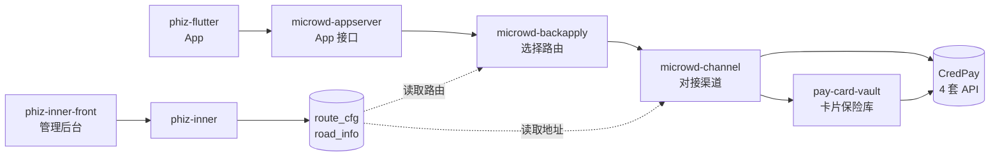
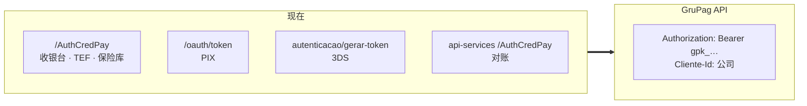
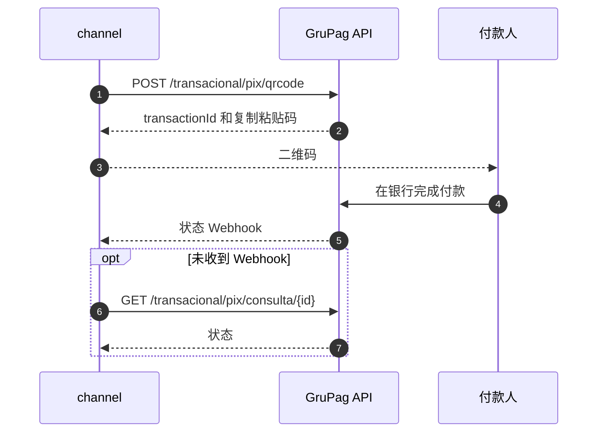

## 摘要 {#summary}

CredPay 发布了新的 API，文档位于 GruPag 门户（`api2.grupag.com.br`）。目前我们通过两个服务中的**八个集成**对接 CredPay，使用**四种不同的登录方式**。本 RFC 提议：

- **在 `phiz-microwd-channel` 中新增一个适配器**，与旧适配器并存，使用独立的服务编码，并通过 API Key 认证。
- **将 `phiz-pay-card-vault` 中的 CredPay 客户端**替换为新的银行卡接口。
- **通过 `route_cfg` 表控制切换**。运营人员已经在内部管理后台维护这张表。每项操作改一行配置即可切换，改回即可回滚，无需发版。
- **分五个阶段**：先做最简单的 PIX。3DS 成为银行卡支付的必经步骤，并决定最终期限，因为 CredPay 将关闭不带 3DS 的旧结构。

本 RFC 也列出了新 API **尚未覆盖**的能力：刷卡终端（TEF）、对账用的流水、银行转账和列表查询。这些操作在 CredPay 回答[待定问题](#questions)之前继续使用旧集成。

::: decision CredPay 设定的期限
PHIZ 是唯一仍在使用不带 3DS 的旧结构的客户。为避免业务中断，CredPay 将在 2026-10-30 前为该路径上线一个临时过渡通道。过渡通道的关闭日期取决于我们对带 3DS 的完整迁移所给出的工期估算，CredPay 希望在 2026-10-23 前收到。
:::

::: stats
- **8** 当前 CredPay 集成
- **4 → 1** 认证方式
- **31** 已映射的现有路由
- **4** 无对应的操作
:::

## 背景：当前的工作方式 {#context}

CredPay 负责银行卡（收银台、已保存的卡、预授权、3DS）、PIX 二维码收款以及商户的刷卡终端。面向 App 的服务都不直接调用它：请求沿服务链传到 channel，只有 channel 和卡片保险库（card-vault）对接 CredPay。



### 一次操作如何到达 CredPay

1. **backapply** 按交易类型、支付方式和卡 BIN 在 `route_cfg` 中查找路由（`RoadRouteServiceImpl.getRouteByTranPayAcct`）。路由决定由哪个渠道、哪个服务编码处理。
2. **channel** 收到编码（例如 `B21`，已保存卡支付），执行以该名称注册的 Spring 服务。
3. 该服务从 `road_info` 读取渠道基础地址，然后调用 CredPay。

::: decision 这对迁移意味着什么
路径由数据而不是代码决定，所以新路径可以先以关闭状态上线，再按商户、按操作打开。回滚只需把这一行改回去。
:::

## 现有集成 {#inventory}

以下清单来自 `phiz-microwd-channel` 和 `phiz-pay-card-vault` 的代码。

| # | 集成 | 位置 | 登录 | 服务编码 |
|---|---|---|---|---|
| 1 | 收银台与已保存的卡 | `CheckOutTokenServiceImpl`、`CheckOutOperationServiceImpl`、`credPayRefactor/` | `POST /AuthCredPay` | B20–B25、B02、B03、Z519、Z520、Z523 |
| 2 | 预授权 | `PreAuthService` | 同收银台 | B26、B27、B28 |
| 3 | PIX、二维码与银行转账 | `service/credpay/` | `POST /oauth/token` | B10–B13 |
| 4 | 3DS 银行卡 | `ThreeDomainSecurePaymentService` | `autenticacao/gerar-token` | B61–B70 |
| 5 | 刷卡终端（TEF） | `TefService` | 同收银台 | B47、B48 |
| 6 | 对账 | `SynChannelDataService`、`Credpay*ReconciliationJob` | `/AuthCredPay/`，地址写死在代码中 | 定时任务 |
| 7 | 保险库令牌化 | card-vault：`CredpagamentosClient` | `POST /AuthCredPay` | — |
| 8 | 卡片验证 | card-vault：`CredpayClient` | `/v1/autenticacao/gerar-token` | — |

::: risk 在第 0 阶段确认
代码只说明哪些接口*可以*被调用。生产环境实际启用了哪些编码取决于 `route_cfg`，目前还没有查询。这份清单是实施的第一步。
:::

## 新 API {#newapi}

文档位于 GruPag 门户（需要登录），共四部分：访问与 API Key、PIX API、银行卡支付 API、费率模拟 API。



### 通用规则

| 主题 | 说明 |
|---|---|
| 基础地址 | `https://api2-homolog.grupag.com.br`（测试）和 `https://api2.grupag.com.br`（生产） |
| 认证 | 在 `Authorization: Bearer` 中携带 API Key `gpk_…`。每个门户用户一个，永不过期，也无需续期。重新生成会立即使旧密钥失效。 |
| 公司 | 请求头 `Cliente-Id` 选择关联的公司。不传则使用用户的主公司。**同一流程中的每次调用都必须一致。** |
| 金额 | 银行卡：以分为单位的字符串（`"15000"`）。PIX：以雷亚尔为单位的小数（`15.00`）。模拟：以分为单位的整数。 |
| 幂等 | 银行卡：按 `orderId`；并发的两次调用返回 409。PIX：短时间内相同金额返回 409。 |
| 响应 | 不同接口族的外层结构不同（`details`、`data` 或字段在根级）。错误统一为 `{message}`。502：无法确定目标渠道。504：渠道未响应。 |
| 测试环境密钥 | CredPay 确认 PHIZ 客户在测试环境中已开通且费率正确。之后 GruPag 门户中会出现生成令牌的按钮；在那里生成的密钥（`gpk_…`）作为 `Bearer` 用于所有调用。 |
| 请求限制 | 按客户设置，而不是按路由。默认每秒 1 笔交易，并根据入驻时申报的业务情况（平均客单价、日交易量、月营业额）调整。临时高峰（如营销活动或账单到期日）可提出申请并说明理由后放开。 |
| 结果确认 | 银行卡：调用的响应中直接返回结果，不需要 Webhook。PIX：提供状态变更 Webhook。两者都可以按 ID 查询交易。 |
| 令牌化 | 多收单机构：CredPay 同时在所有收单机构完成令牌化，并返回一个统一的令牌。某个收单机构失败时会自动尝试另一个。令牌保存在 CredPay 的保险库中，CredPay 只保留卡号前 6 位和后 4 位，不存储原始卡数据。 |

```http
# Today: four different logins, each with its own token and renewal
POST {road_info.url}/AuthCredPay            # checkout, pre-auth, TEF, card-vault
POST {road_info.url}/oauth/token            # PIX and bank transfer
POST {road_info.url}autenticacao/gerar-token # 3DS (platform API)
POST https://api-services.credpay.com.br/AuthCredPay/   # reconciliation (hard-coded URL)
```

```bash
# New: one API Key (gpk_...) on every call, no login, no renewal
curl -X GET "https://api2-homolog.grupag.com.br/v1/pagamento/consulta/nit?nit=$NIT" \
  -H "Authorization: Bearer $GRUPAG_API_KEY" \
  -H "Cliente-Id: $CLIENTE_ID"   # same value on every call of the flow
```

### 可用但不在本次范围内的功能

CredPay 确认了以下功能，目前没有 PHIZ 客户在使用。记录在此，以便有需求时可以快速接入。

| 功能 | 说明 |
|---|---|
| 定期扣款 | 按行业类别开通。适用于健身房、电话套餐和订阅服务。不建议用于实物交付，因为金额不会被预留。 |
| 固定分账 | 余额留存在 CredPay。客户通过 API 指定向哪些供应商结算以及结算周期（15、20 或 30 天）。 |
| 动态分账 | 金额可变，通过 API 控制。只向事先登记并经企业主授权的供应商结算。 |
| 结算 | 责任方必须是企业（CNPJ）；分账收款方可以是已登记的个人（CPF）。资金直接打入申报的银行账户，任何银行均可，不经过资金池账户。 |

## 目标与非目标 {#goals}

#### 目标

- 将银行卡、已保存的卡、3DS、预授权和 PIX 迁移到新 API，不丢失任何当前在用的操作。
- 用存放在密钥库中的 API Key 取代四种登录方式和 `CredPayAuthTask`。
- 按商户、通过配置开启或关闭每项操作，无需发版。
- 金额和状态的转换集中在一个适配器中。
- 删除目前存储的所有 CVV，今后只保存 CredPay 的令牌（见[第 10 节](#breaking)）。

#### 不在范围内

- 使用费率模拟 API 在 App 中展示分期和费率。这是可选的改进，不是迁移的前提。
- 新 API 尚无对应能力的 TEF、对账和银行转账。
- 其他渠道（Pinbank、Cronos、Afro）。
- 定期扣款和分账。API 支持这两项功能，但目前没有 PHIZ 客户使用（见[第 04 节](#newapi)）。

## 逐条路由映射 {#mapping}

<div class="legend"><span><span class="st eq">对应</span> 同一操作，仅格式调整</span><span><span class="st ch">变化</span> 规则或流程不同</span><span><span class="st new">新增</span> 以前没有</span><span><span class="st gap">无对应</span> 保留旧接口</span></div>

### 已保存的卡与收银台

::: table map
| 现在 | 新 API | 状态 | 变化 |
|---|---|---|---|
| POST /Tokenizacao/CriarToken<br>B20 · Z519 | POST /v1/pagamento/cartao/adicionar | <span class="st ch">变化</span> | 需要 `authorizerId`。CredPay 表示令牌化支持多收单机构，只返回一个令牌；需在测试环境确认信用和借记是否仍需分别令牌化。需保存返回的 `customerId`。 |
| GET /Tokenizacao/Obter/{id} | POST /v1/pagamento/cartao/buscar | <span class="st ch">变化</span> | 只返回状态（`ATV` 或 `INA`）。 |
| GET /Tokenizacao/Listar | — | <span class="st gap">无对应</span> | 见[缺口](#gaps)。 |
| POST /Tokenizacao/Excluir/{id}<br>B24 · Z520 | DELETE /v1/pagamento/cartao/remover | <span class="st eq">对应</span> | 带请求体 `{token, customer}` 的 DELETE。 |
| POST /Tokenizacao/Pagar<br>B21 · B02 | POST /v1/pagamento | <span class="st ch">变化</span> | 金额为分（字符串）；`orderId` 必填且幂等；返回 `nit`，作为新的交易主键。 |
| POST /Tokenizacao/Cancelar/{transacaoId}/{referenceId}<br>B25 · B03 | DELETE /v1/pagamento/cancelar | <span class="st ch">变化</span> | 请求体 `{nit, amount}`，支持部分退款。只能在扣款当天 23:59 之前退款。 |
| GET /Consulta/TransactionId/{id}<br>GET /Consulta/NumeroInterno/{n}<br>B22 · Z523 | GET /v1/pagamento/consulta/nit?nit= | <span class="st ch">变化</span> | 只能按 `nit` 查询，不支持按内部编号或 `orderId` 查询。 |
| GET /Consulta/Subdominio/Datas/{ini}/{fim} | — | <span class="st gap">无对应</span> | 用于对账。 |
:::

```json
{
  "nomeDoCliente": "JOAO DA SILVA",
  "documento": "12345678901",
  "quantidadeDeParcelas": 1,
  "valorInicial": 150.0,
  "token": "TOKEN_DO_CARTAO",
  "numeroInterno": "PED-4711",
  "subDominioId": 1234,
  "lojaId": 1
}
```

```json
{
  "merchantChargeId": "20260901010707410895669",
  "orderId": "PED-4711",
  "installments": "1",
  "authorizerId": "2",
  "amount": "15000",
  "typeTransaction": "C",
  "card": {
    "token": "crd_d6dc9c299d15…"
  }
}
```

<p class="cap">同一笔已保存卡支付的前后对比。金额从雷亚尔改为分，内部编号改为 <code>orderId</code>。</p>

### 预授权

::: table map
| 现在 | 新 API | 状态 | 变化 |
|---|---|---|---|
| POST /Transacao/Autorizar<br>B26 | POST /v1/pagamento/preautorizacao | <span class="st eq">对应</span> | 请求体与支付相同；初始状态为 `AUTORIZADO`。 |
| POST /Transacao/Capturar/{transacaoId}/{referenceId}/{valor}<br>B27 | POST /v1/pagamento/preautorizacao/liquidar | <span class="st eq">对应</span> | 请求体 `{nit, amount}`；支持部分请款。 |
| POST /Transacao/Cancelar/{transacaoId}/{referenceId}<br>POST /Transacao/Cancelar/Parcial<br>B28 | DELETE /v1/pagamento/cancelar | <span class="st eq">对应</span> | 合并为一个接口，由金额决定是否部分撤销。撤销预授权没有时间限制。 |
:::

### 3DS 银行卡

::: table map
| 现在 | 新 API | 状态 | 变化 |
|---|---|---|---|
| cartao/adicionar/<br>B62 | POST /v1/pagamento/cartao/adicionar | <span class="st ch">变化</span> | 同已保存的卡。 |
| cartao/validar/ · 3ds/checar/<br>B61 · B69 | POST /v1/pagamento/cartao/buscar | <span class="st ch">变化</span> | 需确认现在的 "validar" 是否不止检查状态。 |
| pagamento/cartao/3ds/configurar/<br>B63 | POST /v1/pagamento/3ds/autenticacao<br>POST /v1/pagamento/3ds/configuracao | <span class="st ch">变化</span> | 拆成两次调用。第一次生成 `merchantChargeId`。 |
| pagamento/cartao/3ds/desafio/<br>B64 | 浏览器端步骤 | <span class="st ch">变化</span> | 3DS Method 和挑战由付款人的浏览器提交表单完成。见[第 07 节](#card-flow)。 |
| pagamento/cartao/3ds/checar/desafio/<br>B65 | GET /v1/pagamento/3ds/consultar3DS | <span class="st eq">对应</span> | 返回 `eci` 和 `authentication.value` 即为通过。 |
| pagamento/cartao/3ds/cobrar/<br>B66 | POST /v1/pagamento + merchantChargeId | <span class="st ch">变化</span> | 认证有效期 15 分钟，扣款时被消耗。 |
| pagamento/cartao/3ds/preautorizada/cobrar/<br>B67 | POST /v1/pagamento/preautorizacao（+ /liquidar） | <span class="st eq">对应</span> | — |
| pagamento/cartao/3ds/cancelar/<br>B68 | DELETE /v1/pagamento/cancelar | <span class="st ch">变化</span> | 23:59 规则。 |
| pagamento/cartao/3ds/consultar/ | GET /v1/pagamento/consulta/nit | <span class="st eq">对应</span> | — |
:::

### PIX

::: table map
| 现在 | 新 API | 状态 | 变化 |
|---|---|---|---|
| POST /api/generate-qrcodes<br>B10 | POST /transacional/pix/qrcode | <span class="st eq">对应</span> | 金额为雷亚尔小数。同步调用，最长 30 秒。有效期 3 分钟（即时）或最长 1 小时（标准）。 |
| GET /api/find-qrcode/{id}<br>B11 | GET /transacional/pix/consulta/{transactionId} | <span class="st eq">对应</span> | 状态为 `CONFIRMADO` 即已支付。提供状态 Webhook；查询作为兜底。 |
| POST /api/bank-transfers<br>B12 | — | <span class="st gap">无对应</span> | — |
| POST /api/list-transactions<br>B13 | — | <span class="st gap">无对应</span> | — |
| — | POST /transacional/pix/cancelamento/{transactionId} | <span class="st new">新增</span> | 据 CredPay 说明，须在交易当天 23:59 前发起；之后需提交工单，由人工审核。文档写的是 24 小时。见[第 14 节](#questions)。 |
| — | POST /transacional/pix/disputa | <span class="st new">新增</span> | 仅限 Admin 角色。可考虑在管理后台增加页面。 |
:::

### 卡片保险库

::: table map
| 现在 | 新 API | 状态 | 变化 |
|---|---|---|---|
| POST /Tokenizacao/CriarToken | POST /v1/pagamento/cartao/adicionar | <span class="st ch">变化</span> | 需要 `authorizerId`。 |
| GET /Tokenizacao/ObterDadosToken/{token} | POST /v1/pagamento/cartao/buscar | <span class="st ch">变化</span> | 只返回状态。需确认保险库是否用到该响应中的其他字段。 |
| POST /Tokenizacao/Excluir/Token/{token} | DELETE /v1/pagamento/cartao/remover | <span class="st eq">对应</span> | — |
| POST /v1/pagamento（卡片验证） | POST /v1/pagamento | <span class="st eq">对应</span> | 路径相同；基础地址和认证变化，并且 `orderId` 变为必填。 |
:::

## 新的 3DS 银行卡流程 {#card-flow}

流程上最大的变化在 3DS。现在 backapply 返回一个现成的地址（`CardCertifyServiceImpl` 中的 `certifyUrl`），前端只需打开。新 API 中有两个步骤在**付款人的浏览器中**执行，前端需要自己构造并提交表单。

据 CredPay 说明，这套透明收银台的第一版于 2025 年 10 月交付，起因是我们不愿嵌入其 3DS iframe，但第一版一直没有被接入。当前版本是第二版。CredPay 还指出，我们的代码目前直接调用交易 API，不经过 3DS，这只在旧结构下可行。在新模式中，交易前必须先完成 3DS，共三个步骤：

1. **Setup（初始化）。**登记交易（卡代码、卡组织、金额），获取在浏览器中运行设备指纹（fingerprint）所需的数据。
2. **Enrollment（认证）与挑战。**提交补充数据（地址、Merchant ID 等），等待结果，可能有挑战也可能无挑战。
3. **查询与支付。**认证通过后，携带生成的哈希（`merchantChargeId`）提交支付。

~~~mermaid 此流程中对 GruPag API 的每次调用都必须携带相同的 `Cliente-Id`。只要有一次缺失，支付就会返回"3DS 未找到"。
sequenceDiagram
  autonumber
  participant F as 付款人前端
  participant BA as backapply
  participant CH as channel
  participant G as GruPag API
  participant E as 发卡行
  BA->>CH: 为订单发起 3DS
  CH->>G: POST /3ds/autenticacao
  G-->>CH: merchantChargeId 和 threeDsMethod
  CH-->>BA: 3DS Method 数据
  BA-->>F: 交给浏览器的数据
  F->>E: 在隐藏 iframe 中执行 3DS Method
  BA->>CH: 携带浏览器数据进行认证
  CH->>G: POST /3ds/configuracao
  G-->>CH: 无感通过或需要挑战
  F->>E: 如有挑战，提交 creq
  CH->>G: GET /3ds/consultar3DS
  G-->>CH: eci 和 CAVV
  CH->>G: POST /v1/pagamento 携带 merchantChargeId
  G-->>CH: nit 和状态 CONFIRMADO
~~~

::: risk 对前端的影响
还需要确认目前是哪个前端打开 `certifyUrl`（App 还是网页表单）。它需要采集真实的浏览器数据（屏幕、时区、User-Agent），在隐藏 iframe 中提交 3DS Method，并在 400×650 的 iframe 中展示挑战页面。
:::

::: decision CredPay 支持
CredPay 可以安排实操会议，与团队一起构造请求，并提供用于测试设备指纹的 HTML 示例页面。直接支持渠道会一直开放到上线。
:::

## 新的 PIX 流程 {#pix-flow}

PIX 的流程形态基本不变：生成二维码，然后等待确认，现在通过 Webhook 接收，查询作为兜底。新增的是带时限规则的退款，以及争议处理。



```mermaid 新 API 中一笔 PIX 收款的状态。争议由 Admin 用户裁决，因此需要在内部管理后台提供页面。时限仍需确认：文档写的是 24 小时；会议中 CredPay 表示须在交易当天 23:59 前发起，因为从午夜开始会进行对账和资金结算，之后只能提交工单由人工审核（见[第 14 节](#questions)）。
stateDiagram-v2
  [*] --> GERADO
  GERADO --> CONFIRMADO: 付款
  GERADO --> EXPIRADO: 过期
  CONFIRMADO --> ESTORNANDO: 时限内退款
  ESTORNANDO --> ESTORNADO
  CONFIRMADO --> DISPUTA: 超过时限退款
  DISPUTA --> CANCELANDO: 管理员批准
  CANCELANDO --> CANCELADO
  DISPUTA --> PAGO: 管理员驳回
```

```bash
curl -X POST "https://api2-homolog.grupag.com.br/transacional/pix/qrcode" \
  -H "Authorization: Bearer $GRUPAG_API_KEY" \
  -H "Content-Type: application/json" \
  -d '{ "amount": 15.00, "description": "Pedido PED-12345", "expirationSeconds": 3600 }'
# 200 → { "transactionId": "a1b2…", "status": "GERADO", "pixCopyAndPaste": "000201…", "destination": "TRANSACIONAL-PIX-SICREDI" }
```

::: decision 二维码有效期
有两种形式。**即时**二维码 3 分钟后过期。**标准**二维码最长有效 1 小时，推荐用于大交易量场景，因为 Banco do Brasil、Caixa 和 Santander 的响应可能需要最长 30 分钟。
:::

## 缺口 {#gaps}

以下操作在新文档中没有出现。在 CredPay 给出替代方案之前，继续使用现有集成。

| 操作 | 当前用途 | 关闭后的影响 |
|---|---|---|
| TEF 终端：`/Pdv/CriarOperacao`、`/Pdv/GetOperacao` | 线下刷卡（B47、B48） | <span class="no">CredPay POS 收款停止。</span> |
| 流水：`/Movimentacao/Analitico`、`/Consulta/Subdominio/Datas` | 每日对账 | <span class="no">对账无法再核对该渠道。</span> |
| 银行转账：`/api/bank-transfers` | B12 | <span class="part">经该渠道的转账停止。</span> |
| 列表：`/Tokenizacao/Listar`、`/api/list-transactions` | 查询与同步 | <span class="part">只能依赖我们自己的记录。</span> |

v1.1 中 Webhook 和定期扣款已从此列表移除：CredPay 已确认两者都有提供（见[第 04 节](#newapi)）。

## 不兼容变更 {#breaking}

| 变更 | 现在 | 新 API | 处理方式 |
|---|---|---|---|
| **卡令牌** | 在 `/Tokenizacao/CriarToken` 中创建 | 不可用，且没有迁移方案。改用新的多收单机构令牌。 | 从零开始：已保存的卡需在新模式中重新登记。见下方说明。 |
| **CVV** | 我们的数据库中存有 CVV | PHIZ 不保留任何原始卡数据 | 删除所有 CVV。见下方说明。 |
| **金额** | 雷亚尔，`BigDecimal`（`valorInicial`） | 银行卡为分（字符串）；PIX 为雷亚尔 | 在适配器中集中一处转换。 |
| **标识** | `transacaoId`、`referenceId`、`numeroInterno` | `nit`、`merchantChargeId`、`customerId` | 在订单和卡片表中新增字段。 |
| **退款时限** | 文档无明确限制 | 银行卡：当天 23:59 前。PIX：据 CredPay 说明为当天 23:59 前；之后需提交工单由人工审核。 | 在 App 和管理后台中处理；提供 API 之外的退款流程。 |
| **公司** | `subDominioId`、`lojaId` | 请求头 `Cliente-Id` | 为每个商户建立映射；每个订单只解析一次并复用。 |
| **3DS** | 现成地址 | 浏览器表单 | 修改前端。 |
| **状态** | 收银台的状态值 | `CONFIRMADO`、`AUTORIZADO`、`PENDENTE`、`NEGADO`… | 在适配器中维护转换表。 |

```java
// Single conversion point in the channel's GruPag adapter
static String toCents(BigDecimal reais) {           // card: cents as a string
    return reais.setScale(2, RoundingMode.UNNECESSARY).movePointRight(2).toPlainString();
}
static BigDecimal toPixReais(BigDecimal reais) {      // PIX: reais as a decimal
    return reais.setScale(2, RoundingMode.UNNECESSARY);
}
```

### 给开发团队的说明：CVV 与令牌

::: risk 银行卡切换前必须完成
旧模式中的令牌和卡数据不会迁移到新模式。数据从零开始。
:::

1. **删除所有已存储的 CVV**，覆盖所有数据表和所有环境。任何形式都不得保存 CVV：不得加密存储，不得写入日志，不得放入缓存。
2. **不要迁移旧令牌。**旧模式下保存的卡不再用于新 API。
3. **所有新卡都通过 CredPay 令牌化**（`POST /v1/pagamento/cartao/adicionar`）。只保存令牌、`customerId` 以及卡号前 6 位和后 4 位。
4. **CVV 只在发往 CredPay 的请求中传输**，用完立即丢弃。
5. **所有银行卡支付都必须先完成 3DS**（初始化、挑战、查询），然后才能调用 `POST /v1/pagamento`。直接调用交易接口只在旧版过渡通道上可行，而该通道将被关闭。
6. **提交证明：**列出曾存有 CVV 的数据表和字段，以及删除结果，交巴西团队审核。

## 技术方案 {#design}

### 新渠道与旧渠道并存

不改动现有服务，而是在 channel 中新增适配器（`service/grupag/`），使用**独立的服务编码**，并新增一条指向 `api2.grupag.com.br` 的 `road_info`。两条路径并存，由路由决定走哪一条。

~~~mermaid 切换一项操作就是在管理后台修改 `route_cfg`，回滚就是撤销这次修改。
flowchart LR
  BA["backapply"] --> RC{"route_cfg<br/>按商户<br/>按操作"}
  RC -- "旧编码" --> OLD["现有 CredPay 服务<br/>B10 · B21 · B61 …"]
  RC -- "新编码" --> NEW["GruPag 适配器<br/>新编码"]
  OLD --> CP[("现有 CredPay API")]
  NEW --> GP[("api2.grupag.com.br")]
  OP["管理后台的运营人员"] -. "修改该行<br/>切换或回滚" .-> RC
~~~

### 各仓库的改动

| 仓库 | 改动 |
|---|---|
| `phiz-microwd-channel` | 携带 API Key 和 `Cliente-Id` 的 HTTP 客户端；银行卡、3DS、预授权和 PIX 适配器；金额与状态转换；注册新编码。 |
| `phiz-pay-card-vault` | 用新接口替换 `CredpagamentosClient` 和 `CredpayClient`，通过配置开关控制。删除已存储的 CVV，并停止写入。 |
| `phiz-microwd-backapply` | 保存 `nit`、`merchantChargeId` 和 `customerId`；让 `CardCertifyServiceImpl` 适配新的 3DS；处理退款时限。 |
| `phiz-microwd-common` | 在订单和卡片实体中新增字段。 |
| `phiz-inner` 和 `phiz-inner-front` | 登记新编码和 `road_info`；PIX 争议页面。 |
| 3DS 前端 | 在浏览器中执行 3DS Method 和挑战。 |

::: decision 凭证
API Key 不会过期，但重新生成会在没有提示的情况下使旧密钥失效。它存放在各环境的密钥库中，不写入代码，也不以明文存入 `road_info`，并在约定的窗口期内更换。
:::

```bash
# Full or partial refund (card). Only until 23:59 on the capture day (Brasília time).
curl -X DELETE "https://api2-homolog.grupag.com.br/v1/pagamento/cancelar" \
  -H "Authorization: Bearer $GRUPAG_API_KEY" \
  -H "Content-Type: application/json" \
  -d '{ "nit": "pag_59c416ca3552…", "amount": "5000" }'
```

## 迁移计划 {#rollout}

::: phases
##### 第 0 阶段： 准备

- 在 `route_cfg` 中盘点在用的 CredPay 编码
- 费率开通后获取测试环境密钥
- 10 月 23 日前向 CredPay 提交工期估算
- 删除 CVV

##### 第 1 阶段： PIX

- 生成二维码与轮询
- 一个测试商户
- 退款与争议

##### 第 2 阶段： 无 3DS 银行卡

- 多收单机构令牌化、支付、取消、查询
- 卡片保险库
- 仅在测试环境：生产环境中银行卡与 3DS 一起切换

##### 第 3 阶段： 3DS

- channel 中的新流程
- 前端改动
- 完成后旧版过渡通道才能关闭

##### 第 4 阶段： 预授权

- 冻结、请款、撤销

##### 第 5 阶段： 下线

- 移除旧编码
- 移除 `CredPayAuthTask` 和旧客户端
- TEF 和对账在有替代方案前保留
:::

### 每个阶段

1. 在测试环境做接口契约测试，以 CredPay 的 Postman 集合为参考。
2. 在生产环境选一个试点商户，通过路由切换。
3. 与旧路径对比，观察授权成功率、各编码的 4xx/5xx 错误和响应时间。
4. 分批切换其余商户。

### 已约定的日期

| 日期 | 事项 |
|---|---|
| 2026-10-23 | PHIZ 向 CredPay 提交带 3DS 的完整迁移工期估算。 |
| 2026-10-30 | CredPay 上线不带 3DS 的旧版过渡通道，保证业务不中断。 |
| 待定 | 根据我们的估算确定过渡通道的关闭日期。在此之前，带 3DS 的银行卡支付必须已在生产环境上线。 |

其他日期在第 0 阶段之后确定，届时我们会知道哪些编码在用。

## 风险 {#risks}

| 风险 | 应对 |
|---|---|
| 旧令牌无法迁移，用户已保存的卡将失效 | 在下次支付时引导用户重新登记银行卡，并在切换前通过 App 提前告知。 |
| 流程中途 `Cliente-Id` 不一致 | 每个订单只解析一次，保存并复用；对完整 3DS 流程做自动化测试。 |
| 金额单位错误（雷亚尔与分） | 只在一处转换，并按接口做契约测试。 |
| 23:59 之后退款被拒 | 在 App 和管理后台中提示；提供 API 之外的退款流程。 |
| 对账缺少数据来源 | 在有替代方案前保留旧的流水接口。 |
| 测试环境指向生产 | card-vault 目前默认使用生产地址，因为当时测试环境不可用。新 API 在非生产环境必须使用测试地址。 |
| 3DS 尚未上线时旧版过渡通道就被关闭 | 10 月 23 日前给出切实的估算；把 3DS 作为关键路径。 |
| 某个数据表、日志或备份中遗留了 CVV | 列出曾存储 CVV 的位置并提供删除证明，由巴西团队审核。 |
| 流量高峰超过限制（默认每秒 1 笔） | 入驻时如实申报交易量，营销活动前提前申请放开。 |

## 需要 CredPay 回答的问题 {#questions}

与 CredPay 的技术会议回答了 v1.0 中八个问题里的五个。

| 问题 | CredPay 的答复 |
|---|---|
| 旧令牌能否在新 API 中使用？ | <span class="no">不能。</span>没有迁移方案：清空后在多收单机构模式下从零开始。 |
| Webhook | <span class="yes">PIX 有。</span>银行卡在调用响应中直接返回结果；两者都可以按 ID 查询。 |
| 定期扣款 | <span class="yes">支持</span>，按行业类别开通。 |
| 限流 | 按客户设置：默认每秒 1 笔，可在入驻时调整，也可按需申请。 |
| 时间表 | PHIZ 是最后一个仍在旧结构上的客户。不带 3DS 的过渡通道将在 2026-10-30 前就绪；关闭日期根据我们的估算确定，估算须在 2026-10-23 前提交。 |

### 仍待确认

::: questions
1. **缺口。**TEF、流水、银行转账和交易列表的替代方案是什么？
2. **模拟。**支付时是否校验 `hashSimulacao`？模拟页面说会校验，银行卡页面说会接收但忽略。
3. **公司。**我们的商户如何对应到 `Cliente-Id`：每个环境一个密钥并关联所有商户，还是每个商户一个密钥？
4. **PIX 退款。**会议中说的是当天 23:59 前，之后提交工单。文档写的是 24 小时内立即退款，之后进入争议。以哪个为准？争议接口是否保留？
5. **多收单机构令牌。**如果所有收单机构共用一个令牌，`authorizerId` 是否仍为必填？信用和借记是否仍需分别令牌化？
6. **过渡通道关闭。**最终日期，在我们提交估算后商定。
:::

## 参考资料 {#refs}

- GruPag 文档（需要登录）：访问与 API Key、PIX API、银行卡支付 API、费率模拟 API。
- 与 CredPay 关于新 API 的技术会议（2026 年 10 月）：3DS、令牌化、PIX、分账、Webhook、定期扣款和限流。
- channel：`CheckOutTokenServiceImpl`、`CheckOutOperationServiceImpl`、`PreAuthService`、`service/credpay/impl/*`、`ThreeDomainSecurePaymentService`、`TefService`、`SynChannelDataService`、`ApiCodeConstant`。
- card-vault：`CredpagamentosClient`、`CredpayClient`、`application.yaml`。
- backapply：`RoadRouteServiceImpl`、`CardCertifyServiceImpl`。
