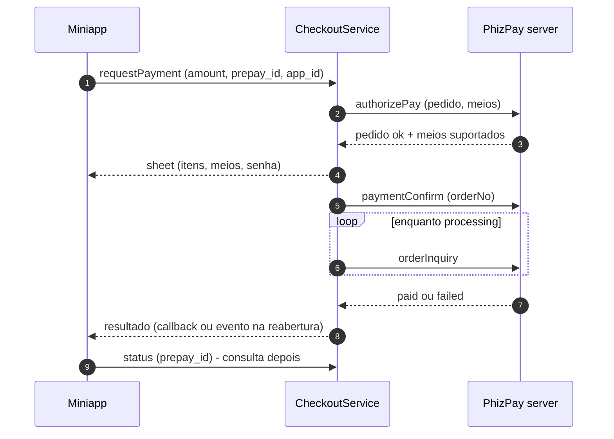
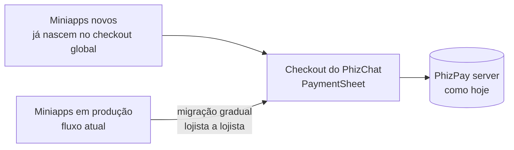
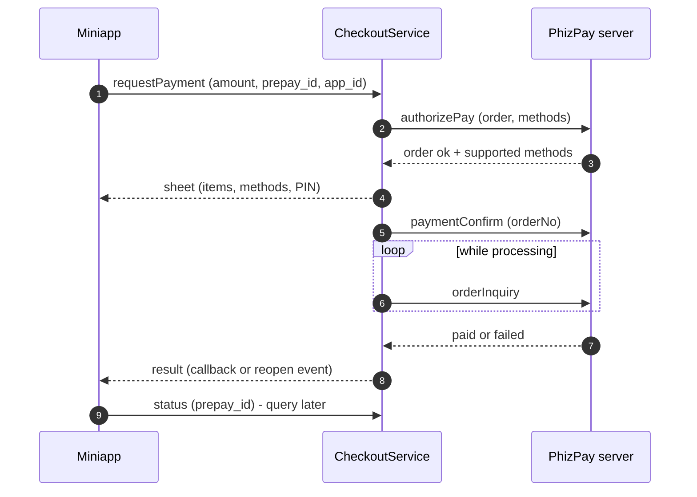
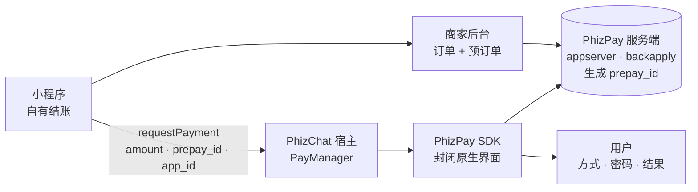
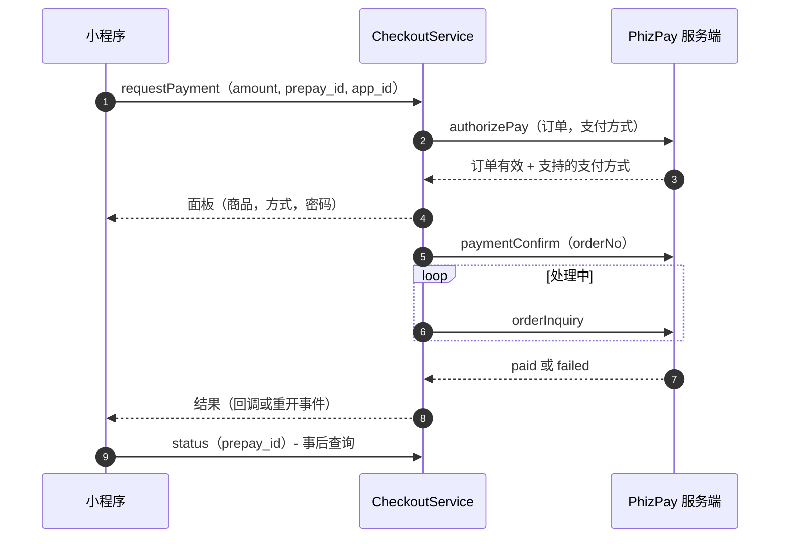
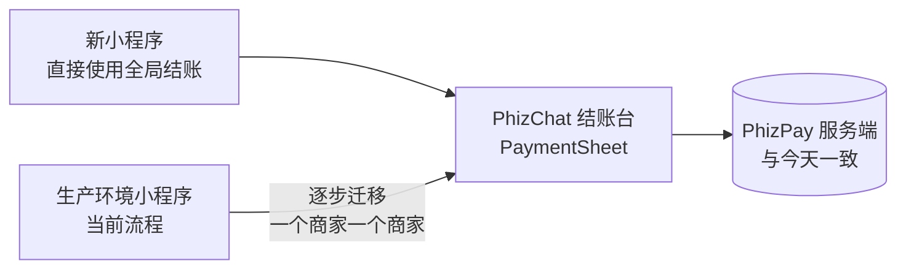

<!-- lang:pt -->

## Resumo {#summary}

Hoje, pagar é global — uma chamada ao SDK PhizPay — mas o checkout inteiro é reimplementado por cada miniapp, só existe dentro do miniapp e tem caminhos diferentes em iOS e Android. Esta RFC propõe um **checkout nativo no app**, chamável de qualquer superfície, com o pagamento executado pelo PhizPay server exatamente como hoje.

- **Checkout nativo único.** Uma PaymentSheet em Flutter — o único lugar do app que desenha o pagamento.
- **Qualquer superfície chama o checkout.** Miniapp (JSAPI `requestPayment` inalterada), chat, Moments, Canal e links passam a ter como cobrar; o usuário volta ao contexto de origem.
- **Criação de cobrança centralizada.** Endpoint único da plataforma no lugar da integração servidor-a-servidor que cada vendedor implementa hoje.
- **Um só caminho nos miniapps.** Novos miniapps já entram com o checkout global do PhizChat; os atuais migram por estrangulamento, com o contrato `requestPayment` inalterado.
- **Status do pagamento como contrato.** Resultado (`paid`, `processing`, `cancelled`, `failed`) entregue ao chamador e consultável depois — no cliente e no servidor do vendedor.

::: stats
- **7** miniapps em produção que reimplementam o próprio checkout
- **2 → 1** caminhos de pagamento (iOS e Android hoje diferentes)
- **1 → todas** superfícies capazes de iniciar uma cobrança
:::

Esta RFC não depende de nenhuma outra RFC ou proposta em andamento.

## Contexto: como funciona hoje {#context}

O pedido nasce fora do app. O miniapp do lojista mantém catálogo, carrinho e confirmação próprios; o backend dele cria o pedido e o pré-pedido no PhizPay server (`appserver` → `backapply`) e recebe o `prepay_id`. O app PhizChat não participa desta fase. Em produção são 7 miniapps repetindo esse custo, e a experiência de compra só existe dentro de cada miniapp.

```mermaid Pagamento de miniapp hoje: pré-pedido fora do app, pagamento via SDK.
flowchart LR
  MA["Miniapp<br/>checkout próprio"] --> VB["Backend do vendedor<br/>pedido + pré-pedido"]
  VB --> PS[("PhizPay server<br/>appserver · backapply<br/>gera prepay_id")]
  MA -- "requestPayment<br/>amount · prepay_id · app_id" --> HOST["Host PhizChat<br/>PayManager"]
  HOST --> SDK["SDK PhizPay<br/>UI nativa fechada"]
  SDK --> PS
  SDK --> U["Usuário<br/>meios · senha · resultado"]
```

Como flui o pagamento, verificado no código de `phiz-flutter` e do SDK:

1. O JS do miniapp chama `requestPayment({amount, prepay_id, app_id})`; no iOS o handler é registrado em `Mop.instance.registerExtensionApi` (`lib/manager/mop_mini/phiz_clip_open_api.dart:41`) — **só no iOS**; no Android a JSAPI vive nativa no processo do miniapp (`PayApiModule.java`, broadcast `check_user_can_pay`).
2. O host valida a Wallet (`lib/manager/pay/pay_manager_mini_app.dart:73`); sem wallet, **fecha o miniapp e abre a Wallet** (`needCloseMiniAppAndOpenWallet:34`) — a principal dor do fluxo atual.
3. O host chama o SDK (`PhizPay.instance.payForMiniCallPhizPay`); o binário (`PhizPay.xcframework` / `phizPaySdk.aar`) chama `authorizePay` no `gateway/pay/handleMain` e desenha meios, senha e 3DS — UI fechada, fora do controle do time.
4. O resultado volta ao JS como código (`'0'` sucesso, `'101'` cancelamento); a confirmação final do pedido é polling no backend do vendedor.

::: decision Por que isso importa
Pagar já é central; checkout não é. O dinheiro nunca entra no miniapp e o PhizPay server é único — falta a camada de produto: um checkout do app, em um só lugar, que qualquer superfície consiga chamar. Esta RFC desenha essa camada e mantém o pagamento intacto até o `prepay_id`.
:::

## Objetivos e fora de escopo {#goals}

#### Objetivos

- Pagar de qualquer superfície — miniapp, chat, Moments, Canal, live, deep link — com a mesma experiência em iOS e Android.
- Um só lugar que desenha o pagamento, sem desvio pela Wallet no caminho feliz.
- Retorno ao contexto de origem: o miniapp reabre onde estava; chat e feed nunca saem do lugar.
- Status do pagamento (`paid`, `processing`, `cancelled`, `failed`) entregue ao chamador e consultável depois — no cliente e no servidor.
- Criação de cobrança como serviço da plataforma, idempotente por `orderRef`.

#### Fora do escopo

- Troca de provedor de pagamento, split e custódia.
- Parcelamento e débito — chegam depois, dirigidos pelo servidor.
- Carrinho multi-loja e serviços no chat.
- Catálogo central ou busca de produtos — o catálogo segue do lojista.
- Cards de produto pagos (ads) em Moments/Canal.

## Proposta {#proposal}

Um módulo nativo no `phiz-flutter`, `features/checkout`: `CheckoutService.open(CheckoutRequest)`, chamável do miniapp (JSAPI `requestPayment`), de telas do app (chat, Moments, Canal, live) e de deep links. A sheet mostra a compra itemizada (produtos, quantidades, preços), os meios disponíveis (saldo, cartões, Pix) e pede a senha; o executor em Dart (`authorizePay` → `paymentConfirm` → polling `orderInquiry`) reutiliza os headers e a criptografia que já existem em Dart (`PayManager`).

| Como é hoje | Com esta RFC |
|---|---|
| Cada miniapp desenha o próprio checkout | Um checkout do app, com a compra itemizada |
| Pagamento = UI fechada do SDK; JSAPI registrada só no iOS | PaymentSheet em Flutter, paridade iOS/Android, flag com rollback ao fluxo atual |
| Desvio pela Wallet quando a wallet não está pronta | Gate de wallet só para onboarding; pagamento direto na sheet |
| Vendedor integra o pré-pedido no microwd sozinho | Endpoint único `POST /commerce/v1/prepays` na plataforma |

O serviço de cobrança da plataforma cria o prepay no PhizPay server em nome do vendedor (autenticação appId + appSecret, idempotência por `orderRef`, resolução da conta de recebimento pela plataforma), expõe consulta de status e avisa o backend do vendedor quando o pagamento fecha. A execução do pagamento segue no PhizPay server, como hoje.

::: endpoints
- POST /commerce/v1/prepays — Cria a cobrança (auth appId + appSecret; idempotente por `orderRef`)
- GET /commerce/v1/prepays/{orderRef} — Consulta o status da cobrança
- POST payment.status — Webhook que avisa o backend do vendedor quando o pagamento fecha (retry idempotente)
:::

::: decision Regra de ouro do contrato
`items[]` é contexto de exibição — o valor cobrado é o que o PhizPay server devolve no `authorizePay`. Dinheiro exige ordem: nesta RFC a ordem nasce no backend do vendedor, que recebe a cobrança pronta do serviço da plataforma.
:::

## Adoção nos miniapps {#adoption}

Não há dois caminhos: o checkout global do PhizChat é o único modo oferecido. Miniapps novos já entram com ele; os existentes migram por estrangulamento.

- **Miniapps novos:** já nascem no checkout global — cobram pelo serviço da plataforma e abrem a PaymentSheet do app.
- **Miniapps em produção:** nada muda no contrato (`requestPayment` igual); a migração acontece aos poucos, lojista a lojista, conforme cada um adota a cobrança da plataforma.
- **Lojistas com checkout próprio:** podem manter o checkout deles — o pagamento continua passando pela PaymentSheet do app, única via de dinheiro.

## Os dois casos em telas {#screens}

Hoje, a compra só existe dentro do miniapp do lojista; depois desta RFC, chat e Moments chegam ao mesmo checkout do PhizChat — e, olhando adiante, serviços com parcelamento.

#### Hoje — a compra acontece dentro do miniapp do lojista

::: gallery phones
-  **A1.** Produto no miniapp do lojista
-  **A2.** Adiciona ao carrinho
-  **A3.** Confirma e envia o pedido
-  **A4.** Pagamento: telas do SDK, no app
:::

#### Depois — compra de qualquer superfície, com o checkout do PhizChat

Do Moments:

::: gallery phones
-  **B1.** Clica no produto no Moments
-  **B2.** Produto vai para o carrinho
-  **B3.** Clica em comprar
-  **B4.** Clica em pagar
-  **B5.** Processa o pagamento
-  **B6.** Pedido confirmado — volta ao feed
:::

Do chat:

::: gallery phones
-  **C1.** Produto compartilhado no chat
-  **C2.** Clica em comprar → checkout do PhizChat
:::

#### Olhando adiante — serviços no chat (para depois)

::: gallery phones
-  **D1.** Agendamento via chat
-  **D2.** Escolhe o serviço
-  **D3.** Visualiza os serviços
-  **D4.** Escolhe o prestador
-  **D5.** Escolhe o horário
-  **D6.** Confirma o agendamento
-  **D7.** Inicia o pagamento
-  **D8.** Forma de pagamento
-  **D9.** Parcelamento
-  **D10.** Processa o pagamento
-  **D11.** Pagamento confirmado
:::

::: note
A compra de hoje (A) acontece dentro do miniapp; os casos B e C são o que esta RFC entrega — compras de fora do miniapp, no checkout do app. O caso D (serviços e parcelamento) fica para depois.
:::

## Fluxos {#flows}

O checkout: da cobrança criada pelo vendedor ao resultado no chamador.



Adoção por estrangulamento: miniapps novos entram direto; os atuais migram aos poucos.



## Mudanças e compatibilidade {#changes}

::: legend
- [muda]{ch} comportamento diferente
- [novo]{new} não existia
:::

::: table changes
| Mudança | Hoje | Depois | O que fazer |
|---|---|---|---|
| **Destino do `requestPayment`** | UI do SDK nativo (binário) | PaymentSheet Flutter; flag `checkout_native_sheet` com rollback ao fluxo atual | Roteamento por flag em `PayManager.miniCallPay` [muda]{ch} |
| **Callback JS no fluxo reaberto** | Sempre dispara (SDK inline) | Pode não disparar: miniapp reaberto + evento host→miniapp ou consulta | Nota aos lojistas; polling do pedido segue como hoje [muda]{ch} |
| **Registro da JSAPI** | Só iOS (`phiz_clip_open_api.dart:41`); Android nativo multi-processo | Paridade: os dois caminhos despacham ao mesmo `CheckoutService` | Ponte Android reusa o broadcast existente [muda]{ch} |
| **Adoção nos miniapps** | Cada miniapp tem o próprio checkout | Novos entram no checkout global; atuais migram aos poucos, contrato inalterado | Nota da plataforma + migração lojista a lojista [novo]{new} |
| **Criação do prepay** | Cada vendedor integra o microwd | `POST /commerce/v1/prepays` na plataforma, idempotente | Serviço de cobrança; vendedores atuais não migram de imediato [novo]{new} |
| **Status da cobrança (vendedor)** | Polling próprio do pedido | `GET /commerce/v1/prepays/{orderRef}` + webhook `payment.status` | Implementar no serviço de cobrança [novo]{new} |
:::

## Plano de implantação {#rollout}

::: phases
##### FASE 1: Checkout do PhizChat

- Contratos e validações com o pay server (autorização do pedido, execução, consulta de status); decisão do dono do serviço de cobrança.
- PaymentSheet Flutter (`CheckoutService.open`) com itens, meios, senha e Pix; status do pagamento entregue ao chamador e consultável; miniapp como primeiro chamador; chamador in-app e deep link de demonstração.
- Serviço de cobrança da plataforma (criação idempotente, consulta, webhook) e selftest ao vivo nos 2 SOs.
- Rollout gradual por flag `checkout_native_sheet`, com rollback ao fluxo atual.
:::

## Riscos {#risks}

| Risco | Mitigação |
|---|---|
| Migração dos miniapps em produção | Contrato `requestPayment` inalterado; migração por estrangulamento, lojista a lojista, com comunicação da plataforma |
| Lojista precisa reagir depois do pagamento (miniapp reaberto) | Nota de plataforma + exemplos atualizados; confirmação por consulta do próprio pedido (norma atual) |
| Divergência entre o que o chamador exibe e o valor cobrado | O servidor vence: total sempre o do PhizPay server, com aviso na sheet |
| Vários vendedores numa mesma compra | Começar com 1 vendedor por cobrança; compras com vários vendedores ficam para depois |
| Lojistas montando checkout próprio fora do padrão | Checkout global como caminho padrão; o pagamento sempre passa pela sheet do app |
| Aprovações externas (detalhes de cartão e cobrança) | Validar na primeira semana com o time de pagamentos; ligar o novo fluxo só depois |

## Perguntas em aberto {#questions}

::: questions
1. **Migração dos miniapps atuais.** Quais lojistas migram primeiro, em que ordem e com qual comunicação? — para produto e Open Platform.
2. **Superfície-piloto fora do miniapp.** Chat ou Moments primeiro? — para produto.
3. **Parcelamento e débito.** Quando entram e com quais regras (juros, número máximo de parcelas)? — para produto e negócio.
4. **Vários vendedores numa mesma compra.** Quando o checkout precisa cobrar mais de um lojista de uma vez? — para produto e negócio.
5. **Comunicação do resultado ao lojista.** Webhook, consulta ou ambos — o que exigimos de cada integração? — para plataforma.
6. **Serviços no chat.** Quando o mesmo checkout passa a valer para agendamentos e serviços? — para produto.
7. **Dono do serviço de cobrança.** Quem opera e mantém o endpoint na plataforma? — para plataforma (China/Brasil).
:::

## Referências {#refs}

- Proposta e plano: `docs/output/projetos/proposta-checkout-global/proposta.md` (v2), `plano-fase-1-checkout-flutter.md` e apresentações na mesma pasta.
- `phiz-flutter`: `lib/manager/mop_mini/phiz_clip_open_api.dart`, `phiz_clip_tools.dart`, `mop_mini_api.dart`; `lib/manager/pay/pay_manager_mini_app.dart`, `pay_manager.dart`; `lib/features/pay/`; `packages/phiz_pay/`; `android/app/src/main/kotlin/com/phiz/live/PayApiModule.java`.
- SDK PhizPay: `src/android/phizPaySdk/src/main/java/com/kis/phizpaysdk/PhizpayManager.java` (`callPhizPay`, `authorizePay`), `src/ios/PhizPay/Class/ViewModels/PhizPaySDK.h`.

<!-- lang:en -->

## Summary {#summary}

Today, paying is global — one call to the PhizPay SDK — but the whole checkout is re-implemented by each miniapp, only exists inside the miniapp, and takes different paths on iOS and Android. This RFC proposes a **native checkout in the app**, callable from any surface, with payment executed by the PhizPay server exactly as today.

- **One native checkout.** A Flutter PaymentSheet — the only place in the app that draws payment.
- **Any surface can charge.** Miniapp (unchanged `requestPayment` JSAPI), chat, Moments, Channel and links; the user returns to the originating context.
- **Centralized charge creation.** A single platform endpoint replacing the server-to-server integration each vendor implements today.
- **One path for miniapps.** New miniapps ship with the PhizChat global checkout from day one; existing ones migrate by strangulation, with the `requestPayment` contract unchanged.
- **Payment status as a contract.** The result (`paid`, `processing`, `cancelled`, `failed`) is delivered to the caller and can be queried later — on the client and on the vendor's server.

::: stats
- **7** miniapps in production re-implementing their own checkout
- **2 → 1** payment paths (iOS and Android differ today)
- **1 → any** surfaces able to start a charge
:::

This RFC does not depend on any other RFC or proposal in progress.

## Context: how it works today {#context}

The order is born outside the app. The vendor's miniapp keeps its own catalog, cart and confirmation; its backend creates the order and the pre-order on the PhizPay server (`appserver` → `backapply`) and receives the `prepay_id`. The PhizChat app takes no part in this phase. In production, 7 miniapps repeat that cost, and the shopping experience only exists inside each miniapp.

```mermaid Miniapp payment today: pre-order outside the app, payment through the SDK.
flowchart LR
  MA["Miniapp<br/>own checkout"] --> VB["Vendor backend<br/>order + pre-order"]
  VB --> PS[("PhizPay server<br/>appserver · backapply<br/>issues prepay_id")]
  MA -- "requestPayment<br/>amount · prepay_id · app_id" --> HOST["PhizChat host<br/>PayManager"]
  HOST --> SDK["PhizPay SDK<br/>closed native UI"]
  SDK --> PS
  SDK --> U["User<br/>methods · PIN · result"]
```

How the payment flows, verified in `phiz-flutter` and SDK code:

1. The miniapp JS calls `requestPayment({amount, prepay_id, app_id})`; on iOS the handler is registered via `Mop.instance.registerExtensionApi` (`lib/manager/mop_mini/phiz_clip_open_api.dart:41`) — **iOS only**; on Android the JSAPI lives natively in the miniapp process (`PayApiModule.java`, broadcast `check_user_can_pay`).
2. The host validates the Wallet (`lib/manager/pay/pay_manager_mini_app.dart:73`); without one, it **closes the miniapp and opens the Wallet** (`needCloseMiniAppAndOpenWallet:34`) — the main pain of the current flow.
3. The host calls the SDK (`PhizPay.instance.payForMiniCallPhizPay`); the binary (`PhizPay.xcframework` / `phizPaySdk.aar`) calls `authorizePay` on `gateway/pay/handleMain` and draws methods, PIN and 3DS — a closed UI, outside the team's control.
4. The result returns to JS as a code (`'0'` success, `'101'` cancel); final order confirmation is polling on the vendor's backend.

::: decision Why this matters
Paying is already central; checkout is not. Money never enters the miniapp and the PhizPay server is unique — what is missing is the product layer: one checkout owned by the app, callable from any surface. This RFC designs that layer and keeps payment untouched up to the `prepay_id`.
:::

## Goals and non-goals {#goals}

#### Goals

- Pay from any surface — miniapp, chat, Moments, Channel, live, deep link — with the same experience on iOS and Android.
- One place that draws payment, with no Wallet detour on the happy path.
- Return to the originating context: the miniapp reopens where it was; chat and feed never leave their place.
- Payment status (`paid`, `processing`, `cancelled`, `failed`) delivered to the caller and queryable later — on the client and on the server.
- Charge creation as a platform service, idempotent by `orderRef`.

#### Non-goals

- Payment provider swap, split and custody.
- Installments and debit — they arrive later, driven by the server.
- Multi-vendor cart and services in chat.
- A central catalog or product search — the catalog stays with the vendor.
- Paid product cards (ads) in Moments/Channel.

## Proposal {#proposal}

A native module in `phiz-flutter`, `features/checkout`: `CheckoutService.open(CheckoutRequest)`, callable from the miniapp (the `requestPayment` JSAPI), from app screens (chat, Moments, Channel, live) and from deep links. The sheet shows the itemized purchase (products, quantities, prices), the available methods (balance, cards, Pix) and asks for the PIN; the Dart executor (`authorizePay` → `paymentConfirm` → polling `orderInquiry`) reuses the headers and cryptography that already exist in Dart (`PayManager`).

| Today | With this RFC |
|---|---|
| Each miniapp draws its own checkout | One app-owned checkout, with the itemized purchase |
| Payment = closed SDK UI; JSAPI registered on iOS only | Flutter PaymentSheet, iOS/Android parity, a flag rolls back to the current flow |
| Wallet detour when the wallet is not ready | Wallet gate only for onboarding; payment goes straight to the sheet |
| Vendor integrates the pre-order into microwd alone | Single platform endpoint `POST /commerce/v1/prepays` |

The platform charge service creates the prepay on the PhizPay server on the vendor's behalf (appId + appSecret authentication, idempotency by `orderRef`, receiving-account resolution by the platform), exposes a status query, and notifies the vendor's backend when the payment settles. Payment execution stays on the PhizPay server, as today.

::: endpoints
- POST /commerce/v1/prepays — Creates the charge (auth appId + appSecret; idempotent by `orderRef`)
- GET /commerce/v1/prepays/{orderRef} — Queries the charge status
- POST payment.status — Webhook that notifies the vendor's backend when the payment settles (idempotent retry)
:::

::: decision Contract golden rule
`items[]` is display context — the charged amount is what the PhizPay server returns on `authorizePay`. Money requires an order: in this RFC the order is born on the vendor's backend, which receives the ready-made charge from the platform service.
:::

## Miniapp adoption {#adoption}

There are no two paths: the PhizChat global checkout is the only mode offered. New miniapps ship with it; existing ones migrate by strangulation.

- **New miniapps:** born on the global checkout — they charge through the platform service and open the app's PaymentSheet.
- **Miniapps in production:** nothing changes in the contract (`requestPayment` as-is); migration happens gradually, vendor by vendor, as each one adopts the platform charge service.
- **Vendors with their own checkout:** they can keep it — payment still goes through the app's PaymentSheet, the only money path.

## The two flows on screen {#screens}

Today the purchase only exists inside the vendor's miniapp; after this RFC, chat and Moments reach the same PhizChat checkout — and, looking further ahead, services with installments.

#### Today — the purchase happens inside the vendor's miniapp

::: gallery phones
-  **A1.** Product in the vendor's miniapp
-  **A2.** Add to cart
-  **A3.** Confirm and send the order
-  **A4.** Payment: SDK screens, in the app
:::

#### After — buy from any surface, with the PhizChat checkout

From Moments:

::: gallery phones
-  **B1.** Tap the product in Moments
-  **B2.** Product goes to the cart
-  **B3.** Tap buy
-  **B4.** Tap pay
-  **B5.** Payment processing
-  **B6.** Order confirmed — back to the feed
:::

From chat:

::: gallery phones
-  **C1.** Product shared in chat
-  **C2.** Tap buy → PhizChat checkout
:::

#### Looking further ahead — services in chat (later)

::: gallery phones
-  **D1.** Booking via chat
-  **D2.** Pick the service
-  **D3.** Browse the services
-  **D4.** Pick the provider
-  **D5.** Pick the time
-  **D6.** Confirm the booking
-  **D7.** Start the payment
-  **D8.** Payment method
-  **D9.** Installments
-  **D10.** Payment processing
-  **D11.** Payment confirmed
:::

::: note
Today's purchase (A) happens inside the miniapp; cases B and C are what this RFC delivers — purchases from outside the miniapp, on the app's checkout. Case D (services and installments) comes later.
:::

## Flows {#flows}

The checkout: from the vendor's charge to the result on the caller.



Adoption by strangulation: new miniapps enter directly; existing ones migrate gradually.

```mermaid Adoption: new ones enter directly, existing ones migrate gradually.
flowchart LR
  MN["New miniapps<br/>born on the global checkout"] --> CS["PhizChat checkout<br/>PaymentSheet"]
  MA["Miniapps in production<br/>current flow"] -- "gradual migration<br/>vendor by vendor" --> CS
  CS --> P[("PhizPay server<br/>as today")]
```

## Changes and compatibility {#changes}

::: legend
- [changes]{ch} different behavior
- [new]{new} did not exist
:::

::: table changes
| Change | Today | After | What to do |
|---|---|---|---|
| **`requestPayment` destination** | Native SDK UI (binary) | Flutter PaymentSheet; `checkout_native_sheet` flag rolls back to the current flow | Flag routing in `PayManager.miniCallPay` [changes]{ch} |
| **JS callback in the reopened flow** | Always fires (inline SDK) | May not fire: miniapp reopened + host→miniapp event or query | Vendor note; order polling stays as today [changes]{ch} |
| **JSAPI registration** | iOS only (`phiz_clip_open_api.dart:41`); Android native multi-process | Parity: both paths dispatch to the same `CheckoutService` | Android bridge reuses the existing broadcast [changes]{ch} |
| **Miniapp adoption** | Each miniapp has its own checkout | New ones enter the global checkout; existing ones migrate gradually, contract unchanged | Platform note + vendor-by-vendor migration [new]{new} |
| **Prepay creation** | Each vendor integrates microwd | Platform `POST /commerce/v1/prepays`, idempotent | Charge service; current vendors do not migrate right away [new]{new} |
| **Charge status (vendor)** | Own order polling | `GET /commerce/v1/prepays/{orderRef}` + `payment.status` webhook | Implement in the charge service [new]{new} |
:::

## Rollout plan {#rollout}

::: phases
##### PHASE 1: PhizChat checkout

- Contracts and validations with the pay server (order authorization, execution, status query); decision on the owner of the charge service.
- Flutter PaymentSheet (`CheckoutService.open`) with items, methods, PIN and Pix; payment status delivered to the caller and queryable; the miniapp as first caller; in-app caller and deep link demo.
- Platform charge service (idempotent creation, query, webhook) and live selftest on both OSs.
- Gradual rollout behind the `checkout_native_sheet` flag, with rollback to the current flow.
:::

## Risks {#risks}

| Risk | Mitigation |
|---|---|
| Migration of the miniapps in production | Unchanged `requestPayment` contract; strangulation migration, vendor by vendor, with platform communication |
| Vendor needs to react after the payment (miniapp reopened) | Platform note + updated samples; confirmation by querying the order (current norm) |
| Divergence between what the caller shows and the charged amount | The server wins: the total is always the PhizPay server's, with a warning on the sheet |
| Several vendors in a single purchase | Start with 1 vendor per charge; multi-vendor purchases come later |
| Vendors building their own checkout outside the standard | Global checkout as the standard path; payment always through the app's sheet |
| External approvals (card and charge details) | Validate in the first week with the payments team; turn the new flow on only afterwards |

## Open questions {#questions}

::: questions
1. **Migration of the existing miniapps.** Which vendors migrate first, in what order, with which communication? — for product and Open Platform.
2. **Pilot surface outside the miniapp.** Chat or Moments first? — for product.
3. **Installments and debit.** When do they arrive and under which rules (interest, maximum number of installments)? — for product and business.
4. **Several vendors in one purchase.** When does the checkout need to charge more than one vendor at once? — for product and business.
5. **Result communication to the vendor.** Webhook, query or both — what do we require from each integration? — for platform.
6. **Services in chat.** When does the same checkout cover bookings and services? — for product.
7. **Owner of the charge service.** Who operates and maintains the endpoint on the platform? — for platform (China/Brazil).
:::

## References {#refs}

- Proposal and plan: `docs/output/projetos/proposta-checkout-global/proposta.md` (v2), `plano-fase-1-checkout-flutter.md` and the presentations in the same folder.
- `phiz-flutter`: `lib/manager/mop_mini/phiz_clip_open_api.dart`, `phiz_clip_tools.dart`, `mop_mini_api.dart`; `lib/manager/pay/pay_manager_mini_app.dart`, `pay_manager.dart`; `lib/features/pay/`; `packages/phiz_pay/`; `android/app/src/main/kotlin/com/phiz/live/PayApiModule.java`.
- PhizPay SDK: `src/android/phizPaySdk/src/main/java/com/kis/phizpaysdk/PhizpayManager.java` (`callPhizPay`, `authorizePay`), `src/ios/PhizPay/Class/ViewModels/PhizPaySDK.h`.

<!-- lang:zh -->

## 摘要 {#summary}

如今，支付本身是全局的——只需调用 PhizPay SDK——但整个结账流程由每个小程序自行实现，只存在于小程序之内，且 iOS 与 Android 路径不一致。本 RFC 提议在 App 内实现**原生结账**，任何入口均可调用，支付仍由 PhizPay 服务端按现有方式执行。

- **唯一的原生结账。** 一个 Flutter 支付面板——App 内唯一绘制支付界面的地方。
- **任何入口均可收款。** 小程序（`requestPayment` JSAPI 保持不变）、聊天、Moments、频道与链接；用户回到原入口上下文。
- **收款单集中创建。** 平台唯一端点，取代如今每个商家各自实现的服务端对接。
- **小程序只有一条路径。** 新小程序直接使用 PhizChat 全局结账；现有小程序按绞杀者方式逐步迁移，`requestPayment` 契约保持不变。
- **支付状态作为契约。** 结果（`paid`、`processing`、`cancelled`、`failed`）送达调用方，且事后可查询——客户端与服务端皆可。

::: stats
- **7** 个生产环境小程序在重复实现各自的结账
- **2 → 1** 支付路径（如今 iOS 与 Android 不一致）
- **1 → 全部** 可发起收款的入口
:::

本 RFC 不依赖于任何其他进行中的 RFC 或提案。

## 背景：当前的工作方式 {#context}

订单在 App 之外产生。商家小程序自建目录、购物车与确认页；其后台在 PhizPay 服务端（`appserver` → `backapply`）创建订单与预订单并取得 `prepay_id`。PhizChat App 不参与这一阶段。生产环境中有 7 个小程序在重复这一成本，且购物体验只存在于每个小程序之内。



支付流程（已在 `phiz-flutter` 与 SDK 代码中核实）：

1. 小程序 JS 调用 `requestPayment({amount, prepay_id, app_id})`；iOS 端通过 `Mop.instance.registerExtensionApi` 注册处理函数（`lib/manager/mop_mini/phiz_clip_open_api.dart:41`）——**仅 iOS**；Android 端 JSAPI 原生运行于小程序进程（`PayApiModule.java`，广播 `check_user_can_pay`）。
2. 宿主校验钱包（`lib/manager/pay/pay_manager_mini_app.dart:73`）；若无钱包，**关闭小程序并打开钱包**（`needCloseMiniAppAndOpenWallet:34`）——当前流程最主要的痛点。
3. 宿主调用 SDK（`PhizPay.instance.payForMiniCallPhizPay`）；二进制（`PhizPay.xcframework` / `phizPaySdk.aar`）调用 `gateway/pay/handleMain` 上的 `authorizePay`，绘制支付方式、密码与 3DS 界面——封闭 UI，团队无法掌控。
4. 结果以代码返回 JS（`'0'` 成功、`'101'` 取消）；订单最终确认依赖商家后台轮询。

::: decision 为什么重要
支付已经集中；结账没有。资金从不进入小程序，PhizPay 服务端是唯一的——缺的是产品层：一个属于 App 的结账台，任何入口都能调用。本 RFC 设计该层，并保证支付在 `prepay_id` 之前保持不变。
:::

## 目标与非目标 {#goals}

#### 目标

- 从任何入口支付——小程序、聊天、Moments、频道、直播、深链——iOS 与 Android 体验一致。
- 唯一绘制支付的地方，正常路径不再绕道钱包。
- 回到原上下文：小程序在原处重开；聊天与信息流从未离开。
- 支付状态（`paid`、`processing`、`cancelled`、`failed`）送达调用方且事后可查——客户端与服务端。
- 收款单创建作为平台服务，按 `orderRef` 幂等。

#### 非目标

- 支付渠道切换、分账与托管。
- 分期与借记卡——随后到来，由服务端驱动。
- 多商家购物车与聊天内服务。
- 中央目录或商品搜索——目录仍归商家。
- Moments/频道中的付费商品卡片（广告）。

## 方案 {#proposal}

在 `phiz-flutter` 中新增原生模块 `features/checkout`：`CheckoutService.open(CheckoutRequest)`，小程序（`requestPayment` JSAPI）、应用内页面（聊天、Moments、频道、直播）与深链均可调用。面板展示逐项购买明细（商品、数量、价格）、可用支付方式（余额、银行卡、Pix）并请求密码；Dart 执行器（`authorizePay` → `paymentConfirm` → 轮询 `orderInquiry`）复用 Dart 中已有的签名头与加密（`PayManager`）。

| 现状 | 采用本 RFC 后 |
|---|---|
| 每个小程序自行绘制结账 | App 唯一结账台，展示逐项购买明细 |
| 支付 = SDK 封闭界面；JSAPI 仅 iOS 注册 | Flutter 支付面板，iOS/Android 对等，可用标志位回退到当前流程 |
| 钱包未就绪时绕道钱包 | 钱包校验仅用于开通引导；支付直接在面板完成 |
| 商家自行向 microwd 对接预订单 | 平台唯一端点 `POST /commerce/v1/prepays` |

平台收款服务代商家在 PhizPay 服务端创建预订单（appId + appSecret 鉴权、按 `orderRef` 幂等、由平台解析收款账户），提供状态查询，并在支付完成时通知商家后台。支付执行仍在 PhizPay 服务端，与今天一致。

::: endpoints
- POST /commerce/v1/prepays — 创建收款单（鉴权 appId + appSecret；按 `orderRef` 幂等）
- GET /commerce/v1/prepays/{orderRef} — 查询收款单状态
- POST payment.status — Webhook，在支付完成时通知商家后台（幂等重试）
:::

::: decision 契约黄金法则
`items[]` 仅作展示上下文——扣款金额以 PhizPay 服务端 `authorizePay` 返回为准。资金必须有订单：在本 RFC 中，订单在商家后台产生，商家从平台服务取得现成的收款单。
:::

## 小程序接入 {#adoption}

不存在两条路径：PhizChat 全局结账是唯一提供的模式。新小程序直接使用；现有小程序按绞杀者方式逐步迁移。

- **新小程序：** 一开始就在全局结账上——通过平台服务收款，打开 App 的支付面板。
- **生产环境小程序：** 契约不变（`requestPayment` 照旧）；迁移逐步进行，一个商家一个商家，随各自接入平台收款服务。
- **拥有自有结账的商家：** 可以保留——支付仍经 App 的支付面板，那是唯一的资金通道。

## 两个流程的界面 {#screens}

如今，购买只存在于商家小程序内；本 RFC 之后，聊天与 Moments 直达同一个 PhizChat 结账台——更远的将来还有带分期的服务预约。

#### 今日——购买发生在商家小程序内

::: gallery phones
-  **A1.** 商家小程序内的商品
-  **A2.** 加入购物车
-  **A3.** 确认并提交订单
-  **A4.** 支付：App 内的 SDK 界面
:::

#### 之后——从任何入口购买，使用 PhizChat 结账台

来自 Moments：

::: gallery phones
-  **B1.** 在 Moments 点击商品
-  **B2.** 商品进入购物车
-  **B3.** 点击购买
-  **B4.** 点击支付
-  **B5.** 支付处理中
-  **B6.** 订单确认——回到信息流
:::

来自聊天：

::: gallery phones
-  **C1.** 聊天中分享的商品
-  **C2.** 点击购买 → PhizChat 结账台
:::

#### 更远的将来——聊天内服务（后续）

::: gallery phones
-  **D1.** 聊天内预约
-  **D2.** 选择服务
-  **D3.** 浏览服务列表
-  **D4.** 选择服务人员
-  **D5.** 选择时间
-  **D6.** 确认预约
-  **D7.** 发起支付
-  **D8.** 支付方式
-  **D9.** 分期
-  **D10.** 支付处理中
-  **D11.** 支付成功
:::

::: note
今日的购买（A）发生在小程序内；B 与 C 是本 RFC 交付的内容——小程序之外的购买，在 App 的结账台完成。D（服务与分期）留待以后。
:::

## 流程 {#flows}

结账：从商家收款单到调用方拿到结果。



绞杀者式接入：新小程序直接进入；现有小程序逐步迁移。



## 变更与兼容性 {#changes}

::: legend
- [变化]{ch} 行为不同
- [新增]{new} 原先不存在
:::

::: table changes
| 变更 | 现状 | 之后 | 需要做什么 |
|---|---|---|---|
| **`requestPayment` 的去向** | SDK 原生界面（二进制） | Flutter 支付面板；标志 `checkout_native_sheet` 可回退当前流程 | 在 `PayManager.miniCallPay` 按标志路由 [变化]{ch} |
| **重开流程中的 JS 回调** | 总会触发（SDK 内联） | 可能不触发：小程序重开 + 宿主→小程序事件或查询 | 通知商家；订单轮询照旧 [变化]{ch} |
| **JSAPI 注册** | 仅 iOS（`phiz_clip_open_api.dart:41`）；Android 原生多进程 | 对等：两条路径都分发到同一 `CheckoutService` | Android 桥复用现有广播 [变化]{ch} |
| **小程序接入** | 每个小程序自有结账 | 新小程序进入全局结账；现有小程序逐步迁移，契约不变 | 平台说明 + 逐商家迁移 [新增]{new} |
| **prepay 创建** | 每个商家自行对接 microwd | 平台 `POST /commerce/v1/prepays`，幂等 | 收款服务；现有商家暂不迁移 [新增]{new} |
| **收款状态（商家侧）** | 自行轮询订单 | `GET /commerce/v1/prepays/{orderRef}` + webhook `payment.status` | 在收款服务中实现 [新增]{new} |
:::

## 实施计划 {#rollout}

::: phases
##### 第 1 阶段：PhizChat 结账

- 与支付服务端的合同与确认（订单授权、执行、状态查询）；收款服务归属决定。
- Flutter 支付面板（`CheckoutService.open`），含商品、方式、密码与 Pix；支付状态送达调用方且可查；小程序作为首个调用方；应用内调用与深链演示。
- 平台收款服务（幂等创建、查询、webhook）与两个系统的实测。
- 经 `checkout_native_sheet` 标志灰度发布，可回退当前流程。
:::

## 风险 {#risks}

| 风险 | 缓解措施 |
|---|---|
| 生产环境小程序的迁移 | `requestPayment` 契约不变；绞杀者式迁移，一个商家一个商家，平台同步沟通 |
| 支付后商家需要响应（小程序重开） | 平台说明 + 更新示例；通过查询自身订单确认（现行常态） |
| 调用方展示与扣款金额不一致 | 以服务端为准：总额始终为 PhizPay 服务端金额，并在面板提示 |
| 一笔购买涉及多个商家 | 先支持每笔收款 1 个商家；多商家购买留待以后 |
| 商家自建标准之外的结账 | 全局结账作为标准路径；支付始终经 App 面板 |
| 外部审批（卡片与收款细节） | 第一周与支付团队确认；确认后再开启新流程 |

## 待定问题 {#questions}

::: questions
1. **现有小程序的迁移。** 哪些商家先迁移、按什么顺序、如何沟通？——提给产品与 Open Platform。
2. **小程序之外的试点入口。** 先做聊天还是 Moments？——提给产品。
3. **分期与借记卡。** 何时上线、规则如何（利息、最大期数）？——提给产品与业务。
4. **一笔购买多个商家。** 结账何时需要一次向多个商家收款？——提给产品与业务。
5. **结果如何通知商家。** Webhook、查询还是两者——每种集成要求是什么？——提给平台。
6. **聊天内服务。** 同一结账台何时覆盖预约与服务？——提给产品。
7. **收款服务归属。** 平台上由谁运营与维护该端点？——提给平台（中国/巴西）。
:::

## 参考资料 {#refs}

- 提案与计划：`docs/output/projetos/proposta-checkout-global/proposta.md`（v2）、`plano-fase-1-checkout-flutter.md` 及同目录演示文稿。
- `phiz-flutter`：`lib/manager/mop_mini/phiz_clip_open_api.dart`、`phiz_clip_tools.dart`、`mop_mini_api.dart`；`lib/manager/pay/pay_manager_mini_app.dart`、`pay_manager.dart`；`lib/features/pay/`；`packages/phiz_pay/`；`android/app/src/main/kotlin/com/phiz/live/PayApiModule.java`。
- PhizPay SDK：`src/android/phizPaySdk/src/main/java/com/kis/phizpaysdk/PhizpayManager.java`（`callPhizPay`、`authorizePay`）、`src/ios/PhizPay/Class/ViewModels/PhizPaySDK.h`。
