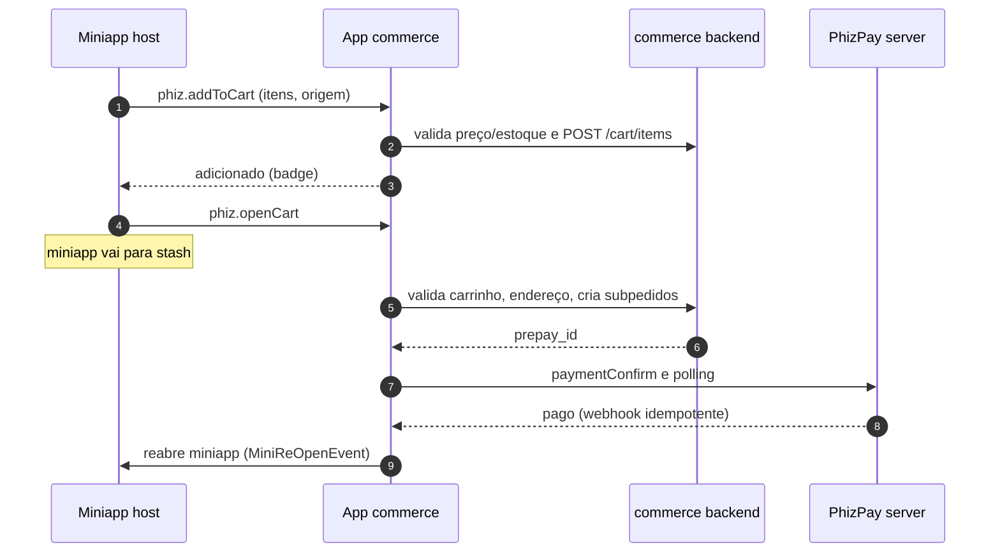
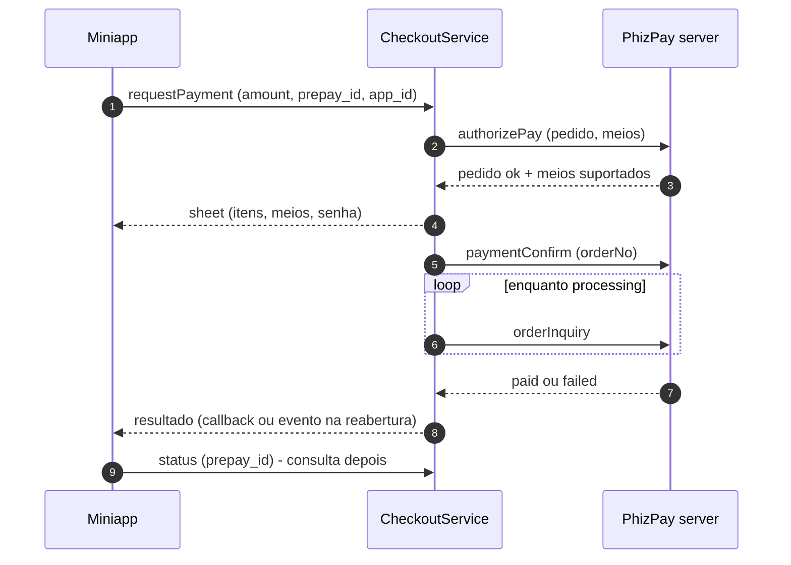
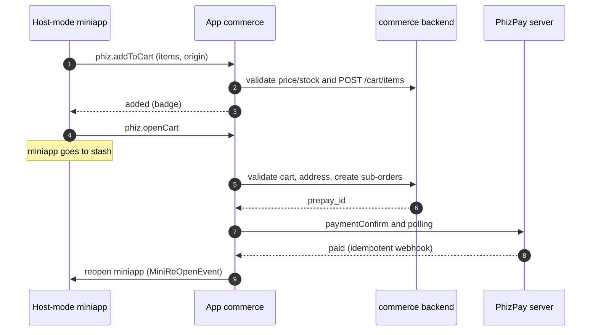
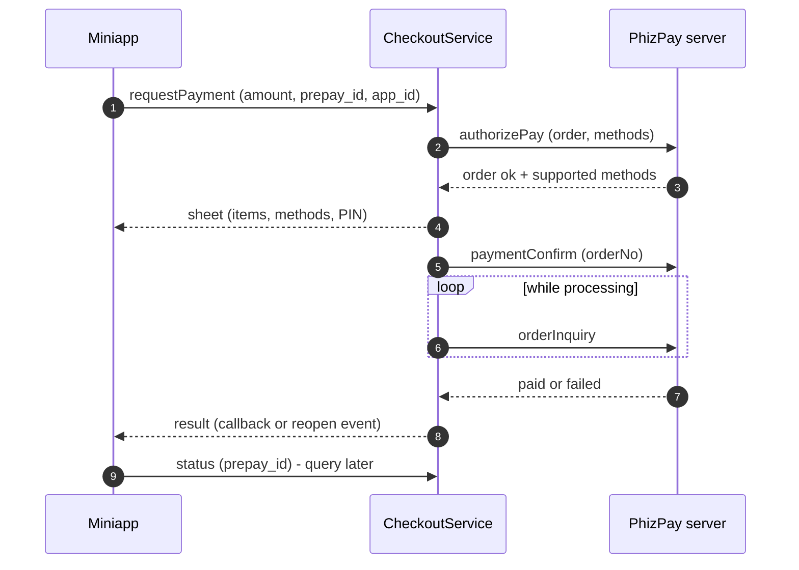
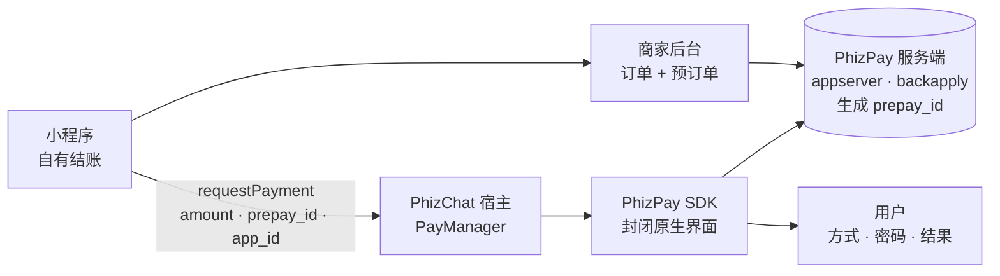
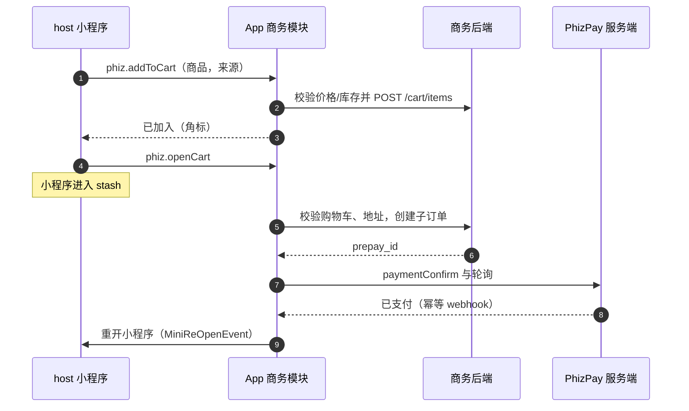
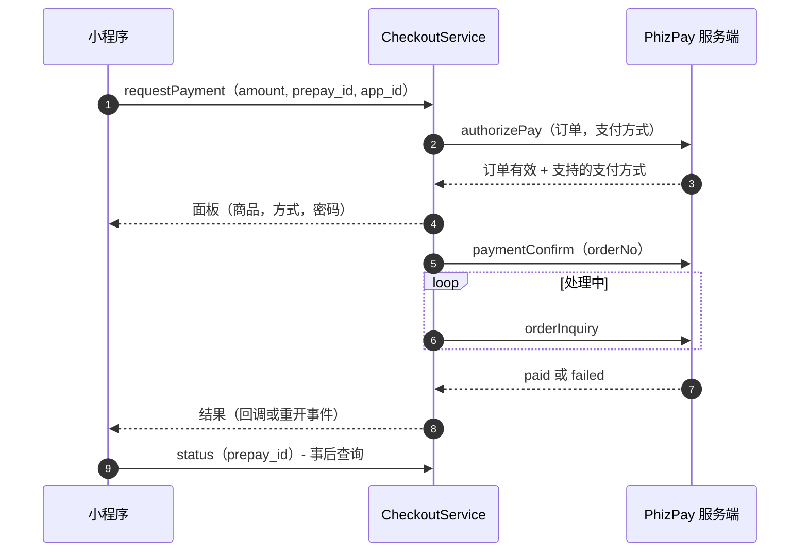

<!-- lang:pt -->

## Resumo {#summary}

Hoje, pagar é global — uma chamada ao SDK PhizPay — mas o checkout inteiro é reimplementado por cada miniapp: sem carrinho fora do live, sem endereço de entrega, com desvio pela Wallet e com caminhos diferentes em iOS e Android. Esta RFC propõe um **módulo nativo de comércio no app** (`features/commerce`), chamável de qualquer superfície, com o pagamento executado pelo PhizPay server exatamente como hoje.

- **Checkout nativo único.** Uma PaymentSheet em Flutter (Fase 1) e, depois, carrinho + CheckoutPage no módulo `features/commerce` — o único lugar do app que desenha o pagamento.
- **Qualquer superfície chama o checkout.** Miniapp (JSAPI `requestPayment` inalterada), chat, Moments, Canal e links passam a ter como cobrar; o usuário volta ao contexto de origem.
- **Criação de cobrança centralizada.** Endpoint único da plataforma (`POST /commerce/v1/prepays`) no lugar da integração servidor-a-servidor que cada vendedor implementa hoje.
- **Dois modos de comércio por miniapp.** `host` (usa o checkout global, opt-in) ou `self` (checkout próprio sobre o Phiz Commerce Kit) — campo `commerceMode` na Open Platform, default `self`.
- **Status do pagamento como contrato.** Resultado (`paid`, `processing`, `cancelled`, `failed`) entregue ao chamador e consultável depois — no cliente e no servidor do vendedor.

::: stats
- **7** miniapps em produção que reimplementam o próprio checkout
- **2 → 1** caminhos de pagamento (iOS e Android hoje diferentes)
- **1 → todas** superfícies capazes de iniciar uma cobrança
:::

Esta RFC não trata da troca de provedor (Pinbank/Credpay → Pagar.me/Iugu), do split lojista/Creator nem da custódia pós-entrega — ver a RFC de pagamentos PHZ-0003 e a proposta da ACL ([perguntas em aberto](#questions)).

## Contexto: como funciona hoje {#context}

O pedido nasce fora do app. O miniapp do lojista mantém catálogo, carrinho e confirmação próprios; o backend dele cria o pedido e o pré-pedido no PhizPay server (`appserver` → `backapply`) e recebe o `prepay_id`. O app PhizChat não participa desta fase. Em produção são 7 miniapps repetindo esse custo. O único carrinho do app é o do live (`lib/features/mall/live_cart/`), escopo de transmissão e retirada; `SHIPPED` nunca é setado em `phiz-chat-shop-order` e não existe CRUD de endereço.

```mermaid Pagamento de miniapp hoje: pré-pedido fora do app, pagamento via SDK.
flowchart LR
  MA["Miniapp<br/>checkout próprio"] --> VB["Backend do vendedor<br/>pedido + pré-pedido"]
  VB --> PS[("PhizPay server<br/>appserver · backapply<br/>gera prepay_id")]
  MA -- "requestPayment<br/>amount · prepay_id · app_id" --> HOST["Host PhizChat<br/>PayManager"]
  HOST --> SDK["SDK PhizPay<br/>UI nativa fechada"]
  SDK --> PS
  SDK --> U["Usuário<br/>meios · senha · resultado"]
```

Como flui o pagamento, verificado no código de `phiz-flutter` e do SDK:

1. O JS do miniapp chama `requestPayment({amount, prepay_id, app_id})`; no iOS o handler é registrado em `Mop.instance.registerExtensionApi` (`lib/manager/mop_mini/phiz_clip_open_api.dart:41`) — **só no iOS**; no Android a JSAPI vive nativa no processo do miniapp (`PayApiModule.java`, broadcast `check_user_can_pay`).
2. O host valida a Wallet (`lib/manager/pay/pay_manager_mini_app.dart:73`); sem wallet, **fecha o miniapp e abre a Wallet** (`needCloseMiniAppAndOpenWallet:34`) — a dor nº 1 diagnosticada pela RFC PHZ-0003.
3. O host chama o SDK (`PhizPay.instance.payForMiniCallPhizPay`); o binário (`PhizPay.xcframework` / `phizPaySdk.aar`) chama `authorizePay` no `gateway/pay/handleMain` e desenha meios, senha e 3DS — UI fechada, fora do controle do time.
4. O resultado volta ao JS como código (`'0'` sucesso, `'101'` cancelamento); a confirmação final do pedido é polling no backend do vendedor.

::: decision Por que isso importa
Pagar já é central; checkout não é. O dinheiro nunca entra no miniapp e o PhizPay server é único — falta a camada de produto (carrinho, checkout, endereço) e um caminho de cobrança que não exija integração por vendedor. Esta RFC desenha essa camada e mantém o pagamento intacto até o `prepay_id`.
:::

## Objetivos e fora de escopo {#goals}

#### Objetivos

- Pagar de qualquer superfície — miniapp, chat, Moments, Canal, live, deep link — com a mesma experiência em iOS e Android.
- Um só lugar que desenha o pagamento (PaymentSheet/CheckoutPage nativas), sem desvio pela Wallet no caminho feliz.
- Carrinho global multi-loja com badge, endereço quando houver entrega física e retorno ao contexto de origem (miniapp reaberto onde estava).
- Status do pagamento (`paid`, `processing`, `cancelled`, `failed`) entregue ao chamador e consultável depois — no cliente e no servidor.
- Criação de cobrança como serviço da plataforma, idempotente por `orderRef`.

#### Fora do escopo

- Troca de provedor, split e custódia (RFC PHZ-0003 e proposta da ACL).
- Parcelamento e débito (entram via capabilities, fase seguinte).
- Catálogo central ou busca de produtos — o catálogo segue do lojista.
- Cards de produto pagos (ads) em Moments/Canal.
- Migração do `live_cart` e Modelo B (serviços no chat) — fases seguintes.

## Proposta {#proposal}

Um feature novo no `phiz-flutter`, `features/commerce` (fora de `features/pay`, que é a Wallet): `CartService` global (get_it + serviço de carrinho no backend), `CheckoutSheet`/`CheckoutPage`, `AddressBook`, `ProductCard` (evolução do card de miniapp type 6 de Moments) e JSAPIs (`phiz.addToCart`, `phiz.openCart`, `phiz.checkout`, `phiz.pickAddress`).

| Como é hoje | Com esta RFC |
|---|---|
| Cada miniapp desenha catálogo, carrinho e confirmação | Carrinho e checkout nativos do app; produto segue no miniapp do lojista |
| Pagamento = UI fechada do SDK; JSAPI registrada só no iOS | PaymentSheet em Flutter, paridade iOS/Android, flag com rollback ao SDK |
| Desvio pela Wallet quando a wallet não está pronta | Gate de wallet só para onboarding; pagamento direto na sheet |
| Vendedor integra o pré-pedido no microwd sozinho | Endpoint único `POST /commerce/v1/prepays` na plataforma |
| Sem carrinho fora do live; sem endereço; `SHIPPED` morto | Carrinho global + AddressBook + `SHIPPED` real com `checkoutId` |

Backend pequeno de comércio: `phiz-commerce-cart` (carrinho por usuário, AddressBook na V1, `validate` na fonte do lojista, criação de subpedidos no `phiz-chat-shop-order` com `checkoutId` e origem de atribuição) e evolução do `phiz-chat-shop-order` (pedido multi-item, `deliveryAddress`, `SHIPPED` + rastreio, idempotência nos syncs). O pagamento segue no PhizPay server até o `prepay_id` — e, adiante, na ACL da RFC PHZ-0003.

A Fase 1 entrega o módulo de pagamento isolado do carrinho: `CheckoutService.open(CheckoutRequest)`, chamável de miniapp, chat, Moments, live e deep link; sheet com itens e meios (saldo, cartões, Pix); executor Dart (`authorizePay` → `paymentConfirm` → polling `orderInquiry`) reutilizando headers e cripto que já existem em Dart (`PayManager`); status canônico e consulta. Entrada: `prepayId` obrigatório + `items[]` de contexto; o total cobrado é sempre o do servidor.

::: endpoints
- POST /commerce/v1/prepays — Cria a cobrança (auth appId + appSecret; idempotente por `orderRef`)
- GET /commerce/v1/prepays/{orderRef} — Consulta o status da cobrança
- POST payment.status — Webhook que avisa o backend do vendedor quando o pagamento fecha (retry idempotente)
:::

::: gallery phones
-  **A1.** Hoje: checkout dentro do miniapp
-  **B1.** Futuro: produto no Moments
-  **B2.** Carrinho global
-  **B3.** Pagar no checkout do PhizChat
-  **B4.** Pedido confirmado
:::

::: decision Regra de ouro do contrato
`items[]` é contexto de exibição — o valor cobrado é o que o PhizPay server devolve no `authorizePay`. Dinheiro exige ordem: na Fase 1 a ordem nasce no backend do vendedor; quando o carrinho global existir, o host passa a criar a ordem e o `prepayId` deixa de vir do vendedor — a sheet não muda.
:::

## Dois modos de comércio {#modes}

Cada miniapp escolhe **um** modo na Open Platform — campo `commerceMode` no metadado do app, default `self` — antes do runtime, nunca por chamada.

| | **host** (opt-in) | **self** (default) |
|---|---|---|
| Carrinho + checkout | Desenhados pelo app (`features/commerce`) | Próprio miniapp, sobre o Phiz Commerce Kit |
| APIs | `phiz.addToCart` · `openCart` · `checkout` | Commerce Kit + `requestPayment` + `phiz.pickAddress` |
| Quem cria a ordem | Backend de comércio do PhizChat | Backend do lojista → `prepay_id` |
| Endereço de entrega | AddressBook do host | `phiz.pickAddress` (consentimento LGPD) |
| Pagamento | Checkout global (sheet/page) | PaymentSheet do host — única via de dinheiro |
| Uso típico | Lojas aderentes; compras vindas de feed/chat | E-commerce complexo do lojista |

Enforcement: no modo `self` as JSAPIs globais não são registradas (`phiz.addToCart` responde `mode_not_allowed`); no modo `host` o gate é a review da Open Platform. Como `requestPayment` existe só no `self`, a fronteira é verificável nos dois sentidos. No `self`, o Phiz Commerce Kit (SDK headless + componentes do design system) é obrigatório: sem Kit, sem publicação.

## Fluxos {#flows}

Modo `host`: compra no miniapp, paga no carrinho global, volta ao contexto.



Fase 1 (modo `self` e qualquer superfície): a PaymentSheet do host via `requestPayment`, com resultado entregue e consultável.



## Mudanças e compatibilidade {#changes}

::: legend
- [muda]{ch} comportamento diferente
- [novo]{new} não existia
:::

::: table changes
| Mudança | Hoje | Depois | O que fazer |
|---|---|---|---|
| **Destino do `requestPayment`** | UI do SDK nativo (binário) | PaymentSheet Flutter; flag `checkout_native_sheet` com rollback ao SDK | Roteamento por flag em `PayManager.miniCallPay` [muda]{ch} |
| **Callback JS no fluxo stashado** | Sempre dispara (SDK inline) | Pode não disparar: miniapp reaberto + evento host→miniapp ou consulta | Nota aos lojistas; polling do pedido segue como hoje [muda]{ch} |
| **Registro da JSAPI** | Só iOS (`phiz_clip_open_api.dart:41`); Android nativo multi-processo | Paridade: os dois caminhos despacham ao mesmo `CheckoutService` | Ponte Android reusa o broadcast existente [muda]{ch} |
| **JSAPIs do modo host** | Não existem | `phiz.addToCart` · `openCart` · `checkout` · `pickAddress` | Registrar por modo; erro `mode_not_allowed` [novo]{new} |
| **`commerceMode`** | Não existe | Campo no metadado do miniapp (Open Platform), default `self` | Console + config servida com o applet [novo]{new} |
| **Criação do prepay** | Cada vendedor integra o microwd | `POST /commerce/v1/prepays` na plataforma, idempotente | Contrato na Fase 0; vendedores atuais não migram [novo]{new} |
| **Status da cobrança (vendedor)** | Polling próprio do pedido | `GET /commerce/v1/prepays/{orderRef}` + webhook `payment.status` | Implementar no serviço de comércio [novo]{new} |
| **Carrinho · endereço · `SHIPPED`** | Só `live_cart`; sem endereço; `SHIPPED` nunca setado | Carrinho global; AddressBook; `SHIPPED` real + rastreio | Fase 2 do rollout; `checkoutId` no shop-order [novo]{new} |
:::

## Plano de implantação {#rollout}

::: phases
##### FASE 0: Fundações (janela D1–D6 da RFC PHZ-0003)

- Contratos: API do `phiz-commerce-cart`, JSAPIs por modo, payload do ProductCard, campo `commerceMode`, endpoint de cobrança e decisão do seu dono.
- Protótipo da CheckoutSheet; spike de overlay/segunda engine sobre o FinClip; paridade iOS/Android do `requestPayment`.
- Validações com o pay server: `authorizePay`, `paymentConfirm` com `orderNo`, semântica de `preAuth`, fluxo 3DS, consulta de status.

##### FASE 1: MVP do checkout (PaymentSheet)

- `CheckoutService.open(CheckoutRequest)` + sheet Flutter (itens, meios, senha, Pix) + executor Dart + status/consulta; miniapp como primeiro chamador; chamador in-app e deep link de demonstração.
- Cobrança centralizada (`prepays`) + consulta + webhook; selftest ao vivo nos 2 SOs; rollout gradual por flag `checkout_native_sheet` com rollback.

##### FASE 2: Completude do requisito (com o novo parceiro)

- ProductCard, carrinho global + badge, CheckoutPage com 1 merchant, Pix + crédito à vista + saldo, retirada.
- Na sequência: parcelado/débito (capabilities), AddressBook + entrega + `SHIPPED`/rastreio, multi-merchant com `splits[]`, Commerce Kit v1.

##### FASE 3: Atribuição e split (pós-piloto)

- Comissão do Creator a partir da origem; custódia e liberação pós-entrega (ACL); Modelo B (serviços no chat) na mesma sheet.
:::

## Riscos {#risks}

| Risco | Mitigação |
|---|---|
| Atomicidade multi-merchant (1 pagamento, N pedidos) | Fases iniciais com 1 merchant por transação; multi-merchant só com `checkoutId` + compensação idempotente |
| Preço/estoque diverge entre carrinho e pagamento | Snapshot no carrinho + revalidação obrigatória no checkout; reprecificação só com consentimento |
| Overlay sobre o FinClip não existe em Flutter | Stash-and-reopen (padrão existente, `MiniReOpenEvent`); spike de segunda engine; evolução: UI acima do container |
| Callback JS pode não disparar no fluxo stashado | Evento host→miniapp na reabertura + consulta de status; polling do vendedor como rede (norma atual) |
| Contrato `authorizePay`/3DS é caixa-preta (dentro do binário) | Extrair do fonte do SDK e validar com o pay server (Fase 0); flag mantém o SDK até confirmar |
| Dois backends de comércio (retail PHP × shop-order) | Declarar o dono do fluxo novo na Fase 0; cart agnóstico à fonte |
| Fragmentação da experiência no modo `self` | Commerce Kit obrigatório + review da Open Platform; sem Kit não publica |
| Miniapp declarar `host` e operar checkout próprio | JSAPIs por modo + telemetria + review; fronteira verificável nos dois sentidos |
| Migração dos 7 miniapps em produção | Default `self` preserva o fluxo atual; `host` é opt-in; comunicação pela Open Platform |

## Perguntas em aberto {#questions}

::: questions
1. **Dono do fluxo de pedido novo.** `phiz-chat-shop-order` ou `retail_shopping_*` (PHP)? Recomendação: shop-order — para o time de comércio.
2. **Semântica de `preAuth`.** Hoje é pass-through opaco (pré-autorização? `tranType '07'`?) — para o pay server.
3. **Fluxo 3DS.** Onde a URL nasce, como `paymentConfirm` sinaliza pendência e o papel de `cardWaitTime` — para o pay server.
4. **Consulta canônica de status.** `authorizePay` como fonte do status (`orderStatus`) e o par `payType '02'`/`buisType '02'` da Pix em prepay de miniapp — para o pay server.
5. **Evento host→miniapp.** Há API no runtime FinClip para notificar o miniapp reaberto? Fallback: consulta de status — para o time do runtime.
6. **Multi-merchant na V1?** Recomendação: 1 merchant por transação; `splits[]` na Fase 2 — para produto.
7. **Onde nasce o AddressBook.** Dentro do `phiz-commerce-cart` (V1) ou no perfil do usuário — para plataforma.
8. **Comunicação aos miniapps.** Nota de plataforma sobre callback/reabertura e migração — para a Open Platform.
9. **Dono do serviço de cobrança.** Primeiro endpoint do `phiz-commerce-cart`? — para plataforma (China/Brasil).
:::

## Referências {#refs}

- Proposta e plano: `docs/output/projetos/proposta-checkout-global/proposta.md` (v2), `plano-fase-1-checkout-flutter.md` (Fase 1 detalhada) e apresentações na mesma pasta.
- RFC PHZ-0003 (PhizChat Payments) e proposta da ACL: `docs/output/rfcs/PHZ-0003/`, `docs/output/proposta-acl-pagamentos/proposta.md`.
- `phiz-flutter`: `lib/manager/mop_mini/phiz_clip_open_api.dart`, `phiz_clip_tools.dart`, `mop_mini_api.dart`; `lib/manager/pay/pay_manager_mini_app.dart`, `pay_manager.dart`; `lib/features/pay/`; `packages/phiz_pay/`; `android/app/src/main/kotlin/com/phiz/live/PayApiModule.java`.
- SDK PhizPay: `src/android/phizPaySdk/src/main/java/com/kis/phizpaysdk/PhizpayManager.java` (`callPhizPay`, `authorizePay`), `src/ios/PhizPay/Class/ViewModels/PhizPaySDK.h`.
- Análises de apoio: `docs/output/rfcs/PHZ-0003/analise.md` e `fluxo-pagamento-atual-corrigido.md`.

<!-- lang:en -->

## Summary {#summary}

Today, paying is global — one call to the PhizPay SDK — but the whole checkout is re-implemented by each miniapp: no cart outside live, no delivery address, a detour through the Wallet, and different paths on iOS and Android. This RFC proposes a **native commerce module in the app** (`features/commerce`), callable from any surface, with payment executed by the PhizPay server exactly as today.

- **One native checkout.** A Flutter PaymentSheet (Phase 1) and, later, cart + CheckoutPage in the `features/commerce` module — the only place in the app that draws payment.
- **Any surface can charge.** Miniapp (unchanged `requestPayment` JSAPI), chat, Moments, Channel and links; the user returns to the originating context.
- **Centralized charge creation.** A single platform endpoint (`POST /commerce/v1/prepays`) replacing the server-to-server integration each vendor implements today.
- **Two commerce modes per miniapp.** `host` (uses the global checkout, opt-in) or `self` (own checkout on the Phiz Commerce Kit) — a `commerceMode` field on the Open Platform, default `self`.
- **Payment status as a contract.** The result (`paid`, `processing`, `cancelled`, `failed`) is delivered to the caller and can be queried later — on the client and on the vendor's server.

::: stats
- **7** miniapps in production re-implementing their own checkout
- **2 → 1** payment paths (iOS and Android differ today)
- **1 → any** surfaces able to start a charge
:::

This RFC does not cover the provider swap (Pinbank/Credpay → Pagar.me/Iugu), the vendor/Creator split or post-delivery custody — see the payments RFC PHZ-0003 and the ACL proposal ([open questions](#questions)).

## Context: how it works today {#context}

The order is born outside the app. The vendor's miniapp keeps its own catalog, cart and confirmation; its backend creates the order and the pre-order on the PhizPay server (`appserver` → `backapply`) and receives the `prepay_id`. The PhizChat app takes no part in this phase. In production, 7 miniapps repeat that cost. The only cart in the app is the live one (`lib/features/mall/live_cart/`), scoped to a broadcast and pickup; `SHIPPED` is never set in `phiz-chat-shop-order`, and there is no address CRUD.

```mermaid Miniapp payment today: pre-order outside the app, payment through the SDK.
flowchart LR
  MA["Miniapp<br/>own checkout"] --> VB["Vendor backend<br/>order + pre-order"]
  VB --> PS[("PhizPay server<br/>appserver · backapply<br/>issues prepay_id")]
  MA -- "requestPayment<br/>amount · prepay_id · app_id" --> HOST["PhizChat host<br/>PayManager"]
  HOST --> SDK["PhizPay SDK<br/>closed native UI"]
  SDK --> PS
  SDK --> U["User<br/>methods · PIN · result"]
```

How the payment flows, verified in `phiz-flutter` and SDK code:

1. The miniapp JS calls `requestPayment({amount, prepay_id, app_id})`; on iOS the handler is registered via `Mop.instance.registerExtensionApi` (`lib/manager/mop_mini/phiz_clip_open_api.dart:41`) — **iOS only**; on Android the JSAPI lives natively in the miniapp process (`PayApiModule.java`, broadcast `check_user_can_pay`).
2. The host validates the Wallet (`lib/manager/pay/pay_manager_mini_app.dart:73`); without one, it **closes the miniapp and opens the Wallet** (`needCloseMiniAppAndOpenWallet:34`) — pain #1 diagnosed by RFC PHZ-0003.
3. The host calls the SDK (`PhizPay.instance.payForMiniCallPhizPay`); the binary (`PhizPay.xcframework` / `phizPaySdk.aar`) calls `authorizePay` on `gateway/pay/handleMain` and draws methods, PIN and 3DS — a closed UI, outside the team's control.
4. The result returns to JS as a code (`'0'` success, `'101'` cancel); final order confirmation is polling on the vendor's backend.

::: decision Why this matters
Paying is already central; checkout is not. Money never enters the miniapp and the PhizPay server is unique — what is missing is the product layer (cart, checkout, address) and a charge path that does not require per-vendor integration. This RFC designs that layer and keeps payment untouched up to the `prepay_id`.
:::

## Goals and non-goals {#goals}

#### Goals

- Pay from any surface — miniapp, chat, Moments, Channel, live, deep link — with the same experience on iOS and Android.
- One place that draws payment (native PaymentSheet/CheckoutPage), with no Wallet detour on the happy path.
- Multi-vendor global cart with badge, address when physical delivery exists, and return to the originating context (miniapp reopened where it was).
- Payment status (`paid`, `processing`, `cancelled`, `failed`) delivered to the caller and queryable later — on the client and on the server.
- Charge creation as a platform service, idempotent by `orderRef`.

#### Non-goals

- Provider swap, split and custody (RFC PHZ-0003 and the ACL proposal).
- Installments and debit (arrive via capabilities in a later phase).
- A central catalog or product search — the catalog stays with the vendor.
- Paid product cards (ads) in Moments/Channel.
- `live_cart` migration and Model B (services in chat) — later phases.

## Proposal {#proposal}

A new feature in `phiz-flutter`, `features/commerce` (outside `features/pay`, which is the Wallet): a global `CartService` (get_it + a cart service on the backend), `CheckoutSheet`/`CheckoutPage`, `AddressBook`, `ProductCard` (evolution of the Moments type-6 miniapp card) and JSAPIs (`phiz.addToCart`, `phiz.openCart`, `phiz.checkout`, `phiz.pickAddress`).

| Today | With this RFC |
|---|---|
| Each miniapp draws catalog, cart and confirmation | Native app cart and checkout; the product stays in the vendor's miniapp |
| Payment = closed SDK UI; JSAPI registered on iOS only | Flutter PaymentSheet, iOS/Android parity, a flag rolls back to the SDK |
| Wallet detour when the wallet is not ready | Wallet gate only for onboarding; payment goes straight to the sheet |
| Vendor integrates the pre-order into microwd alone | Single platform endpoint `POST /commerce/v1/prepays` |
| No cart outside live; no address; `SHIPPED` dead | Global cart + AddressBook + real `SHIPPED` with `checkoutId` |

A small commerce backend: `phiz-commerce-cart` (per-user cart, AddressBook in V1, `validate` against the vendor's source, sub-order creation in `phiz-chat-shop-order` with `checkoutId` and attribution origin) and evolution of `phiz-chat-shop-order` (multi-item order, `deliveryAddress`, real `SHIPPED` + tracking, idempotent syncs). Payment stays on the PhizPay server up to the `prepay_id` — and later on the ACL of RFC PHZ-0003.

Phase 1 delivers the payment module decoupled from the cart: `CheckoutService.open(CheckoutRequest)`, callable from miniapp, chat, Moments, live and deep link; a sheet with items and methods (balance, cards, Pix); a Dart executor (`authorizePay` → `paymentConfirm` → polling `orderInquiry`) reusing headers and crypto that already exist in Dart (`PayManager`); canonical status and query. Input: required `prepayId` + context `items[]`; the charged amount is always the server's.

::: endpoints
- POST /commerce/v1/prepays — Creates the charge (auth appId + appSecret; idempotent by `orderRef`)
- GET /commerce/v1/prepays/{orderRef} — Queries the charge status
- POST payment.status — Webhook that notifies the vendor's backend when the payment settles (idempotent retry)
:::

::: gallery phones
-  **A1.** Today: checkout inside the miniapp
-  **B1.** Future: product in Moments
-  **B2.** Global cart
-  **B3.** Pay on the PhizChat checkout
-  **B4.** Order confirmed
:::

::: decision Contract golden rule
`items[]` is display context — the charged amount is what the PhizPay server returns on `authorizePay`. Money requires an order: in Phase 1 the order is born on the vendor's backend; once the global cart exists, the host creates the order and the `prepayId` no longer comes from the vendor — the sheet does not change.
:::

## Two commerce modes {#modes}

Each miniapp picks **one** mode on the Open Platform — a `commerceMode` field in the app metadata, default `self` — before the runtime, never per call.

| | **host** (opt-in) | **self** (default) |
|---|---|---|
| Cart + checkout | Drawn by the app (`features/commerce`) | The miniapp itself, on the Phiz Commerce Kit |
| APIs | `phiz.addToCart` · `openCart` · `checkout` | Commerce Kit + `requestPayment` + `phiz.pickAddress` |
| Who creates the order | PhizChat commerce backend | Vendor backend → `prepay_id` |
| Delivery address | Host AddressBook | `phiz.pickAddress` (LGPD consent) |
| Payment | Global checkout (sheet/page) | Host PaymentSheet — the only money path |
| Typical use | Adopting stores; purchases from feed/chat | Complex vendor e-commerce |

Enforcement: in `self` mode the global JSAPIs are not registered (`phiz.addToCart` answers `mode_not_allowed`); in `host` mode the gate is Open Platform review. Since `requestPayment` exists only in `self`, the boundary is verifiable both ways. In `self`, the Phiz Commerce Kit (headless SDK + design-system components) is mandatory: no Kit, no publishing.

## Flows {#flows}

`host` mode: buy in the miniapp, pay on the global cart, return to context.



Phase 1 (`self` mode and any surface): the host PaymentSheet via `requestPayment`, with the result delivered and queryable.



## Changes and compatibility {#changes}

::: legend
- [changes]{ch} different behavior
- [new]{new} did not exist
:::

::: table changes
| Change | Today | After | What to do |
|---|---|---|---|
| **`requestPayment` destination** | Native SDK UI (binary) | Flutter PaymentSheet; `checkout_native_sheet` flag rolls back to the SDK | Flag routing in `PayManager.miniCallPay` [changes]{ch} |
| **JS callback in the stashed flow** | Always fires (inline SDK) | May not fire: miniapp reopened + host→miniapp event or query | Vendor note; order polling stays as today [changes]{ch} |
| **JSAPI registration** | iOS only (`phiz_clip_open_api.dart:41`); Android native multi-process | Parity: both paths dispatch to the same `CheckoutService` | Android bridge reuses the existing broadcast [changes]{ch} |
| **host-mode JSAPIs** | Do not exist | `phiz.addToCart` · `openCart` · `checkout` · `pickAddress` | Register per mode; `mode_not_allowed` error [new]{new} |
| **`commerceMode`** | Does not exist | Field in the miniapp metadata (Open Platform), default `self` | Console + config served with the applet [new]{new} |
| **Prepay creation** | Each vendor integrates microwd | Platform `POST /commerce/v1/prepays`, idempotent | Contract in Phase 0; current vendors do not migrate [new]{new} |
| **Charge status (vendor)** | Own order polling | `GET /commerce/v1/prepays/{orderRef}` + `payment.status` webhook | Implement in the commerce service [new]{new} |
| **Cart · address · `SHIPPED`** | Only `live_cart`; no address; `SHIPPED` never set | Global cart; AddressBook; real `SHIPPED` + tracking | Rollout Phase 2; `checkoutId` in shop-order [new]{new} |
:::

## Rollout plan {#rollout}

::: phases
##### PHASE 0: Foundations (RFC PHZ-0003 D1–D6 window)

- Contracts: `phiz-commerce-cart` API, per-mode JSAPIs, ProductCard payload, `commerceMode` field, charge endpoint and its owner decision.
- CheckoutSheet prototype; overlay/second-engine spike over FinClip; iOS/Android `requestPayment` parity.
- Validations with the pay server: `authorizePay`, `paymentConfirm` with `orderNo`, `preAuth` semantics, 3DS flow, status query.

##### PHASE 1: Checkout MVP (PaymentSheet)

- `CheckoutService.open(CheckoutRequest)` + Flutter sheet (items, methods, PIN, Pix) + Dart executor + status/query; the miniapp as first caller; in-app caller and deep link demo.
- Centralized charge (`prepays`) + query + webhook; live selftest on both OSs; gradual rollout behind the `checkout_native_sheet` flag with rollback.

##### PHASE 2: Requirement completeness (with the new partner)

- ProductCard, global cart + badge, CheckoutPage with 1 merchant, Pix + straight credit + balance, pickup.
- Then: installments/debit (capabilities), AddressBook + delivery + `SHIPPED`/tracking, multi-merchant with `splits[]`, Commerce Kit v1.

##### PHASE 3: Attribution and split (post-pilot)

- Creator commission from the origin; custody and post-delivery release (ACL); Model B (services in chat) on the same sheet.
:::

## Risks {#risks}

| Risk | Mitigation |
|---|---|
| Multi-merchant atomicity (1 payment, N orders) | Early phases with 1 merchant per transaction; multi-merchant only with `checkoutId` + idempotent compensation |
| Price/stock drift between cart and payment | Cart snapshot + mandatory revalidation at checkout; repricing only with user consent |
| No Flutter overlay over FinClip | Stash-and-reopen (existing pattern, `MiniReOpenEvent`); second-engine spike; evolution: UI above the container |
| JS callback may not fire in the stashed flow | host→miniapp event on reopen + status query; vendor polling as the safety net (current norm) |
| `authorizePay`/3DS contract is a black box (inside the binary) | Extract from the SDK source and validate with the pay server (Phase 0); flag keeps the SDK until confirmed |
| Two commerce backends (PHP retail × shop-order) | Declare the new flow's owner in Phase 0; cart is source-agnostic |
| Experience fragmentation in `self` mode | Mandatory Commerce Kit + Open Platform review; no Kit, no publishing |
| Miniapp declares `host` and runs its own checkout | Per-mode JSAPIs + telemetry + review; boundary verifiable both ways |
| Migration of the 7 production miniapps | Default `self` preserves the current flow; `host` is opt-in; Open Platform communication |

## Open questions {#questions}

::: questions
1. **Owner of the new order flow.** `phiz-chat-shop-order` or `retail_shopping_*` (PHP)? Recommendation: shop-order — for the commerce team.
2. **`preAuth` semantics.** Today an opaque pass-through (pre-authorization? `tranType '07'`?) — for the pay server.
3. **3DS flow.** Where the URL is born, how `paymentConfirm` signals pendency, the role of `cardWaitTime` — for the pay server.
4. **Canonical status query.** `authorizePay` as the status source (`orderStatus`) and the Pix pair `payType '02'`/`buisType '02'` on a miniapp prepay — for the pay server.
5. **host→miniapp event.** Is there an API in the FinClip runtime to notify the reopened miniapp? Fallback: status query — for the runtime team.
6. **Multi-merchant in V1?** Recommendation: 1 merchant per transaction; `splits[]` in Phase 2 — for product.
7. **Where the AddressBook is born.** Inside `phiz-commerce-cart` (V1) or in the user profile — for platform.
8. **Miniapp communication.** Platform note on callback/reopen and migration — for the Open Platform.
9. **Owner of the charge service.** First endpoint of `phiz-commerce-cart`? — for platform (China/Brazil).
:::

## References {#refs}

- Proposal and plan: `docs/output/projetos/proposta-checkout-global/proposta.md` (v2), `plano-fase-1-checkout-flutter.md` (detailed Phase 1) and the presentations in the same folder.
- RFC PHZ-0003 (PhizChat Payments) and the ACL proposal: `docs/output/rfcs/PHZ-0003/`, `docs/output/proposta-acl-pagamentos/proposta.md`.
- `phiz-flutter`: `lib/manager/mop_mini/phiz_clip_open_api.dart`, `phiz_clip_tools.dart`, `mop_mini_api.dart`; `lib/manager/pay/pay_manager_mini_app.dart`, `pay_manager.dart`; `lib/features/pay/`; `packages/phiz_pay/`; `android/app/src/main/kotlin/com/phiz/live/PayApiModule.java`.
- PhizPay SDK: `src/android/phizPaySdk/src/main/java/com/kis/phizpaysdk/PhizpayManager.java` (`callPhizPay`, `authorizePay`), `src/ios/PhizPay/Class/ViewModels/PhizPaySDK.h`.
- Supporting analyses: `docs/output/rfcs/PHZ-0003/analise.md` and `fluxo-pagamento-atual-corrigido.md`.

<!-- lang:zh -->

## 摘要 {#summary}

如今，支付本身是全局的——只需调用 PhizPay SDK——但整个结账流程由每个小程序自行实现：live 之外没有购物车，没有收货地址，会绕道钱包，且 iOS 与 Android 路径不一致。本 RFC 提议在 App 内建立一个**原生商务模块**（`features/commerce`），任何入口均可调用，支付仍由 PhizPay 服务端按现有方式执行。

- **唯一的原生结账。** Flutter 支付面板（第 1 阶段），随后是 `features/commerce` 模块中的购物车 + CheckoutPage——App 内唯一绘制支付界面的地方。
- **任何入口均可收款。** 小程序（`requestPayment` JSAPI 保持不变）、聊天、Moments、频道与链接；用户回到原入口上下文。
- **收款单集中创建。** 平台唯一端点（`POST /commerce/v1/prepays`）取代如今每个商家各自实现的服务端对接。
- **每个小程序两种商务模式。** `host`（使用全局结账，主动加入）或 `self`（基于 Phiz Commerce Kit 的自有结账）——Open Platform 的 `commerceMode` 字段，默认 `self`。
- **支付状态作为契约。** 结果（`paid`、`processing`、`cancelled`、`failed`）送达调用方，且事后可查询——客户端与服务端皆可。

::: stats
- **7** 个生产环境小程序在重复实现各自的结账
- **2 → 1** 支付路径（如今 iOS 与 Android 不一致）
- **1 → 全部** 可发起收款的入口
:::

本 RFC 不涉及渠道切换（Pinbank/Credpay → Pagar.me/Iugu）、商家/Creator 分账及售后托管——见支付类 RFC PHZ-0003 与 ACL 提案（[待定问题](#questions)）。

## 背景：当前的工作方式 {#context}

订单在 App 之外产生。商家小程序自建目录、购物车与确认页；其后台在 PhizPay 服务端（`appserver` → `backapply`）创建订单与预订单并取得 `prepay_id`。PhizChat App 不参与这一阶段。生产环境中有 7 个小程序在重复这一成本。App 内唯一的购物车是 live 的（`lib/features/mall/live_cart/`），仅限直播与自提；`phiz-chat-shop-order` 从不设置 `SHIPPED`，也没有地址的增删改查。



支付流程（已在 `phiz-flutter` 与 SDK 代码中核实）：

1. 小程序 JS 调用 `requestPayment({amount, prepay_id, app_id})`；iOS 端通过 `Mop.instance.registerExtensionApi` 注册处理函数（`lib/manager/mop_mini/phiz_clip_open_api.dart:41`）——**仅 iOS**；Android 端 JSAPI 原生运行于小程序进程（`PayApiModule.java`，广播 `check_user_can_pay`）。
2. 宿主校验钱包（`lib/manager/pay/pay_manager_mini_app.dart:73`）；若无钱包，**关闭小程序并打开钱包**（`needCloseMiniAppAndOpenWallet:34`）——RFC PHZ-0003 诊断的头号痛点。
3. 宿主调用 SDK（`PhizPay.instance.payForMiniCallPhizPay`）；二进制（`PhizPay.xcframework` / `phizPaySdk.aar`）调用 `gateway/pay/handleMain` 上的 `authorizePay`，绘制支付方式、密码与 3DS 界面——封闭 UI，团队无法掌控。
4. 结果以代码返回 JS（`'0'` 成功、`'101'` 取消）；订单最终确认依赖商家后台轮询。

::: decision 为什么重要
支付已经集中；结账没有。资金从不进入小程序，PhizPay 服务端是唯一的——缺的是产品层（购物车、结账、地址），以及一条不要求逐商家对接的收款路径。本 RFC 设计该层，并保证支付在 `prepay_id` 之前保持不变。
:::

## 目标与非目标 {#goals}

#### 目标

- 从任何入口支付——小程序、聊天、Moments、频道、直播、深链——iOS 与 Android 体验一致。
- 唯一绘制支付的地方（原生 PaymentSheet/CheckoutPage），正常路径不再绕道钱包。
- 多商家全局购物车与角标，存在实物配送时提供地址，支付后回到原上下文（小程序在原处重开）。
- 支付状态（`paid`、`processing`、`cancelled`、`failed`）送达调用方且事后可查——客户端与服务端。
- 收款单创建作为平台服务，按 `orderRef` 幂等。

#### 非目标

- 渠道切换、分账与托管（RFC PHZ-0003 与 ACL 提案）。
- 分期与借记卡（后续阶段经 capabilities 引入）。
- 中央目录或商品搜索——目录仍归商家。
- Moments/频道中的付费商品卡片（广告）。
- `live_cart` 迁移与模式 B（聊天内服务）——后续阶段。

## 方案 {#proposal}

在 `phiz-flutter` 中新增 feature `features/commerce`（放在 `features/pay` 之外，后者是钱包）：全局 `CartService`（get_it + 后端购物车服务）、`CheckoutSheet`/`CheckoutPage`、`AddressBook`、`ProductCard`（Moments type-6 小程序卡片的演进）以及 JSAPI（`phiz.addToCart`、`phiz.openCart`、`phiz.checkout`、`phiz.pickAddress`）。

| 现状 | 采用本 RFC 后 |
|---|---|
| 每个小程序自行绘制目录、购物车与确认页 | 购物车与结账由 App 原生承载；商品仍在商家小程序内 |
| 支付 = SDK 封闭界面；JSAPI 仅 iOS 注册 | Flutter 支付面板，iOS/Android 对等，可用标志位回退到 SDK |
| 钱包未就绪时绕道钱包 | 钱包校验仅用于开通引导；支付直接在面板完成 |
| 商家自行向 microwd 对接预订单 | 平台唯一端点 `POST /commerce/v1/prepays` |
| live 之外无购物车；无地址；`SHIPPED` 缺失 | 全局购物车 + AddressBook + 真实 `SHIPPED` 与 `checkoutId` |

小型商务后端：`phiz-commerce-cart`（按用户的购物车、V1 含 AddressBook、向商家源头 `validate`、在 `phiz-chat-shop-order` 创建带 `checkoutId` 与归因来源的子订单）以及 `phiz-chat-shop-order` 的演进（多商品订单、`deliveryAddress`、真实 `SHIPPED` + 轨迹、同步幂等）。支付在 `prepay_id` 之前仍走 PhizPay 服务端——之后走 RFC PHZ-0003 的 ACL。

第 1 阶段交付与购物车解耦的支付模块：`CheckoutService.open(CheckoutRequest)`，小程序、聊天、Moments、直播与深链均可调用；面板展示商品与支付方式（余额、银行卡、Pix）；Dart 执行器（`authorizePay` → `paymentConfirm` → 轮询 `orderInquiry`），复用 Dart 中已有的签名头与加密（`PayManager`）；规范化的状态与查询。入参：必填 `prepayId` + 上下文 `items[]`；扣款金额以服务端返回为准。

::: endpoints
- POST /commerce/v1/prepays — 创建收款单（鉴权 appId + appSecret；按 `orderRef` 幂等）
- GET /commerce/v1/prepays/{orderRef} — 查询收款单状态
- POST payment.status — Webhook，在支付完成时通知商家后台（幂等重试）
:::

::: gallery phones
-  **A1.** 今日：结账在小程序内
-  **B1.** 未来：Moments 中的商品
-  **B2.** 全局购物车
-  **B3.** 在 PhizChat 结账台支付
-  **B4.** 订单已确认
:::

::: decision 契约黄金法则
`items[]` 仅作展示上下文——扣款金额以 PhizPay 服务端 `authorizePay` 返回为准。资金必须有订单：第 1 阶段订单在商家后台产生；全局购物车就绪后，由宿主创建订单，`prepayId` 不再来自商家——支付面板不变。
:::

## 两种商务模式 {#modes}

每个小程序在 Open Platform 上选择**唯一**模式——应用元数据中的 `commerceMode` 字段，默认 `self`——在运行时之前确定，绝不按次调用选择。

| | **host**（主动加入） | **self**（默认） |
|---|---|---|
| 购物车 + 结账 | 由 App 绘制（`features/commerce`） | 小程序自有，基于 Phiz Commerce Kit |
| API | `phiz.addToCart` · `openCart` · `checkout` | Commerce Kit + `requestPayment` + `phiz.pickAddress` |
| 订单创建方 | PhizChat 商务后端 | 商家后台 → `prepay_id` |
| 收货地址 | 宿主 AddressBook | `phiz.pickAddress`（LGPD 同意） |
| 支付 | 全局结账（面板/页面） | 宿主 PaymentSheet——唯一的资金通道 |
| 典型场景 | 接入平台的店铺；来自信息流/聊天的购买 | 商家复杂电商 |

约束：`self` 模式下不注册全局 JSAPI（`phiz.addToCart` 返回 `mode_not_allowed`）；`host` 模式的闸门是 Open Platform 审核。由于 `requestPayment` 仅存在于 `self`，边界在两个方向均可验证。`self` 模式强制使用 Phiz Commerce Kit（无头 SDK + 设计系统组件）：无 Kit 不予发布。

## 流程 {#flows}

`host` 模式：在小程序内选购，在全局购物车支付，回到原上下文。



第 1 阶段（`self` 模式及任意入口）：经 `requestPayment` 打开宿主支付面板，结果送达且可查。



## 变更与兼容性 {#changes}

::: legend
- [变化]{ch} 行为不同
- [新增]{new} 原先不存在
:::

::: table changes
| 变更 | 现状 | 之后 | 需要做什么 |
|---|---|---|---|
| **`requestPayment` 的去向** | SDK 原生界面（二进制） | Flutter 支付面板；标志 `checkout_native_sheet` 可回退 SDK | 在 `PayManager.miniCallPay` 按标志路由 [变化]{ch} |
| **stash 流程中的 JS 回调** | 总会触发（SDK 内联） | 可能不触发：小程序重开 + 宿主→小程序事件或查询 | 通知商家；订单轮询照旧 [变化]{ch} |
| **JSAPI 注册** | 仅 iOS（`phiz_clip_open_api.dart:41`）；Android 原生多进程 | 对等：两条路径都分发到同一 `CheckoutService` | Android 桥复用现有广播 [变化]{ch} |
| **host 模式 JSAPI** | 不存在 | `phiz.addToCart` · `openCart` · `checkout` · `pickAddress` | 按模式注册；错误 `mode_not_allowed` [新增]{new} |
| **`commerceMode`** | 不存在 | 小程序元数据字段（Open Platform），默认 `self` | 控制台 + 随 applet 下发的配置 [新增]{new} |
| **prepay 创建** | 每个商家自行对接 microwd | 平台 `POST /commerce/v1/prepays`，幂等 | 合同在第 0 阶段；现有商家不迁移 [新增]{new} |
| **收款状态（商家侧）** | 自行轮询订单 | `GET /commerce/v1/prepays/{orderRef}` + webhook `payment.status` | 在商务服务中实现 [新增]{new} |
| **购物车 · 地址 · `SHIPPED`** | 仅 `live_cart`；无地址；`SHIPPED` 从不设置 | 全局购物车；AddressBook；真实 `SHIPPED` + 轨迹 | 发布计划第 2 阶段；shop-order 增加 `checkoutId` [新增]{new} |
:::

## 实施计划 {#rollout}

::: phases
##### 第 0 阶段：基础（RFC PHZ-0003 的 D1–D6 窗口）

- 合同：`phiz-commerce-cart` API、按模式的 JSAPI、ProductCard 载荷、`commerceMode` 字段、收款端点及其归属决定。
- CheckoutSheet 原型；FinClip 之上的覆盖层/第二引擎技术验证；`requestPayment` 的 iOS/Android 对等。
- 与支付服务端的确认：`authorizePay`、带 `orderNo` 的 `paymentConfirm`、`preAuth` 语义、3DS 流程、状态查询。

##### 第 1 阶段：结账 MVP（支付面板）

- `CheckoutService.open(CheckoutRequest)` + Flutter 面板（商品、方式、密码、Pix）+ Dart 执行器 + 状态/查询；小程序作为首个调用方；应用内调用与深链演示。
- 集中收款（`prepays`）+ 查询 + webhook；两个系统实测；经 `checkout_native_sheet` 标志灰度发布并可回退。

##### 第 2 阶段：需求完整（随新渠道）

- ProductCard、全局购物车 + 角标、单商家 CheckoutPage、Pix + 一次性信用卡 + 余额、自提。
- 随后：分期/借记卡（capabilities）、AddressBook + 配送 + `SHIPPED`/轨迹、多商家 `splits[]`、Commerce Kit v1。

##### 第 3 阶段：归因与分账（试点后）

- 基于来源的 Creator 佣金；交付后的托管与释放（ACL）；模式 B（聊天内服务）复用同一面板。
:::

## 风险 {#risks}

| 风险 | 缓解措施 |
|---|---|
| 多商家原子性（1 笔支付，N 笔订单） | 前期每笔交易仅 1 个商家；多商家仅在具备 `checkoutId` + 幂等补偿后支持 |
| 购物车与支付之间价格/库存漂移 | 购物车快照 + 结账时强制重新校验；改价须用户同意 |
| Flutter 无法覆盖 FinClip | stash-and-reopen（现有模式，`MiniReOpenEvent`）；第二引擎技术验证；演进：界面覆盖容器 |
| stash 流程中 JS 回调可能不触发 | 重开时宿主→小程序事件 + 状态查询；商家轮询兜底（现行常态） |
| `authorizePay`/3DS 合同是黑盒（在二进制内） | 从 SDK 源码提取并与支付服务端确认（第 0 阶段）；确认前标志位保留 SDK |
| 两个商务后端（PHP retail × shop-order） | 第 0 阶段明确新流程归属；cart 对来源不可知 |
| `self` 模式体验碎片化 | 强制 Commerce Kit + Open Platform 审核；无 Kit 不予发布 |
| 小程序声明 `host` 却自建结账 | 按模式 JSAPI + 遥测 + 审核；边界双向可验证 |
| 7 个生产小程序的迁移 | 默认 `self` 保留现有流程；`host` 为主动加入；经 Open Platform 沟通 |

## 待定问题 {#questions}

::: questions
1. **新订单流程的归属。** `phiz-chat-shop-order` 还是 `retail_shopping_*`（PHP）？建议：shop-order——提给商务团队。
2. **`preAuth` 的语义。** 如今是不透明透传（预授权？`tranType '07'`？）——提给支付服务端。
3. **3DS 流程。** URL 在哪里产生、`paymentConfirm` 如何标记待处理、`cardWaitTime` 的作用——提给支付服务端。
4. **规范的状态查询。** 以 `authorizePay` 作为状态来源（`orderStatus`），以及小程序 prepay 上 Pix 的 `payType '02'`/`buisType '02'` 组合——提给支付服务端。
5. **宿主→小程序事件。** FinClip 运行时是否有 API 通知重开的小程序？回退：状态查询——提给运行时团队。
6. **V1 是否多商家？** 建议：每笔交易 1 个商家；`splits[]` 在第 2 阶段——提给产品。
7. **AddressBook 在哪里诞生。** 放在 `phiz-commerce-cart`（V1）还是用户资料——提给平台。
8. **小程序沟通。** 关于回调/重开与迁移的平台说明——提给 Open Platform。
9. **收款服务归属。** 是否作为 `phiz-commerce-cart` 的首个端点？——提给平台（中国/巴西）。
:::

## 参考资料 {#refs}

- 提案与计划：`docs/output/projetos/proposta-checkout-global/proposta.md`（v2）、`plano-fase-1-checkout-flutter.md`（第 1 阶段详述）及同目录演示文稿。
- RFC PHZ-0003（PhizChat Payments）与 ACL 提案：`docs/output/rfcs/PHZ-0003/`、`docs/output/proposta-acl-pagamentos/proposta.md`。
- `phiz-flutter`：`lib/manager/mop_mini/phiz_clip_open_api.dart`、`phiz_clip_tools.dart`、`mop_mini_api.dart`；`lib/manager/pay/pay_manager_mini_app.dart`、`pay_manager.dart`；`lib/features/pay/`；`packages/phiz_pay/`；`android/app/src/main/kotlin/com/phiz/live/PayApiModule.java`。
- PhizPay SDK：`src/android/phizPaySdk/src/main/java/com/kis/phizpaysdk/PhizpayManager.java`（`callPhizPay`、`authorizePay`）、`src/ios/PhizPay/Class/ViewModels/PhizPaySDK.h`。
- 支撑分析：`docs/output/rfcs/PHZ-0003/analise.md` 与 `fluxo-pagamento-atual-corrigido.md`。
