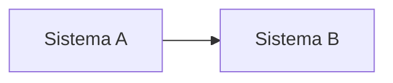

# Markdown syntax for RFCs

Everything below is written the same way in each language section of `RFC.md`. The site shows submitted text **without raw HTML** (the one exception is `<br>` for a line break inside a table cell); everything else has a Markdown form below.

## Sections

```markdown
## Contexto: como funciona hoje {#context}
```

Every `##` needs an id (`{#slug}`) and starts a numbered section. Nothing before the first `##`. `###` and `####` are sub-headings. Link to a section with `[perguntas em aberto](#questions)`.

## Tables

Plain GFM tables get the site style. Variants wrap one table:

```markdown
::: table changes
| Mudança | Hoje | Depois | O que fazer |
|---|---|---|---|
| **Valores** | reais | centavos | multiplicar por 100 |
:::
```

`changes` (four wide columns), `num` (mono first column), `map` (route mapping: first two columns mono). A small coloured label goes in a cell, or anywhere in text, as `[text]{kind}` with kind `eq`, `ch`, `gap`, `new` (green, amber, red, blue) or `yes`, `part`, `no`. A line break inside a cell is `<br>`.

```markdown
::: legend
- [equivalente]{eq} mesma operação
- [muda]{ch} regra diferente
- [novo]{new} não existia
:::

::: table map
| Hoje | API nova | Situação | O que muda |
|---|---|---|---|
| POST /Tokenizacao/Pagar<br>B21 | POST /v1/pagamento | [muda]{ch} | … |
:::
```

Label text: PT equivalente / muda / novo / sem equivalente; EN equivalent / changes / new / no equivalent; ZH 对应 / 变化 / 新增 / 无对应. `::: legend` is a list of what each label means.

A note under a table or a code block, without taking a paragraph number: `::: caption` with one paragraph.

## Callouts

```markdown
::: decision Decisão
Texto do callout.
:::
```

`note` (neutral), `decision` (green, choices made), `risk` (red, pending confirmations and impacts). The label after the name is optional (defaults: Nota / Decisão / A confirmar; Note / Decision / To confirm; 备注 / 决定 / 待确认).

## Stats (summary)

```markdown
::: stats
- **8** integrações hoje
- **4 → 1** formas de autenticação
:::
```

## Endpoints

```markdown
::: endpoints
- POST /v1/pagamento — Cobra o cartão
- GET /v1/pagamento/{id} — Consulta o pagamento
:::
```

Methods: GET, POST, PUT, PATCH, DELETE.

## Phases

```markdown
::: phases
##### FASE 0: Preparação

- Inventário das rotas.

##### FASE 1: PIX

- Contrato e piloto.
:::
```

Tags: `FASE N:` / `PHASE N:` / `第 N 阶段：`. The first card is highlighted.

## Open questions

```markdown
::: questions
1. **Tokens.** Pergunta, e para quem (“para a CredPay”).
:::
```

## Diagrams

````markdown

````

## Code

Fenced blocks with a language: `json`, `bash`, `http`, `python`, `yaml`, `java`, `javascript`, `typescript`, `dart`, `kotlin`, `go`, `sql`, `text`. Identical in the three languages. Realistic but fake values; never real keys, tokens, documents or customer data. Comments in English.

## Images and galleries

Mermaid draws most diagrams as text. For screenshots and drawings made elsewhere (draw.io, Excalidraw, app screens), export PNG, JPEG or WebP (at most 1 MB each; up to 160 per RFC) and cite them by name; whoever publishes attaches the files:

```markdown

```

Names are lowercase letters, digits, `.`, `_`, `-` (up to 60). An image that changes by language (a translated screen) gets one file per language (`tela-pt.png`, `tela-en.png`, `tela-zh.png`). The alt text is translated. `https://` links also work for images, but a file is better: it stays with the RFC.

Several related images with captions:

```markdown
::: gallery
-  **A1.** Tela de login
-  **A2.** Tela inicial
:::
```

`::: gallery phones` shows tall phone screens in narrow columns. Each item is an image followed by its caption.

## Screens (cards)

One card per menu item or screen, each with where it shows and a list:

```markdown
::: screens
##### Painel | Muda · Tela 1

- Métricas de mensagens
- Alertas de segredo antigo

##### Membros | Sem mudança

- Os papéis definem quem gerencia as aplicações
:::
```

## Placeholders

The template marks what to fill with `TODO:`; the page refuses the file while any is left.
