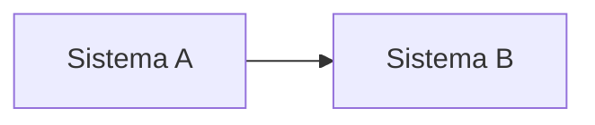

# Markdown syntax for RFCs

Everything below is written the same way in each language section of `RFC.md` (and in `rfc.pt.md`, `rfc.en.md` and `rfc.zh.md` for RFCs kept in the repository, whose format is `docs/spec/rfc-format.md`).

## Sections

```markdown
## Contexto: como funciona hoje {#context}
```

Every `##` needs an id (`{#slug}`) and starts a numbered section. Nothing before the first `##`. `###` and `####` are sub-headings. Link to a section with `[perguntas em aberto](#questions)`.

## Tables

Plain GFM tables get the site style. Variants wrap one table:

```markdown
::: table changes
| Mudança | Hoje | Depois | O que fazer |
|---|---|---|---|
| **Valores** | reais | centavos | multiplicar por 100 |
:::
```

`changes` (four wide columns), `num` (mono first column), `map` (route mapping: first two columns mono). Inline verdicts and chips are raw HTML, allowed anywhere:

```markdown
<div class="legend"><span><span class="st eq">equivalente</span> mesma operação</span><span><span class="st ch">muda</span> regra diferente</span><span><span class="st new">novo</span> não existia</span><span><span class="st gap">sem equivalente</span> fica no antigo</span></div>

::: table map
| Hoje | API nova | Situação | O que muda |
|---|---|---|---|
| POST /Tokenizacao/Pagar | POST /v1/pagamento | <span class="st ch">muda</span> | … |
:::
```

Chip labels: PT equivalente / muda / novo / sem equivalente; EN equivalent / changes / new / no equivalent; ZH 对应 / 变化 / 新增 / 无对应. Also `<span class="yes">`, `<span class="part">`, `<span class="no">`.

## Callouts

```markdown
::: decision Decisão
Texto do callout.
:::
```

`note` (neutral), `decision` (green, choices made), `risk` (red, pending confirmations and impacts). The label after the name is optional (defaults: Nota / Decisão / A confirmar; Note / Decision / To confirm; 备注 / 决定 / 待确认).

## Stats (summary)

```markdown
::: stats
- **8** integrações hoje
- **4 → 1** formas de autenticação
:::
```

## Endpoints

```markdown
::: endpoints
- POST /v1/pagamento — Cobra o cartão
- GET /v1/pagamento/{id} — Consulta o pagamento
:::
```

Methods: GET, POST, PUT, PATCH, DELETE.

## Phases

```markdown
::: phases
##### FASE 0: Preparação

- Inventário das rotas.

##### FASE 1: PIX

- Contrato e piloto.
:::
```

Tags: `FASE N:` / `PHASE N:` / `第 N 阶段：`. The first card is highlighted.

## Open questions

```markdown
::: questions
1. **Tokens.** Pergunta, e para quem (“para a CredPay”).
:::
```

## Diagrams

````markdown

````

## Code

Fenced blocks with a language: `json`, `bash`, `http`, `python`, `yaml`, `java`, `javascript`, `typescript`, `dart`, `kotlin`, `go`, `sql`, `text`. Identical in the three languages. Realistic but fake values; never real keys, tokens, documents or customer data. Comments in English.

## Raw HTML

Allowed anywhere as an escape hatch (for example `<code>` lists, `<br>`, the chips above). Prefer Markdown.

## Placeholders

The template marks what to fill with `TODO:`; the checker (rule F08) refuses any left.
