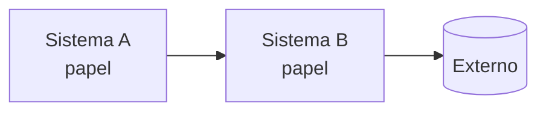
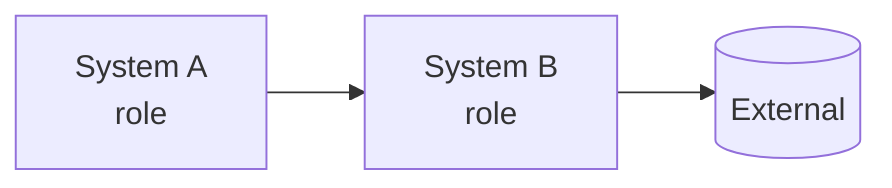
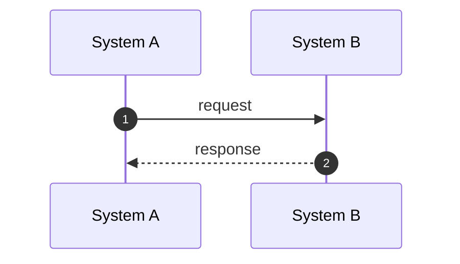
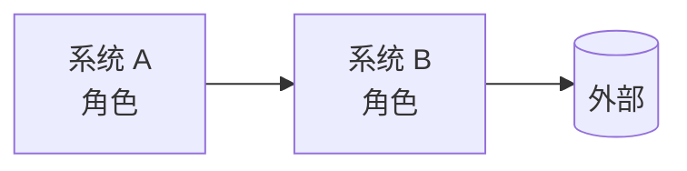
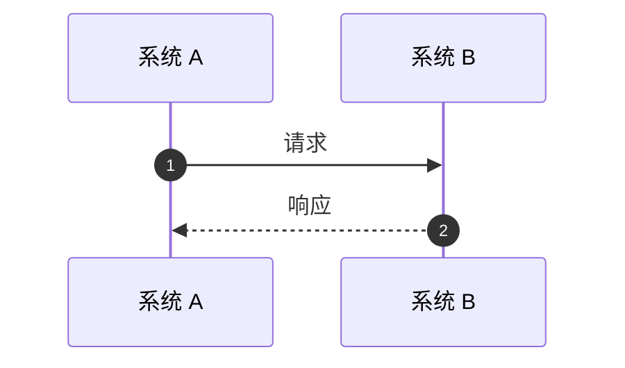

<!--
  MODELO DE RFC (um arquivo só, três idiomas) / RFC TEMPLATE (one file, three languages)

  PT  Preencha este arquivo (você pode pedir a uma IA: veja o prompt na página "Nova RFC"), depois envie na página "Nova RFC" do site.
      - Cada ponto a preencher está marcado com TODO: (com dois-pontos). Troque todos; o envio é recusado enquanto sobrar algum.
      - Escreva primeiro a seção em português, depois traduza para inglês e chinês mantendo as MESMAS seções, ids {#...}, parágrafos,
        itens de lista, tabelas, diagramas e blocos de código, na mesma ordem (os comentários por parágrafo usam essa numeração).
      - Nada de HTML, scripts ou segredos. Imagens só com link https.
      - Título e resumo nos três idiomas ficam no bloco do topo; o autor e os colaboradores você informa na página de envio.

  EN  Fill in this file (an AI can do it: see the prompt on the "New RFC" page), then upload it on the "New RFC" page of the site.
      - Every spot to fill is marked TODO: (with a colon). Replace them all; the upload is refused while any is left.
      - Write the Portuguese section first, then translate to English and Chinese keeping the SAME sections, {#...} ids, paragraphs,
        list items, tables, diagrams and code blocks, in the same order (per-paragraph comments use that numbering).
      - No HTML, scripts or secrets. Images only as https links.
      - Title and summary in the three languages go in the block at the top; you give author and collaborators on the upload page.
-->
---
title_pt: TODO: título em português
title_en: TODO: title in English
title_zh: TODO: 中文标题
summary_pt: TODO: uma frase em português: o que muda, para quem e por quê
summary_en: TODO: one sentence in English: what changes, for whom and why
summary_zh: TODO: 一句话（中文）：改变什么、面向谁、为什么
systems: TODO: sistema-a, sistema-b
---
<!-- lang:pt -->

## Resumo {#summary}

TODO: o problema em uma frase e o que esta RFC propõe:

- **TODO: Mudança 1.** Uma frase.
- **TODO: Mudança 2.** Uma frase.

::: stats
- **TODO: 0** número que dá a dimensão do problema
- **TODO: 0 → 0** antes e depois
:::

## Contexto: como funciona hoje {#context}

TODO: como funciona hoje, com base no código e na documentação. Cite classes e arquivos.

::: decision Por que isso importa
TODO: ligue o contexto à proposta.
:::

## Objetivos e fora de escopo {#goals}

#### Objetivos

- TODO: objetivo verificável.

#### Fora do escopo

- TODO: o que não será feito agora.

## Proposta {#proposal}

TODO: a solução, em blocos de no máximo um parágrafo.

| Como é hoje | Com esta RFC |
|---|---|
| TODO: situação atual | TODO: situação proposta |

## Fluxos {#flows}

## Mudanças e compatibilidade {#changes}

::: table changes
| Mudança | Hoje | Depois | O que fazer |
|---|---|---|---|
| **TODO: mudança** | TODO: hoje | TODO: depois | TODO: ação |
:::

## Plano de implantação {#rollout}

::: phases
##### FASE 1: TODO: nome

- TODO: entrega

##### FASE 2: TODO: nome

- TODO: entrega
:::

## Riscos {#risks}

| Risco | Mitigação |
|---|---|
| TODO: risco | TODO: mitigação |

## Perguntas em aberto {#questions}

::: questions
1. **TODO: Tema.** Pergunta, e para quem.
:::

## Referências {#refs}

- TODO: arquivos, classes e documentos usados no levantamento.

<!-- lang:en -->

## Summary {#summary}

TODO: the problem in one sentence and what this RFC proposes:

- **TODO: Change 1.** One sentence.
- **TODO: Change 2.** One sentence.

::: stats
- **TODO: 0** number that sizes the problem
- **TODO: 0 → 0** before and after
:::

## Context: how it works today {#context}

TODO: how it works today, based on the code and the documentation. Cite classes and files.

::: decision Why this matters
TODO: connect the context to the proposal.
:::

## Goals and non-goals {#goals}

#### Goals

- TODO: verifiable goal.

#### Non-goals

- TODO: what will not be done now.

## Proposal {#proposal}

TODO: the solution, in blocks of at most one paragraph.

| Today | With this RFC |
|---|---|
| TODO: current situation | TODO: proposed situation |

## Flows {#flows}

## Changes and compatibility {#changes}

::: table changes
| Change | Today | After | What to do |
|---|---|---|---|
| **TODO: change** | TODO: today | TODO: after | TODO: action |
:::

## Rollout plan {#rollout}

::: phases
##### PHASE 1: TODO: name

- TODO: deliverable

##### PHASE 2: TODO: name

- TODO: deliverable
:::

## Risks {#risks}

| Risk | Mitigation |
|---|---|
| TODO: risk | TODO: mitigation |

## Open questions {#questions}

::: questions
1. **TODO: Topic.** Question, and for whom.
:::

## References {#refs}

- TODO: files, classes and documents used in the investigation.

<!-- lang:zh -->

## 摘要 {#summary}

TODO: 用一句话说明问题，以及本 RFC 的提议：

- **TODO: 变更 1。** 一句话。
- **TODO: 变更 2。** 一句话。

::: stats
- **TODO: 0** 说明问题规模的数字
- **TODO: 0 → 0** 前后对比
:::

## 背景：当前的工作方式 {#context}

TODO: 基于代码和文档说明当前如何工作，并引用类和文件。

::: decision 为什么重要
TODO: 把背景与方案联系起来。
:::

## 目标与非目标 {#goals}

#### 目标

- TODO: 可验证的目标。

#### 非目标

- TODO: 现在不做的事。

## 方案 {#proposal}

TODO: 解决方案，每块不超过一段。

| 现状 | 采用本 RFC 后 |
|---|---|
| TODO: 当前情况 | TODO: 提议的情况 |

## 流程 {#flows}

## 变更与兼容性 {#changes}

::: table changes
| 变更 | 现状 | 之后 | 需要做什么 |
|---|---|---|---|
| **TODO: 变更** | TODO: 现状 | TODO: 之后 | TODO: 行动 |
:::

## 实施计划 {#rollout}

::: phases
##### 第 1 阶段：TODO: 名称

- TODO: 交付物

##### 第 2 阶段：TODO: 名称

- TODO: 交付物
:::

## 风险 {#risks}

| 风险 | 缓解措施 |
|---|---|
| TODO: 风险 | TODO: 缓解措施 |

## 待定问题 {#questions}

::: questions
1. **TODO: 主题。** 问题，以及向谁提出。
:::

## 参考资料 {#refs}

- TODO: 调查中使用的文件、类和文档。
