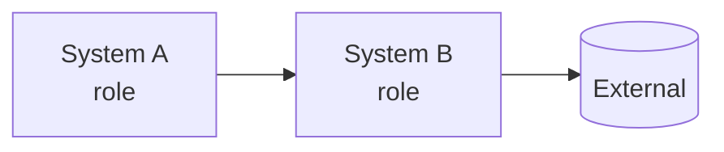
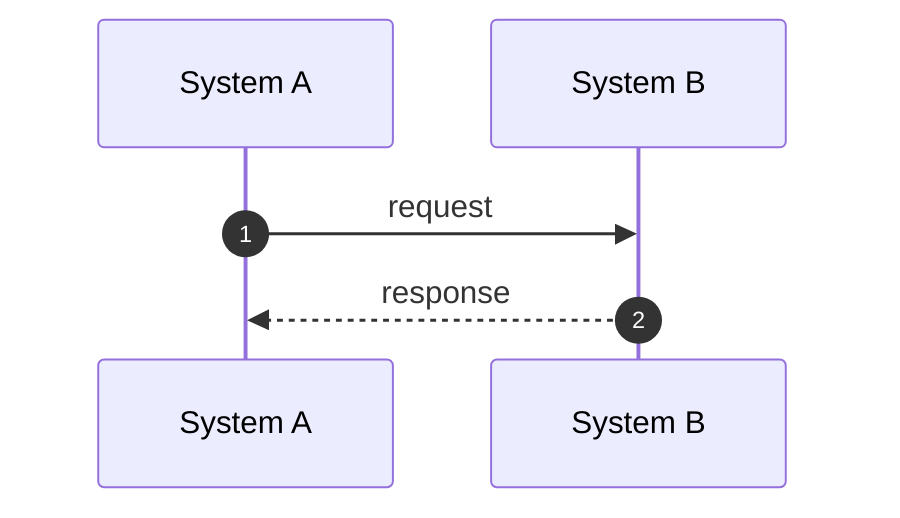

<!--
  RFC in English. Translate it from rfc.pt.md keeping the same sections, ids, paragraphs, diagrams and code blocks
  (order and count matter: per-paragraph comments use those numbers).
  Rules and components: docs/spec/rfc-format.md. Replace every pending marker (TODO followed by a colon); the
  validator (tools/check_rfc.py) rejects the file while any is left.
-->

## Summary {#summary}

TODO: the problem in one sentence and what this RFC proposes:

- **TODO: Change 1.** One sentence.
- **TODO: Change 2.** One sentence.

::: stats
- **TODO: 0** number that sizes the problem
- **TODO: 0 → 0** before and after
:::

## Context: how it works today {#context}

TODO: how it works today, based on the code and the documentation. Cite classes and files.

::: decision Why this matters
TODO: connect the context to the proposal.
:::

## Goals and non-goals {#goals}

#### Goals

- TODO: verifiable goal.

#### Non-goals

- TODO: what will not be done now.

## Proposal {#proposal}

TODO: the solution, in blocks of at most one paragraph.

| Today | With this RFC |
|---|---|
| TODO: current situation | TODO: proposed situation |

## Flows {#flows}

## Changes and compatibility {#changes}

::: table changes
| Change | Today | After | What to do |
|---|---|---|---|
| **TODO: change** | TODO: today | TODO: after | TODO: action |
:::

## Rollout plan {#rollout}

::: phases
##### PHASE 1: TODO: name

- TODO: deliverable

##### PHASE 2: TODO: name

- TODO: deliverable
:::

## Risks {#risks}

| Risk | Mitigation |
|---|---|
| TODO: risk | TODO: mitigation |

## Open questions {#questions}

::: questions
1. **TODO: Topic.** Question, and for whom.
:::

## References {#refs}

- TODO: files, classes and documents used in the investigation.
