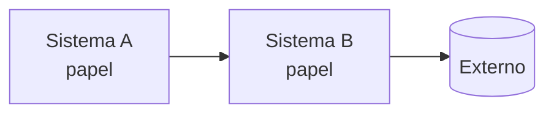
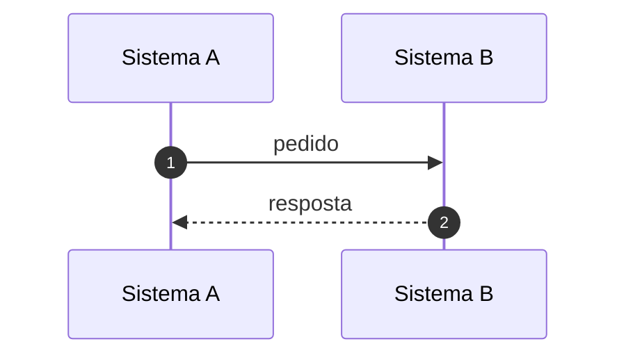

<!--
  RFC em Português (idioma de referência). Escreva este arquivo primeiro; depois traduza para rfc.en.md e rfc.zh.md
  mantendo as mesmas seções, ids, parágrafos, diagramas e blocos de código (a ordem e a quantidade importam:
  os comentários por parágrafo usam esses números).
  Regras e componentes: docs/spec/rfc-format.md. Troque cada marcador de pendência (TODO seguido de dois-pontos) pelo
  conteúdo; o validador (tools/check_rfc.py) recusa o arquivo enquanto houver algum.
  Título, resumo, autores, revisores e status ficam em rfc.json, não aqui.
-->

## Resumo {#summary}

TODO: o problema em uma frase e o que esta RFC propõe:

- **TODO: Mudança 1.** Uma frase.
- **TODO: Mudança 2.** Uma frase.

::: stats
- **TODO: 0** número que dá a dimensão do problema
- **TODO: 0 → 0** antes e depois
:::

## Contexto: como funciona hoje {#context}

TODO: como funciona hoje, com base no código e na documentação. Cite classes e arquivos.

::: decision Por que isso importa
TODO: ligue o contexto à proposta.
:::

## Objetivos e fora de escopo {#goals}

#### Objetivos

- TODO: objetivo verificável.

#### Fora do escopo

- TODO: o que não será feito agora.

## Proposta {#proposal}

TODO: a solução, em blocos de no máximo um parágrafo.

| Como é hoje | Com esta RFC |
|---|---|
| TODO: situação atual | TODO: situação proposta |

## Fluxos {#flows}

## Mudanças e compatibilidade {#changes}

::: table changes
| Mudança | Hoje | Depois | O que fazer |
|---|---|---|---|
| **TODO: mudança** | TODO: hoje | TODO: depois | TODO: ação |
:::

## Plano de implantação {#rollout}

::: phases
##### FASE 1: TODO: nome

- TODO: entrega

##### FASE 2: TODO: nome

- TODO: entrega
:::

## Riscos {#risks}

| Risco | Mitigação |
|---|---|
| TODO: risco | TODO: mitigação |

## Perguntas em aberto {#questions}

::: questions
1. **TODO: Tema.** Pergunta, e para quem.
:::

## Referências {#refs}

- TODO: arquivos, classes e documentos usados no levantamento.
