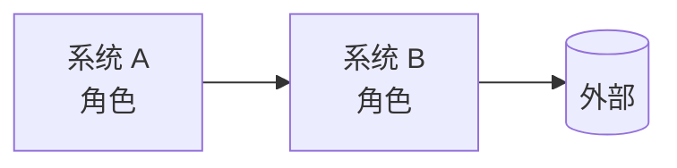
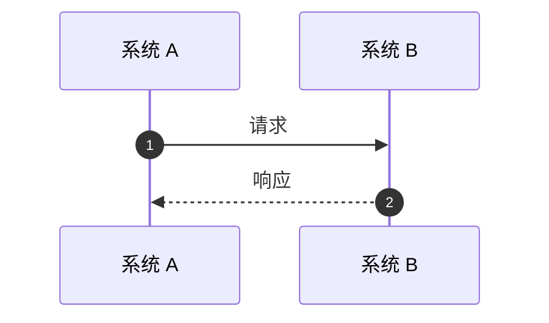

<!--
  中文版 RFC。请根据 rfc.pt.md 翻译，保持相同的章节、id、段落、图表和代码块
  （顺序和数量很重要：按段落评论使用这些编号）。
  规则与组件：docs/spec/rfc-format.md。请替换每个待办标记（TODO 加冒号）；
  只要还有标记，校验工具 tools/check_rfc.py 就会拒绝该文件。
-->

## 摘要 {#summary}

TODO: 用一句话说明问题，以及本 RFC 的提议：

- **TODO: 变更 1。** 一句话。
- **TODO: 变更 2。** 一句话。

::: stats
- **TODO: 0** 说明问题规模的数字
- **TODO: 0 → 0** 前后对比
:::

## 背景：当前的工作方式 {#context}

TODO: 基于代码和文档说明当前如何工作，并引用类和文件。

::: decision 为什么重要
TODO: 把背景与方案联系起来。
:::

## 目标与非目标 {#goals}

#### 目标

- TODO: 可验证的目标。

#### 非目标

- TODO: 现在不做的事。

## 方案 {#proposal}

TODO: 解决方案，每块不超过一段。

| 现状 | 采用本 RFC 后 |
|---|---|
| TODO: 当前情况 | TODO: 提议的情况 |

## 流程 {#flows}

## 变更与兼容性 {#changes}

::: table changes
| 变更 | 现状 | 之后 | 需要做什么 |
|---|---|---|---|
| **TODO: 变更** | TODO: 现状 | TODO: 之后 | TODO: 行动 |
:::

## 实施计划 {#rollout}

::: phases
##### 第 1 阶段：TODO: 名称

- TODO: 交付物

##### 第 2 阶段：TODO: 名称

- TODO: 交付物
:::

## 风险 {#risks}

| 风险 | 缓解措施 |
|---|---|
| TODO: 风险 | TODO: 缓解措施 |

## 待定问题 {#questions}

::: questions
1. **TODO: 主题。** 问题，以及向谁提出。
:::

## 参考资料 {#refs}

- TODO: 调查中使用的文件、类和文档。
