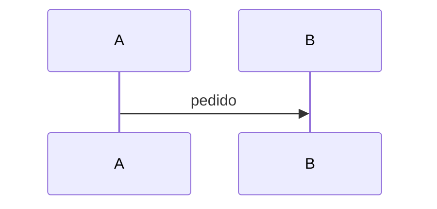

<!-- Covers the syntax the renderers must treat the same way: tests/test_parity.py renders this file with Python and with JavaScript. -->

## Basics {#basics}

Paragraph with **bold**, *italic*, `code`, ``code with ` tick``, a [link](https://example.com/x?a=1&b=2), an [internal link](#lists) and an image .

> A blockquote
> on two lines

---

Line one\
line two, an escaped \* star, snake_case_word, 2 * 3 * 4 and <angle> brackets & ampersands.

**文字：**中文紧跟着粗体，还有 **状态。**若这样。

## Lists {#lists}

- one
  - nested **bold**
    - deeper
- two with `code`

1. first
2. second
   - mixed list

## Tables {#tables}

| Left | Center | Right |
|:-----|:------:|------:|
| a | b | c |
| `x` | **y** | z<br>w |

::: table map
| A | B |
|---|---|
| x | y |
:::

::: table num
| N | V |
|---|---|
| 1 | 2 |
:::

<div class="legend"><span><span class="st eq">same</span> raw HTML, kept only for files that live in the repository</span></div>

## Directives {#directives}

::: note
A note without a label.
:::

::: decision Custom label
Body with `code` and a [link](#basics).
:::

::: risk
Pending confirmation.

A second paragraph.
:::

::: stats
- **8** things
- **4 → 1** steps
:::

::: phases
##### PHASE 0: Prepare

- inventory
- plan

##### PHASE 1: Pilot

- contract
:::

::: questions
1. **Topic.** Question one?
2. **Other.** Question two?
:::

::: endpoints
- POST /v1/messages — Creates a message
- GET `/v1/messages/{id}` — Reads it, with `code`
:::

## Code {#code}

```json
{"a": [1, 2.5, true, null], "b": "x \"quoted\"", "c": {"d": -3}}
```

```bash
# a comment
curl -X GET "https://api.example.com/v1/items" \
  -H "Authorization: Bearer $TOKEN"   # trailing comment
echo 'single quoted'
```

```http
POST /v1/messages HTTP/1.1
Content-Type: application/json
X-Trace: abc # not a comment

{"a": 1}
```

```python
# comment
def f(x):
    return "text"  # trailing
```

```yaml
key: value  # comment
list:
  - "a"
```

```java
// Single conversion point
static String toCents(BigDecimal reais) {   // card
    return reais.movePointRight(2).toPlainString();
}
```

```javascript
const a = `template ${x}`; // comment
async function f() { return await g("x://y"); }
```

```typescript
export class A { private x = 1; }
```

```dart
final x = 1; // dart
```

```kotlin
class K { fun f() = 1 }
```

```go
func main() { return }
```

```sql
select 1 -- comment
```

```text
plain <text> & more
```

## Diagrams {#diagrams}

~~~mermaid Caption with `code` and a [link](#basics).
flowchart LR
  A["Sistema A<br/>papel"] --> B["B"]
~~~


