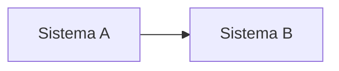
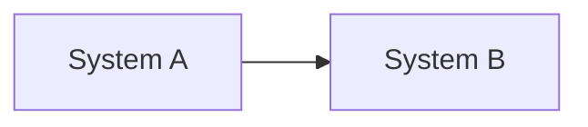
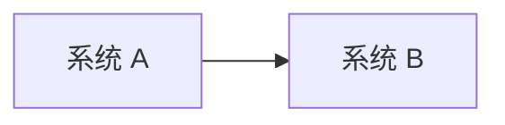

<!-- A small, complete RFC in the single-file format, used by the upload and viewer tests. -->
---
title_pt: Integração de teste
title_en: Test integration
title_zh: 测试集成
summary_pt: Uma RFC pequena e completa para os testes.
summary_en: A small, complete RFC for the tests.
summary_zh: 一个用于测试的小而完整的 RFC。
systems: channel, vault
---
<!-- lang:pt -->

## Resumo {#summary}

O problema em uma frase.

- **Mudança 1.** Uma frase.
- **Mudança 2.** Outra frase.

## Fluxo {#flow}



```bash
curl -X GET "https://api.example.com/v1/items"
```

## Perguntas {#questions}

::: questions
1. **Prazo.** Qual o prazo? Para Produto.
:::

<!-- lang:en -->

## Summary {#summary}

The problem in one sentence.

- **Change 1.** One sentence.
- **Change 2.** Another sentence.

## Flow {#flow}



```bash
curl -X GET "https://api.example.com/v1/items"
```

## Questions {#questions}

::: questions
1. **Deadline.** What is the deadline? For Product.
:::

<!-- lang:zh -->

## 摘要 {#summary}

一句话说明问题。

- **变更 1。** 一句话。
- **变更 2。** 另一句话。

## 流程 {#flow}



```bash
curl -X GET "https://api.example.com/v1/items"
```

## 问题 {#questions}

::: questions
1. **期限。** 期限是多久？向产品团队提问。
:::
