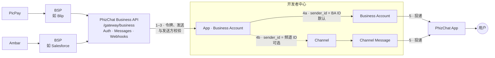
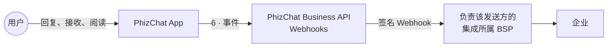
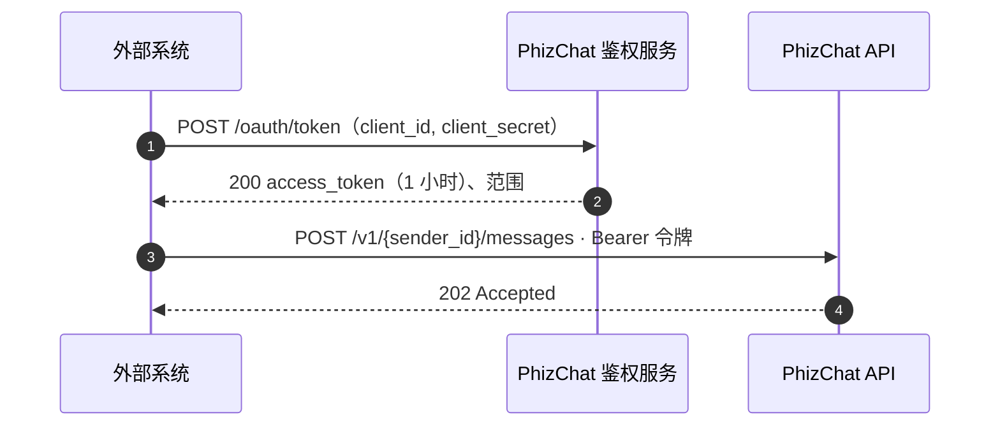

<!-- lang:pt -->

## Resumo {#summary}

Este documento propõe uma API pública para que sistemas externos (Blip, Salesforce, CRMs ou sistemas próprios do comerciante) conversem com usuários PhizChat em nome de um comerciante. A proposta tem quatro partes:

- **Autenticação OAuth 2.0 (client credentials)** com credenciais emitidas para uma *aplicação* da Central do Desenvolvedor, sob o Developer ID do comerciante, e não mais para um canal.
- **Envio de mensagens** para um número de telefone (E.164) ou um Open ID, em nome de um **Business Account** (BA) criado na aplicação. Usar um canal como remetente é opcional. O Business Account é a única conversa entre a empresa e o usuário: atendimento, avisos e informações, enviados por pessoas ou pela API.
- **Webhooks** assinados que entregam as mensagens recebidas dos usuários e cada mudança de status das mensagens enviadas.
- A **Central do Desenvolvedor PhizChat**, que já existe, onde o comerciante (Developer ID) cria **aplicações**. Cada aplicação tem `client_id` e secret próprios, **no máximo um Business Account**, assinaturas de eventos e histórico de entregas, e pode ter também mini programa, canal e pagamento. Um BSP, como a Blip, tem o próprio Developer ID e é autorizado pela aplicação do comerciante.
- Duas plataformas com **login e organização unificados**: a Central do Desenvolvedor (configuração técnica) e o Open Platform (dados e operação do Business Account), descritas na seção 06.

Os contratos de mensagem e webhook reproduzem a estrutura da Cloud API da Meta, trocando apenas os nomes do domínio. Quem já integra com o WhatsApp Business Platform adapta a integração mudando URLs, credenciais e alguns nomes de campo.

## Contexto: como funciona hoje {#context}

Levantamento feito na documentação atual (Apifox, módulo *Authentication*) e no Open Platform (`open.phiz.chat`).

### Autenticação atual

O token é obtido em `POST /gateway/openapi/auth` com `app_id`, `app_secret`, `description` (obrigatório) e `grant_type: "user_credentials"`. A resposta traz um access token de cerca de 2 horas e um refresh token de cerca de 90 dias, renovado em `POST /gateway/openapi/token/refresh`.

```http
POST /gateway/openapi/auth
Content-Type: application/json

{
  "app_id": "69c37cb1821121af34201f48",
  "app_secret": "94B18B920D19463C7264BD0BDE30C31…",
  "description": "push news",
  "grant_type": "user_credentials",
  "device_fingerprint": ""
}

200 OK
{
  "code": 200,
  "msg": "success",
  "data": {
    "scope": "channel",
    "status": "active",
    "access_token": "at_1770343926041_1Y3iz6XN…",
    "token_type": "Bearer",
    "expires_in": 7199,
    "refresh_token": "rt_1770343926041_mxc7RV9…",
    "access_token_expires_at": "2026-02-06T04:…",
    "refresh_token_expires_at": "2026-05-07T02:…",
    "created_at": "2026-02-05T10:15:23.672+00:00"
  },
  "success": true
}
```

### Onde ficam as credenciais

No Open Platform, cada canal tem a página *Canal › Configuração de Desenvolvimento* com **AppID** e **AppSecret**. O secret não é exibido e só pode ser *redefinido*. O canal também oferece, em *Robô de IA*, o modo de resposta **“Phiz Business API”**, que encaminha as conversas do canal para envio e callbacks de webhook da Business Message API. Esta RFC substitui essa API (Q7).

No nível do comerciante já existem o **ID do Comerciante** (UUID), *Gerenciamento da equipe* com funções, membros e registro de operações. O ID do Comerciante é o mesmo **Developer ID** da Central do Desenvolvedor: um único identificador da organização nas duas plataformas (seção 06).

### O que muda com esta RFC

Cada linha mostra como funciona hoje, por que isso atrapalha, o que esta proposta coloca no lugar e um caso de uso concreto.

::: table changes
| Como é hoje | Por que atrapalha | Com esta RFC | Caso de uso |
|---|---|---|---|
| Para falar com o usuário pela API, o comerciante precisa de um canal. | Quem não tem canal, ou quer falar como a própria empresa, não consegue mandar mensagem direta ao usuário. | O comerciante envia pelo seu Business Account, exibido ao usuário como a empresa. Usar o canal passa a ser uma opção. | Uma farmácia sem canal avisa a cliente Maria, pelo telefone dela, que o pedido está pronto para retirada. A mensagem chega na conversa Business Account da farmácia. |
| Cada canal tem seu próprio AppID e secret. | Um comerciante com 5 canais administra 5 credenciais, e a Blip precisa de um token por canal. | Uma credencial por aplicação, na Central do Desenvolvedor, com o próprio Business Account e os canais escolhidos. O BSP é autorizado pela aplicação. | A Loja Exemplo tem 3 canais e usa a Blip. Hoje cadastra 3 AppIDs na Blip; com a RFC, cria uma aplicação com o Business Account da loja, liga os 3 canais e autoriza o Developer ID da Blip. |
| “Redefinir” invalida o secret na hora. | A integração fica fora do ar até alguém atualizar o secret no sistema externo. | Dois secrets válidos ao mesmo tempo: o novo entra e o antigo continua valendo durante a tolerância (até 7 dias, padrão da Central). | O secret do Salesforce apareceu num log. O time gera um novo, atualiza o Salesforce à tarde e revoga o antigo no fim do dia, sem nenhuma mensagem perdida. |
| O login usa `grant_type: user_credentials` e exige o campo `description`. | Ferramentas que já falam OAuth, como o Salesforce, não conseguem se conectar sem código sob medida. | OAuth 2.0 padrão (`client_credentials`), que essas ferramentas suportam de fábrica. | O administrador do Salesforce conecta a PhizChat em Named Credentials preenchendo só a URL do token, o client\_id e o secret, sem desenvolvedor. |
| Existe um refresh token válido por cerca de 90 dias. | É mais um segredo de longa duração para guardar, sem ganho numa integração entre servidores. | Token de 1 h, sem refresh token; quando expira, o sistema pede outro. | A Blip renova o token sozinha a cada hora com o mesmo client\_id e secret. Não existe refresh token que possa vencer num fim de semana e derrubar o atendimento. |
| A configuração do canal não tem tela para webhook, logs ou várias integrações. | O comerciante não consegue configurar o webhook nem descobrir sozinho por que uma integração parou. | Central do Desenvolvedor existente, estendida com apps separados para a Business API, assinaturas de eventos, histórico de entregas e logs. | As respostas dos clientes param de chegar na Blip. O comerciante abre o histórico de entregas, vê que o webhook responde erro 500 desde as 10h e, depois da correção, reenvia os eventos. |
:::

## Referência: a experiência no WhatsApp {#whatsapp}

Esta RFC replica no PhizChat o modelo da WhatsApp Business Platform. Para que todos (Brasil e China) tenham a mesma imagem do que estamos copiando, esta seção mostra a jornada de um usuário brasileiro no WhatsApp: como cria a conta, como **autoriza** uma empresa, como a mensagem chega e o que pode fazer com ela. Exemplo: comerciante PicPay, usuária Ana Souza, em São Paulo.

::: note Sobre as telas
São ilustrações, não a interface oficial do WhatsApp. O texto está em português, como o usuário vê no app. Os códigos (A2, O1, C3…) seguem o canvas de Design que deu origem a esta seção. Clique em uma imagem para abrir em tamanho real.
:::

### Caminho da mensagem

A empresa não fala direto com o WhatsApp: o sistema dela (CRM, atendimento) chama um **BSP** (Blip, Zenvia, Twilio, Infobip), que chama a **Cloud API** da Meta, que entrega no celular. Respostas, cliques e status voltam por webhook pelo mesmo caminho. No PhizChat, a **PhizChat Business Messaging API** ocupa o lugar da Cloud API, o Developer ID e a aplicação ocupam o lugar da WABA e o Business Account (BA ID) ocupa o lugar do número comercial (ver a equivalência na seção 06).

::: gallery
-  **B01.** Empresa → BSP → Meta Cloud API → WhatsApp → usuário, com o opt-in como pré-requisito e o caminho de volta por webhook
:::

### Cadastro do usuário

No WhatsApp, a conta é o número de telefone, verificado por SMS. Não existe pedido de amizade: quem tem o número consegue escrever. Empresas e família ficam na **mesma caixa de entrada**, por isso o controle sobre mensagens de empresas é rígido. Desde 2026 o WhatsApp oferece nomes de usuário e identificadores por empresa (BSUID) no lugar do telefone, o que conversa com o uso do Open ID nesta RFC.

::: gallery phones
-  **A02.** Número de telefone = identidade da conta
-  **A10.** Uma única caixa de entrada para tudo
:::

### Autorização do usuário (opt-in)

Antes de uma empresa iniciar uma conversa, o usuário precisa ter autorizado *aquela empresa*. Há quatro formas comuns: no app da empresa (O1), no cadastro ou checkout (O2), quando o próprio usuário escreve primeiro, o que vale só para aquele atendimento (O3), e respondendo “sim” dentro do chat (O4). A boa prática é separar por finalidade: autorizar alertas da conta não autoriza ofertas.

::: gallery
-  **O00.** Ciclo do consentimento: coletar, registrar, enviar dentro do escopo, revogar
:::

::: gallery phones
-  **O01.** Opt-in no app do comerciante, separado por finalidade
-  **O02.** Opt-in no cadastro, com caixas desmarcadas
-  **O03.** O usuário escreve primeiro: autoriza só o atendimento
-  **O04.** Opt-in pedido dentro do chat, com botões
:::

**A Meta tem a política, mas não valida o opt-in.** Não há campo nem endpoint para comprovar a autorização; a Meta confia na empresa e só reage depois, por bloqueios, denúncias e nota de qualidade. Já o *opt-out* é aplicado pela plataforma: bloqueio, “parar ofertas” e limite de marketing fazem o envio falhar. Mesmo assim, pela LGPD cabe à empresa provar o consentimento e respeitar a revogação, então o registro (quem, comerciante, categoria, origem, data, texto exibido, revogação) é obrigatório na prática.

::: gallery
-  **O05.** Registro de consentimento do lado do comerciante
-  **O06.** A Meta não verifica o opt-in; o opt-out é aplicado pela plataforma; por que registrar mesmo assim
:::

### O que o usuário recebe

Mensagens iniciadas pela empresa usam **templates** aprovados, em quatro categorias: utilidade (pagamentos, contas), marketing, autenticação (códigos) e serviço. Cada categoria depende do opt-in correspondente.

::: gallery phones
-  **C01.** Notificação igual à de um contato pessoal
-  **C02.** Lista de conversas: conta comercial verificada, não lida e no topo, ao lado de família e amigos
-  **C03.** Utilidade: Pix recebido, com botões
-  **C04.** Marketing: exige opt-in próprio para ofertas
-  **C05.** Autenticação: código com botão de copiar
-  **C06.** Fatura com código Pix copia e cola
:::

### O que o usuário pode fazer

O usuário responde (texto, botões, lista, formulário), consulta o perfil da empresa ou retira a autorização. Cada ação gera, ou não, um evento para a empresa.

::: gallery
-  **D00.** Todas as opções do usuário e o que a empresa recebe de volta
:::

::: gallery phones
-  **D02.** Resposta rápida por botão
-  **D04.** Mensagem de lista
-  **D05.** Formulário dentro do chat (Flows), próximo de um mini app
-  **D07.** Parar ofertas e manter alertas
-  **D08.** Bloquear e denunciar, com motivo
-  **D10.** Opt-out por palavra-chave, tratado pelo comerciante
:::

| Ação do usuário | No WhatsApp | No PhizChat |
|---|---|---|
| Responde com texto ou mídia | Webhook `messages`; abre janela de 24 h | Evento `message` (seção 10) |
| Toca em botão ou lista | `button_reply` / `list_reply` | Evento `message` com o id escolhido |
| Para ofertas | Envios de marketing falham | Fase 2: a plataforma bloqueia a categoria para aquele Business Account (`ba_id`). Na Fase 1 há só o bloqueio simples |
| Bloqueia ou denuncia | Todos os envios falham; nota de qualidade cai | Proposta: erro no envio e sinal de qualidade (ver Q3) |
| Silencia ou arquiva | Invisível para a empresa | Igual |

### O que levamos para o PhizChat

- A identidade que o usuário vê, autoriza e bloqueia é o **Business Account** (`ba_id`): é ele que recebe o opt-in, o bloqueio e a nota de qualidade. O Developer ID (o antigo Merchant ID) é dono das aplicações, e cada aplicação tem no máximo um Business Account (seção 06).
- Consentimento por Business Account, com opt-out aplicado pela plataforma; categorias de mensagem na Fase 2 (ver Política de envio, seção 09).
- Sinais do usuário (bloquear, denunciar, parar ofertas) alimentando limites de envio do comerciante.
- Formulários dentro do chat (Flows) como referência para mini apps.

## Opt-in no PhizChat: no app e na empresa {#phizoptin}

::: note Opt-in em discussão
As regras de opt-in desta seção e da seção 09 **estão em discussão** com o time da China e ainda não são definitivas. Uma proposta de opt-in será apresentada nos próximos dias e vai atualizar esta seção, a seção 09 e a Q1.
:::

A seção 03 mostrou que no WhatsApp o opt-in quase sempre acontece fora do app e que a Meta não o valida. Esta seção propõe como o usuário **autoriza** uma conta business no PhizChat, por dois caminhos que terminam nos mesmos controles de opt-out:

- **Fluxo P — dentro do PhizChat:** o usuário aceita a conta business no próprio app. A plataforma guarda a prova.
- **Fluxo Q — na empresa, fora do PhizChat:** o usuário autorizou no app, site ou loja do comerciante, e o comerciante inicia a conversa.

::: note Sobre as telas
São propostas ilustrativas, com o PicPay como comerciante de exemplo. Os códigos (P0…P8, Q0…Q5) seguem o canvas de Design. Clique em uma imagem para abrir em tamanho real.
:::

### Fluxo P · Opt-in dentro do PhizChat

O usuário chega à conta business por link de SMS ou e-mail, QR code, app ou site do comerciante, ou pela busca no app. Se não tem o Phiz, vê uma página H5 só com o perfil e o download; o aceite nunca acontece fora do app. Depois de instalar e entrar, um deep link diferido o leva ao mesmo chat, que abre **bloqueado até o aceite**. Ao aceitar, o PhizChat registra o consentimento (Open ID do usuário, `ba_id`, data, ponto de entrada), envia o template de boas-vindas, se houver, e libera o chat.

::: gallery
-  **P00.** Mapa do fluxo P: entradas, instalação, login, aceite e depois
:::

::: gallery phones
-  **P01.** Sem o app: página H5 com perfil e download, sem botão Aceitar
-  **P02.** Chat da conta business com o cartão de consentimento; campo bloqueado até o aceite
-  **P03.** Depois do aceite: boas-vindas e chat liberado
-  **P04.** Perfil da empresa antes do consentimento, também com Aceitar
-  **P05.** Janela de confirmação do consentimento
:::

Depois do aceite, o perfil mostra o status e a data do consentimento. O usuário pode **revogar** (o chat volta ao estado bloqueado e pode ser autorizado de novo) ou **bloquear** (reaproveita o bloqueio atual; a API continua aceitando chamadas, mas devolve o status bloqueado).

::: gallery phones
-  **P06.** Perfil depois do consentimento: status, data e Revogar consentimento
-  **P07.** Confirmação da revogação; o chat volta a ficar bloqueado
-  **P08.** Conta business bloqueada: a API devolve o status bloqueado
:::

### Fluxo Q · Opt-in coletado pela empresa, fora do PhizChat

A maioria das empresas brasileiras já coleta consentimento nos próprios canais. No fluxo Q, o usuário ativa “mensagens no PhizChat” no app do PicPay; o PicPay guarda a prova e envia o template pela API. A API confere se o destinatário é usuário do Phiz e se não bloqueou nem revogou; no modelo B, confere também se há consentimento registrado para aquela categoria. No app, a primeira mensagem chega com um **cartão de origem do consentimento** (o que foi autorizado, onde e quando), e o usuário pode continuar recebendo, parar ou denunciar.

::: gallery
-  **Q00.** Mapa do fluxo Q: lado da empresa, verificações da API e lado do usuário, com a comparação P × Q
:::

::: gallery phones
-  **Q01.** Opt-in no app do PicPay, citando o PhizChat
-  **Q02.** Primeira mensagem na lista, com a etiqueta Nova empresa
-  **Q03.** Cartão com a origem do consentimento: continuar, parar ou denunciar
-  **Q04.** Status do consentimento por categoria, com origem e data
:::

::: gallery
-  **Q05.** Modelo B: registro do consentimento na API e erros de envio (proposta ilustrativa)
:::

### P × Q

|  | P · opt-in no PhizChat | Q · opt-in na empresa |
|---|---|---|
| Quem coleta | PhizChat (Aceitar) | O comerciante (app, site, loja) |
| Onde fica a prova | PhizChat | CRM do comerciante (modelo A) · também no PhizChat (modelo B) |
| Primeira conversa | Bloqueada até o aceite | Abre com a mensagem e a origem do consentimento |
| Opt-out | Igual nos dois: revogar, bloquear, denunciar — aplicado pelo PhizChat |  |

### Estados da relação com o usuário

O documento **PHZ-BM-0001** (*Business Account Messaging*) propõe estados explícitos para a relação entre o Business Account e o usuário. Eles se encaixam nos fluxos P e Q e decidem o que pode ser enviado:

| Estado | Significado | Serviço | Marketing |
|---|---|---|---|
| `NO_RELATION` | Só existe a resolução do telefone | Só casos fortes aprovados (por exemplo, código de verificação) | Não |
| `USER_INITIATED` | O usuário escreveu, escaneou um QR ou abriu uma entrada da empresa | Sim | Consentimento separado |
| `BUSINESS_RELATION` | Pedido, suporte, agendamento ou relação parecida (fluxo Q) | Sim | Consentimento separado |
| `MARKETING_OPT_IN` | O usuário autorizou marketing de forma explícita (fluxo P ou Q) | Sim | Sim |
| `BLOCKED` / `UNSUBSCRIBED` | Bloqueio ou cancelamento pelo usuário, ou supressão pela plataforma | Conforme a política | Não |

O estado fica ligado ao par Business Account (`ba_id`) e Open ID do usuário. Ele não é exposto pela API; o envio só recebe o resultado (aceito ou erro com motivo).

### Controles do usuário

| Ação | Resultado | Fase |
|---|---|---|
| Bloquear ou continuar | A primeira mensagem de um Business Account mostra as duas opções; continuar vale como opt-in | Fase 1 |
| Bloquear | Bloqueio total: nenhuma mensagem desse Business Account até o usuário desbloquear | Fase 1 |
| Silenciar | Desliga notificações e mantém a conversa | Fase 1 |
| Denunciar, ou bloquear e denunciar | Abre uma reclamação com motivo e evidências | A definir (Q3) |
| Cancelar marketing | Desliga marketing, sem desligar avisos de serviço necessários | Fase 2 (depende das categorias) |
| Consultar a empresa | Mostra entidade verificada, suporte e política de privacidade | Fase 1 |

A conversa empresarial precisa ser visualmente diferente de uma conversa entre amigos: nome verificado, por que a mensagem chegou e acesso fácil a bloquear, denunciar e cancelar. Na Fase 1 ela fica **na lista de conversas, junto das outras**, e cada empresa tem uma única conversa com o usuário. Pasta ou filtro de empresas (como “Empresas” ao lado de “Não lidas” e “Grupos”) fica para depois, com teste A/B: no WeChat, a pasta veio tarde e reduziu a taxa de abertura das contas empresariais (Q20). No backlog, a experiência no app está na [PHIZ-5313](https://phiz.atlassian.net/browse/PHIZ-5313).

### Decisões em aberto

- **Modelo A × B** (Q1): a proposta da PhizChat Brasil é o modelo A, em que a empresa é responsável pelo opt-in e a PhizChat é só o canal (seção 09).
- **Entrega antes do aceite no fluxo Q:** a primeira mensagem é entregue com as opções *Bloquear* ou *Continuar*; continuar vale como opt-in, como no WhatsApp.
- **Categorias de consentimento** (alertas da conta, ofertas, códigos): a proposta da PhizChat Brasil é deixá-las para a Fase 2, junto com as categorias de mensagem. Depois de estudar o WhatsApp, o time da China propõe que o opt-in varie conforme a categoria da mensagem e vai refinar a regra com o time técnico (Q1).
- **Nomes técnicos** — `/v1/{sender_id}/consents`, o webhook `consent_update` e os códigos de erro — são provisórios, para discussão.

## Objetivos e não-objetivos {#goals}

#### Objetivos

- Credenciais ligadas a **aplicações** da Central do Desenvolvedor, e não mais a cada canal. O Developer ID (o antigo Merchant ID) cria uma **aplicação** por uso, com `client_id`, secret, escopos e **no máximo um Business Account**. BSPs como Blip ou Salesforce têm o próprio Developer ID e são autorizados pela aplicação do comerciante. Canais podem ser ligados como remetentes opcionais.
- OAuth 2.0 padrão (client credentials), compatível com bibliotecas e plataformas de mercado.
- Enviar mensagens para **telefone ou Open ID** e receber respostas e status por **webhook assinado**.
- Compatibilidade estrutural com a Cloud API da Meta, para que integrações existentes migrem com pouco código.
- Publicar a especificação da API em formato OpenAPI 3.1 (o padrão do Swagger). É um arquivo que descreve todas as rotas, campos, respostas e webhooks, e funciona como acordo entre o time que constrói a API e quem integra com ela. Com ele, parceiros geram documentação e código e testam antes da entrega.

#### Fora do escopo desta RFC

- Templates, campanhas, segmentação e categorias de mensagem (Fase 2 e Marketing API). O backlog já cobre templates Utility na Fase 1 ([PHIZ-5315](https://phiz.atlassian.net/browse/PHIZ-5315)); ponto para discutirmos (Q14).
- Preço e cobrança por conversa.
- Grupos, chamadas de voz e vídeo.
- Página oficial da empresa (feed com novidades, Moments, Clips e canal) e pasta ou filtro de empresas na lista de conversas.
- SDKs oficiais (podem vir depois, gerados a partir do OpenAPI).

## Modelo de domínio {#model}

O modelo oficial de identidades é o do diagrama *Business Account hierarchy*, definido com o time técnico da PhizChat: **Developer ID → várias aplicações → no máximo um Business Account por aplicação**. O `merchant_id` **não** identifica o remetente; ele é o próprio Developer ID com o nome antigo.

| Identidade | O que é | Onde aparece |
|---|---|---|
| **Dev Account** | Conta de login e operação, ligada ao Phiz ID da pessoa. É o login unificado da Central do Desenvolvedor e do Open Platform. | Login nas duas plataformas |
| **Developer ID** | O antigo Merchant ID com nome unificado: a organização (CNPJ ou CPF), dona dos recursos. **Não** são duas entidades criadas em sincronia. Pode ser um comerciante (PicPay, Ambar) ou um BSP/ISV (Blip, Zenvia, Twilio). O mapeamento com a Organização da Central será verificado pelo time da plataforma. | Central do Desenvolvedor e Open Platform |
| **App ID** | Aplicação do Developer ID: credenciais (`client_id` e secret), escopos e contexto de isolamento. Tem no máximo um Business Account e pode ter também mini programa, canal e pagamento. Pode autorizar o Developer ID de um BSP. O Open ID do usuário é diferente em cada aplicação. | Token, `/v1/apps/{app_id}` |
| **BA ID** | Business Account: o remetente real, que o usuário vê e autoriza. Pertence a um único Developer ID e a uma única aplicação; não existe BA ligado a várias aplicações. Criptografia e isolamento são por BA. | Conversa no PhizChat, `entry[].id` dos webhooks |
| **sender\_id** | Referência externa ao remetente, usada na API e mapeada para o BA ID. Para um canal (opcional), é o ID do canal. | `POST /v1/{sender_id}/messages` |
| **Open ID** | Identificador do usuário dentro de uma aplicação. O telefone é trocado pelo Open ID, e o vínculo com o BA é feito pelo Open ID, não pelo número. | `to` com `to_type: open_id`; `from` nos webhooks |

```mermaid Modelo oficial: Developer ID → aplicações → no máximo um Business Account por aplicação. A aplicação do comerciante pode autorizar o Developer ID de um BSP.
flowchart LR
  DA["Dev Account<br/>Phiz ID · login unificado"] --> D["Developer ID<br/>antigo Merchant ID · CNPJ/CPF"]
  D --> A1["Aplicação A<br/>Credential: client_id + secret"]
  D --> A2["Aplicação B"]
  A1 --> B1["Business Account<br/>BA ID = sender_id"]
  A1 --> R1["Mini programa · Canal · Pagamento"]
  A2 --> B2["Business Account"]
  A1 -. "autoriza" .-> DB["Developer ID do BSP<br/>Blip · Zenvia · Twilio"]
  B1 --> U(("Usuário<br/>Open ID por aplicação"))
  B2 --> U
```

### Tipos de conversa

Definição do time de produto e tecnologia da PhizChat: No backlog: [PHIZ-5059](https://phiz.atlassian.net/browse/PHIZ-5059).

- **Conversa de conta pública**: categoria geral de conversa; não é exibida ao usuário.
- **Conversa de serviço empresarial**: subclassificação da conversa de conta pública; também não é exibida.
- **Business Account**: tipo de produto dentro da conversa de serviço empresarial, **exibido ao usuário**, como a identificação de empresa do WhatsApp. É voltado a empresas, governos e instituições.

Para ter um Business Account, a empresa usa o seu Developer ID (o mesmo Merchant ID do Open Platform), cria uma aplicação (App ID) e, nela, o Business Account (BA ID). Tanto as chamadas de terceiros (Salesforce, BSPs) quanto a autorização do usuário para receber mensagens são feitas sobre o BA ID. O Business Account é um tipo de conversa novo: produto e tecnologia vão refinar a definição dele e dos demais tipos, pensando em expansões futuras (Q4).

::: decision Uma conversa por empresa (reunião de 22/10)
O Business Account é **o único lugar onde a empresa e o usuário conversam**. Atendimento, avisos de serviço (por exemplo, a entrega de um pedido feito no mini programa), informações e dúvidas ficam na mesma conversa, quer a mensagem venha de um atendente ou da API. Nenhuma empresa tem mais de uma conversa com o mesmo usuário. A divulgação fica em outro lugar: a **página oficial da empresa** (nome a definir: feed, página ou conta oficial), com novidades, publicidade, Moments, Clips e canal, um botão para o mini programa e um botão “Falar com a empresa” que abre a conversa. Tocar no logo da empresa na conversa abre essa página. O Channel de hoje é transmissão (um para muitos); o Business Account é conversa um a um. Esta RFC trata só da conversa; o nome e o papel do Channel ficam na Q22.
:::

::: risk Avisos automáticos no meio do atendimento
Com uma única conversa, avisos automáticos (pagamento, entrega, pedido do mini programa) podem chegar enquanto o usuário fala com um atendente e interromper a conversa. No WhatsApp isso é raro porque não há mini programas; no WeChat os avisos vão para outro lugar. Propostas em discussão: segurar os avisos enquanto o usuário estiver em atendimento (por exemplo, se ele interagiu nos últimos 5 minutos) e entregá-los quando ele ficar inativo, ou levar os avisos para um canal de notificações separado. Na Fase 1, as mensagens são entregues na ordem de chegada (Q24).
:::

::: decision Modelo oficial (v1.8)
O diagrama *Business Account hierarchy* define: **Developer ID → várias aplicações → no máximo um Business Account por aplicação**. Um BA pertence a um único Developer ID e a uma única aplicação; **não** adotamos o modelo em que um BA se liga a várias aplicações. Developer ID é o nome unificado do antigo Merchant ID, e não duas entidades criadas em sincronia. Dev Account é a identidade de login e operação. O Business Account e o Channel são recursos separados da aplicação. Com isso, o modelo do **PHZ-BM-0001** (`Organization → Business Account → App → Credential`, com BA acima das aplicações e como subtipo de Channel) não é adotado; a tabela abaixo mostra as diferenças.
:::

| Ponto | Modelo oficial (v1.8) | PHZ-BM-0001 |
|---|---|---|
| Hierarquia | Developer ID (organização) → App ID → Credential → BA ID | Organization → Business Account → App → Credential |
| Aplicações por BA | Uma; no máximo um BA por aplicação | Várias (as aplicações enviam em nome do BA) |
| O que é o BA | Recurso da aplicação, ao lado de mini programa, canal e pagamento; tipo de conversa conta pública › serviço empresarial › Business Account | Subtipo de produto de Channel |
| Canal | Recurso separado da aplicação; remetente opcional | O BA é um Channel; um ID de canal sozinho nunca autoriza acesso |
| ID da conversa | Não definido | Curto prazo: `channel:<id>` com `conversation_kind=BUSINESS_1_TO_1`, `business_channel_id` e `recipient_user_id`; longo prazo: ID opaco do servidor |
| Usuário | Open ID por aplicação | `recipient_user_id` |
| Auditoria | Aplicação e Business Account | Organização, aplicação e operador como sujeitos separados |

### Duas plataformas: Central do Desenvolvedor e Open Platform

O diagrama oficial tem duas plataformas com **login unificado** (Dev Account, pelo Phiz ID) e **organização unificada** (Developer ID, o antigo Merchant ID). O time técnico da PhizChat confirmou que é **um único sistema e uma única conta**: as plataformas só mostram partes diferentes dos mesmos recursos (mini programa, Business Account, canal e pagamento). O Business Account e a Business Messaging API são suportados pela **Central do Desenvolvedor**, onde o desenvolvedor cria a aplicação (o fluxo de autorização da API) e configura o Business Account. Para o usuário a experiência é a mesma, seja qual for a plataforma usada pela empresa.

| Assunto | Central do Desenvolvedor PhizChat | Open Platform / Merchant Services |
|---|---|---|
| Para quem | Desenvolvedores do comerciante e BSPs | Time de negócio e operação do comerciante |
| Business Account | Criação técnica, BA ID, aplicação dona e escopos (seção 12) | Perfil público (nome, foto, verificação), dados e operações do dia a dia |
| Credenciais e acesso | Aplicações, secrets, autorização de BSPs, lista de IPs | Página do canal com o aviso de migração das credenciais antigas |
| Mensagens | Assinaturas de eventos, entregas de webhook e uso da API | Conversas e métricas de negócio |
| Usuários | Usuários autorizados por BA (contagem) | Bloqueios, denúncias e qualidade |

::: caption
A Central do Desenvolvedor é a referência do Business Account. Quais dados e operações o Open Platform também mostra é uma proposta desta RFC e precisa ser confirmada com o time da plataforma (Q21).
:::

### Abertura e estados do Business Account

O Business Account é aberto sobre o cadastro e a verificação de comerciante que já existem. Esta RFC mostra o desenvolvedor criando o BA na Central (seção 12, Tela 7); o backlog ([PHIZ-5061](https://phiz.atlassian.net/browse/PHIZ-5061)) prevê também a abertura assistida pela operação, com revisão no **Admin**, a ferramenta interna da PhizChat. No Admin, a operação revisa e ativa Business Accounts, aplica restrições e suspensões e faz a recuperação; a Central e o Open Platform mostram o estado. Qual caminho é o padrão na Fase 1 é a Q25.

| Estado | Significado | API | App |
|---|---|---|---|
| Em revisão | Criado, aguardando revisão e ativação | Envio recusado | Não aparece na busca |
| Ativo | Liberado para enviar e receber | Envio permitido, sujeito às verificações da seção 09 | Perfil e conversa visíveis |
| Restrito | Limitado por qualidade, denúncias ou política | Só o que a restrição permite; o resto falha com motivo | Conversa visível |
| Suspenso | Suspenso pela operação ou pela governança | Envio recusado com motivo | O usuário vê que a empresa está indisponível |
| Recuperado | Volta ao estado Ativo depois de restrição ou suspensão, com registro no Admin | Envio permitido | Normal |

Toda mudança de estado vale ao mesmo tempo no Admin, na elegibilidade da API e no app, e fica registrada na auditoria. Os nomes e as transições são proposta desta RFC.

### Impacto no app PhizChat

O **PHZ-BM-0001** levantou o que o app (Flutter) precisa mudar para exibir conversas Business Account. Vale também para o modelo oficial:

| Hoje no app | O que falta |
|---|---|
| `ChannelInfo.type` | Subtipo explícito para Business Account, com enum compatível |
| `ChannelInfo.companyAuth` (booleano) | Estado, nível, validade e motivo da verificação |
| Conversa `channel:<id>` | Metadados de conversa Business Account e proteção dos parsers antigos |
| `StrangerChatHelper` | Política empresarial separada, sem misturar com a regra de amizade |
| `MessageReceiver` / `MessageSender` | Envelope com finalidade, identidade do remetente e decisão do servidor |

### Fluxo ponta a ponta

Visão para o time técnico: por onde a mensagem passa, da empresa até o usuário, e por onde voltam as respostas e os status.

```mermaid Ida: da empresa até o usuário. A linha tracejada é o caminho opcional pelo canal.
flowchart LR
  PP["PicPay"] --> B1["BSP<br/>ex.: Blip"]
  AM["Ambar"] --> B2["BSP<br/>ex.: Salesforce"]
  B1 --> API["PhizChat Business API<br/>/gateway/business<br/>Auth · Messages · Webhooks"]
  B2 --> API
  API -- "1–3 · token, envio e<br/>validação do remetente" --> MA
  subgraph OP["Central do Desenvolvedor"]
    MA["App · Business Account"]
    MA -- "4a · sender_id = BA ID<br/>padrão" --> DM["Business Account"]
    MA -. "4b · sender_id = ID do canal<br/>opcional" .-> CH["Channel"]
    CH --> CM["Channel Message"]
  end
  DM -- "5 · entrega" --> APP["PhizChat App"]
  CM -- "5 · entrega" --> APP
  APP --> U(("Usuário"))
```

#### Retorno: respostas e status

```mermaid Volta: respostas do usuário e status das mensagens chegam ao BSP pelo webhook.
flowchart LR
  U(("Usuário")) -- "responde, recebe, lê" --> APP["PhizChat App"]
  APP -- "6 · eventos" --> WH["PhizChat Business API<br/>Webhooks"]
  WH -- "webhook assinado" --> BSP["BSP da integração<br/>responsável pelo remetente"]
  BSP --> EMP["Empresa"]
```

1. **Integração.** A empresa (por exemplo, PicPay ou Ambar) usa um BSP para o atendimento. Na Central do Desenvolvedor, o comerciante cria a aplicação com o seu Business Account e autoriza o Developer ID do BSP a operar por ela (Q23).
2. **Token.** O BSP chama `/oauth/token`. O Auth confere a aplicação na Central do Desenvolvedor (secret, escopos e Business Accounts) e devolve um JWT de 1 h.
3. **Envio.** O BSP chama `POST /v1/{sender_id}/messages`. A API troca o telefone pelo Open ID do usuário, valida token, escopo, remetente, política de opt-in e `Idempotency-Key`, responde `202` e coloca a mensagem na fila. Para mídia, o BSP primeiro envia o arquivo para `POST /v1/{sender_id}/media` e usa no envio o `id` ou o link PhizChat devolvido.
4. **Roteamento.** Com o `sender_id` de um Business Account, a mensagem sai como conversa Business Account (padrão). Com o ID de um canal, segue como Channel Message (opcional).
5. **Entrega.** O PhizChat App exibe a mensagem ao usuário e baixa a mídia do armazenamento da PhizChat, pelo link gerado no upload.
6. **Retorno.** Respostas do usuário e status (`sent`, `delivered`, `read`, `failed`) viram eventos que o serviço de Webhooks entrega, assinados, à aplicação dona do Business Account.

| Componente | Responsabilidade | Situação |
|---|---|---|
| BSP / sistema da empresa | Chama a API, envia as mídias por upload e recebe o webhook. | Externo |
| PhizChat Business API · Auth | Emite e revoga JWT; valida `client_id` e secret. | Novo |
| PhizChat Business API · Messages | Valida e aceita envios (`202`), aplica idempotência e limites, enfileira e roteia por `sender_id`. | Novo |
| PhizChat Business API · Media | Recebe o upload, valida formato e tamanho, guarda o arquivo por tempo limitado e gera o `id` e o link PhizChat usados no envio. | Novo |
| PhizChat Business API · Webhooks | Consome eventos do app, assina e entrega pelas assinaturas de eventos da Central do Desenvolvedor, com as retentativas e o histórico dele. | Novo |
| Central do Desenvolvedor | Existente. Guarda organizações, aplicações, secrets (hash), escopos e assinaturas de eventos. A Business API acrescenta o Business Account de cada aplicação e a autorização de BSPs. | Alterado: credenciais saem do canal e vão para aplicações do Developer ID |
| Open Platform (Merchant Services) | Dados e operação do Business Account: perfil público, conversas e métricas de negócio. | Alterado (Q21) |
| Business Account | Conversa de serviço empresarial exibida ao usuário como a empresa; criptografia e isolamento por BA. | Novo (seção 06, Q3) |
| Channel / Channel Message | Envio pelo canal do comerciante. | Existente |
| PhizChat App | Exibe mensagens, baixa mídia pelo link PhizChat e gera eventos de entrega, leitura e resposta. | Alterado |

### Equivalência com a Cloud API da Meta

| Meta (WhatsApp Cloud API) | PhizChat (esta proposta) |
|---|---|
| WhatsApp Business Account (WABA) | Developer ID · aplicação (App ID) |
| Número comercial · `phone_number_id` | Business Account · `sender_id` mapeado para o BA ID; opcionalmente, um canal (ID do canal) |
| App da Meta + token de System User | App de desenvolvedor + OAuth client credentials |
| `wa_id` | `open_id` (por aplicação) |
| `POST /{phone-number-id}/messages` | `POST /v1/{sender_id}/messages` |
| `POST /{phone-number-id}/media` · mídia por `id` ou `link` de terceiros | `POST /v1/{sender_id}/media` · mídia só por `id` ou link PhizChat; links de terceiros não são aceitos |
| `object: whatsapp_business_account` | `object: phiz_business_account` |
| `X-Hub-Signature-256` | `X-Phiz-Signature-256` + `X-Phiz-Timestamp` |
| `hub.mode` / `hub.verify_token` / `hub.challenge` | Iguais |

## Princípios de design {#principles}

- **Mesmo formato da Cloud API.** Corpos de envio, respostas e webhooks seguem a estrutura da Meta. Divergimos só onde há ganho claro de segurança (timestamp na assinatura, mídia só pelo armazenamento da PhizChat) ou de clareza (`to_type`).
- Status HTTP, um único envelope de erro e `trace_id` em toda resposta de erro.
- O envio é assíncrono e responde `202 Accepted`; o resultado chega pelo webhook.
- **Idempotência.** O cabeçalho `Idempotency-Key` evita mensagens duplicadas quando o cliente repete uma requisição.
- **Menor privilégio.** Cada aplicação tem seus escopos, no máximo um Business Account e os canais ligados a ela.
- Versionamento `/v1`. Mudanças compatíveis (campos novos) entram de maneira padronizada; mudanças incompatíveis exigem `/v2`.
- **Sem amizade não é anônimo.** Falar com quem não é amigo não exige relação prévia, mas o remetente empresarial é sempre identificável.
- **Supressão da plataforma vence.** Bloqueio, cancelamento e supressão têm prioridade sobre qualquer permissão da empresa.

## Autenticação {#auth}

Usamos o fluxo **client credentials** do OAuth 2.0 (RFC 6749 §4.4). O app troca `client_id` e `client_secret` por um access token de 1 hora e o envia em `Authorization: Bearer` em todas as chamadas. Não há refresh token: quando o token expira, o app pede outro.

Na Central do Desenvolvedor, o app, o `appId` e o `appSecret` são o app, o `client_id` e o `client_secret` desta seção, e o grant `CLIENT_CREDENTIALS` da plataforma é o fluxo descrito aqui (seção 12).

::: endpoints
- POST `/oauth/token` — Emite access token
- POST `/oauth/revoke` — Revoga um token (RFC 7009)
- GET `/v1/me` — Mostra aplicação, Developer ID, escopos e remetentes do token
:::

```mermaid Perto de expirar, o sistema pede outro token. Não há refresh token.
sequenceDiagram
  autonumber
  participant S as Sistema externo
  participant A as PhizChat Auth
  participant API as PhizChat API
  S->>A: POST /oauth/token (client_id, client_secret)
  A-->>S: 200 access_token (1 h), escopos
  S->>API: POST /v1/{sender_id}/messages · Bearer token
  API-->>S: 202 Accepted
```

### Requisição e resposta

```bash
# Base URL of this API: current PhizChat gateway + /gateway/business prefix (illustrative host)
PHIZ_API_BASE="https://gateway.phiz.chat/gateway/business"

curl -X POST "$PHIZ_API_BASE/oauth/token" \
  -H "Content-Type: application/x-www-form-urlencoded" \
  -d grant_type=client_credentials \
  -d client_id=app_2Fk81PzQ \
  -d client_secret="$PHIZ_CLIENT_SECRET" \
  -d "scope=messages:send messages:read"
```

```json
{
  "access_token": "eyJhbGciOiJFUzI1NiIsImtpZCI6InBoei0yMDI2LTEwIn0…",
  "token_type": "Bearer",
  "expires_in": 3600,
  "scope": "messages:send messages:read",
  "developer_id": "7f3e2a10-5b8c-4d21-9e6f-2a1c0b9d4e57"
}
```

Os endpoints `/oauth/*` usam o formato de erro do OAuth (RFC 6749 §5.2), que as bibliotecas já entendem:

```json
{
  "error": "invalid_client",
  "error_description": "Client authentication failed."
}
```

### Formato do token

Decisão: o token é um JWT assinado com ES256 e chave publicada em `/.well-known/jwks.json`. O gateway valida o token localmente, sem consulta ao banco a cada chamada. Revogações e secrets rotacionados entram numa lista de negação de curta duração (até a expiração do token). Para o integrador o token é opaco; o conteúdo abaixo é informativo.

```json
{
  "iss": "https://gateway.phiz.chat/gateway/business",
  "sub": "app_2Fk81PzQ",
  "aud": "phiz-business-api",
  "did": "7f3e2a10-5b8c-4d21-9e6f-2a1c0b9d4e57",
  "scope": "messages:send messages:read",
  "snd": [
    "ba_7Kq2M9xTpL",
    "1231"
  ],
  "env": "live",
  "iat": 1760527800,
  "exp": 1760531400,
  "jti": "tok_01JA9VQ4N2"
}
```

### Escopos

| Escopo | Permite |
|---|---|
| `messages:send` | Enviar mensagens de serviço, enviar e gerenciar mídias e marcar mensagens como lidas |
| `messages:read` | Consultar status de mensagens |
| `webhooks:manage` | Configurar, testar e reenviar o webhook do próprio app (Fase 2) |
| `account:read` | Ler dados da aplicação, dos Business Accounts e dos canais |
| `templates:manage` | Reservado para a Marketing API |
| `recipients:resolve` | Verificar se um telefone pode receber mensagens do Business Account, sem revelar cadastro (proposta, Q18) |
| `messages:send_marketing` | Enviar mensagens de marketing; aprovação separada (reservado para a Marketing API) |

### Secrets e rotação

- O secret tem prefixo de ambiente (`phzsk_live_`, `phzsk_test_`), o que ajuda scanners de vazamento a reconhecê-lo.
- É exibido **uma única vez**, na criação ou rotação, e guardado apenas como hash (Argon2id).
- Cada app pode ter **até dois secrets ativos**. Ao gerar um novo, o anterior continua válido durante a tolerância (até 7 dias, padrão da Central), permitindo trocar sem queda.
- A tela mostra o último uso de cada secret, para saber se o antigo ainda está em uso antes de revogá-lo.
- Lista de IPs permitidos por app e política de rotação de 90 dias, ambas já existentes na Central do Desenvolvedor.

### Pré-requisito: verificação

O **PHZ-BM-0001** aponta que hoje não existe um objeto de verificação de conta: os campos `companyAuth` e `memberAuth` não bastam para autorizar a API. A Central do Desenvolvedor já mostra “Organização verificada”, mas o modelo abaixo ainda precisa ser confirmado (Q13). A proposta é que cada nível libere um conjunto de escopos, publicado numa matriz pública:

| Nível | Pode solicitar | Não recebe por padrão |
|---|---|---|
| `UNVERIFIED` | Nada proativo | Resolução, serviço, marketing |
| `PERSON_VERIFIED` | Teste, leitura e respostas iniciadas pelo usuário | Envio em massa e marketing |
| `INDIVIDUAL_BUSINESS_VERIFIED` | Serviço restrito | Marketing e resolução ampla |
| `BUSINESS_VERIFIED` | Serviço, templates e resolução ligada à relação | Marketing |
| `BUSINESS_VERIFIED` + `MARKETING_APPROVED` | Marketing, sujeito a consentimento, template, opt-out e cota | Acesso ilimitado ou entre regiões |

A verificação é uma máquina de estados, não um booleano: `DRAFT → SUBMITTED → UNDER_REVIEW → VERIFIED`, com `NEEDS_INFO` e `REJECTED`, e depois `LIMITED → SUSPENDED → DISABLED`. As mensagens têm estado próprio: `NOT_ENABLED → SERVICE_ENABLED → MARKETING_REVIEW → MARKETING_ENABLED → PAUSED`. Verificação não libera marketing sozinha.

### Atual × proposto

| Aspecto | Hoje | Proposta |
|---|---|---|
| Dono da credencial | Canal | Aplicação da Central (Developer ID) |
| Fluxo | `user_credentials` (próprio) | `client_credentials` (RFC 6749) |
| Campos obrigatórios extras | `description` | Nenhum |
| Validade | ~2 h + refresh token ~90 dias | 1 h, sem refresh token |
| Escopos | `channel` | Por capacidade + remetentes permitidos |
| Rotação | Redefinir invalida na hora | Dois secrets ativos, com sobreposição |
| Erros | HTTP 200 + `code` no corpo | Status HTTP real + envelope padrão |

## Envio de mensagens {#messages}

::: endpoints
- POST `/v1/{sender_id}/messages` — Envia mensagem ou marca como lida
- POST `/v1/{sender_id}/media` — Envia um arquivo de mídia e devolve `id` e link PhizChat
- GET `/v1/media/{media_id}` — Dados da mídia: link, tipo, tamanho e validade
- DELETE `/v1/media/{media_id}` — Remove a mídia antes do prazo
- GET `/v1/messages/{message_id}` — Último status conhecido (contingência)
- GET `/v1/apps/{app_id}/senders` — Business Accounts e canais da aplicação
- POST `/v1/{sender_id}/recipients/resolve` — Verifica se o telefone pode receber, sem revelar cadastro (proposta, Q18)
:::

### Remetente: um Business Account ou um canal

O `sender_id` no caminho define em nome de quem a mensagem sai. Ele é uma referência externa ao remetente e **não** é o `merchant_id`: No backlog, envio e atendimento estão na [PHIZ-5314](https://phiz.atlassian.net/browse/PHIZ-5314).

- **Business Account (padrão).** Use o `sender_id` do Business Account, mapeado para o BA ID, por exemplo `ba_7Kq2M9xTpL`. A mensagem aparece numa conversa **Business Account**, exibida ao usuário como a empresa, e não depende de canal. Cada Business Account pertence a uma única aplicação, que é quem envia e recebe por ele.
- **Um canal (opcional).** Use o ID do canal, por exemplo `1231`. Útil para quem separa marcas ou áreas em canais diferentes. A mensagem aparece na conversa **Channel Service** do canal, a mesma usada pelo Channel Bot.

Os dois funcionam do mesmo jeito na API: mesmos campos, mesmas respostas e mesmos webhooks. Nos webhooks, `metadata.sender_type` indica qual foi usado e `metadata.conversation_type` traz o tipo de conversa (`business_account` ou `channel_service`).

### Destinatário: telefone ou Open ID

O Business Account envia sempre para o **Open ID** do usuário naquela aplicação. Todo usuário PhizChat tem um telefone válido e verificado, então o integrador pode informar o telefone e a PhizChat faz a troca. O campo `to` recebe o destinatário e `to_type` diz como interpretá-lo:

- `phone` (padrão): telefone em E.164, por exemplo `+5511987654321`, inclusive números de outros países. A PhizChat troca o número pelo Open ID do usuário antes do envio.
- `open_id`: o Open ID do usuário nesta aplicação, por exemplo `oid_Qm7f2K9xT4Lw`. É o identificador que chega nos webhooks, então respostas podem usá-lo diretamente.

O vínculo entre o Business Account e o usuário é feito pelo Open ID, e não pelo telefone: se o usuário trocar de número, a conversa continua com o mesmo Open ID. O Open ID é diferente em cada aplicação, então não serve para cruzar usuários entre aplicações.

Se o telefone não pertencer a uma conta PhizChat, ou o usuário tiver bloqueado o remetente, a API ainda responde `202` e o webhook informa `failed` com erro `2104`. Assim a API não serve para descobrir quais números têm conta na PhizChat.

### Exemplo: texto para telefone

```bash
# sender_id = BA ID: message from the Business Account (default), no channel needed
curl -X POST "$PHIZ_API_BASE/v1/ba_7Kq2M9xTpL/messages" \
  -H "Authorization: Bearer $PHIZ_TOKEN" \
  -H "Content-Type: application/json" \
  -H "Idempotency-Key: pedido-48213-envio" \
  -d '{
    "messaging_product": "phiz",
    "to": "+5511987654321",
    "to_type": "phone",
    "type": "text",
    "text": { "body": "Olá, Maria! Seu pedido #48213 foi enviado." },
    "biz_opaque_callback_data": "pedido=48213"
  }'
```

```json
{
  "messaging_product": "phiz",
  "contacts": [
    {
      "input": "+5511987654321",
      "open_id": null
    }
  ],
  "messages": [
    {
      "id": "pmid.01JA9VZ6T8R3",
      "message_status": "accepted"
    }
  ]
}
```

`contacts[].open_id` só vem preenchido se o usuário já tem vínculo com esse Business Account. `messages[].id` é a chave para relacionar os webhooks de status.

### Outros exemplos

#### O mesmo envio, saindo por um canal

```bash
# sender_id = 1231: same request, sent through the merchant's channel
curl -X POST "$PHIZ_API_BASE/v1/1231/messages" \
  -H "Authorization: Bearer $PHIZ_TOKEN" \
  -H "Content-Type: application/json" \
  -d '{ "to": "+5511987654321", "type": "text", "text": { "body": "Novidades da semana na Loja Exemplo - Ofertas" } }'
```

#### Texto para Open ID

```json
{
  "to": "oid_Qm7f2K9xT4Lw",
  "to_type": "open_id",
  "type": "text",
  "text": {
    "body": "Seu cupom chegou: PhizChat10"
  }
}
```

#### Upload de mídia

```bash
# 1. Upload the file to PhizChat (multipart/form-data). Third-party URLs are not accepted when sending.
curl -X POST "$PHIZ_API_BASE/v1/ba_7Kq2M9xTpL/media" \
  -H "Authorization: Bearer $PHIZ_TOKEN" \
  -F messaging_product=phiz \
  -F type=application/pdf \
  -F file=@nota-fiscal-48213.pdf
```

```json
{
  "id": "pmed.01JB2K7Q9X",
  "link": "https://media.phiz.chat/biz/pmed.01JB2K7Q9X",
  "mime_type": "application/pdf",
  "file_size": 184320,
  "sha256": "9b1f…",
  "expires_at": "2026-11-19T14:00:00Z"
}
```

#### Áudio pelo `id` da mídia

```json
{
  "to": "+5511987654321",
  "type": "audio",
  "audio": {
    "id": "pmed.01JB2K4M7A"
  }
}
```

#### Vídeo pelo link PhizChat, para Open ID

```json
{
  "to": "oid_Qm7f2K9xT4Lw",
  "to_type": "open_id",
  "type": "video",
  "video": {
    "link": "https://media.phiz.chat/biz/pmed.01JB2K5V1C",
    "caption": "Como montar seu produto"
  }
}
```

#### Documento com nome de arquivo

```json
{
  "to": "+5511987654321",
  "type": "document",
  "document": {
    "id": "pmed.01JB2K7Q9X",
    "filename": "nota-fiscal-48213.pdf",
    "caption": "Nota fiscal do pedido #48213"
  }
}
```

#### Botões de resposta

```json
{
  "to": "+5511987654321",
  "type": "interactive",
  "interactive": {
    "type": "button",
    "body": {
      "text": "Confirma a entrega amanhã entre 9h e 12h?"
    },
    "action": {
      "buttons": [
        {
          "type": "reply",
          "reply": {
            "id": "confirmar",
            "title": "Confirmar"
          }
        },
        {
          "type": "reply",
          "reply": {
            "id": "reagendar",
            "title": "Reagendar"
          }
        }
      ]
    }
  }
}
```

#### Marcar mensagem recebida como lida

```json
{
  "messaging_product": "phiz",
  "status": "read",
  "message_id": "pmid.IN_01JA9W2C"
}
```

### Tipos suportados

| type | Conteúdo | Fase |
|---|---|---|
| `text` | Até 4.096 caracteres; `preview_url` opcional | MVP |
| `image` | Por `id` ou link PhizChat (upload prévio); legenda opcional | MVP |
| `audio` | Por `id` ou link PhizChat (upload prévio); sem legenda | MVP |
| `video` | Por `id` ou link PhizChat (upload prévio); legenda opcional | MVP |
| `document` | Por `id` ou link PhizChat (upload prévio); legenda e nome do arquivo opcionais | MVP |

Tipos interativos (botões, listas, respostas rápidas) não fazem parte da Fase 1 desta RFC. O backlog ([PHIZ-5312](https://phiz.atlassian.net/browse/PHIZ-5312)) já trata interações ligadas à mensagem original e um comportamento definido para versões antigas do app. A visão da RFC: os tipos interativos entram junto com os templates, e todo tipo novo tem uma versão simples em texto, exibida pelas versões do app que ainda não o suportam, avisando que a ação não está disponível. Ponto para discutirmos (Q26).

### Mídia: upload na PhizChat e armazenamento temporário

Toda mídia passa pelo armazenamento da PhizChat. O envio acontece em dois passos:

1. **Upload.** O BSP envia o arquivo para `POST /v1/{sender_id}/media` (`multipart/form-data`). A PhizChat confere formato e tamanho, guarda o arquivo e devolve um `id` e um `link` PhizChat, com a data de validade em `expires_at`.
2. **Envio.** Na mensagem, o objeto da mídia traz o `id` (recomendado) ou esse `link`. O app do usuário baixa o arquivo do armazenamento da PhizChat.

- **Só links gerados pela PhizChat.** Na Fase 1, a API recusa URLs de terceiros (CDN do comerciante ou do parceiro) com erro `2302`. Assim a PhizChat garante que o link é seguro e que o arquivo continua acessível até a entrega, e o app não expõe o IP do usuário a servidores externos.
- **Armazenamento temporário.** O arquivo fica guardado só pelo tempo necessário para o envio e a entrega: 30 dias a partir do upload, como o `id` de mídia da Cloud API da Meta (Q8). Durante esse prazo, o mesmo `id` pode ser usado em vários envios, por exemplo o mesmo PDF para muitos clientes. Depois dele, o `id` e o link deixam de valer e novos envios falham com `2303`. O comerciante pode apagar antes com `DELETE /v1/media/{media_id}`. Depois da entrega, a mídia vai para o armazenamento normal do chat e continua no histórico da conversa.
- **Validação no upload.** Formato e tamanho são checados no upload, e não na entrega: arquivos fora da tabela abaixo são recusados na hora (`2304` e `2305`).
- **Escopo.** Upload, consulta e remoção usam o escopo `messages:send`, e a mídia só pode ser usada por remetentes da mesma aplicação.

::: decision Decisão (v1.3, confirmada na v1.6)
Na Fase 1, mídia só por upload na PhizChat, com armazenamento temporário; links de terceiros não são aceitos. Formatos e tamanhos são definidos por esta RFC (tabela abaixo). Liberar URLs de terceiros, cliente a cliente, fica para uma fase futura. Combinado com Henry Wu e confirmado pelo time técnico.
:::

| Tipo | Formatos aceitos | Tamanho máximo |
|---|---|---|
| `image` | JPEG, PNG, WebP | 5 MB |
| `audio` | AAC, MP3, M4A, OGG (Opus), AMR | 16 MB |
| `video` | MP4 (H.264 + AAC), 3GP | 16 MB |
| `document` | PDF, DOC/DOCX, XLS/XLSX, PPT/PPTX, TXT, CSV | 100 MB |

::: caption
Formatos e tamanhos que o app PhizChat deve aceitar, inspirados nos limites da Cloud API. A conversão e a compressão ficam a cargo de quem envia o arquivo; o upload recusa o que estiver fora da tabela.
:::

### Política de envio (consentimento)

Proposta inspirada no WhatsApp (ver seção 03), com os fluxos de opt-in detalhados na seção 04: A regra de opt-in está em discussão; uma proposta será apresentada nos próximos dias.

- **Iniciar conversa exige opt-in** do usuário para aquele Business Account (`ba_id`). Na Fase 1 não há categorias: o usuário continua ou bloqueia. Categorias (alertas da conta, ofertas, códigos) entram na Fase 2. Responder em até 24 h depois de uma mensagem do usuário não exige opt-in prévio.
- O opt-in pode ser coletado fora do PhizChat (app, site ou loja do comerciante) ou dentro do app PhizChat.
- **Opt-out aplicado pela plataforma:** se o usuário bloqueia o Business Account ou para as ofertas, os envios daquela categoria falham com erro, sem depender do comerciante.
- **Registro obrigatório:** o comerciante guarda a prova de cada consentimento (Open ID do usuário, `ba_id`, categoria, origem, data, texto exibido e revogação). Pela LGPD, cabe a quem trata os dados provar o consentimento e respeitar a revogação.

::: decision Proposta: a PhizChat é só o canal (modelo A)
Como a Meta, a PhizChat não valida o opt-in: a empresa declara que tem a autorização e responde por ela, porque, se obteve o dado de forma legal, pode usar qualquer canal (ligação, SMS, WhatsApp). Ao se cadastrar, a empresa aceita um termo que deixa claro que o opt-in é responsabilidade dela; a PhizChat aplica o opt-out (bloqueio). A LGPD também permite envio por legítimo interesse, mas isso é difícil de explicar ao usuário. A decisão entre A e B fica na Q1.
:::

### Categorias, janela de atendimento e templates

Com base no **PHZ-BM-0001**, cada mensagem tem uma direção e uma categoria, e serviço e marketing têm permissões, consentimento, limites e revisão separados. É a meta da Fase 2:

| Categoria | Uso | Quando a empresa inicia |
|---|---|---|
| `AUTHENTICATION` | Códigos de verificação e segurança | Template aprovado |
| `UTILITY` | Pedido, pagamento, entrega, reembolso, agendamento, suporte; ligado a um evento de origem | Template aprovado |
| `MARKETING` | Ofertas e campanhas | Template aprovado, opt-in explícito, horário local e limite de frequência (Marketing API) |
| `USER_REPLY` | Respostas dentro da janela aberta pelo usuário | Não se aplica: só dentro da janela |

- **Janela de atendimento.** Quando o usuário escreve, abre-se uma janela em que a empresa responde com texto livre e mídia. A duração é configurável por política (valor inicial de referência: 24 h). Fora dela, a empresa só inicia conversa com template aprovado (erro `2203`). O backlog ([PHIZ-5314](https://phiz.atlassian.net/browse/PHIZ-5314)) já prevê a janela de atendimento na Fase 1; ponto para discutirmos (Q14).
- **Templates.** Ciclo `DRAFT → SUBMITTED → PENDING_REVIEW → APPROVED / REJECTED`, com `PAUSED`, `DISABLED` e snapshots de versão. A pausa por qualidade gera resultado explícito (erro `2204` e evento `template_status`). No backlog: [PHIZ-5315](https://phiz.atlassian.net/browse/PHIZ-5315).
- **Sem promoção disfarçada.** Conteúdo de serviço deve ter relação direta com o evento de origem; marketing em categoria de serviço é recusado e conta para a qualidade.
- **Fase 1 e Fase 2.** Proposta da PhizChat Brasil: a Fase 1 não tem categorias nem templates obrigatórios (opt-in e bloqueio simples); categorias e templates entram na Fase 2, com o marketing. Separar por categoria importa: na Meta, usar o mesmo número para marketing e utilidade “queima” o número e reduz o alcance. O **PHZ-BM-0001** propõe templates de serviço já na primeira fase (Q14). O time da China trata as quatro categorias como um subprojeto próprio, com regras de envio por categoria: por exemplo, atendimento pela interação na conversa e mensagens de serviço sujeitas a opt-in (seção 15). O backlog já cobre templates Utility ([PHIZ-5315](https://phiz.atlassian.net/browse/PHIZ-5315)) e janela de atendimento e limite de frequência ([PHIZ-5314](https://phiz.atlassian.net/browse/PHIZ-5314)) na Fase 1. A proposta da PhizChat Brasil continua sendo a Fase 2; é um ponto para discutirmos (Q14, Q17).

### Verificações antes do envio

A decisão de aceitar uma mensagem combina permissão da organização, escopo, verificação, ambiente, elegibilidade, supressão, finalidade, template, cota e idempotência:

- Estado do Business Account e elegibilidade para a categoria.
- Relação com o usuário ou consentimento de marketing ativo (ver estados na seção 04).
- Template aprovado, vigente e estruturalmente válido, quando exigido.
- Destinatário não bloqueado, não descadastrado, não suprimido e dentro da cota.
- Localidade, horário silencioso, região e regras de setores de risco (erro `2205`). O horário silencioso não pode bloquear avisos críticos de serviço, como um alerta do seguro do carro às 3h (Q17).
- Limites por organização, Business Account, aplicação, template, usuário e IP (erro `2502`).

### Resolução de destinatário (proposta)

O **PHZ-BM-0001** propõe um endpoint de resolução separado do envio. Aqui ele fica como `POST /v1/{sender_id}/recipients/resolve`, com o escopo `recipients:resolve`. A resposta traz só `addressable`, `eligible` e um motivo estável; nunca nome, foto, amizade ou se o número tem cadastro. Só faz sentido para destinatários com relação com o Business Account, e entra na Q18.

### Idempotência

Envie `Idempotency-Key` em todo envio. A mesma chave em até 24 h devolve a resposta original sem reenviar. A mesma chave com corpo diferente devolve `409`. Isso torna seguros os retries após timeout ou erro `5xx`.

## Webhooks {#webhooks}

Cada app tem uma assinatura de webhook com URL, `verify_token` e lista de eventos. Na Central do Desenvolvedor, ela é registrada em *Assinaturas de eventos*: uma assinatura liga um evento do app a uma URL de retorno. No backlog: [PHIZ-5060](https://phiz.atlassian.net/browse/PHIZ-5060).

::: decision Decisão (v1.5, a confirmar)
Na **Fase 1**, o parceiro cadastra a URL sozinho em **Assinaturas de eventos**, na Central do Desenvolvedor. Isso substitui o cadastro manual pela PhizChat proposto na v1.4. Como a plataforma já oferece retentativas, dead letters e reenvio, essas proteções passam a ser **reaproveitadas** e deixam de ser trabalho da Fase 2. O que a Fase 2 mantém é a configuração por API. Confirmado com o time da Central do Desenvolvedor (Q9).
:::

### Configuração na Central do Desenvolvedor (Fase 1)

- O catálogo de eventos da Central do Desenvolvedor ganha `messages` e `message_status`, que o app escolhe em *Assinaturas de eventos › Nova assinatura*, com a URL de retorno.
- A assinatura pode ser ativada, desativada e editada na própria tela, e as mudanças geram auditoria e notificação.
- O formato dos eventos, a assinatura e o handshake descritos abaixo valem para as duas formas de configuração. A plataforma já assina as entregas e aceita esse handshake e esse envelope (Q9).

### Configuração por API (Fase 2)

Estes endpoints são opcionais e ficam para a Fase 2. Na Fase 1, o parceiro usa a tela *Assinaturas de eventos*.

::: endpoints
- PUT `/v1/apps/{app_id}/webhook` — Define URL, verify\_token e eventos (Fase 2)
- GET `/v1/apps/{app_id}/webhook` — Configuração e saúde (Fase 2)
- POST `/v1/apps/{app_id}/webhook/test` — Dispara evento de teste assinado (Fase 2)
- GET `/v1/apps/{app_id}/webhook/deliveries` — Histórico de entregas, 72 h (Fase 2)
- POST `/v1/apps/{app_id}/webhook/deliveries/{id}/replay` — Reenvia uma entrega (Fase 2)
:::

```bash
curl -X PUT "$PHIZ_API_BASE/v1/apps/app_2Fk81PzQ/webhook" \
  -H "Authorization: Bearer $PHIZ_TOKEN" \
  -H "Content-Type: application/json" \
  -d '{
    "url": "https://integracao.lojaexemplo.com.br/phiz/webhook",
    "verify_token": "um-texto-que-so-voce-conhece",
    "fields": ["messages", "message_status"]
  }'
```

::: caption
Exemplo da chamada de configuração da Fase 2.
:::

### Eventos

| field | Quando |
|---|---|
| `messages` | O usuário enviou mensagem, clicou num botão ou reagiu |
| `message_status` | Uma mensagem enviada mudou para `sent`, `delivered`, `read` ou `failed` |
| `sender_update` | Mudou o status, a qualidade ou o limite de um remetente (Business Account ou canal) |
| `account_update` | Mudança na aplicação ou no Developer ID (verificação, restrição) |

### Verificação da URL

Antes de ativar, a PhizChat faz um `GET` na URL com `hub.mode=subscribe`, `hub.verify_token` e `hub.challenge`. O servidor confere o token e responde 200 com o valor de `hub.challenge`. É o mesmo handshake da Meta.

### Assinatura

Todo `POST` traz os cabeçalhos abaixo. A assinatura é um HMAC-SHA256 de `{X-Phiz-Timestamp}.{corpo bruto}` com o **webhook secret** do app, separado do client secret. Rejeite eventos com timestamp mais de 5 minutos fora do relógio. Durante a rotação do webhook secret, o cabeçalho traz duas assinaturas separadas por vírgula.

```http
POST /phiz/webhook HTTP/1.1
Host: integracao.lojaexemplo.com.br
Content-Type: application/json
User-Agent: PHIZ-Webhooks/1.0
X-Phiz-Delivery-Id: dlv_01JA9W2D7K
X-Phiz-Timestamp: 1760528527
X-Phiz-Signature-256: sha256=6f1c0e…
```

```javascript
// Express: verification handshake + signed events
import express from "express";
import crypto from "node:crypto";

const app = express();
app.use(express.raw({ type: "application/json" })); // keep the raw body for the HMAC

app.get("/phiz/webhook", (req, res) => {
  const ok = req.query["hub.mode"] === "subscribe" &&
             req.query["hub.verify_token"] === process.env.PHIZ_VERIFY_TOKEN;
  return ok ? res.status(200).send(req.query["hub.challenge"]) : res.sendStatus(403);
});

app.post("/phiz/webhook", (req, res) => {
  const ts = Number(req.get("X-Phiz-Timestamp"));
  if (Math.abs(Date.now() / 1000 - ts) > 300) return res.sendStatus(400);

  const expected = "sha256=" + crypto
    .createHmac("sha256", process.env.PHIZ_WEBHOOK_SECRET)
    .update(`${ts}.${req.body}`)
    .digest("hex");
  const received = (req.get("X-Phiz-Signature-256") || "").split(",");
  const valid = received.some(sig => sig.length === expected.length &&
    crypto.timingSafeEqual(Buffer.from(sig), Buffer.from(expected)));
  if (!valid) return res.sendStatus(401);

  queue.push({ deliveryId: req.get("X-Phiz-Delivery-Id"), event: JSON.parse(req.body) });
  res.sendStatus(200); // answer fast, process asynchronously
});
```

```python
# Flask: signature check
import hmac, hashlib, time, os
from flask import request, abort

def verify_phiz_signature() -> None:
    ts = int(request.headers["X-Phiz-Timestamp"])
    if abs(time.time() - ts) > 300:
        abort(400)
    msg = f"{ts}.".encode() + request.get_data()  # raw bytes, before JSON parsing
    expected = "sha256=" + hmac.new(os.environ["PHIZ_WEBHOOK_SECRET"].encode(), msg, hashlib.sha256).hexdigest()
    received = request.headers.get("X-Phiz-Signature-256", "").split(",")
    if not any(hmac.compare_digest(sig, expected) for sig in received):
        abort(401)
```

### Mensagem recebida

```json
{
  "object": "phiz_business_account",
  "entry": [
    {
      "id": "ba_7Kq2M9xTpL",
      "changes": [
        {
          "field": "messages",
          "value": {
            "messaging_product": "phiz",
            "metadata": {
              "sender_id": "ba_7Kq2M9xTpL",
              "sender_type": "business_account",
              "conversation_type": "business_account",
              "display_name": "Loja Exemplo"
            },
            "contacts": [
              {
                "profile": {
                  "name": "Maria Souza"
                },
                "open_id": "oid_Qm7f2K9xT4Lw",
                "phone": "+5511987654321"
              }
            ],
            "messages": [
              {
                "from": "oid_Qm7f2K9xT4Lw",
                "id": "pmid.IN_01JA9W2C",
                "timestamp": "1760528527",
                "type": "text",
                "text": {
                  "body": "Quero reagendar a entrega"
                },
                "context": {
                  "id": "pmid.01JA9VZ6T8R3"
                }
              }
            ]
          }
        }
      ]
    }
  ]
}
```

### Mensagem recebida com mídia

Quando o usuário envia imagem, áudio, vídeo ou documento, o evento traz um `url` temporário que aponta para o arquivo no armazenamento atual do chat. A API de mensagens não faz cópia nem guarda a mídia; o `url` vale por 30 dias; baixe o arquivo nesse prazo. Abaixo, o item `messages[]` de uma mensagem de voz:

```json
{
  "from": "oid_Qm7f2K9xT4Lw",
  "id": "pmid.IN_01JA9W7R",
  "timestamp": "1760528731",
  "type": "audio",
  "audio": {
    "url": "https://media.phiz.chat/in/9xT2…?expires=1760615131&sig=…",
    "mime_type": "audio/ogg; codecs=opus",
    "sha256": "3f9a…",
    "voice": true
  }
}
```

### Status de mensagem enviada

```json
{
  "object": "phiz_business_account",
  "entry": [
    {
      "id": "ba_7Kq2M9xTpL",
      "changes": [
        {
          "field": "message_status",
          "value": {
            "messaging_product": "phiz",
            "metadata": {
              "sender_id": "ba_7Kq2M9xTpL",
              "sender_type": "business_account",
              "conversation_type": "business_account",
              "display_name": "Loja Exemplo"
            },
            "statuses": [
              {
                "id": "pmid.01JA9VZ6T8R3",
                "status": "delivered",
                "timestamp": "1760528410",
                "recipient_id": "oid_Qm7f2K9xT4Lw",
                "biz_opaque_callback_data": "pedido=48213",
                "conversation": {
                  "id": "conv_01JA9W",
                  "origin": {
                    "type": "service"
                  },
                  "expires_at": "1760614810"
                }
              }
            ]
          }
        }
      ]
    }
  ]
}
```

```json
{
  "object": "phiz_business_account",
  "entry": [
    {
      "id": "ba_7Kq2M9xTpL",
      "changes": [
        {
          "field": "message_status",
          "value": {
            "messaging_product": "phiz",
            "metadata": {
              "sender_id": "ba_7Kq2M9xTpL",
              "sender_type": "business_account",
              "conversation_type": "business_account",
              "display_name": "Loja Exemplo"
            },
            "statuses": [
              {
                "id": "pmid.01JA9X0QW1",
                "status": "failed",
                "timestamp": "1760528600",
                "recipient_id": "+5511900000000",
                "errors": [
                  {
                    "code": 2104,
                    "title": "recipient_not_reachable",
                    "message": "The phone number is not linked to a PhizChat account or blocked this sender.",
                    "href": "https://developers.phiz.chat/docs/errors#2104"
                  }
                ]
              }
            ]
          }
        }
      ]
    }
  ]
}
```

~~~mermaid Ciclo de vida do status. `accepted` só aparece na resposta da API e no `GET /v1/messages/{id}`; os demais chegam por webhook.
stateDiagram-v2
  direction LR
  [*] --> accepted: 202 da API
  accepted --> sent: entregue ao servidor PhizChat
  sent --> delivered: chegou ao aparelho
  delivered --> read: usuário abriu
  accepted --> failed
  sent --> failed
  read --> [*]
  failed --> [*]
~~~

### Garantias de entrega

**Fase 1.** Regras para quem recebe os eventos:

- **Duplicados são possíveis.** O mesmo evento pode chegar mais de uma vez; use `X-Phiz-Delivery-Id` para descartar duplicados.
- **Sem ordem garantida.** Um `read` pode chegar antes do `delivered`; ordene por `timestamp` e nunca regrida status.
- **Responda em até 10 s** com 2xx e processe depois. Qualquer outra resposta, ou timeout, conta como falha.
- Para status de mensagens enviadas, `GET /v1/messages/{message_id}` serve de contingência se um webhook se perder.

::: note Entrega na Fase 1
A entrega com retentativas, dead letters e reenvio vem das assinaturas de eventos da Central do Desenvolvedor, e a política dela atende ao que propomos abaixo. Mensagens recebidas perdidas são recuperadas pelo reenvio (Q9).
:::

**Política alvo.** A Central do Desenvolvedor já tem retentativas, dead letters e reenvio. A política abaixo é a meta da Business API: onde a plataforma já a cumpre, reaproveitamos; o restante entra na Fase 2.

- **Pelo menos uma vez.** Entrega com **retentativas** e backoff exponencial (10 s, 30 s, 1 min, 5 min, 15 min, 1 h e depois a cada hora) por até 24 h.
- **Reenvio manual.** Depois das 24 h, o evento fica disponível para reenvio por 72 h, com o histórico de entregas (`/webhook/deliveries`).
- **Webhook `failing`.** Se a URL falhar continuamente por 24 h, o webhook passa para `failing` e os administradores do comerciante recebem um aviso.

### Resultados explícitos

Pausa de template, rebaixamento do Business Account, opt-out, risco de qualidade e janela vencida geram resultado explícito: erro na chamada ou evento de webhook (`message_status` com erro, `sender_update`, `template_status` e o proposto `consent_update`). Nunca há retentativa silenciosa nem troca automática de categoria.

## Erros, limites e versões {#errors}

Fora de `/oauth/*`, todos os erros usam um envelope único:

```json
{
  "error": {
    "code": 1003,
    "type": "invalid_parameter",
    "message": "Field 'to' must be E.164 when to_type is 'phone'.",
    "details": [
      {
        "field": "to",
        "issue": "format"
      }
    ],
    "trace_id": "trc_9f2c41ab"
  }
}
```

::: table num
| code | HTTP | type | Significado |
|---|---|---|---|
| 1001 | 400 | invalid\_request | JSON malformado ou campo obrigatório ausente |
| 1003 | 400 | invalid\_parameter | Valor inválido (ver `details`) |
| 1101 | 401 | token\_expired | Token expirado; peça outro |
| 1102 | 401 | invalid\_token | Token inválido ou revogado |
| 1201 | 403 | insufficient\_scope | O token não tem o escopo necessário |
| 1202 | 403 | sender\_not\_allowed | A aplicação não tem permissão para esse remetente |
| 1301 | 404 | not\_found | Recurso inexistente ou de outra aplicação |
| 1401 | 409 | idempotency\_conflict | Mesma Idempotency-Key com corpo diferente |
| 1501 | 429 | rate\_limited | Limite de requisições; respeite `Retry-After` |
| 2104 | webhook | recipient\_not\_reachable | Telefone sem conta PhizChat ou usuário bloqueou o remetente |
| 2201 | 422 | policy\_violation | Envio não permitido pela política de opt-in |
| 2202 | 422 | unsupported\_type | Tipo de mensagem não habilitado para o remetente |
| 2203 | 422 | service\_window\_closed | Fora da janela de atendimento; use um template aprovado |
| 2204 | 422 | template\_not\_approved | Template inexistente, não aprovado, pausado ou desativado |
| 2205 | 422 | send\_window\_restricted | Horário silencioso, região ou regra de setor impede o envio agora |
| 2301 | webhook | media\_unavailable | O app não conseguiu baixar a mídia do armazenamento da PhizChat (mídia expirada ou removida antes da entrega) |
| 2302 | 400 | media\_link\_not\_allowed | O `link` não foi gerado pela PhizChat; faça o upload e use o `id` ou o link devolvido |
| 2303 | 422 | media\_expired | O `id` ou o link da mídia expirou, foi removido ou pertence a outra aplicação |
| 2304 | 415 | unsupported\_media\_type | Formato de arquivo não aceito no upload |
| 2305 | 413 | media\_too\_large | Arquivo acima do tamanho máximo do tipo |
| 2401 | 403 | sender\_disabled | Remetente desativado ou restrito |
| 2402 | 403 | verification\_required | Nível de verificação insuficiente para o escopo ou a categoria |
| 2501 | 429 | messaging\_limit\_reached | Limite diário de destinatários do remetente atingido |
| 2502 | 429 | frequency\_capped | Limite de frequência por usuário, template ou aplicação atingido |
| 5000 | 500 | internal\_error | Erro interno; repita com a mesma Idempotency-Key |
:::

### Limites (proposta inicial)

| Recurso | Limite |
|---|---|
| `/oauth/token` | 60 req/min por app |
| Envio de mensagens | 80 msg/s por remetente (ajustável por contrato) |
| Demais endpoints | 600 req/min por app |
| Destinatários únicos de mensagens iniciadas pela empresa | Faixas por remetente: 1 mil → 10 mil → 100 mil → ilimitado em 24 h, conforme qualidade (Fase 2) |

```http
HTTP/1.1 429 Too Many Requests
Retry-After: 2
X-RateLimit-Limit: 80
X-RateLimit-Remaining: 0
X-RateLimit-Reset: 1760528529
```

### Ambientes

- **Produção:** `https://{gateway}/gateway/business`
- **Sandbox:** `https://{gateway-de-teste}/gateway/business`, no ambiente de testes usado hoje (Openapi-test), com um remetente de teste por aplicação e até 5 destinatários cadastrados (como o número de teste da Meta). Secrets `phzsk_test_` só funcionam aqui.

### Prefixo de rotas

A nova API roda no mesmo gateway da API atual, separada por prefixo:

- `/gateway/openapi/…`: API atual, mantida durante a migração.
- `/gateway/business/…`: esta API (autenticação, mensagens e webhooks).

Com prefixos distintos, cada contexto tem roteamento, autenticação, limites e logs próprios, e o legado pode ser desligado sem afetar a nova API. Todos os caminhos deste documento, como `/oauth/token` e `/v1/{sender_id}/messages`, são relativos a `https://{gateway}/gateway/business`. Nos exemplos, esse endereço aparece como `$PHIZ_API_BASE`.

### Auditoria e dados

Cada autorização e cada recusa apontam para a empresa, o Business Account, a aplicação, o operador, o template, o snapshot da política usada no envio, o `trace_id` e o estado final. Telefones aparecem em logs e métricas só como token irreversível. Eventos podem chegar duplicados ou fora de ordem, mas o estado final de cada mensagem só avança. A revisão jurídica define consentimento, retenção, exclusão, transferência internacional e exceções de serviço por jurisdição (Q19).

## Central do Desenvolvedor PhizChat {#devarea}

A configuração de desenvolvedor da Business API **não vira uma área nova** no menu do comerciante. Ela é construída dentro da **Central do Desenvolvedor PhizChat** que já existe (ambiente de testes: `developer-uat.phiz.chat`), com o mesmo menu, as mesmas telas de aplicações, chaves, auditoria, assinaturas de eventos e webhook, e uma tela nova de *Business Accounts*. Os dados e a operação do Business Account ficam no Open Platform (seção 06). No backlog: [PHIZ-5060](https://phiz.atlassian.net/browse/PHIZ-5060).

::: decision Decisão (v1.5)
A experiência desenhada na v1.4 para o Open Platform (visão geral, integrações, segredos, webhooks e remetentes) migra para a Central do Desenvolvedor. Integração passa a ser uma **aplicação do tipo Business Messaging**, as permissões viram os papéis da organização e o webhook usa *Assinaturas de eventos*. “Canal › Configuração de Desenvolvimento” passa a apontar para a Central.
:::

Mockups no visual da Central do Desenvolvedor, com valores de exemplo. Clique em uma imagem para abrir em tamanho real.

::: gallery
-  **Tela 1.** Painel: Developer ID (antigo Merchant ID), métricas de mensagens, primeiros passos da Business Messaging API e alertas
-  **Tela 2.** Nova aplicação: tipo Business Messaging, tipo de integração, ambiente, scopes com aprovação, Business Account da aplicação, canais opcionais e lista de IPs
-  **Tela 3.** Detalhes da aplicação: credenciais OAuth, scopes aprovados ou pendentes, Business Accounts e canais, e segredos com rotação
-  **Tela 4.** Segredo gerado, exibido uma única vez; o anterior continua válido durante a tolerância
-  **Tela 5.** Assinaturas de eventos: `messages` e `message_status` com URL verificada, verify token e webhook secret
-  **Tela 6.** Webhook: entregas, retentativas, última resposta, `trace_id`, retentar falhas e dead letter
-  **Tela 7.** Business Accounts (tela nova): BA ID, aplicação dona e usuários autorizados; canais opcionais com a aplicação responsável pelas conversas
-  **Tela 8.** Aplicações com a migração das credenciais de canal: aplicação Legado, prazos e troca para OAuth
:::

### O que muda em cada menu

Cada cartão é um item do menu lateral da Central, com o que a Business Messaging API muda nele e as telas acima que o mostram.

::: screens
##### Painel | Muda · Tela 1

- Métricas de mensagens: enviadas, entregues e com falha nas últimas 24 h, e webhooks entregues
- Primeiros passos da Business Messaging API
- Alertas de segredo antigo em uso e de webhook falhando

##### Membros | Sem mudança

- Os papéis OWNER, ADMIN, DEVELOPER e AUDITOR definem quem gerencia aplicações, segredos e assinaturas (tabela Papéis); o login é o Dev Account, pelo Phiz ID

##### Aplicações | Muda · Telas 2, 3, 4, 8

- Novo tipo *Business Messaging*, com tipo de integração (própria, Blip, Salesforce, outra) e autorização do Developer ID de um BSP (Q23)
- Ambientes TEST, SANDBOX e PRODUCTION; no SANDBOX, remetente de teste, até 5 destinatários e credenciais `phzsk_test_`
- No máximo um Business Account por aplicação, e canais opcionais
- Segredo com rotação, tolerância de até 7 dias e último uso
- Aplicações *Legado* criadas a partir dos canais

##### Business Accounts | Novo · Tela 7

- Business Accounts de cada aplicação, com BA ID (`sender_id`), status, limite e usuários autorizados
- Cada BA pertence a uma aplicação; criptografia e isolamento por BA
- Canais opcionais: aplicações com acesso, aplicação responsável pelas conversas e modo “Phiz Business API”

##### Scope e API | Muda

- Publica os ativos da Business API: mensagens, mídia, `/v1/me` e conta
- Cadastra os scopes da seção 08; a plataforma aprova as solicitações

##### Lista de Permissão | Sem mudança

- IPs que podem chamar a API
- URLs de callback aceitas nas assinaturas de eventos

##### Chaves e Certificados | Sem mudança

- A Business API não usa API keys (`X-Api-Key`) nem certificados; só `Authorization: Bearer`

##### Uso de API | Muda

- Chamadas aprovadas, rejeitadas e com falha também para os endpoints da Business API
- Fase 2: log por requisição com `trace_id`

##### Assinaturas de eventos | Muda · Tela 5

- Novos eventos `messages`, `message_status`, `sender_update` e `account_update`
- URL verificada com `hub.challenge`, verify token e webhook secret
- Enviar evento de teste

##### Webhook | Sem mudança · Tela 6

- Mesma tela de entregas, agora com os eventos de mensagens
- Retentativas, dead letter e reenvio manual por 72 h

##### Auditoria e Notificações | Sem mudança

- Registram e avisam mudanças de segredos, scopes, Business Accounts e assinaturas
- Categorias *Segredos* e *Webhook* alimentam os alertas do Painel
:::

### Papéis

A Central já controla o acesso pelos papéis da organização, definidos em *Membros*; não há permissões novas. A tabela mostra o que cada papel faz nas telas da Business Messaging API. É uma proposta, a confirmar com o que cada papel permite hoje (Q10). Aprovar scopes não é papel da organização: quem aprova é a plataforma.

| Ação | OWNER | ADMIN | DEVELOPER | AUDITOR |
|---|---|---|---|---|
| Ver aplicações, Business Accounts, assinaturas, entregas, uso e auditoria (sem segredos) | ✓ | ✓ | ✓ | ✓ |
| Criar, editar e desativar aplicações Business Messaging; solicitar scopes | ✓ | ✓ | ✓ | — |
| Criar e editar Business Accounts; escolher a aplicação responsável por um canal | ✓ | ✓ | ✓ | — |
| Ligar o modo “Phiz Business API” de um canal | ✓ | ✓ | — | — |
| Gerar, rotacionar e revogar segredos | ✓ | ✓ | — | — |
| Criar e editar assinaturas de eventos; enviar teste; retentar entregas | ✓ | ✓ | ✓ | — |
| Gerenciar membros e papéis | ✓ | ✓ | — | — |

Criar, rotacionar ou revogar um segredo, mudar scopes ou Business Accounts e alterar uma assinatura de evento geram registro em *Auditoria* e notificação para OWNER e ADMIN nas categorias *Segredos* e *Webhook*.

O **PHZ-BM-0001** propõe ainda o papel **Operator**, que só envia templates aprovados dentro de finalidade e cota, e reforça que o Developer nunca recebe o secret de produção. A Central não tem Operator hoje (Q16).

### Business Account e aplicação

Cada aplicação tem no máximo um Business Account, e cada Business Account pertence a uma única aplicação. Assim, só essa aplicação envia por ele e recebe os eventos `messages` e `message_status` dele, e o Open ID do usuário é o daquela aplicação. Uma empresa que usa a Blip no atendimento e o Salesforce em campanhas cria uma aplicação para cada uso, cada uma com o seu Business Account, e autoriza o Developer ID de cada BSP (Tela 7).

- **Canais compartilhados.** Um canal (remetente opcional) pode ser liberado para mais de uma aplicação. Nesse caso, a tela *Business Accounts* define a **aplicação responsável pelas conversas** do canal: só ela recebe o evento `messages`; as outras podem enviar e recebem o `message_status` do que enviaram.
- Trocar a responsável vale para as próximas mensagens recebidas e fica registrado em *Auditoria*.
- Usar o mesmo Business Account em duas aplicações, ou passar a conversa de um sistema para outro (como o handover do Messenger), fica para depois (Q6).

### Migração das credenciais de canal

Hoje cada canal tem AppID e secret próprios, gerenciados em *Canal › Configuração de Desenvolvimento* no Open Platform. A migração leva essas credenciais para a Central sem parar nenhuma integração (Tela 8):

1. **Criação automática.** Para cada canal com AppID, criamos na organização do comerciante uma aplicação *Legado – nome do canal*, do tipo Business Messaging, com o mesmo AppID como `appId`, o mesmo secret (já armazenado) e acesso só àquele canal, que fica como responsável pelas conversas dele. A aplicação fica no Developer ID do comerciante (o mesmo Merchant ID).
2. **Convivência.** `/gateway/openapi/auth` e `/token/refresh` continuam funcionando. Para usar a nova API, basta pedir o token em `/oauth/token` com o mesmo AppID e secret. A página do canal no Open Platform mostra um aviso com link para a Central, e a tela *Aplicações* mostra o último uso do login antigo.
3. **Somente leitura.** Após 3 meses, a página do canal deixa de permitir redefinir o secret; segredos e rotação passam a ser só na Central.
4. **Desligamento.** Após 6 meses, e com o uso do login antigo perto de zero, os endpoints antigos respondem `410 Gone`. OWNER e ADMIN recebem aviso em *Notificações* 30 dias antes.

## Integração com parceiros {#partners}

**No modelo oficial**, o BSP (Blip, Zenvia, Twilio, Salesforce) tem o próprio Developer ID, e a aplicação do comerciante autoriza esse Developer ID a operar o Business Account dela. O BSP usa as próprias credenciais e não precisa do secret do comerciante. Enquanto o mecanismo de autorização não existir (Q23), o comerciante pode entregar ao BSP as credenciais da própria aplicação, como faz hoje. As URLs de webhook vêm do parceiro, que as cadastra em *Assinaturas de eventos* (seção 10). Como os contratos seguem a Cloud API, parceiros que já têm conector de WhatsApp reaproveitam a maior parte dele.

**Numa fase seguinte**, criamos o programa de *parceiros de tecnologia*, equivalente ao Embedded Signup da Meta:

- O parceiro registra um app de plataforma na PhizChat.
- O comerciante clica em “Conectar com a PhizChat” dentro do parceiro e autoriza escopos e Business Accounts numa tela de consentimento (OAuth 2.0 authorization code + PKCE).
- O parceiro recebe tokens limitados àquele comerciante e um único webhook para todos os seus clientes. O campo `entry[].id` do envelope identifica o Business Account; por isso o envelope já nasce com essa estrutura.

A Central do Desenvolvedor já suporta authorization code e o mapeamento `openId`/`unionId`, que são a base desse programa.

No modelo oficial (seção 06), o Developer ID do BSP é independente do Developer ID do comerciante: a identidade de desenvolvedor e os recursos do BSP são dele, e o acesso ao Business Account vem da autorização dada pela aplicação do comerciante. Como essa autorização é concedida e revogada é a Q23.

## Caminho para a Marketing API {#marketing}

Esta RFC reserva o espaço que a Marketing API vai ocupar, sem implementá-la:

- `type: template` no envio e o escopo `templates:manage` já existem no contrato. Templates de serviço (`UTILITY`, `AUTHENTICATION`) podem entrar antes, com a política de envio da seção 09 (Q14); templates de marketing ficam com a Marketing API.
- Templates com aprovação: `/v1/{sender_id}/message_templates` e evento de webhook `template_status`.
- Categorias de conversa (`conversation.origin.type`: `service`, `utility`, `marketing`), base para relatórios e preço.
- Gestão de opt-in e opt-out por remetente, campanhas para segmentos e métricas em `/v1/{sender_id}/analytics`.
- Faixas de limite de envio e nota de qualidade por remetente, já presentes no recurso `Sender`.

## Plano de entrega {#plan}

::: phases
##### FASE 0 · FUNDAÇÃO: Verificação e regras

- Modelo oficial de identidades (seção 06) e mapeamento Organização ↔ Developer ID
- Níveis de verificação e matriz nível → escopo publicada (Q13)
- Termo de aceite: a empresa responde pelo opt-in (Q1)
- Lista interna de destinatários de teste; sem resolução em massa

##### FASE 1 · MVP: Autenticar e enviar

- `/oauth/token`, `/oauth/revoke`, `/v1/me`
- Envio de `text`, `image`, `audio`, `video` e `document` para telefone e Open ID
- Upload de mídia (`/v1/{sender_id}/media`) com armazenamento temporário; sem links de terceiros
- Webhooks `messages` e `message_status` com assinatura, com a URL cadastrada pelo parceiro em Assinaturas de eventos
- Central do Desenvolvedor: tipo de app Business Messaging, ativos de API e escopos, Business Accounts por app e eventos no catálogo
- Modelo de identidades: Developer ID, App ID, Business Account (BA ID) e Open ID; canais como remetentes opcionais
- Migração automática das credenciais de canal
- Primeira mensagem com *Bloquear* ou *Continuar*; bloqueio simples

##### FASE 2: Complementos

- Configuração do webhook por API (`PUT /v1/apps/{app_id}/webhook`, teste e saúde)
- Log por requisição com `trace_id` e métricas de mensagens
- Categorias de mensagem (marketing × utilidade), templates e regras de bloqueio por categoria — o backlog já prevê templates Utility na Fase 1 ([PHIZ-5315](https://phiz.atlassian.net/browse/PHIZ-5315)); ponto em discussão (Q14)
- Regra para avisos automáticos durante o atendimento (Q24); pasta ou filtro de empresas na lista de conversas, com teste A/B (Q20)
:::

O objetivo da Fase 1 é colocar a primeira API no ar. As regras de negócio mais complexas (opt-in, avisos automáticos, controles e exibição) serão definidas em conjunto com o time da China, no workshop presencial em Shenzhen, e a plataforma evolui a partir daí.

### Subprojetos e itens de trabalho do app

Na revisão inicial de requisitos com o time técnico (22/10), o time da China dividiu a iniciativa em quatro subprojetos de entrega. Esta RFC é o contrato do **subprojeto 4** e reúne as propostas da PhizChat Brasil para os outros três, que podem virar RFCs próprias.

| Subprojeto | Escopo | Nesta RFC | Questões | Jira |
|---|---|---|---| --- |
| 1 · Opt-in | Regras de inscrição dentro e fora do PhizChat; relação entre o Business Account e o consentimento do usuário | Seções 04 e 09 | Q1, Q19 | Sem ticket; proposta de opt-in nos próximos dias |
| 2 · Quatro categorias de mensagem | Regras de envio e lógica de cada categoria: atendimento pela conversa, serviço sujeito a opt-in | Seção 09 (categorias, janela e templates) | Q14, Q17, Q24 | [PHIZ-5314](https://phiz.atlassian.net/browse/PHIZ-5314), [PHIZ-5315](https://phiz.atlassian.net/browse/PHIZ-5315) |
| 3 · Governança do BA | Controles e gestão dos comerciantes e das mensagens | Seções 04 (controles), 09 (verificações) e 12 | Q3, Q13, Q16 | [PHIZ-5061](https://phiz.atlassian.net/browse/PHIZ-5061) |
| 4 · Outros | Open Platform, APIs e capacidades relacionadas | Seções 06 a 14 | Q2, Q7–Q10, Q15, Q18, Q21–Q23 | [PHIZ-5060](https://phiz.atlassian.net/browse/PHIZ-5060) |

No app, os requisitos viram três itens de trabalho:

- **Conversa:** o novo tipo Business Account Chat, com regras para a lista de conversas e as notificações push (Q4, Q12, Q20, Q24). Jira: [PHIZ-5059](https://phiz.atlassian.net/browse/PHIZ-5059).
- **Mensagens:** tipos de mensagem atuais que serão suportados, tipos novos, elementos das mensagens de template e as interações de UI (seção 09, Q14). Jira: [PHIZ-5312](https://phiz.atlassian.net/browse/PHIZ-5312).
- **Business Account:** busca, envio de mensagem e página de perfil (seção 04, Q20). Jira: [PHIZ-5313](https://phiz.atlassian.net/browse/PHIZ-5313).

### Critérios de aceite para o lançamento

Adaptados do **PHZ-BM-0001**:

- Verificação, criação do Business Account e solicitação e revogação de escopos testadas de ponta a ponta.
- A matriz pública de níveis e escopos bate com a aprovação na Central, as decisões da API, os códigos de erro e a documentação.
- Conversas empresariais nunca viram amizade ou chat comum; telefones não podem ser enumerados; secrets de produção nunca chegam ao cliente.
- Testes de retentativa, reconexão, vários dispositivos, bloqueio, opt-out e regras regionais passam.
- Consentimento, retenção, exclusão, processamento internacional e mensagens de serviço obrigatórias seguem a prática jurídica atual da PhizChat (Q19).

Datas serão definidas após a revisão desta RFC com o time da China.

## Questões em aberto {#questions}

Cada questão tem uma etiqueta: [Fase 1]{gap} precisa ser respondida para a Messaging API de atendimento; [Depois]{part} pode esperar; [Respondida]{yes} já foi decidida.

::: questions
1. **Política de opt-in.** [Fase 1]{gap} Proposta da PhizChat Brasil: modelo A (a PhizChat é só o canal; a empresa responde pelo opt-in e aceita isso no cadastro; a PhizChat aplica o bloqueio), sem categorias na Fase 1. Alternativa: modelo B (registro de consentimento no PhizChat, `/v1/{sender_id}/consents`, verificado no envio). Os pontos de LGPD, incluindo o legítimo interesse, seguem a prática atual da PhizChat (Q19). Vale para Business Account e Channel Service. O time da China estudou o WhatsApp e propõe opt-in diferente por categoria de mensagem; vai refinar a proposta com o time técnico (subprojeto 1). Isso diverge da proposta sem categorias na Fase 1 e precisa ser fechado entre os dois times. **Em discussão:** uma proposta de opt-in será apresentada nos próximos dias.
2. **IDs de remetente.** [Respondida]{yes} O `merchant_id` não identifica o remetente; o `sender_id` é mapeado para o BA ID (seção 06). Falta decidir se o canal também ganha um ID opaco, para não expor o ID sequencial.
3. **Bloqueio e denúncia no app.** [Fase 1]{gap} Tipo de conversa respondido na v1.6 (seção 06). Fase 1: *Bloquear* ou *Continuar* na primeira mensagem e bloqueio total. Falta definir se denunciar, e bloquear e denunciar com motivo, entram na Fase 1. Fica no subprojeto 3 (governança do BA). Jira: [PHIZ-5061](https://phiz.atlassian.net/browse/PHIZ-5061), [PHIZ-5313](https://phiz.atlassian.net/browse/PHIZ-5313).
4. **Tipos de conversa vigentes.** [Depois]{part} Além do Business Account há outros tipos, e esta entrega cria um novo. Produto e tecnologia vão redefinir os tipos; falta a tabela final de tipos e permissões. O novo tipo Business Account Chat é um item de trabalho do app (*Conversa*, seção 15). Jira: [PHIZ-5059](https://phiz.atlassian.net/browse/PHIZ-5059).
5. **Telefones.** [Respondida]{yes} Todo usuário PhizChat tem telefone verificado; o telefone é trocado pelo Open ID e o BA se liga ao Open ID, não ao número (seção 09).
6. **Passagem de conversa entre aplicações.** [Depois]{part} Respondido no modelo oficial: um BA nunca se liga a várias aplicações. Falta decidir se a passagem de conversa entre sistemas (bot → atendente humano) entra na Fase 2.
7. **Business Message API existente.** [Respondida]{yes} Esta RFC **substitui** a API atual do modo “Phiz Business API” do Robô de IA, que interage com o canal. O foco da nova API é o envio de mensagens de uma empresa diretamente para o usuário.
8. **Mídia.** [Respondida]{yes} O prazo de 30 dias serve. Depois da entrega, a mídia vai para o armazenamento normal do chat e fica no histórico. O `url` das mídias recebidas vale por 30 dias (seção 10).
9. **Webhook na Fase 1.** [Respondida]{yes} O parceiro cadastra a URL em *Assinaturas de eventos*. Retentativas, retenção e reenvio da plataforma atendem a seção 10; a plataforma assina as entregas e aceita o handshake e o envelope da Business Message API; mensagens recebidas perdidas são recuperadas pelo reenvio. Jira: [PHIZ-5060](https://phiz.atlassian.net/browse/PHIZ-5060).
10. **Central do Desenvolvedor.** [Fase 1]{gap} (a) Respondido em parte: Developer ID é o antigo Merchant ID e o Dev Account é o login; falta o time da plataforma confirmar o mapeamento Organização ↔ Developer ID. (b) Endpoint, validade e formato do token `CLIENT_CREDENTIALS`. (c) Um único padrão de escopos: `write:clips:publish`, os nomes da seção 08 ou `business.message.send.service`. (d) Quem aprova escopos e em quanto tempo. (e) O que cada papel permite hoje. (f) O SANDBOX envia mensagens simuladas ou reais? (g) Qual time constrói as telas da seção 12. Jira: [PHIZ-5060](https://phiz.atlassian.net/browse/PHIZ-5060).
11. **Hierarquia RFC × PHZ-BM-0001.** [Respondida]{yes} Respondida pelo modelo oficial *Business Account hierarchy* (seção 06): Developer ID → aplicações → no máximo um BA por aplicação. O PHZ-BM-0001 precisa ser atualizado.
12. **ID da conversa no app.** [Fase 1]{gap} Respondido: o BA não é subtipo de Channel; são recursos separados da aplicação. Falta decidir o ID da conversa no app: `channel:<id>` com metadados no curto prazo e ID opaco depois? Item de trabalho *Conversa* (seção 15). Jira: [PHIZ-5059](https://phiz.atlassian.net/browse/PHIZ-5059).
13. **Verificação.** [Fase 1]{gap} A Central mostra “Organização verificada”, mas o PHZ-BM-0001 diz que não há objeto de verificação. O que existe hoje, quais níveis adotar, quem revisa, e a Fase 1 depende disso? Subprojeto 3. Jira: [PHIZ-5061](https://phiz.atlassian.net/browse/PHIZ-5061).
14. **Templates e janela na Fase 1.** [Fase 1]{gap} Proposta da PhizChat Brasil: templates e categorias na Fase 2, com o marketing; na Fase 1, opt-in e bloqueio simples. O PHZ-BM-0001 quer templates de serviço já na primeira fase. Qual a duração da janela de atendimento? O time da China já colocou os elementos das mensagens de template nos requisitos do app e trata as quatro categorias como o subprojeto 2; falta decidir o que entra na primeira entrega. **Ponto para discutirmos:** o backlog já cobre templates Utility ([PHIZ-5315](https://phiz.atlassian.net/browse/PHIZ-5315)) e a janela de atendimento ([PHIZ-5314](https://phiz.atlassian.net/browse/PHIZ-5314)) na Fase 1; a proposta da PhizChat Brasil continua sendo a Fase 2.
15. **Rotas.** [Respondida]{yes} Mantém o formato `/v1/{sender_id}/messages`, chamado de formato da Business Message API; o `/v1/business/messages` do PHZ-BM-0001 não é adotado.
16. **Papel Operator.** [Depois]{part} Criar o papel Operator na Central? Confirmar que DEVELOPER nunca vê o secret de produção. Subprojeto 3. Jira: [PHIZ-5060](https://phiz.atlassian.net/browse/PHIZ-5060).
17. **Horário silencioso, frequência e regras regionais.** [Depois]{part} Quais valores, por região e setor, e onde configurar? Avisos críticos de serviço (por exemplo, seguro às 3h) ficam fora do horário silencioso? Subprojeto 2. **Ponto para discutirmos:** o backlog coloca o limite de frequência na Fase 1 ([PHIZ-5314](https://phiz.atlassian.net/browse/PHIZ-5314)).
18. **Resolução de destinatário.** [Depois]{part} Vale ter `/recipients/resolve`? Para quais estados de relação, com qual limite, e como evitar que sirva para enumerar telefones?
19. **Revisão jurídica.** [Respondida]{yes} Seguimos a forma como a PhizChat já trata hoje consentimento, legítimo interesse, retenção, exclusão, transferência internacional e exceções de serviço.
20. **Exibição da conversa empresarial.** [Respondida]{yes} Reunião de 22/10: uma única conversa por empresa, na lista de conversas junto das outras. Pasta ou filtro de empresas fica para depois, com teste A/B. Falta o desenho da diferenciação visual (nome verificado, motivo da mensagem). Jira: [PHIZ-5313](https://phiz.atlassian.net/browse/PHIZ-5313).
21. **Divisão entre as duas plataformas.** [Fase 1]{gap} Respondido em parte: é um único sistema e uma única conta, e o Business Account e a API ficam na Central do Desenvolvedor. Falta definir o que o Open Platform também mostra (perfil, dados, operação); a tabela da seção 06 é uma proposta. Jira: [PHIZ-5060](https://phiz.atlassian.net/browse/PHIZ-5060).
22. **Futuro do Channel e página oficial da empresa.** [Depois]{part} O Channel de hoje é transmissão; a direção é uma página oficial da empresa com novidades, Moments, Clips e canal, separada da conversa. Falta o nome (feed, página, conta oficial) e alinhar o conceito com o time de Social: no WeChat o canal é uma entidade (a empresa), no Brasil é um recurso que qualquer um pode ter. O canal continua como remetente na API? Como fica a migração das credenciais de canal?
23. **Autorização do BSP.** [Fase 1]{gap} Como a aplicação do comerciante autoriza o Developer ID de um BSP: OAuth authorization code, convite na Central ou outro mecanismo? Como o comerciante revoga, e o que o BSP vê nos tokens e webhooks?
24. **Avisos automáticos durante o atendimento.** [Depois]{part} Como evitar que avisos da API (pagamento, entrega, pedido do mini programa) interrompam uma conversa com um atendente: segurar os avisos até o usuário ficar inativo (por exemplo, 5 minutos sem interação) ou levá-los a um canal de notificações separado? Na Fase 1, entrega na ordem de chegada (seção 06). Jira: [PHIZ-5059](https://phiz.atlassian.net/browse/PHIZ-5059).
25. **Abertura do Business Account.** [Fase 1]{gap} O BA é criado pelo próprio desenvolvedor na Central (seção 12) ou com apoio da operação, com revisão no Admin ([PHIZ-5061](https://phiz.atlassian.net/browse/PHIZ-5061))? Quais estados e transições da seção 06 valem na Fase 1?
26. **Tipos interativos e versões antigas do app.** [Fase 1]{gap} O backlog ([PHIZ-5312](https://phiz.atlassian.net/browse/PHIZ-5312)) trata interações e versões antigas do app; a RFC propõe tipos interativos junto com os templates e uma versão em texto para quem não os suporta (seção 09). O que entra na primeira entrega?
:::

## Referência OpenAPI {#openapi}

A especificação OpenAPI 3.1 cobre todos os endpoints e webhooks desta RFC, com descrições neste idioma. [Abrir a referência interativa](https://phiz-brasil.github.io/phiz-rfcs/rfcs/PHZ-0001/openapi/) (o botão “Try it out” fica desligado porque a API ainda não existe) ou [baixar o YAML](https://phiz-brasil.github.io/phiz-rfcs/rfcs/PHZ-0001/openapi.pt.yaml) para levar ao Apifox, Postman ou a um gerador de SDK.

<!-- lang:en -->

## Summary {#summary}

This document proposes a public API that lets external systems (Blip, Salesforce, CRMs or the merchant's own systems) talk to PhizChat users on behalf of a merchant. It has four parts:

- **OAuth 2.0 authentication (client credentials)** with credentials issued to a Developer Center *application*, under the merchant’s Developer ID, instead of a channel.
- **Sending messages** to a phone number (E.164) or an Open ID, on behalf of a **Business Account** (BA) created in the application. Using a channel as the sender is optional. The Business Account is the single conversation between the business and the user: support, notices and information, sent by people or through the API.
- Signed **webhooks** that deliver messages received from users and every status change of sent messages.
- The existing **PhizChat Developer Center**, where the merchant (Developer ID) creates **applications**. Each application has its own `client_id` and secret, **at most one Business Account**, event subscriptions and delivery history, and can also hold a mini program, channel and payment. A BSP such as Blip has its own Developer ID and is authorized by the merchant’s application.
- Two platforms with **unified login and organization**: the Developer Center (technical setup) and the Open Platform (Business Account data and operations), described in section 06.

Message and webhook contracts reproduce the structure of Meta's Cloud API, renaming only domain terms. Anyone already integrated with the WhatsApp Business Platform can adapt by changing URLs, credentials and a few field names.

## Context: how it works today {#context}

Based on the current documentation (Apifox, *Authentication* module) and the Open Platform (`open.phiz.chat`).

### Current authentication

The token is obtained at `POST /gateway/openapi/auth` with `app_id`, `app_secret`, `description` (required) and `grant_type: "user_credentials"`. The response carries an access token valid for about 2 hours and a refresh token valid for about 90 days, renewed at `POST /gateway/openapi/token/refresh`.

```http
POST /gateway/openapi/auth
Content-Type: application/json

{
  "app_id": "69c37cb1821121af34201f48",
  "app_secret": "94B18B920D19463C7264BD0BDE30C31…",
  "description": "push news",
  "grant_type": "user_credentials",
  "device_fingerprint": ""
}

200 OK
{
  "code": 200,
  "msg": "success",
  "data": {
    "scope": "channel",
    "status": "active",
    "access_token": "at_1770343926041_1Y3iz6XN…",
    "token_type": "Bearer",
    "expires_in": 7199,
    "refresh_token": "rt_1770343926041_mxc7RV9…",
    "access_token_expires_at": "2026-02-06T04:…",
    "refresh_token_expires_at": "2026-05-07T02:…",
    "created_at": "2026-02-05T10:15:23.672+00:00"
  },
  "success": true
}
```

### Where credentials live

In the Open Platform, every channel has a *Channel › Development Settings* page with an **AppID** and an **AppSecret**. The secret is never displayed and can only be *reset*. Under *AI Robot*, the channel also offers the **“Phiz Business API”** reply mode, which routes the channel's conversations to the Business Message API for sending and webhook callbacks. This RFC replaces that API (Q7).

At merchant level there is already a **Merchant ID** (UUID) and *Team management* with roles, members and an operation log. The Merchant ID is the same **Developer ID** used in the Developer Center: a single organization identifier across both platforms (section 06).

### What this RFC changes

Each row shows how things work today, why that is a problem, what this proposal puts in its place, and a concrete use case.

::: table changes
| Today | Why it is a problem | With this RFC | Use case |
|---|---|---|---|
| To reach a user through the API, the merchant needs a channel. | Merchants without a channel, or that want to speak as the business itself, cannot send a direct message to the user. | The merchant sends from its Business Account, shown to the user as the business. Using a channel becomes optional. | A pharmacy with no channel tells its customer Maria, by her phone number, that her order is ready for pickup. The message arrives in the pharmacy’s Business Account conversation. |
| Each channel has its own AppID and secret. | A merchant with 5 channels manages 5 credentials, and Blip needs one token per channel. | One credential per application, in the Developer Center, with its own Business Account and the chosen channels. The BSP is authorized by the application. | Loja Exemplo has 3 channels and uses Blip. Today it registers 3 AppIDs in Blip; with this RFC it creates one application with the store’s Business Account, links the 3 channels and authorizes Blip’s Developer ID. |
| “Reset” invalidates the secret immediately. | The integration stays down until someone updates the secret in the external system. | Two valid secrets at the same time: the new one goes live and the old one keeps working during the grace period (up to 7 days, the Developer Center default). | The Salesforce secret showed up in a log. The team generates a new one, updates Salesforce in the afternoon and revokes the old one at the end of the day, without losing a single message. |
| Login uses `grant_type: user_credentials` and requires a `description` field. | Tools that already speak OAuth, such as Salesforce, cannot connect without custom code. | Standard OAuth 2.0 (`client_credentials`), which those tools support out of the box. | The Salesforce admin connects PhizChat in Named Credentials by filling in only the token URL, client\_id and secret, with no developer involved. |
| There is a refresh token valid for about 90 days. | It is one more long-lived secret to store, with no benefit in a server-to-server integration. | 1-hour token with no refresh token; when it expires, the system requests a new one. | Blip renews the token on its own every hour with the same client\_id and secret. There is no refresh token that can expire over a weekend and take customer service down. |
| The channel setup has no screen for webhooks, logs or multiple integrations. | The merchant cannot set up the webhook or find out alone why an integration stopped. | A The existing Developer Center, extended with separate apps for the Business API, event subscriptions, delivery history and logs. | Customer replies stop arriving in Blip. The merchant opens the delivery history, sees the webhook has returned HTTP 500 since 10 a.m. and, after the fix, replays the events. |
:::

## Reference: the WhatsApp experience {#whatsapp}

This RFC brings the WhatsApp Business Platform model to PhizChat. So that everyone (Brazil and China) shares the same picture of what we are copying, this section walks through a Brazilian user's journey on WhatsApp: how they create an account, how they **authorize** a business, how a message arrives and what they can do with it. Example: merchant PicPay, user Ana Souza, in São Paulo.

::: note About the screens
They are illustrations, not the official WhatsApp UI. Text is shown in English; in the real app the user sees Portuguese. The codes (A2, O1, C3…) follow the Design canvas this section comes from. Click an image to open it at full size.
:::

### Message path

A business does not talk to WhatsApp directly: its system (CRM, customer service) calls a **BSP** (Blip, Zenvia, Twilio, Infobip), which calls Meta's **Cloud API**, which delivers to the phone. Replies, taps and statuses come back by webhook along the same path. In PhizChat, the **PhizChat Business Messaging API** takes the place of the Cloud API, the Developer ID and the application take the place of the WABA, and the Business Account (BA ID) takes the place of the business phone number (see the mapping in section 06).

::: gallery
-  **B01.** Company → BSP → Meta Cloud API → WhatsApp → user, with opt-in as a prerequisite and the webhook return path
:::

### User sign-up

On WhatsApp, the account is the phone number, verified by SMS. There are no friend requests: anyone with the number can write. Businesses and family share **one inbox**, which is why business messaging is tightly controlled. Since 2026 WhatsApp offers usernames and business-scoped user IDs (BSUID) instead of the phone number, which lines up with the use of Open ID in this RFC.

::: gallery phones
-  **A02.** Phone number = account identity
-  **A10.** One inbox for everything
:::

### User authorization (opt-in)

Before a business starts a conversation, the user must have authorized *that business*. There are four common ways: in the business's app (O1), at sign-up or checkout (O2), when the user writes first, which covers only that service conversation (O3), and by answering “yes” inside the chat (O4). Good practice is to split by purpose: authorizing account alerts does not authorize offers.

::: gallery
-  **O00.** Consent lifecycle: collect, record, send within scope, revoke
:::

::: gallery phones
-  **O01.** Opt-in in the merchant's app, split by purpose
-  **O02.** Opt-in at sign-up, with unticked boxes
-  **O03.** The user writes first: authorizes only that service chat
-  **O04.** Opt-in asked inside the chat, with buttons
:::

**Meta has the policy but does not verify the opt-in.** There is no field or endpoint to prove authorization; Meta trusts the business and only reacts afterwards, through blocks, reports and the quality rating. *Opt-out*, on the other hand, is enforced by the platform: blocking, “stop offers” and the marketing cap make sends fail. Even so, under Brazil's LGPD the business must prove consent and honor withdrawal, so the record (who, merchant, category, source, date, wording shown, revocation) is required in practice.

::: gallery
-  **O05.** Consent record on the merchant side
-  **O06.** Meta does not verify opt-in; opt-out is enforced by the platform; why record it anyway
:::

### What the user receives

Business-initiated messages use approved **templates** in four categories: utility (payments, bills), marketing, authentication (codes) and service. Each category depends on the matching opt-in.

::: gallery phones
-  **C01.** Notification identical to a personal contact's
-  **C02.** Chat list: verified business account, unread and on top, next to family and friends
-  **C03.** Utility: Pix received, with buttons
-  **C04.** Marketing: needs its own opt-in for offers
-  **C05.** Authentication: code with a copy button
-  **C06.** Bill with a Pix copy-and-paste code
:::

### What the user can do

The user replies (text, buttons, list, form), checks the business profile or withdraws permission. Each action does, or does not, create an event for the business.

::: gallery
-  **D00.** Every user option and what the business receives back
:::

::: gallery phones
-  **D02.** Quick-reply button
-  **D04.** List message
-  **D05.** In-chat form (Flows), close to a mini app
-  **D07.** Stop offers, keep alerts
-  **D08.** Block and report, with a reason
-  **D10.** Keyword opt-out, handled by the merchant
:::

| User action | On WhatsApp | On PhizChat |
|---|---|---|
| Replies with text or media | `messages` webhook; opens the 24 h window | `message` event (section 10) |
| Taps a button or list row | `button_reply` / `list_reply` | `message` event with the chosen id |
| Stops offers | Marketing sends fail | Phase 2: the platform blocks the category for that Business Account (`ba_id`). Phase 1 only has a simple block |
| Blocks or reports | All sends fail; quality rating drops | Proposal: send error plus a quality signal (see Q3) |
| Mutes or archives | Invisible to the business | Same |

### What we take to PhizChat

- The identity the user sees, authorizes and blocks is the **Business Account** (`ba_id`): it receives the opt-in, the block and the quality rating. The Developer ID (the former Merchant ID) owns the applications, and each application has at most one Business Account (section 06).
- Consent per Business Account, with opt-out enforced by the platform; message categories in Phase 2 (see Sending policy, section 09).
- User signals (block, report, stop offers) feeding the merchant's sending limits.
- In-chat forms (Flows) as a reference for mini apps.

## Opt-in in PhizChat: in the app and at the business {#phizoptin}

::: note Opt-in under discussion
The opt-in rules in this section and in section 09 **are under discussion** with the China team and are not final yet. An opt-in proposal will be presented in the coming days and will update this section, section 09 and Q1.
:::

Section 03 showed that on WhatsApp opt-in almost always happens outside the app and Meta does not verify it. This section proposes how a user **authorizes** a business account in PhizChat, through two paths that end in the same opt-out controls:

- **Flow P — inside PhizChat:** the user accepts the business account in the app itself. The platform keeps the proof.
- **Flow Q — at the business, outside PhizChat:** the user authorized in the merchant's app, website or store, and the merchant starts the conversation.

::: note About the screens
They are illustrative proposals, with PicPay as the example merchant. The codes (P0…P8, Q0…Q5) follow the Design canvas. Click an image to open it at full size.
:::

### Flow P · Opt-in inside PhizChat

The user reaches the business account through an SMS or e-mail link, a QR code, the merchant's app or website, or in-app search. Without Phiz installed, they see an H5 page with only the profile and a download button; acceptance never happens outside the app. After installing and logging in, a deferred deep link takes them to the same chat, which opens **locked until Accept**. On Accept, PhizChat records the consent (the user’s Open ID, `ba_id`, date, entry point), sends the welcome template if there is one, and unlocks the chat.

::: gallery
-  **P00.** Flow P map: entry points, install, login, acceptance and afterwards
:::

::: gallery phones
-  **P01.** Without the app: H5 page with profile and download, no Accept button
-  **P02.** BA chat with the consent card; input locked until Accept
-  **P03.** After Accept: welcome message and chat unlocked
-  **P04.** Business profile before consent, also with Accept
-  **P05.** Consent confirmation sheet
:::

After Accept, the profile shows the consent status and date. The user can **revoke** (the chat goes back to the locked state and can be authorized again) or **block** (reuses today's Block; the API still accepts calls but returns the blocked status).

::: gallery phones
-  **P06.** Profile after consent: status, date and Revoke consent
-  **P07.** Revocation confirmation; the chat is locked again
-  **P08.** Blocked business account: the API returns the blocked status
:::

### Flow Q · Opt-in collected by the business, outside PhizChat

Most Brazilian companies already collect consent in their own channels. In flow Q, the user turns on “messages on PhizChat” in the PicPay app; PicPay keeps the proof and sends a template through the API. The API checks that the recipient is a Phiz user and has not blocked or revoked; in model B it also checks for a registered consent for that category. In the app, the first message arrives with a **consent source card** (what was authorized, where and when), and the user can keep receiving, stop or report.

::: gallery
-  **Q00.** Flow Q map: business side, API checks and user side, with the P vs Q comparison
:::

::: gallery phones
-  **Q01.** Opt-in in the PicPay app, naming PhizChat
-  **Q02.** First message in the list, labeled New business
-  **Q03.** Consent source card: keep receiving, stop or report
-  **Q04.** Consent status per category, with source and date
:::

::: gallery
-  **Q05.** Model B: registering consent through the API and send errors (illustrative proposal)
:::

### P vs Q

|  | P · opt-in in PhizChat | Q · opt-in at the business |
|---|---|---|
| Who collects | PhizChat (Accept) | The merchant (app, website, store) |
| Proof lives in | PhizChat | Merchant CRM (model A) · also PhizChat (model B) |
| First chat | Locked until Accept | Opens with the message and the consent source |
| Opt-out | Same for both: revoke, block, report — enforced by PhizChat |  |

### Relation states with the user

The **PHZ-BM-0001** document (*Business Account Messaging*) proposes explicit states for the relation between the Business Account and the user. They fit flows P and Q and decide what can be sent:

| State | Meaning | Service | Marketing |
|---|---|---|---|
| `NO_RELATION` | Only the phone resolution exists | Only approved strong cases (for example, a verification code) | No |
| `USER_INITIATED` | The user wrote, scanned a QR code or opened a business entry point | Yes | Separate consent |
| `BUSINESS_RELATION` | Order, support, booking or a similar relation (flow Q) | Yes | Separate consent |
| `MARKETING_OPT_IN` | The user explicitly authorized marketing (flow P or Q) | Yes | Yes |
| `BLOCKED` / `UNSUBSCRIBED` | Blocked or unsubscribed by the user, or suppressed by the platform | Per policy | No |

The state is tied to the pair Business Account (`ba_id`) and user Open ID. It is not exposed by the API; a send only gets the outcome (accepted, or an error with a reason).

### User controls

| Action | Result | Phase |
|---|---|---|
| Block or continue | The first message from a Business Account shows both options; continuing counts as opt-in | Phase 1 |
| Block | Full block: no messages from that Business Account until the user unblocks it | Phase 1 |
| Mute | Turns off notifications and keeps the conversation | Phase 1 |
| Report, or block and report | Opens a complaint with a reason and evidence | To define (Q3) |
| Stop marketing | Turns off marketing without turning off required service notices | Phase 2 (needs categories) |
| About the business | Shows the verified entity, support and privacy policy | Phase 1 |

A business conversation must look different from a chat between friends: verified name, why the message arrived, and easy access to block, report and unsubscribe. In Phase 1 it sits **in the chat list, alongside the other chats**, and each business has a single conversation with the user. A businesses folder or filter (such as “Businesses” next to “Unread” and “Groups”) comes later, with A/B testing: on WeChat the folder came late and lowered the open rate of business accounts (Q20). In the backlog, the app experience is [PHIZ-5313](https://phiz.atlassian.net/browse/PHIZ-5313).

### Open decisions

- **Model A vs B** (Q1): PhizChat Brasil proposes model A, where the business is responsible for the opt-in and PhizChat is only the channel (section 09).
- **Delivery before Accept in flow Q:** the first message is delivered with the *Block* or *Continue* options; continuing counts as opt-in, as on WhatsApp.
- **Consent categories** (account alerts, offers, codes): the PhizChat Brasil proposal is to leave them for Phase 2, together with message categories. After studying WhatsApp, the China team proposes that opt-in vary by message category and will refine the rule with the technical team (Q1).
- **Technical names** — `/v1/{sender_id}/consents`, the `consent_update` webhook and the error codes — are placeholders for discussion.

## Goals and non-goals {#goals}

#### Goals

- Credentials tied to Developer Center **applications** instead of each channel. The Developer ID (the former Merchant ID) creates one **application** per use, with `client_id`, secret, scopes and **at most one Business Account**. BSPs such as Blip or Salesforce have their own Developer ID and are authorized by the merchant’s application. Channels can be linked as optional senders.
- Standard OAuth 2.0 (client credentials), compatible with common libraries and platforms.
- Send messages to a **phone number or Open ID** and receive replies and statuses through a **signed webhook**.
- Structural compatibility with Meta's Cloud API so existing integrations migrate with little code.
- Publish the API specification in OpenAPI 3.1 format (the Swagger standard). It is a file that describes every route, field, response and webhook, and works as the agreement between the team that builds the API and those who integrate with it. With it, partners generate documentation and code and can test before delivery.

#### Out of scope for this RFC

- Templates, campaigns, segmentation and message categories (Phase 2 and Marketing API). The backlog already covers Utility templates in Phase 1 ([PHIZ-5315](https://phiz.atlassian.net/browse/PHIZ-5315)); a point for us to discuss (Q14).
- Per-conversation pricing and billing.
- Groups, voice and video calls.
- The business’s official page (feed with news, Moments, Clips and channel) and a businesses folder or filter in the chat list.
- Official SDKs (may come later, generated from the OpenAPI spec).

## Domain model {#model}

The official identity model is the one in the *Business Account hierarchy* diagram, defined with the PhizChat technical team: **Developer ID → several applications → at most one Business Account per application**. The `merchant_id` does **not** identify the sender; it is the Developer ID itself under its old name.

| Identity | What it is | Where it shows up |
|---|---|---|
| **Dev Account** | Login and operations account, tied to the person’s Phiz ID. It is the unified login for the Developer Center and the Open Platform. | Sign-in on both platforms |
| **Developer ID** | The former Merchant ID under a unified name: the organization (CNPJ or CPF) that owns the resources. These are **not** two entities created in sync. It can be a merchant (PicPay, Ambar) or a BSP/ISV (Blip, Zenvia, Twilio). Its mapping to the Developer Center Organization will be verified by the platform team. | Developer Center and Open Platform |
| **App ID** | An application of the Developer ID: credentials (`client_id` and secret), scopes and isolation context. It has at most one Business Account and can also hold a mini program, channel and payment. It can authorize a BSP’s Developer ID. The user’s Open ID is different in each application. | Token, `/v1/apps/{app_id}` |
| **BA ID** | Business Account: the actual sender, which the user sees and authorizes. It belongs to a single Developer ID and a single application; there is no BA linked to several applications. Encryption and isolation are per BA. | PhizChat conversation, webhook `entry[].id` |
| **sender\_id** | External reference to the sender, used in the API and mapped to the BA ID. For a channel (optional), it is the channel ID. | `POST /v1/{sender_id}/messages` |
| **Open ID** | The user’s identifier inside one application. The phone number is exchanged for the Open ID, and the BA is bound to the Open ID, not to the number. | `to` with `to_type: open_id`; `from` in webhooks |

```mermaid Official model: Developer ID → applications → at most one Business Account per application. The merchant’s application can authorize a BSP’s Developer ID.
flowchart LR
  DA["Dev Account<br/>Phiz ID · unified login"] --> D["Developer ID<br/>former Merchant ID · CNPJ/CPF"]
  D --> A1["Application A<br/>Credential: client_id + secret"]
  D --> A2["Application B"]
  A1 --> B1["Business Account<br/>BA ID = sender_id"]
  A1 --> R1["Mini program · Channel · Payment"]
  A2 --> B2["Business Account"]
  A1 -. "authorizes" .-> DB["BSP Developer ID<br/>Blip · Zenvia · Twilio"]
  B1 --> U(("User<br/>Open ID per application"))
  B2 --> U
```

### Conversation types

Definition from the PhizChat product and technology team: In the backlog: [PHIZ-5059](https://phiz.atlassian.net/browse/PHIZ-5059).

- **Public account session**: the general category of conversation; not shown to the user.
- **Business service session**: a sub-category of the public account session; not shown either.
- **Business Account**: a product type within the business service session, **shown to the user**, like WhatsApp’s business display. It is meant for businesses, governments and institutions.

To have a Business Account, the business uses its Developer ID (the same Merchant ID as in the Open Platform), creates an application (App ID) and, in it, the Business Account (BA ID). Both third-party calls (Salesforce, BSPs) and the user’s authorization to receive messages operate on the BA ID. The Business Account is a new conversation type: product and technology will refine its definition and the other types, preparing for future expansion (Q4).

::: decision One conversation per business (meeting of Oct 22)
The Business Account is **the only place where the business and the user talk**. Support, service notices (for example, delivery of an order placed in the mini program), information and questions stay in the same conversation, whether the message comes from an agent or from the API. No business has more than one conversation with the same user. Promotion lives elsewhere: the **business’s official page** (name to be defined: feed, page or official account), with news, advertising, Moments, Clips and channel, a button to the mini program and a “Talk to the business” button that opens the conversation. Tapping the business logo in the conversation opens that page. Today’s Channel is broadcast (one to many); the Business Account is a one-to-one conversation. This RFC covers only the conversation; the Channel’s name and role are Q22.
:::

::: risk Automatic notices in the middle of support
With a single conversation, automatic notices (payment, delivery, a mini program order) can arrive while the user is talking to an agent and interrupt the conversation. This is rare on WhatsApp because it has no mini programs; on WeChat notices go somewhere else. Proposals under discussion: hold notices while the user is in a support session (for example, if they interacted in the last 5 minutes) and deliver them once the user is idle, or move notices to a separate notification channel. In Phase 1, messages are delivered in order of arrival (Q24).
:::

::: decision Official model (v1.8)
The *Business Account hierarchy* diagram defines: **Developer ID → several applications → at most one Business Account per application**. A BA belongs to a single Developer ID and a single application; we do **not** adopt the model where one BA links to several applications. Developer ID is the unified name of the former Merchant ID, not two entities created in sync. Dev Account is the login and operations identity. Business Account and Channel are separate resources of the application. So the **PHZ-BM-0001** model (`Organization → Business Account → App → Credential`, with the BA above the applications and as a Channel subtype) is not adopted; the table below shows the differences.
:::

| Topic | Official model (v1.8) | PHZ-BM-0001 |
|---|---|---|
| Hierarchy | Developer ID (organization) → App ID → Credential → BA ID | Organization → Business Account → App → Credential |
| Applications per BA | One; at most one BA per application | Several (applications send on behalf of the BA) |
| What the BA is | A resource of the application, next to mini program, channel and payment; conversation type public account › business service › Business Account | Product subtype of Channel |
| Channel | A separate resource of the application; optional sender | The BA is a Channel; a channel ID alone never grants access |
| Conversation ID | Not defined | Short term: `channel:<id>` with `conversation_kind=BUSINESS_1_TO_1`, `business_channel_id` and `recipient_user_id`; long term: opaque server ID |
| User | Open ID per application | `recipient_user_id` |
| Audit | Application and Business Account | Organization, application and operator as separate subjects |

### Two platforms: Developer Center and Open Platform

The official diagram has two platforms with a **unified login** (Dev Account, through the Phiz ID) and a **unified organization** (Developer ID, the former Merchant ID). The PhizChat technical team confirmed that it is **one system and one account**: the platforms only show different parts of the same resources (mini program, Business Account, channel and payment). The Business Account and the Business Messaging API are supported by the **Developer Center**, where the developer creates the application (the API authorization flow) and configures the Business Account. For the user the experience is the same, whichever platform the business uses.

| Topic | PhizChat Developer Center | Open Platform / Merchant Services |
|---|---|---|
| For whom | The merchant’s developers and BSPs | The merchant’s business and operations team |
| Business Account | Technical creation, BA ID, owning application and scopes (section 12) | Public profile (name, photo, verification), data and day-to-day operations |
| Credentials and access | Applications, secrets, BSP authorization, IP allowlist | Channel page with the migration notice for old credentials |
| Messages | Event subscriptions, webhook deliveries and API usage | Conversations and business metrics |
| Users | Authorized users per BA (count) | Blocks, reports and quality |

::: caption
The Developer Center is the home of the Business Account. Which data and operations the Open Platform also shows is a proposal of this RFC and must be confirmed with the platform team (Q21).
:::

### Business Account provisioning and states

The Business Account is opened on top of the existing merchant registration and verification. This RFC shows the developer creating the BA in the Developer Center (section 12, Screen 7); the backlog ([PHIZ-5061](https://phiz.atlassian.net/browse/PHIZ-5061)) also plans provisioning assisted by operations, with review in the **Admin**, PhizChat’s internal tool. In the Admin, operations reviews and activates Business Accounts, applies restrictions and suspensions and handles recovery; the Developer Center and the Open Platform show the state. Which path is the default in Phase 1 is Q25.

| State | Meaning | API | App |
|---|---|---|---|
| In review | Created, awaiting review and activation | Sending rejected | Not shown in search |
| Active | Allowed to send and receive | Sending allowed, subject to the checks in section 09 | Profile and conversation visible |
| Restricted | Limited by quality, reports or policy | Only what the restriction allows; the rest fails with a reason | Conversation visible |
| Suspended | Suspended by operations or governance | Sending rejected with a reason | The user sees that the business is unavailable |
| Recovered | Back to Active after a restriction or suspension, recorded in the Admin | Sending allowed | Normal |

Every state change applies at the same time in the Admin, in API eligibility and in the app, and is recorded in the audit log. The names and transitions are a proposal of this RFC.

### Impact on the PhizChat app

**PHZ-BM-0001** lists what the app (Flutter) needs to change to show Business Account conversations. It also applies to the official model:

| Today in the app | What is missing |
|---|---|
| `ChannelInfo.type` | Explicit subtype for Business Account, with a compatible enum |
| `ChannelInfo.companyAuth` (boolean) | Verification state, level, validity and reason |
| `channel:<id>` conversation | Business Account conversation metadata and protection for old parsers |
| `StrangerChatHelper` | A separate business policy, not mixed with the friendship rule |
| `MessageReceiver` / `MessageSender` | Envelope with purpose, sender identity and the server’s decision |

### End-to-end flow

View for the engineering team: where a message travels from the business to the user, and how replies and statuses come back.

```mermaid Outbound: from the business to the user. The dashed line is the optional channel path.
flowchart LR
  PP["PicPay"] --> B1["BSP<br/>e.g. Blip"]
  AM["Ambar"] --> B2["BSP<br/>e.g. Salesforce"]
  B1 --> API["PhizChat Business API<br/>/gateway/business<br/>Auth · Messages · Webhooks"]
  B2 --> API
  API -- "1–3 · token, send and<br/>sender validation" --> MA
  subgraph OP["Developer Center"]
    MA["App · Business Account"]
    MA -- "4a · sender_id = BA ID<br/>default" --> DM["Business Account"]
    MA -. "4b · sender_id = channel ID<br/>optional" .-> CH["Channel"]
    CH --> CM["Channel Message"]
  end
  DM -- "5 · deliver" --> APP["PhizChat App"]
  CM -- "5 · deliver" --> APP
  APP --> U(("User"))
```

#### Return: replies and statuses

```mermaid Inbound: user replies and message statuses reach the BSP through the webhook.
flowchart LR
  U(("User")) -- "replies, receives, reads" --> APP["PhizChat App"]
  APP -- "6 · events" --> WH["PhizChat Business API<br/>Webhooks"]
  WH -- "signed webhook" --> BSP["BSP of the integration<br/>that owns the sender"]
  BSP --> EMP["Business"]
```

1. **Integration.** The business (for example PicPay or Ambar) uses a BSP for customer service. In the Developer Center, the merchant creates the application with its Business Account and authorizes the BSP’s Developer ID to operate through it (Q23).
2. **Token.** The BSP calls `/oauth/token`. Auth checks the application in the Developer Center (secret, scopes and Business Accounts) and returns a 1-hour JWT.
3. **Send.** The BSP calls `POST /v1/{sender_id}/messages`. The API exchanges the phone number for the user’s Open ID, validates the token, scope, sender, opt-in policy and `Idempotency-Key`, answers `202` and queues the message. For media, the BSP first uploads the file to `POST /v1/{sender_id}/media` and uses the returned `id` or PhizChat link in the send.
4. **Routing.** With a Business Account `sender_id`, the message goes out as a Business Account conversation (default). With a channel ID it goes out as a Channel Message (optional).
5. **Delivery.** The PhizChat App shows the message to the user and downloads media from PhizChat storage, through the link generated at upload.
6. **Return.** User replies and statuses (`sent`, `delivered`, `read`, `failed`) become events that the Webhooks service delivers, signed, to the application that owns the Business Account.

| Component | Responsibility | Status |
|---|---|---|
| BSP / business system | Calls the API, uploads media and receives the webhook. | External |
| PhizChat Business API · Auth | Issues and revokes JWTs; validates `client_id` and secret. | New |
| PhizChat Business API · Messages | Validates and accepts sends (`202`), applies idempotency and limits, queues and routes by `sender_id`. | New |
| PhizChat Business API · Media | Receives uploads, checks format and size, stores the file for a limited time and generates the `id` and PhizChat link used in the send. | New |
| PhizChat Business API · Webhooks | Consumes app events, signs them and delivers through the Developer Center’s event subscriptions, with its retries and history. | New |
| Developer Center | Existing. Stores organizations, applications, secrets (hashed), scopes and event subscriptions. The Business API adds each application’s Business Account and BSP authorization. | Changed: credentials move from the channel to Developer ID applications |
| Open Platform (Merchant Services) | Business Account data and operations: public profile, conversations and business metrics. | Changed (Q21) |
| Business Account | Business service session shown to the user as the business; encryption and isolation per BA. | New (section 06, Q3) |
| Channel / Channel Message | Sending through the merchant's channel. | Existing |
| PhizChat App | Shows messages, downloads media by PhizChat link and emits delivery, read and reply events. | Changed |

### Mapping to Meta's Cloud API

| Meta (WhatsApp Cloud API) | PhizChat (this proposal) |
|---|---|
| WhatsApp Business Account (WABA) | Developer ID · application (App ID) |
| Business phone number · `phone_number_id` | Business Account · `sender_id` mapped to the BA ID; optionally, a channel (channel ID) |
| Meta app + System User token | Developer app + OAuth client credentials |
| `wa_id` | `open_id` (per application) |
| `POST /{phone-number-id}/messages` | `POST /v1/{sender_id}/messages` |
| `POST /{phone-number-id}/media` · media by `id` or third-party `link` | `POST /v1/{sender_id}/media` · media only by `id` or PhizChat link; third-party links are not accepted |
| `object: whatsapp_business_account` | `object: phiz_business_account` |
| `X-Hub-Signature-256` | `X-Phiz-Signature-256` + `X-Phiz-Timestamp` |
| `hub.mode` / `hub.verify_token` / `hub.challenge` | Unchanged |

## Design principles {#principles}

- **Same shape as the Cloud API.** Send bodies, responses and webhooks follow Meta's structure. We diverge only for a clear gain in security (timestamp in the signature, media only through PhizChat storage) or clarity (`to_type`).
- HTTP status codes, a single error envelope and a `trace_id` in every error response.
- Sending is asynchronous and returns `202 Accepted`; the outcome arrives by webhook.
- **Idempotency.** The `Idempotency-Key` header prevents duplicate messages when a client retries.
- **Least privilege.** Each application has its own scopes, at most one Business Account and the channels linked to it.
- Versioning `/v1`. Compatible changes (new fields) ship in a standardized way; breaking changes require `/v2`.
- **No friendship is not anonymous.** Messaging people who are not friends needs no prior relation, but the business sender is always identifiable.
- **Platform suppression wins.** Blocks, unsubscribes and suppression take priority over any business permission.

## Authentication {#auth}

We use the OAuth 2.0 **client credentials** flow (RFC 6749 §4.4). The app exchanges `client_id` and `client_secret` for a 1-hour access token and sends it as `Authorization: Bearer` on every call. There is no refresh token: when the token expires, the app requests a new one.

In the Developer Center, the app, `appId` and `appSecret` are this section’s app, `client_id` and `client_secret`, and the platform’s `CLIENT_CREDENTIALS` grant is the flow described here (section 12).

::: endpoints
- POST `/oauth/token` — Issues an access token
- POST `/oauth/revoke` — Revokes a token (RFC 7009)
- GET `/v1/me` — Shows the token's application, Developer ID, scopes and senders
:::

```mermaid Close to expiry, the system requests a new token. There is no refresh token.
sequenceDiagram
  autonumber
  participant S as External system
  participant A as PhizChat Auth
  participant API as PhizChat API
  S->>A: POST /oauth/token (client_id, client_secret)
  A-->>S: 200 access_token (1 h), scopes
  S->>API: POST /v1/{sender_id}/messages · Bearer token
  API-->>S: 202 Accepted
```

### Request and response

```bash
# Base URL of this API: current PhizChat gateway + /gateway/business prefix (illustrative host)
PHIZ_API_BASE="https://gateway.phiz.chat/gateway/business"

curl -X POST "$PHIZ_API_BASE/oauth/token" \
  -H "Content-Type: application/x-www-form-urlencoded" \
  -d grant_type=client_credentials \
  -d client_id=app_2Fk81PzQ \
  -d client_secret="$PHIZ_CLIENT_SECRET" \
  -d "scope=messages:send messages:read"
```

```json
{
  "access_token": "eyJhbGciOiJFUzI1NiIsImtpZCI6InBoei0yMDI2LTEwIn0…",
  "token_type": "Bearer",
  "expires_in": 3600,
  "scope": "messages:send messages:read",
  "developer_id": "7f3e2a10-5b8c-4d21-9e6f-2a1c0b9d4e57"
}
```

The `/oauth/*` endpoints use the OAuth error format (RFC 6749 §5.2), which client libraries already understand:

```json
{
  "error": "invalid_client",
  "error_description": "Client authentication failed."
}
```

### Token format

Decision: the token is a JWT signed with ES256, keys published at `/.well-known/jwks.json`. The gateway validates tokens locally without a database lookup per call. Revoked tokens and rotated secrets go into a short-lived deny list (until the token's expiry). For integrators the token is opaque; the content below is informative.

```json
{
  "iss": "https://gateway.phiz.chat/gateway/business",
  "sub": "app_2Fk81PzQ",
  "aud": "phiz-business-api",
  "did": "7f3e2a10-5b8c-4d21-9e6f-2a1c0b9d4e57",
  "scope": "messages:send messages:read",
  "snd": [
    "ba_7Kq2M9xTpL",
    "1231"
  ],
  "env": "live",
  "iat": 1760527800,
  "exp": 1760531400,
  "jti": "tok_01JA9VQ4N2"
}
```

### Scopes

| Scope | Allows |
|---|---|
| `messages:send` | Send service messages, upload and manage media, and mark messages as read |
| `messages:read` | Query message status |
| `webhooks:manage` | Set up, test and replay the app's own webhook (Phase 2) |
| `account:read` | Read application, Business Account and channel data |
| `templates:manage` | Reserved for the Marketing API |
| `recipients:resolve` | Check whether a phone number can receive messages from the Business Account, without revealing registration (proposal, Q18) |
| `messages:send_marketing` | Send marketing messages; separate approval (reserved for the Marketing API) |

### Secrets and rotation

- Secrets carry an environment prefix (`phzsk_live_`, `phzsk_test_`) so leak scanners can recognise them.
- A secret is shown **only once**, at creation or rotation, and stored only as a hash (Argon2id).
- Each app can have **up to two active secrets**. When a new one is generated, the previous one stays valid during the grace period (up to 7 days, the Developer Center default), so the switch causes no downtime.
- The screen shows when each secret was last used, so you know whether the old one is still in use before revoking it.
- Allowed IP list per app and a 90-day rotation policy, both already available in the Developer Center.

### Prerequisite: verification

**PHZ-BM-0001** points out that today there is no account verification object: the `companyAuth` and `memberAuth` fields are not enough to authorize the API. The Developer Center already shows “Verified organization”, but the model below still needs confirmation (Q13). The proposal is that each level unlocks a set of scopes, published in a public matrix:

| Level | Can request | Not granted by default |
|---|---|---|
| `UNVERIFIED` | Nothing proactive | Resolution, service, marketing |
| `PERSON_VERIFIED` | Test, read and user-initiated replies | Bulk reach and marketing |
| `INDIVIDUAL_BUSINESS_VERIFIED` | Restricted service | Marketing and broad resolution |
| `BUSINESS_VERIFIED` | Service, templates and relation-bound resolution | Marketing |
| `BUSINESS_VERIFIED` + `MARKETING_APPROVED` | Marketing, subject to consent, template, opt-out and quota | Unlimited or cross-region access |

Verification is a state machine, not a boolean: `DRAFT → SUBMITTED → UNDER_REVIEW → VERIFIED`, with `NEEDS_INFO` and `REJECTED`, then `LIMITED → SUSPENDED → DISABLED`. Messaging has its own state: `NOT_ENABLED → SERVICE_ENABLED → MARKETING_REVIEW → MARKETING_ENABLED → PAUSED`. Verification alone does not enable marketing.

### Current vs proposed

| Aspect | Today | Proposal |
|---|---|---|
| Credential owner | Channel | Developer Center application (Developer ID) |
| Flow | `user_credentials` (custom) | `client_credentials` (RFC 6749) |
| Extra required fields | `description` | None |
| Lifetime | ~2 h + ~90-day refresh token | 1 h, no refresh token |
| Scopes | `channel` | Per capability + allowed senders |
| Rotation | Reset invalidates immediately | Two active secrets with overlap |
| Errors | HTTP 200 + `code` in the body | Real HTTP status + standard envelope |

## Sending messages {#messages}

::: endpoints
- POST `/v1/{sender_id}/messages` — Sends a message or marks one as read
- POST `/v1/{sender_id}/media` — Uploads a media file and returns its `id` and PhizChat link
- GET `/v1/media/{media_id}` — Media details: link, type, size and expiry
- DELETE `/v1/media/{media_id}` — Deletes the media before it expires
- GET `/v1/messages/{message_id}` — Latest known status (fallback)
- GET `/v1/apps/{app_id}/senders` — Business Accounts and channels of the application
- POST `/v1/{sender_id}/recipients/resolve` — Checks whether the phone can receive, without revealing registration (proposal, Q18)
:::

### Sender: a Business Account or a channel

The `sender_id` in the path defines on whose behalf the message is sent. It is an external reference to the sender and is **not** the `merchant_id`: In the backlog, sending and customer service are [PHIZ-5314](https://phiz.atlassian.net/browse/PHIZ-5314).

- **Business Account (default).** Use the Business Account’s `sender_id`, mapped to the BA ID, for example `ba_7Kq2M9xTpL`. The message appears in a **Business Account** conversation, shown to the user as the business, with no channel needed. Each Business Account belongs to a single application, which is the one that sends and receives through it.
- **A channel (optional).** Use the channel ID, for example `1231`. Useful for merchants that separate brands or departments into different channels. The message appears in the channel's **Channel Service** conversation, the same one Channel Bot uses.

Both work the same way in the API: same fields, same responses and same webhooks. In webhooks, `metadata.sender_type` shows which one was used and `metadata.conversation_type` carries the conversation type (`business_account` or `channel_service`).

### Recipient: phone number or Open ID

A Business Account always sends to the user’s **Open ID** in that application. Every PhizChat user has a valid, verified phone number, so the integrator can pass the phone number and PhizChat does the exchange. The `to` field holds the recipient and `to_type` says how to read it:

- `phone` (default): an E.164 phone number such as `+5511987654321`, including numbers from other countries. PhizChat exchanges the number for the user’s Open ID before sending.
- `open_id`: the user’s Open ID in this application, such as `oid_Qm7f2K9xT4Lw`. This is the identifier webhooks carry, so replies can use it directly.

The Business Account is bound to the user by Open ID, not by phone number: if the user changes number, the conversation continues with the same Open ID. The Open ID differs in each application, so it cannot be used to match users across applications.

If the phone number does not belong to a PhizChat account, or the user has blocked the sender, the API still answers `202` and the webhook reports `failed` with error `2104`. This keeps the API from being used to find out which numbers have a PhizChat account.

### Example: text to a phone number

```bash
# sender_id = BA ID: message from the Business Account (default), no channel needed
curl -X POST "$PHIZ_API_BASE/v1/ba_7Kq2M9xTpL/messages" \
  -H "Authorization: Bearer $PHIZ_TOKEN" \
  -H "Content-Type: application/json" \
  -H "Idempotency-Key: pedido-48213-envio" \
  -d '{
    "messaging_product": "phiz",
    "to": "+5511987654321",
    "to_type": "phone",
    "type": "text",
    "text": { "body": "Olá, Maria! Seu pedido #48213 foi enviado." },
    "biz_opaque_callback_data": "pedido=48213"
  }'
```

```json
{
  "messaging_product": "phiz",
  "contacts": [
    {
      "input": "+5511987654321",
      "open_id": null
    }
  ],
  "messages": [
    {
      "id": "pmid.01JA9VZ6T8R3",
      "message_status": "accepted"
    }
  ]
}
```

`contacts[].open_id` is filled only if the user is already bound to this Business Account. `messages[].id` is the key to match status webhooks.

### More examples

#### The same send, through a channel

```bash
# sender_id = 1231: same request, sent through the merchant's channel
curl -X POST "$PHIZ_API_BASE/v1/1231/messages" \
  -H "Authorization: Bearer $PHIZ_TOKEN" \
  -H "Content-Type: application/json" \
  -d '{ "to": "+5511987654321", "type": "text", "text": { "body": "Novidades da semana na Loja Exemplo - Ofertas" } }'
```

#### Text to a Open ID

```json
{
  "to": "oid_Qm7f2K9xT4Lw",
  "to_type": "open_id",
  "type": "text",
  "text": {
    "body": "Seu cupom chegou: PhizChat10"
  }
}
```

#### Media upload

```bash
# 1. Upload the file to PhizChat (multipart/form-data). Third-party URLs are not accepted when sending.
curl -X POST "$PHIZ_API_BASE/v1/ba_7Kq2M9xTpL/media" \
  -H "Authorization: Bearer $PHIZ_TOKEN" \
  -F messaging_product=phiz \
  -F type=application/pdf \
  -F file=@nota-fiscal-48213.pdf
```

```json
{
  "id": "pmed.01JB2K7Q9X",
  "link": "https://media.phiz.chat/biz/pmed.01JB2K7Q9X",
  "mime_type": "application/pdf",
  "file_size": 184320,
  "sha256": "9b1f…",
  "expires_at": "2026-11-19T14:00:00Z"
}
```

#### Audio by media `id`

```json
{
  "to": "+5511987654321",
  "type": "audio",
  "audio": {
    "id": "pmed.01JB2K4M7A"
  }
}
```

#### Video by PhizChat link, to a Open ID

```json
{
  "to": "oid_Qm7f2K9xT4Lw",
  "to_type": "open_id",
  "type": "video",
  "video": {
    "link": "https://media.phiz.chat/biz/pmed.01JB2K5V1C",
    "caption": "Como montar seu produto"
  }
}
```

#### Document with a file name

```json
{
  "to": "+5511987654321",
  "type": "document",
  "document": {
    "id": "pmed.01JB2K7Q9X",
    "filename": "nota-fiscal-48213.pdf",
    "caption": "Nota fiscal do pedido #48213"
  }
}
```

#### Reply buttons

```json
{
  "to": "+5511987654321",
  "type": "interactive",
  "interactive": {
    "type": "button",
    "body": {
      "text": "Confirma a entrega amanhã entre 9h e 12h?"
    },
    "action": {
      "buttons": [
        {
          "type": "reply",
          "reply": {
            "id": "confirmar",
            "title": "Confirmar"
          }
        },
        {
          "type": "reply",
          "reply": {
            "id": "reagendar",
            "title": "Reagendar"
          }
        }
      ]
    }
  }
}
```

#### Mark an inbound message as read

```json
{
  "messaging_product": "phiz",
  "status": "read",
  "message_id": "pmid.IN_01JA9W2C"
}
```

### Supported types

| type | Content | Phase |
|---|---|---|
| `text` | Up to 4,096 characters; optional `preview_url` | MVP |
| `image` | By `id` or PhizChat link (upload first); optional caption | MVP |
| `audio` | By `id` or PhizChat link (upload first); no caption | MVP |
| `video` | By `id` or PhizChat link (upload first); optional caption | MVP |
| `document` | By `id` or PhizChat link (upload first); optional caption and file name | MVP |

Interactive types (buttons, lists, quick replies) are not part of this RFC’s Phase 1. The backlog ([PHIZ-5312](https://phiz.atlassian.net/browse/PHIZ-5312)) already covers interactions tied to the original message and a defined behavior for older app versions. The RFC’s view: interactive types come together with templates, and every new type has a plain-text version, shown by app versions that do not support it yet, saying that the action is unavailable. A point for us to discuss (Q26).

### Media: upload to PhizChat and temporary storage

All media goes through PhizChat storage. Sending takes two steps:

1. **Upload.** The BSP sends the file to `POST /v1/{sender_id}/media` (`multipart/form-data`). PhizChat checks format and size, stores the file and returns an `id` and a PhizChat `link`, with the expiry date in `expires_at`.
2. **Send.** In the message, the media object carries the `id` (recommended) or that `link`. The user's app downloads the file from PhizChat storage.

- **Only links generated by PhizChat.** In Phase 1 the API rejects third-party URLs (the merchant's or partner's CDN) with error `2302`. This way PhizChat guarantees the link is safe and the file stays reachable until delivery, and the app does not expose the user's IP to outside servers.
- **Temporary storage.** The file is kept only as long as sending and delivery need it: 30 days from upload, like Meta’s Cloud API media `id` (Q8). Within that period the same `id` can be used in many sends, for example the same PDF to many customers. After it, the `id` and the link stop working and new sends fail with `2303`. The merchant can delete it earlier with `DELETE /v1/media/{media_id}`. After delivery, the media moves to regular chat storage and stays in the conversation history.
- **Checked at upload.** Format and size are checked at upload, not at delivery: files outside the table below are rejected right away (`2304` and `2305`).
- **Scope.** Upload, lookup and deletion use the `messages:send` scope, and media can only be used by senders of the same application.

::: decision Decision (v1.3, confirmed in v1.6)
In Phase 1, media only by upload to PhizChat, with temporary storage; third-party links are not accepted. Formats and sizes are set by this RFC (table below). Releasing third-party URLs, customer by customer, is left for a later phase. Agreed with Henry Wu and confirmed by the technical team.
:::

| Type | Accepted formats | Max size |
|---|---|---|
| `image` | JPEG, PNG, WebP | 5 MB |
| `audio` | AAC, MP3, M4A, OGG (Opus), AMR | 16 MB |
| `video` | MP4 (H.264 + AAC), 3GP | 16 MB |
| `document` | PDF, DOC/DOCX, XLS/XLSX, PPT/PPTX, TXT, CSV | 100 MB |

::: caption
Formats and sizes the PhizChat app should accept, inspired by the Cloud API limits. Conversion and compression are up to whoever sends the file; the upload rejects anything outside the table.
:::

### Sending policy (consent)

Proposal inspired by WhatsApp (see section 03), with the opt-in flows detailed in section 04: The opt-in rule is under discussion; a proposal will be presented in the coming days.

- **Starting a conversation requires opt-in** from the user for that Business Account (`ba_id`). Phase 1 has no categories: the user continues or blocks. Categories (account alerts, offers, codes) come in Phase 2. Replying within 24 h of a user message needs no prior opt-in.
- Opt-in can be collected outside PhizChat (the merchant's app, website or store) or inside the PhizChat app.
- **Opt-out enforced by the platform:** if the user blocks the Business Account or stops offers, sends in that category fail with an error, without relying on the merchant.
- **Record required:** the merchant keeps proof of each consent (the user’s Open ID, `ba_id`, category, source, date, wording shown and revocation). Under the LGPD, whoever processes the data must prove consent and honor withdrawal.

::: decision Proposal: PhizChat is only the channel (model A)
Like Meta, PhizChat does not validate the opt-in: the business declares it has the authorization and answers for it, because if it obtained the data lawfully it can use any channel (call, SMS, WhatsApp). On registration, the business accepts terms that make clear the opt-in is its responsibility; PhizChat enforces the opt-out (block). The LGPD also allows sending on legitimate interest, but that is hard to explain to the user. The choice between A and B is Q1.
:::

### Categories, service window and templates

Based on **PHZ-BM-0001**, every message has a direction and a category, and service and marketing have separate permissions, consent, limits and review. This is the Phase 2 target:

| Category | Use | When the business starts it |
|---|---|---|
| `AUTHENTICATION` | Verification and security codes | Approved template |
| `UTILITY` | Order, payment, delivery, refund, booking, support; tied to a source event | Approved template |
| `MARKETING` | Offers and campaigns | Approved template, explicit opt-in, local time and frequency cap (Marketing API) |
| `USER_REPLY` | Replies within the window opened by the user | Not applicable: only inside the window |

- **Service window.** When the user writes, a window opens in which the business replies with free text and media. Its length is set by policy (initial reference value: 24 h). Outside it, the business can only start a conversation with an approved template (error `2203`). The backlog ([PHIZ-5314](https://phiz.atlassian.net/browse/PHIZ-5314)) already plans the service window in Phase 1; a point for us to discuss (Q14).
- **Templates.** Lifecycle `DRAFT → SUBMITTED → PENDING_REVIEW → APPROVED / REJECTED`, with `PAUSED`, `DISABLED` and version snapshots. A quality pause produces an explicit outcome (error `2204` and a `template_status` event). In the backlog: [PHIZ-5315](https://phiz.atlassian.net/browse/PHIZ-5315).
- **No hidden promotion.** Service content must relate directly to the source event; marketing in a service category is rejected and counts against quality.
- **Phase 1 and Phase 2.** PhizChat Brasil proposal: Phase 1 has no categories and no mandatory templates (opt-in and simple block); categories and templates come in Phase 2, with marketing. Splitting by category matters: on Meta, using the same number for marketing and utility “burns” the number and cuts its reach. **PHZ-BM-0001** proposes service templates already in the first phase (Q14). The China team treats the four categories as a sub-project of their own, with sending rules per category: for example, service-desk support through conversation interaction and service messages subject to opt-in (section 15). The backlog already covers Utility templates ([PHIZ-5315](https://phiz.atlassian.net/browse/PHIZ-5315)) and the service window and frequency limits ([PHIZ-5314](https://phiz.atlassian.net/browse/PHIZ-5314)) in Phase 1. The PhizChat Brasil proposal is still Phase 2; this is a point for us to discuss (Q14, Q17).

### Checks before sending

Accepting a message combines organization permission, scope, verification, environment, eligibility, suppression, purpose, template, quota and idempotency:

- Business Account state and eligibility for the category.
- Relation with the user or active marketing consent (see states in section 04).
- Approved, current and structurally valid template, when required.
- Recipient not blocked, unsubscribed, suppressed or over quota.
- Locale, quiet hours, region and high-risk sector rules (error `2205`). Quiet hours must not block critical service notices, such as a car insurance alert at 3 a.m. (Q17).
- Limits per organization, Business Account, application, template, user and IP (error `2502`).

### Recipient resolution (proposal)

**PHZ-BM-0001** proposes a resolution endpoint separate from sending. Here it is `POST /v1/{sender_id}/recipients/resolve`, with the `recipients:resolve` scope. The response carries only `addressable`, `eligible` and a stable reason; never name, photo, friendship or whether the number is registered. It only makes sense for recipients with a relation to the Business Account, and is tracked in Q18.

### Idempotency

Send an `Idempotency-Key` with every message. The same key within 24 h returns the original response without sending again. The same key with a different body returns `409`. This makes retries after a timeout or a `5xx` safe.

## Webhooks {#webhooks}

Each app has one webhook subscription with a URL, a `verify_token` and a list of events. In the Developer Center it is registered under *Event subscriptions*: a subscription links one of the app’s events to a callback URL. In the backlog: [PHIZ-5060](https://phiz.atlassian.net/browse/PHIZ-5060).

::: decision Decision (v1.5, to confirm)
In **Phase 1**, the partner registers the URL by themselves in **Event subscriptions**, in the Developer Center. This replaces the manual registration by PhizChat proposed in v1.4. Since the platform already offers retries, dead letters and replay, those safeguards are **reused** and are no longer Phase 2 work. What Phase 2 keeps is setup through the API. Confirmed with the Developer Center team (Q9).
:::

### Setup in the Developer Center (Phase 1)

- The Developer Center’s event catalog gains `messages` and `message_status`, which the app chooses in *Event subscriptions › New subscription*, with the callback URL.
- The subscription can be activated, disabled and edited on the same screen, and changes produce an audit record and a notification.
- The event format, signature and handshake described below apply to both ways of configuring. The platform already signs deliveries and accepts this handshake and envelope (Q9).

### Setup through the API (Phase 2)

These endpoints are optional and left for Phase 2. In Phase 1, the partner uses the *Event subscriptions* screen.

::: endpoints
- PUT `/v1/apps/{app_id}/webhook` — Sets URL, verify\_token and events (Phase 2)
- GET `/v1/apps/{app_id}/webhook` — Settings and health (Phase 2)
- POST `/v1/apps/{app_id}/webhook/test` — Fires a signed test event (Phase 2)
- GET `/v1/apps/{app_id}/webhook/deliveries` — Delivery history, 72 h (Phase 2)
- POST `/v1/apps/{app_id}/webhook/deliveries/{id}/replay` — Replays a delivery (Phase 2)
:::

```bash
curl -X PUT "$PHIZ_API_BASE/v1/apps/app_2Fk81PzQ/webhook" \
  -H "Authorization: Bearer $PHIZ_TOKEN" \
  -H "Content-Type: application/json" \
  -d '{
    "url": "https://integracao.lojaexemplo.com.br/phiz/webhook",
    "verify_token": "um-texto-que-so-voce-conhece",
    "fields": ["messages", "message_status"]
  }'
```

::: caption
Example of the Phase 2 setup call.
:::

### Events

| field | When |
|---|---|
| `messages` | The user sent a message, tapped a button or reacted |
| `message_status` | A sent message changed to `sent`, `delivered`, `read` or `failed` |
| `sender_update` | A sender’s status, quality or limit changed (Business Account or channel) |
| `account_update` | The application or the Developer ID changed (verification, restriction) |

### URL verification

Before activating, PhizChat sends a `GET` to the URL with `hub.mode=subscribe`, `hub.verify_token` and `hub.challenge`. The server checks the token and answers 200 with the value of `hub.challenge`. It is the same handshake Meta uses.

### Signature

Every `POST` carries the headers below. The signature is an HMAC-SHA256 of `{X-Phiz-Timestamp}.{raw body}` using the app's **webhook secret**, which is separate from the client secret. Reject events whose timestamp is more than 5 minutes off. While the webhook secret is being rotated, the header carries two comma-separated signatures.

```http
POST /phiz/webhook HTTP/1.1
Host: integracao.lojaexemplo.com.br
Content-Type: application/json
User-Agent: PHIZ-Webhooks/1.0
X-Phiz-Delivery-Id: dlv_01JA9W2D7K
X-Phiz-Timestamp: 1760528527
X-Phiz-Signature-256: sha256=6f1c0e…
```

```javascript
// Express: verification handshake + signed events
import express from "express";
import crypto from "node:crypto";

const app = express();
app.use(express.raw({ type: "application/json" })); // keep the raw body for the HMAC

app.get("/phiz/webhook", (req, res) => {
  const ok = req.query["hub.mode"] === "subscribe" &&
             req.query["hub.verify_token"] === process.env.PHIZ_VERIFY_TOKEN;
  return ok ? res.status(200).send(req.query["hub.challenge"]) : res.sendStatus(403);
});

app.post("/phiz/webhook", (req, res) => {
  const ts = Number(req.get("X-Phiz-Timestamp"));
  if (Math.abs(Date.now() / 1000 - ts) > 300) return res.sendStatus(400);

  const expected = "sha256=" + crypto
    .createHmac("sha256", process.env.PHIZ_WEBHOOK_SECRET)
    .update(`${ts}.${req.body}`)
    .digest("hex");
  const received = (req.get("X-Phiz-Signature-256") || "").split(",");
  const valid = received.some(sig => sig.length === expected.length &&
    crypto.timingSafeEqual(Buffer.from(sig), Buffer.from(expected)));
  if (!valid) return res.sendStatus(401);

  queue.push({ deliveryId: req.get("X-Phiz-Delivery-Id"), event: JSON.parse(req.body) });
  res.sendStatus(200); // answer fast, process asynchronously
});
```

```python
# Flask: signature check
import hmac, hashlib, time, os
from flask import request, abort

def verify_phiz_signature() -> None:
    ts = int(request.headers["X-Phiz-Timestamp"])
    if abs(time.time() - ts) > 300:
        abort(400)
    msg = f"{ts}.".encode() + request.get_data()  # raw bytes, before JSON parsing
    expected = "sha256=" + hmac.new(os.environ["PHIZ_WEBHOOK_SECRET"].encode(), msg, hashlib.sha256).hexdigest()
    received = request.headers.get("X-Phiz-Signature-256", "").split(",")
    if not any(hmac.compare_digest(sig, expected) for sig in received):
        abort(401)
```

### Inbound message

```json
{
  "object": "phiz_business_account",
  "entry": [
    {
      "id": "ba_7Kq2M9xTpL",
      "changes": [
        {
          "field": "messages",
          "value": {
            "messaging_product": "phiz",
            "metadata": {
              "sender_id": "ba_7Kq2M9xTpL",
              "sender_type": "business_account",
              "conversation_type": "business_account",
              "display_name": "Loja Exemplo"
            },
            "contacts": [
              {
                "profile": {
                  "name": "Maria Souza"
                },
                "open_id": "oid_Qm7f2K9xT4Lw",
                "phone": "+5511987654321"
              }
            ],
            "messages": [
              {
                "from": "oid_Qm7f2K9xT4Lw",
                "id": "pmid.IN_01JA9W2C",
                "timestamp": "1760528527",
                "type": "text",
                "text": {
                  "body": "Quero reagendar a entrega"
                },
                "context": {
                  "id": "pmid.01JA9VZ6T8R3"
                }
              }
            ]
          }
        }
      ]
    }
  ]
}
```

### Inbound message with media

When the user sends an image, audio, video or document, the event carries a temporary `url` pointing to the file in the current chat storage. The messaging API does not copy or keep the media; the `url` is valid for 30 days; download the file within that period. Below is the `messages[]` item of a voice message:

```json
{
  "from": "oid_Qm7f2K9xT4Lw",
  "id": "pmid.IN_01JA9W7R",
  "timestamp": "1760528731",
  "type": "audio",
  "audio": {
    "url": "https://media.phiz.chat/in/9xT2…?expires=1760615131&sig=…",
    "mime_type": "audio/ogg; codecs=opus",
    "sha256": "3f9a…",
    "voice": true
  }
}
```

### Status of a sent message

```json
{
  "object": "phiz_business_account",
  "entry": [
    {
      "id": "ba_7Kq2M9xTpL",
      "changes": [
        {
          "field": "message_status",
          "value": {
            "messaging_product": "phiz",
            "metadata": {
              "sender_id": "ba_7Kq2M9xTpL",
              "sender_type": "business_account",
              "conversation_type": "business_account",
              "display_name": "Loja Exemplo"
            },
            "statuses": [
              {
                "id": "pmid.01JA9VZ6T8R3",
                "status": "delivered",
                "timestamp": "1760528410",
                "recipient_id": "oid_Qm7f2K9xT4Lw",
                "biz_opaque_callback_data": "pedido=48213",
                "conversation": {
                  "id": "conv_01JA9W",
                  "origin": {
                    "type": "service"
                  },
                  "expires_at": "1760614810"
                }
              }
            ]
          }
        }
      ]
    }
  ]
}
```

```json
{
  "object": "phiz_business_account",
  "entry": [
    {
      "id": "ba_7Kq2M9xTpL",
      "changes": [
        {
          "field": "message_status",
          "value": {
            "messaging_product": "phiz",
            "metadata": {
              "sender_id": "ba_7Kq2M9xTpL",
              "sender_type": "business_account",
              "conversation_type": "business_account",
              "display_name": "Loja Exemplo"
            },
            "statuses": [
              {
                "id": "pmid.01JA9X0QW1",
                "status": "failed",
                "timestamp": "1760528600",
                "recipient_id": "+5511900000000",
                "errors": [
                  {
                    "code": 2104,
                    "title": "recipient_not_reachable",
                    "message": "The phone number is not linked to a PhizChat account or blocked this sender.",
                    "href": "https://developers.phiz.chat/docs/errors#2104"
                  }
                ]
              }
            ]
          }
        }
      ]
    }
  ]
}
```

~~~mermaid Status lifecycle. `accepted` appears only in the API response and in `GET /v1/messages/{id}`; the others arrive by webhook.
stateDiagram-v2
  direction LR
  [*] --> accepted: API returns 202
  accepted --> sent: reached PhizChat servers
  sent --> delivered: reached the device
  delivered --> read: user opened it
  accepted --> failed
  sent --> failed
  read --> [*]
  failed --> [*]
~~~

### Delivery guarantees

**Phase 1.** Rules for whoever receives the events:

- **Duplicates are possible.** The same event may arrive more than once; use `X-Phiz-Delivery-Id` to drop duplicates.
- **No ordering guarantee.** A `read` may arrive before `delivered`; order by `timestamp` and never move a status backwards.
- **Answer within 10 s** with a 2xx and process afterwards. Any other response, or a timeout, counts as a failure.
- For the status of sent messages, `GET /v1/messages/{message_id}` is the fallback if a webhook is lost.

::: note Delivery in Phase 1
Delivery with retries, dead letters and replay comes from the Developer Center’s event subscriptions, and its policy meets what we propose below. Lost inbound messages are recovered through replay (Q9).
:::

**Target policy.** The Developer Center already has retries, dead letters and replay. The policy below is the Business API goal: where the platform already meets it, we reuse it; the rest goes into Phase 2.

- **At least once.** Delivery with **retries** and exponential backoff (10 s, 30 s, 1 min, 5 min, 15 min, 1 h, then hourly) for up to 24 h.
- **Manual replay.** After the 24 h, the event stays available for replay for 72 h, together with the delivery history (`/webhook/deliveries`).
- **`failing` webhook.** If the URL keeps failing for 24 h, the webhook moves to `failing` and the merchant's administrators are notified.

### Explicit outcomes

Template pauses, Business Account downgrades, opt-outs, quality risk and expired windows always produce an explicit outcome: an error on the call or a webhook event (`message_status` with an error, `sender_update`, `template_status` and the proposed `consent_update`). There is never a silent retry or an automatic category change.

## Errors, limits and versions {#errors}

Outside `/oauth/*`, every error uses one envelope:

```json
{
  "error": {
    "code": 1003,
    "type": "invalid_parameter",
    "message": "Field 'to' must be E.164 when to_type is 'phone'.",
    "details": [
      {
        "field": "to",
        "issue": "format"
      }
    ],
    "trace_id": "trc_9f2c41ab"
  }
}
```

::: table num
| code | HTTP | type | Meaning |
|---|---|---|---|
| 1001 | 400 | invalid\_request | Malformed JSON or missing required field |
| 1003 | 400 | invalid\_parameter | Invalid value (see `details`) |
| 1101 | 401 | token\_expired | Token expired; request a new one |
| 1102 | 401 | invalid\_token | Invalid or revoked token |
| 1201 | 403 | insufficient\_scope | The token lacks the required scope |
| 1202 | 403 | sender\_not\_allowed | The application is not allowed to use this sender |
| 1301 | 404 | not\_found | Resource does not exist or belongs to another application |
| 1401 | 409 | idempotency\_conflict | Same Idempotency-Key with a different body |
| 1501 | 429 | rate\_limited | Rate limit reached; honour `Retry-After` |
| 2104 | webhook | recipient\_not\_reachable | No PhizChat account for the number, or the user blocked the sender |
| 2201 | 422 | policy\_violation | Sending not allowed by the opt-in policy |
| 2202 | 422 | unsupported\_type | Message type not enabled for the sender |
| 2203 | 422 | service\_window\_closed | Outside the service window; use an approved template |
| 2204 | 422 | template\_not\_approved | Template missing, not approved, paused or disabled |
| 2205 | 422 | send\_window\_restricted | Quiet hours, region or sector rule prevents sending now |
| 2301 | webhook | media\_unavailable | The app could not download the media from PhizChat storage (media expired or deleted before delivery) |
| 2302 | 400 | media\_link\_not\_allowed | The `link` was not generated by PhizChat; upload the file and use the returned `id` or link |
| 2303 | 422 | media\_expired | The media `id` or link has expired, was deleted or belongs to another application |
| 2304 | 415 | unsupported\_media\_type | File format not accepted at upload |
| 2305 | 413 | media\_too\_large | File above the maximum size for its type |
| 2401 | 403 | sender\_disabled | Sender disabled or restricted |
| 2402 | 403 | verification\_required | Verification level not enough for the scope or category |
| 2501 | 429 | messaging\_limit\_reached | The sender's daily recipient limit was reached |
| 2502 | 429 | frequency\_capped | Frequency cap per user, template or application reached |
| 5000 | 500 | internal\_error | Internal error; retry with the same Idempotency-Key |
:::

### Limits (initial proposal)

| Resource | Limit |
|---|---|
| `/oauth/token` | 60 req/min per app |
| Sending messages | 80 msg/s per sender (adjustable by contract) |
| Other endpoints | 600 req/min per app |
| Unique recipients of business-initiated messages | Per-sender tiers: 1k → 10k → 100k → unlimited in 24 h, based on quality (Phase 2) |

```http
HTTP/1.1 429 Too Many Requests
Retry-After: 2
X-RateLimit-Limit: 80
X-RateLimit-Remaining: 0
X-RateLimit-Reset: 1760528529
```

### Environments

- **Production:** `https://{gateway}/gateway/business`
- **Sandbox:** `https://{test-gateway}/gateway/business`, in the test environment used today (Openapi-test), with one test sender per application and up to 5 registered recipients (like Meta's test number). `phzsk_test_` secrets only work here.

### Route prefix

The new API runs on the same gateway as the current API, separated by prefix:

- `/gateway/openapi/…`: the current API, kept during the migration.
- `/gateway/business/…`: this API (authentication, messages and webhooks).

With separate prefixes, each context has its own routing, authentication, limits and logs, and the legacy API can be shut down without affecting the new one. Every path in this document, such as `/oauth/token` and `/v1/{sender_id}/messages`, is relative to `https://{gateway}/gateway/business`. In the examples this address appears as `$PHIZ_API_BASE`.

### Audit and data

Every authorization and every rejection points to the business, the Business Account, the application, the operator, the template, the policy snapshot used for the send, the `trace_id` and the final state. Phone numbers appear in logs and metrics only as irreversible tokens. Events may arrive duplicated or out of order, but each message’s final state only moves forward. Legal review defines consent, retention, deletion, international transfer and service exceptions per jurisdiction (Q19).

## PhizChat Developer Center {#devarea}

The Business API developer setup **does not become a new area** in the merchant menu. It is built inside the **PhizChat Developer Center** that already exists (test environment: `developer-uat.phiz.chat`), with the same menu, the same screens for applications, keys, audit, event subscriptions and webhook, plus a new *Business Accounts* screen. Business Account data and operations live in the Open Platform (section 06). In the backlog: [PHIZ-5060](https://phiz.atlassian.net/browse/PHIZ-5060).

::: decision Decision (v1.5)
The experience designed in v1.4 for the Open Platform (overview, integrations, secrets, webhooks and senders) moves into the Developer Center. An integration becomes a **Business Messaging application**, permissions become the organization roles and the webhook uses *Event subscriptions*. “Channel › Development settings” will point to the Developer Center.
:::

Mockups in the Developer Center look, with sample values. Click an image to open it full size.

::: gallery
-  **Screen 1.** Dashboard: Developer ID (former Merchant ID), message metrics, Business Messaging API getting started and alerts
-  **Screen 2.** New application: Business Messaging type, integration type, environment, scopes with approval, the application’s Business Account, optional channels and IP allowlist
-  **Screen 3.** Application details: OAuth credentials, approved or pending scopes, Business Accounts and channels, and secrets with rotation
-  **Screen 4.** Secret generated, shown only once; the previous one stays valid during the grace period
-  **Screen 5.** Event subscriptions: `messages` and `message_status` with a verified URL, verify token and webhook secret
-  **Screen 6.** Webhook: deliveries, retries, last response, `trace_id`, retry failures and dead letter
-  **Screen 7.** Business Accounts (new screen): BA ID, owning application and authorized users; optional channels with the application that owns conversations
-  **Screen 8.** Applications with the channel credentials migration: Legacy application, dates and switch to OAuth
:::

### What changes in each menu

Each card is an item in the Developer Center side menu, with what the Business Messaging API changes in it and the screens above that show it.

::: screens
##### Dashboard | Changes · Screen 1

- Message metrics: sent, delivered and failed in the last 24 h, and webhooks delivered
- Business Messaging API getting started
- Alerts for an old secret still in use and a failing webhook

##### Members | No change

- The OWNER, ADMIN, DEVELOPER and AUDITOR roles define who manages applications, secrets and subscriptions (Roles table); sign-in is the Dev Account, through the Phiz ID

##### Applications | Changes · Screens 2, 3, 4, 8

- New *Business Messaging* type, with integration type (own, Blip, Salesforce, other) and authorization of a BSP’s Developer ID (Q23)
- TEST, SANDBOX and PRODUCTION environments; in SANDBOX, a test sender, up to 5 recipients and `phzsk_test_` credentials
- At most one Business Account per application, and optional channels
- Secret with rotation, up to 7 days of grace and last use
- *Legacy* applications created from channels

##### Business Accounts | New · Screen 7

- Each application’s Business Accounts, with BA ID (`sender_id`), status, limit and authorized users
- Each BA belongs to one application; encryption and isolation per BA
- Optional channels: applications with access, application that owns conversations and “Phiz Business API” mode

##### Scope and API | Changes

- Publishes the Business API assets: messages, media, `/v1/me` and account
- Registers the section 08 scopes; the platform approves requests

##### Allowlist | No change

- IPs allowed to call the API
- Callback URLs accepted in event subscriptions

##### Keys and Certificates | No change

- The Business API does not use API keys (`X-Api-Key`) or certificates; only `Authorization: Bearer`

##### API usage | Changes

- Approved, rejected and failed calls also for the Business API endpoints
- Phase 2: per-request log with `trace_id`

##### Event subscriptions | Changes · Screen 5

- New `messages`, `message_status`, `sender_update` and `account_update` events
- URL verified with `hub.challenge`, verify token and webhook secret
- Send a test event

##### Webhook | No change · Screen 6

- Same deliveries screen, now with the messaging events
- Retries, dead letter and manual replay for 72 h

##### Audit and Notifications | No change

- Record and notify changes to secrets, scopes, Business Accounts and subscriptions
- The *Secrets* and *Webhook* categories feed the Dashboard alerts
:::

### Roles

The Developer Center already controls access through the organization roles set in *Members*; there are no new permissions. The table shows what each role does in the Business Messaging API screens. It is a proposal, to be confirmed against what each role allows today (Q10). Approving scopes is not an organization role: the platform approves them.

| Action | OWNER | ADMIN | DEVELOPER | AUDITOR |
|---|---|---|---|---|
| See applications, Business Accounts, subscriptions, deliveries, usage and audit (no secrets) | ✓ | ✓ | ✓ | ✓ |
| Create, edit and disable Business Messaging applications; request scopes | ✓ | ✓ | ✓ | — |
| Create and edit Business Accounts; choose the application that owns a channel’s conversations | ✓ | ✓ | ✓ | — |
| Turn on “Phiz Business API” mode for a channel | ✓ | ✓ | — | — |
| Generate, rotate and revoke secrets | ✓ | ✓ | — | — |
| Create and edit event subscriptions; send a test; retry deliveries | ✓ | ✓ | ✓ | — |
| Manage members and roles | ✓ | ✓ | — | — |

Creating, rotating or revoking a secret, changing scopes or Business Accounts and changing an event subscription produce a record in *Audit* and a notification to OWNER and ADMIN in the *Secrets* and *Webhook* categories.

**PHZ-BM-0001** also proposes an **Operator** role, which only sends approved templates within purpose and quota, and stresses that the Developer never receives the production secret. The Developer Center has no Operator today (Q16).

### Business Account and application

Each application has at most one Business Account, and each Business Account belongs to a single application. So only that application sends through it and receives its `messages` and `message_status` events, and the user’s Open ID is the one from that application. A business that uses Blip for customer service and Salesforce for campaigns creates one application for each use, each with its own Business Account, and authorizes each BSP’s Developer ID (Screen 7).

- **Shared channels.** A channel (optional sender) can be released to more than one application. In that case, the *Business Accounts* screen sets the **application that owns the channel’s conversations**: only it receives the `messages` event; the others can send and receive the `message_status` of what they sent.
- Changing the owner applies to the next incoming messages and is recorded in *Audit*.
- Using the same Business Account in two applications, or handing a conversation from one system to another (like Messenger’s handover), is left for later (Q6).

### Migration of channel credentials

Today each channel has its own AppID and secret, managed in *Channel › Development settings* in the Open Platform. The migration moves these credentials into the Developer Center without stopping any integration (Screen 8):

1. **Automatic creation.** For each channel with an AppID, we create a *Legacy – channel name* Business Messaging application in the merchant’s organization, with the same AppID as `appId`, the same secret (already stored) and access to that channel only, which it owns conversations for. The application lives under the merchant’s Developer ID (the same Merchant ID).
2. **Coexistence.** `/gateway/openapi/auth` and `/token/refresh` keep working. To use the new API, request a token at `/oauth/token` with the same AppID and secret. The channel page in the Open Platform shows a notice linking to the Developer Center, and the *Applications* screen shows the last use of the old login.
3. **Read-only.** After 3 months, the channel page no longer allows resetting the secret; secrets and rotation live only in the Developer Center.
4. **Shutdown.** After 6 months, and with old-login usage near zero, the old endpoints return `410 Gone`. OWNER and ADMIN get a notice in *Notifications* 30 days before.

## Partner integrations {#partners}

**In the official model**, the BSP (Blip, Zenvia, Twilio, Salesforce) has its own Developer ID, and the merchant’s application authorizes that Developer ID to operate its Business Account. The BSP uses its own credentials and does not need the merchant’s secret. Until the authorization mechanism exists (Q23), the merchant can hand its own application credentials to the BSP, as it does today. Webhook URLs come from the partner, who registers them under *Event subscriptions* (section 10). Because the contracts follow the Cloud API, partners that already have a WhatsApp connector can reuse most of it.

**In a later phase** we create a *technology partner* program, equivalent to Meta's Embedded Signup:

- The partner registers a platform app with PhizChat.
- The merchant clicks “Connect with PhizChat” inside the partner's product and grants scopes and Business Accounts on a consent screen (OAuth 2.0 authorization code + PKCE).
- The partner receives tokens limited to that merchant and a single webhook for all its customers. The envelope's `entry[].id` identifies the Business Account, which is why the envelope has that structure from day one.

The Developer Center already supports authorization code and the `openId`/`unionId` mapping, which are the basis for that program.

In the official model (section 06), the BSP’s Developer ID is independent of the merchant’s: the BSP’s developer identity and resources are its own, and access to the Business Account comes from the authorization given by the merchant’s application. How that authorization is granted and revoked is Q23.

## Path to the Marketing API {#marketing}

This RFC reserves the space the Marketing API will occupy, without implementing it:

- `type: template` for sending and the `templates:manage` scope already exist in the contract. Service templates (`UTILITY`, `AUTHENTICATION`) may come earlier, with the sending policy in section 09 (Q14); marketing templates stay with the Marketing API.
- Templates with approval: `/v1/{sender_id}/message_templates` and a `template_status` webhook event.
- Conversation categories (`conversation.origin.type`: `service`, `utility`, `marketing`), the basis for reporting and pricing.
- Per-sender opt-in and opt-out management, campaigns to segments and metrics at `/v1/{sender_id}/analytics`.
- Messaging limit tiers and a quality rating per sender, already present in the `Sender` resource.

## Delivery plan {#plan}

::: phases
##### PHASE 0 · FOUNDATION: Verification and rules

- Official identity model (section 06) and the Organization ↔ Developer ID mapping
- Verification levels and a published level → scope matrix (Q13)
- Terms of acceptance: the business answers for the opt-in (Q1)
- Internal allowlist of test recipients; no bulk resolution

##### PHASE 1 · MVP: Authenticate and send

- `/oauth/token`, `/oauth/revoke`, `/v1/me`
- Send `text`, `image`, `audio`, `video` and `document` to phone and Open ID
- Media upload (`/v1/{sender_id}/media`) with temporary storage; no third-party links
- Signed `messages` and `message_status` webhooks, with the URL registered by the partner under Event subscriptions
- Developer Center: Business Messaging app type, API assets and scopes, Business Accounts per app and events in the catalog
- Identity model: Developer ID, App ID, Business Account (BA ID) and Open ID; channels as optional senders
- Automatic migration of channel credentials
- First message with *Block* or *Continue*; simple block

##### PHASE 2: Additions

- Webhook setup through the API (`PUT /v1/apps/{app_id}/webhook`, test and health)
- Per-request log with `trace_id` and message metrics
- Message categories (marketing vs utility), templates and per-category block rules — the backlog already plans Utility templates in Phase 1 ([PHIZ-5315](https://phiz.atlassian.net/browse/PHIZ-5315)); under discussion (Q14)
- Rule for automatic notices during support (Q24); businesses folder or filter in the chat list, with A/B testing (Q20)
:::

The goal of Phase 1 is to get the first API up and running. The more complex business rules (opt-in, automatic notices, controls and display) will be defined together with the China team at the in-person workshop in Shenzhen, and the platform evolves from there.

### Sub-projects and app work items

At the initial requirement review with the technical team (Oct 22), the China team split the initiative into four delivery sub-projects. This RFC is the contract for **sub-project 4** and gathers the PhizChat Brasil proposals for the other three, which may become RFCs of their own.

| Sub-project | Scope | In this RFC | Questions | Jira |
|---|---|---|---| --- |
| 1 · Opt-in | Subscription rules inside and outside PhizChat; relationship between the Business Account and the user’s consent | Sections 04 and 09 | Q1, Q19 | No ticket; opt-in proposal in the coming days |
| 2 · Four message categories | Sending rules and logic for each category: support through the conversation, service messages subject to opt-in | Section 09 (categories, window and templates) | Q14, Q17, Q24 | [PHIZ-5314](https://phiz.atlassian.net/browse/PHIZ-5314), [PHIZ-5315](https://phiz.atlassian.net/browse/PHIZ-5315) |
| 3 · BA governance | Controls and management of merchants and their messages | Sections 04 (controls), 09 (checks) and 12 | Q3, Q13, Q16 | [PHIZ-5061](https://phiz.atlassian.net/browse/PHIZ-5061) |
| 4 · Others | Open Platform, APIs and related capabilities | Sections 06 to 14 | Q2, Q7–Q10, Q15, Q18, Q21–Q23 | [PHIZ-5060](https://phiz.atlassian.net/browse/PHIZ-5060) |

In the app, the requirements become three work items:

- **Conversation:** the new Business Account Chat type, with rules for the chat list and push notifications (Q4, Q12, Q20, Q24). Jira: [PHIZ-5059](https://phiz.atlassian.net/browse/PHIZ-5059).
- **Messages:** existing message types to support, new types, template message elements and the UI interactions (section 09, Q14). Jira: [PHIZ-5312](https://phiz.atlassian.net/browse/PHIZ-5312).
- **Business Account:** search, message sending and profile page (section 04, Q20). Jira: [PHIZ-5313](https://phiz.atlassian.net/browse/PHIZ-5313).

### Launch acceptance criteria

Adapted from **PHZ-BM-0001**:

- Verification, Business Account creation and scope request and revocation tested end to end.
- The public level and scope matrix matches Developer Center approval, API decisions, error codes and documentation.
- Business conversations never become friendships or ordinary chats; phone numbers cannot be enumerated; production secrets never reach the client.
- Retry, reconnection, multi-device, block, opt-out and regional rule tests pass.
- Consent, retention, deletion, international processing and required service messages follow PhizChat’s current legal practice (Q19).

Dates will be set after this RFC is reviewed with the China team.

## Open questions {#questions}

Each question has a label: [Phase 1]{gap} must be answered for the customer-service Messaging API; [Later]{part} can wait; [Answered]{yes} is already decided.

::: questions
1. **Opt-in policy.** [Phase 1]{gap} PhizChat Brasil proposal: model A (PhizChat is only the channel; the business answers for the opt-in and accepts that on registration; PhizChat enforces the block), with no categories in Phase 1. Alternative: model B (a consent registry in PhizChat, `/v1/{sender_id}/consents`, checked on send). The LGPD points, including legitimate interest, follow PhizChat’s current practice (Q19). Applies to Business Account and Channel Service. The China team studied WhatsApp and proposes different opt-in per message category; it will refine the proposal with the technical team (sub-project 1). This diverges from the no-categories proposal for Phase 1 and must be settled between the two teams. **Under discussion:** an opt-in proposal will be presented in the coming days.
2. **Sender IDs.** [Answered]{yes} The `merchant_id` does not identify the sender; the `sender_id` maps to the BA ID (section 06). Still to decide whether the channel also gets an opaque ID, so the sequential ID is not exposed.
3. **Block and report in the app.** [Phase 1]{gap} Conversation type answered in v1.6 (section 06). Phase 1: *Block* or *Continue* on the first message, and full block. Still to define whether report, and block and report with a reason, are in Phase 1. Belongs to sub-project 3 (BA governance). Jira: [PHIZ-5061](https://phiz.atlassian.net/browse/PHIZ-5061), [PHIZ-5313](https://phiz.atlassian.net/browse/PHIZ-5313).
4. **Current conversation types.** [Later]{part} Besides the Business Account there are other types, and this delivery creates a new one. Product and technology will redefine the types; the final table of types and permissions is still missing. The new Business Account Chat type is an app work item (*Conversation*, section 15). Jira: [PHIZ-5059](https://phiz.atlassian.net/browse/PHIZ-5059).
5. **Phone numbers.** [Answered]{yes} Every PhizChat user has a verified phone number; the number is exchanged for the Open ID and the BA is bound to the Open ID, not the number (section 09).
6. **Conversation handover between applications.** [Later]{part} Answered by the official model: a BA never links to several applications. Still to decide whether handing a conversation between systems (bot → human agent) comes in Phase 2.
7. **Existing Business Message API.** [Answered]{yes} This RFC **replaces** the current API behind the AI Robot’s “Phiz Business API” mode, which works through the channel. The new API focuses on a business sending messages directly to the user.
8. **Media.** [Answered]{yes} The 30-day period works. After delivery, media moves to regular chat storage and stays in the history. The `url` of inbound media is valid for 30 days (section 10).
9. **Webhook in Phase 1.** [Answered]{yes} The partner registers the URL under *Event subscriptions*. The platform’s retries, retention and replay meet section 10; the platform signs deliveries and accepts the Business Message API handshake and envelope; lost inbound messages are recovered through replay. Jira: [PHIZ-5060](https://phiz.atlassian.net/browse/PHIZ-5060).
10. **Developer Center.** [Phase 1]{gap} (a) Partly answered: Developer ID is the former Merchant ID and Dev Account is the login; the platform team must confirm the Organization ↔ Developer ID mapping. (b) Endpoint, lifetime and format of the `CLIENT_CREDENTIALS` token. (c) A single scope pattern: `write:clips:publish`, the section 08 names or `business.message.send.service`. (d) Who approves scopes and how fast. (e) What each role allows today. (f) Does SANDBOX send simulated or real messages? (g) Which team builds the section 12 screens. Jira: [PHIZ-5060](https://phiz.atlassian.net/browse/PHIZ-5060).
11. **RFC vs PHZ-BM-0001 hierarchy.** [Answered]{yes} Answered by the official *Business Account hierarchy* model (section 06): Developer ID → applications → at most one BA per application. PHZ-BM-0001 needs to be updated.
12. **Conversation ID in the app.** [Phase 1]{gap} Answered: the BA is not a Channel subtype; they are separate resources of the application. Still to decide the conversation ID in the app: `channel:<id>` with metadata in the short term and an opaque ID later? *Conversation* work item (section 15). Jira: [PHIZ-5059](https://phiz.atlassian.net/browse/PHIZ-5059).
13. **Verification.** [Phase 1]{gap} The Developer Center shows “Verified organization”, but PHZ-BM-0001 says there is no verification object. What exists today, which levels do we adopt, who reviews, and does Phase 1 depend on it? Sub-project 3. Jira: [PHIZ-5061](https://phiz.atlassian.net/browse/PHIZ-5061).
14. **Templates and window in Phase 1.** [Phase 1]{gap} PhizChat Brasil proposal: templates and categories in Phase 2, with marketing; in Phase 1, opt-in and simple block. PHZ-BM-0001 wants service templates already in the first phase. How long is the service window? The China team has already put template message elements in the app requirements and treats the four categories as sub-project 2; what goes into the first delivery is still to be decided. **Point for us to discuss:** the backlog already covers Utility templates ([PHIZ-5315](https://phiz.atlassian.net/browse/PHIZ-5315)) and the service window ([PHIZ-5314](https://phiz.atlassian.net/browse/PHIZ-5314)) in Phase 1; the PhizChat Brasil proposal is still Phase 2.
15. **Routes.** [Answered]{yes} Keep the `/v1/{sender_id}/messages` format, referred to as the Business Message API format; PHZ-BM-0001’s `/v1/business/messages` is not adopted.
16. **Operator role.** [Later]{part} Should the Developer Center add an Operator role? Confirm that DEVELOPER never sees the production secret. Sub-project 3. Jira: [PHIZ-5060](https://phiz.atlassian.net/browse/PHIZ-5060).
17. **Quiet hours, frequency and regional rules.** [Later]{part} Which values, per region and sector, and where are they configured? Are critical service notices (for example, insurance at 3 a.m.) exempt from quiet hours? Sub-project 2. **Point for us to discuss:** the backlog puts frequency limits in Phase 1 ([PHIZ-5314](https://phiz.atlassian.net/browse/PHIZ-5314)).
18. **Recipient resolution.** [Later]{part} Is `/recipients/resolve` worth having? For which relation states, with what limit, and how do we stop it being used to enumerate phone numbers?
19. **Legal review.** [Answered]{yes} We follow the way PhizChat already handles consent, legitimate interest, retention, deletion, international transfer and service exceptions today.
20. **Display of the business conversation.** [Answered]{yes} Meeting of Oct 22: a single conversation per business, in the chat list with the other chats. A businesses folder or filter comes later, with A/B testing. The visual design that sets it apart (verified name, why the message arrived) is still to be drawn. Jira: [PHIZ-5313](https://phiz.atlassian.net/browse/PHIZ-5313).
21. **Split between the two platforms.** [Phase 1]{gap} Partly answered: it is one system and one account, and the Business Account and the API live in the Developer Center. Still to define: what the Open Platform also shows (profile, data, operations); the table in section 06 is a proposal. Jira: [PHIZ-5060](https://phiz.atlassian.net/browse/PHIZ-5060).
22. **Future of the Channel and the business’s official page.** [Later]{part} Today’s Channel is broadcast; the direction is an official business page with news, Moments, Clips and channel, separate from the conversation. Still open: the name (feed, page, official account) and aligning the concept with the Social team: on WeChat a channel is an entity (the business), in Brazil it is a feature anyone can have. Does the channel stay as a sender in the API? What happens to the channel credentials migration?
23. **BSP authorization.** [Phase 1]{gap} How does the merchant’s application authorize a BSP’s Developer ID: OAuth authorization code, an invitation in the Developer Center or another mechanism? How does the merchant revoke it, and what does the BSP see in tokens and webhooks?
24. **Automatic notices during support.** [Later]{part} How to keep API notices (payment, delivery, mini program order) from interrupting a conversation with an agent: hold notices until the user is idle (for example, 5 minutes without interaction) or move them to a separate notification channel? In Phase 1, delivery in order of arrival (section 06). Jira: [PHIZ-5059](https://phiz.atlassian.net/browse/PHIZ-5059).
25. **Business Account provisioning.** [Phase 1]{gap} Is the BA created by the developer in the Developer Center (section 12) or with help from operations, with review in the Admin ([PHIZ-5061](https://phiz.atlassian.net/browse/PHIZ-5061))? Which states and transitions from section 06 apply in Phase 1?
26. **Interactive types and older app versions.** [Phase 1]{gap} The backlog ([PHIZ-5312](https://phiz.atlassian.net/browse/PHIZ-5312)) covers interactions and older app versions; the RFC proposes interactive types together with templates and a text version for clients that do not support them (section 09). What goes into the first delivery?
:::

## OpenAPI reference {#openapi}

The OpenAPI 3.1 specification covers every endpoint and webhook in this RFC, with descriptions in this language. [Open the interactive reference](https://phiz-brasil.github.io/phiz-rfcs/rfcs/PHZ-0001/openapi/) (“Try it out” is turned off because the API does not exist yet) or [download the YAML](https://phiz-brasil.github.io/phiz-rfcs/rfcs/PHZ-0001/openapi.en.yaml) to take it into Apifox, Postman or an SDK generator.

<!-- lang:zh -->

## 概要 {#summary}

本文提出一套公开 API，使外部系统（Blip、Salesforce、各类 CRM 或商户自有系统）能够代表商户与 PhizChat 用户对话。方案包含四个部分：

- **OAuth 2.0 鉴权（客户端凭证模式）**，凭证签发给开发者中心的*应用*（隶属于商户的 Developer ID），不再绑定频道。
- **发送消息**：以应用下创建的 **Business Account**（BA）名义向手机号（E.164）或 Open ID 发送消息，是否通过频道发送为可选项。Business Account 是企业与用户之间唯一的会话：客服、通知和资讯，无论由人工还是通过 API 发送，都在其中。
- 带签名的 **Webhook**：推送用户发来的消息，以及已发送消息的每一次状态变化。
- 现有的 **PhizChat开发者中心**：商户（Developer ID）在其中创建**应用**。每个应用拥有独立的 `client_id` 和密钥、**最多一个 Business Account**、事件订阅及投递记录，还可以包含小程序、频道和支付。Blip 等 BSP 拥有自己的 Developer ID，由商户的应用授权。
- 两个平台共享**统一登录和统一组织**：开发者中心（技术配置）与开放平台（Business Account 的数据与运营），见第 06 节。

消息与 Webhook 的数据结构沿用 Meta Cloud API，仅替换领域名称。已对接 WhatsApp Business Platform 的系统，只需修改 URL、凭证和少量字段名即可适配。

## 背景：现状 {#context}

以下内容基于现有文档（Apifox 的 *Authentication* 模块）和开放平台（`open.phiz.chat`）。

### 现有鉴权方式

通过 `POST /gateway/openapi/auth` 获取令牌，参数为 `app_id`、`app_secret`、`description`（必填）和 `grant_type: "user_credentials"`。响应包含约 2 小时有效的访问令牌和约 90 天有效的刷新令牌，刷新接口为 `POST /gateway/openapi/token/refresh`。

```http
POST /gateway/openapi/auth
Content-Type: application/json

{
  "app_id": "69c37cb1821121af34201f48",
  "app_secret": "94B18B920D19463C7264BD0BDE30C31…",
  "description": "push news",
  "grant_type": "user_credentials",
  "device_fingerprint": ""
}

200 OK
{
  "code": 200,
  "msg": "success",
  "data": {
    "scope": "channel",
    "status": "active",
    "access_token": "at_1770343926041_1Y3iz6XN…",
    "token_type": "Bearer",
    "expires_in": 7199,
    "refresh_token": "rt_1770343926041_mxc7RV9…",
    "access_token_expires_at": "2026-02-06T04:…",
    "refresh_token_expires_at": "2026-05-07T02:…",
    "created_at": "2026-02-05T10:15:23.672+00:00"
  },
  "success": true
}
```

### 凭证所在位置

在开放平台中，每个频道都有 *频道 › 开发配置* 页面，显示 **AppID** 和 **AppSecret**。密钥不会明文显示，只能*重置*。频道的 *AI 机器人* 中还提供 **“Phiz Business API”** 回复模式，将频道会话交给 Business Message API 发送并通过 Webhook 回调。本 RFC 将替代该 API（Q7）。

商户层面已有**商户 ID**（UUID），以及包含角色、成员和操作记录的*团队管理*。商户 ID 就是开发者中心的 **Developer ID**：两个平台使用同一个组织标识（见第 06 节）。

### 本 RFC 带来的变化

每一行分别说明现状、存在的问题、本方案的做法，以及一个具体使用场景。

::: table changes
| 现状 | 问题所在 | 本 RFC 的做法 | 使用场景 |
|---|---|---|---|
| 商户要通过 API 联系用户，必须拥有频道。 | 没有频道、或希望以企业本身身份沟通的商户，无法直接给用户发消息。 | 商户通过自己的 Business Account 发送，对用户以企业身份展示，频道变为可选项。 | 一家没有频道的药店通过手机号通知顾客 Maria 订单已可取货。消息出现在药店的 Business Account 会话中。 |
| 每个频道都有自己的 AppID 和密钥。 | 有 5 个频道的商户要管理 5 套凭证，Blip 需要为每个频道单独获取令牌。 | 每个应用一套凭证，位于开发者中心，拥有自己的 Business Account 和选定的频道；BSP 由应用授权。 | Loja Exemplo 有 3 个频道并使用 Blip。现在要在 Blip 中录入 3 个 AppID；采用本 RFC 后，只需创建一个应用，配置门店的 Business Account，关联这 3 个频道，并授权 Blip 的 Developer ID。 |
| “重置”会立即使密钥失效。 | 在外部系统更新密钥之前，集成一直不可用。 | 两个密钥可同时有效：新密钥生效后，旧密钥在宽限期内仍可用（最长 7 天，开发者中心默认值）。 | Salesforce 的密钥出现在日志中。团队生成新密钥，下午更新 Salesforce，当天结束时撤销旧密钥，没有丢失任何消息。 |
| 登录使用 `grant_type: user_credentials`，并要求填写 `description`。 | Salesforce 等原生支持 OAuth 的工具，必须写定制代码才能接入。 | 标准 OAuth 2.0（`client_credentials`），这些工具开箱即用。 | Salesforce 管理员在 Named Credentials 中只需填写令牌 URL、client\_id 和密钥即可连接 PhizChat，无需开发人员。 |
| 存在有效期约 90 天的刷新令牌。 | 多了一个需要保管的长期密钥，对服务端之间的集成没有好处。 | 1 小时令牌，不提供刷新令牌；过期后重新申请。 | Blip 每小时用同一组 client\_id 和密钥自动续期令牌，不会出现刷新令牌在周末过期、导致客服中断的情况。 |
| 频道配置中没有配置 Webhook、查看日志或管理多个集成的页面。 | 商户无法自行配置 Webhook，也无法自行排查集成为何中断。 | 沿用现有开发者中心，扩展出 Business API 的独立应用、事件订阅、投递记录和日志。 | 顾客回复不再进入 Blip。商户打开投递记录，发现 Webhook 从上午 10 点起一直返回 500，修复后重放这些事件。 |
:::

## 参考：WhatsApp 上的用户体验 {#whatsapp}

本 RFC 将 WhatsApp Business Platform 的模式引入 PhizChat。为了让巴西和中国团队对“我们要复刻的是什么”有相同的理解，本节展示一位巴西用户在 WhatsApp 上的完整旅程：如何注册账号、如何**授权**一家企业、消息如何到达，以及收到后能做什么。示例：商户 PicPay，用户 Ana Souza（圣保罗）。

::: note 关于画面
这些是示意图，并非 WhatsApp 官方界面。画面文字已译为中文（真实应用中用户看到的是葡萄牙语）。编号（A2、O1、C3…）与本节来源的设计画布一致。点击图片可查看原尺寸。
:::

### 消息路径

企业不直接对接 WhatsApp：企业系统（CRM、客服）调用 **BSP**（Blip、Zenvia、Twilio、Infobip），BSP 调用 Meta 的 **Cloud API**，再投递到用户手机。回复、点击和状态沿同一路径通过 Webhook 返回。在 PhizChat 中，**PhizChat 商家消息 API** 对应 Cloud API，Developer ID 与应用对应 WABA，Business Account（BA ID）对应企业号码（对照见第 06 节）。

::: gallery
-  **B01.** 企业 → BSP → Meta Cloud API → WhatsApp → 用户；opt-in 是前提，Webhook 为返回路径
:::

### 用户注册

在 WhatsApp 上，账号就是经短信验证的手机号。没有好友申请：知道号码就能发消息。企业和家人在**同一个收件箱**里，因此企业消息受到严格管控。自 2026 年起，WhatsApp 提供用户名和企业范围用户 ID（BSUID）来替代手机号，这与本 RFC 中使用 Open ID 的思路一致。

::: gallery phones
-  **A02.** 手机号即账号身份
-  **A10.** 所有对话共用一个收件箱
:::

### 用户授权（opt-in）

企业主动发起会话之前，用户必须已授权*该企业*。常见方式有四种：在企业自己的 App 中（O1）、注册或结账时（O2）、用户先发消息，仅覆盖这次客服会话（O3），以及在聊天中回答“是”（O4）。最佳实践是按用途分开：同意账户提醒不等于同意营销优惠。

::: gallery
-  **O00.** 同意的生命周期：收集、记录、在授权范围内发送、撤回
:::

::: gallery phones
-  **O01.** 在商户 App 中 opt-in，按用途分开
-  **O02.** 注册时 opt-in，复选框默认不勾选
-  **O03.** 用户先发消息：仅授权本次客服
-  **O04.** 在聊天中用按钮请求 opt-in
:::

**Meta 有政策，但不验证 opt-in。**没有用于证明授权的字段或接口；Meta 信任企业，只在事后通过屏蔽、举报和质量评级作出反应。而 *opt-out* 由平台强制执行：屏蔽、“停止优惠”和营销上限都会使发送失败。尽管如此，根据巴西 LGPD，企业必须能证明已获得同意并尊重撤回，因此实际上必须保存记录（谁、商户、类别、来源、时间、展示的文案、撤回）。

::: gallery
-  **O05.** 商户侧的同意记录
-  **O06.** Meta 不验证 opt-in；opt-out 由平台执行；为何仍需记录
:::

### 用户收到什么

企业主动发送的消息使用经审核的**模板**，分四类：交易通知（付款、账单）、营销、验证码和客服。每一类都依赖对应的 opt-in。

::: gallery phones
-  **C01.** 通知与私人联系人的通知完全相同
-  **C02.** 聊天列表：已认证的企业账号未读并置顶，与家人朋友的对话并列
-  **C03.** 交易通知：收到 Pix，带按钮
-  **C04.** 营销：需要单独的优惠 opt-in
-  **C05.** 验证码：带复制按钮
-  **C06.** 账单提醒，附 Pix 复制粘贴付款码
:::

### 用户能做什么

用户可以回复（文字、按钮、列表、表单）、查看企业资料，或撤回授权。每个操作可能会、也可能不会向企业产生事件。

::: gallery
-  **D00.** 用户的所有选项，以及企业收到的反馈
:::

::: gallery phones
-  **D02.** 快捷回复按钮
-  **D04.** 列表消息
-  **D05.** 聊天内表单（Flows），接近小程序
-  **D07.** 停止优惠，保留提醒
-  **D08.** 屏蔽并举报，附原因
-  **D10.** 关键词退订，由商户处理
:::

| 用户操作 | WhatsApp | PhizChat |
|---|---|---|
| 回复文字或媒体 | `messages` Webhook；开启 24 小时窗口 | `message` 事件（第 10 节） |
| 点击按钮或列表项 | `button_reply` / `list_reply` | 带所选 id 的 `message` 事件 |
| 停止优惠 | 营销消息发送失败 | 第 2 阶段：平台对该 Business Account（`ba_id`）屏蔽此类别。第 1 阶段只有简单屏蔽 |
| 屏蔽或举报 | 所有发送失败；质量评级下降 | 提议：发送报错并产生质量信号（见 Q3） |
| 静音或归档 | 企业不可见 | 相同 |

### 对 PhizChat 的启示

- 用户看到、授权和屏蔽的身份是 **Business Account**（`ba_id`）：opt-in、屏蔽和质量评级都归属于它。Developer ID（即原 Merchant ID）拥有应用，每个应用最多一个 Business Account（见第 06 节）。
- 按 Business Account 管理同意，opt-out 由平台执行；消息类别在第 2 阶段（见第 09 节发送策略）。
- 用户信号（屏蔽、举报、停止优惠）影响商户的发送额度。
- 聊天内表单（Flows）可作为小程序的参考。

## PhizChat 中的 opt-in：应用内与企业侧 {#phizoptin}

::: note Opt-in 讨论中
本节及第 09 节的 opt-in 规则**仍在与中国团队讨论**，尚未最终确定。未来几天将提出 opt-in 方案，并据此更新本节、第 09 节和 Q1。
:::

第 03 节说明了在 WhatsApp 上 opt-in 几乎都发生在应用之外，而且 Meta 并不核实。本节提议用户在 PhizChat 中如何**授权**企业账号，共有两条路径，最终都使用相同的退订控制：

- **流程 P——在 PhizChat 内：**用户在应用中直接接受企业账号，由平台保存证明。
- **流程 Q——在企业侧、PhizChat 之外：**用户在商户的 App、网站或门店中授权，由商户发起对话。

::: note 关于画面
这些是示意性提议，以 PicPay 作为示例商户。编号（P0…P8、Q0…Q5）与设计画布一致。点击图片可查看原尺寸。
:::

### 流程 P · 在 PhizChat 内 opt-in

用户通过短信或邮件链接、二维码、商户 App 或网站，或应用内搜索找到企业账号。未安装 Phiz 时，只会看到带资料和下载按钮的 H5 页面；接受永远不会在应用之外发生。安装并登录后，延迟深度链接把用户带回同一个对话，该对话在**接受之前保持锁定**。用户接受后，PhizChat 记录同意（用户 Open ID、`ba_id`、日期、入口），如有欢迎模板则发送，并解锁对话。

::: gallery
-  **P00.** 流程 P 总览：入口、安装、登录、接受及之后
:::

::: gallery phones
-  **P01.** 未安装应用：H5 页面只有资料和下载，没有“接受”按钮
-  **P02.** 带同意卡片的企业账号对话；接受之前输入框锁定
-  **P03.** 接受之后：欢迎消息，对话解锁
-  **P04.** 同意之前的企业资料页，同样提供“接受”
-  **P05.** 同意确认弹窗
:::

接受之后，资料页显示同意状态和日期。用户可以**撤回**（对话回到锁定状态，之后可以重新授权），或**屏蔽**（沿用现有屏蔽功能；API 仍可调用，但会返回已屏蔽状态）。

::: gallery phones
-  **P06.** 同意之后的资料页：状态、日期和“撤回同意”
-  **P07.** 确认撤回；对话重新锁定
-  **P08.** 已屏蔽的企业账号：API 返回已屏蔽状态
:::

### 流程 Q · 企业在 PhizChat 之外收集的 opt-in

大多数巴西企业已经在自己的渠道中收集同意。在流程 Q 中，用户在 PicPay App 中开启“PhizChat 消息”；PicPay 保存证明，并通过 API 发送模板。API 检查收件人是否为 Phiz 用户、是否已屏蔽或撤回；在模式 B 中，还会检查该类别是否有已登记的同意。在应用中，第一条消息会附带**同意来源卡片**（授权了什么、在哪里、何时），用户可以继续接收、停止或举报。

::: gallery
-  **Q00.** 流程 Q 总览：企业侧、API 检查和用户侧，以及 P 与 Q 的对比
:::

::: gallery phones
-  **Q01.** 在 PicPay App 中 opt-in，并写明 PhizChat
-  **Q02.** 列表中的第一条消息，带“新企业”标签
-  **Q03.** 同意来源卡片：继续接收、停止或举报
-  **Q04.** 按类别显示同意状态，含来源和日期
:::

::: gallery
-  **Q05.** 模式 B：通过 API 登记同意及发送错误（示意性提议）
:::

### P 与 Q 对比

|  | P · 在 PhizChat 内 opt-in | Q · 在企业处 opt-in |
|---|---|---|
| 由谁收集 | PhizChat（接受） | 商户（App、网站、门店） |
| 证明保存在 | PhizChat | 商户 CRM（模式 A）· 同时在 PhizChat（模式 B） |
| 首次对话 | 接受之前锁定 | 以消息和同意来源打开 |
| 退订 | 两者相同：撤回、屏蔽、举报——由 PhizChat 执行 |  |

### 与用户的关系状态

**PHZ-BM-0001**（*Business Account Messaging*）文档为 Business Account 与用户之间的关系提出了明确的状态。它们与流程 P、Q 相对应，并决定可以发送什么：

| 状态 | 含义 | 服务 | 营销 |
|---|---|---|---|
| `NO_RELATION` | 只有手机号解析结果 | 仅限经批准的强场景（如验证码） | 否 |
| `USER_INITIATED` | 用户发起对话、扫码或打开企业入口 | 是 | 需单独同意 |
| `BUSINESS_RELATION` | 订单、客服、预约等类似关系（流程 Q） | 是 | 需单独同意 |
| `MARKETING_OPT_IN` | 用户明确授权营销（流程 P 或 Q） | 是 | 是 |
| `BLOCKED` / `UNSUBSCRIBED` | 用户屏蔽或退订，或平台抑制 | 按策略 | 否 |

状态绑定在 Business Account（`ba_id`）与用户 Open ID 这一对上。API 不对外暴露状态；发送只返回结果（受理，或带原因的错误）。

### 用户控制

| 操作 | 结果 | 阶段 |
|---|---|---|
| 屏蔽或继续 | Business Account 的第一条消息会显示这两个选项；选择继续即视为 opt-in | 第 1 阶段 |
| 屏蔽 | 完全屏蔽：在用户解除屏蔽前不再接收该 Business Account 的任何消息 | 第 1 阶段 |
| 静音 | 关闭通知，保留会话 | 第 1 阶段 |
| 举报，或屏蔽并举报 | 提交带原因和证据的投诉 | 待定（Q3） |
| 退订营销 | 关闭营销消息，不影响必要的服务通知 | 第 2 阶段（依赖消息类别） |
| 查看企业信息 | 展示已认证主体、客服和隐私政策 | 第 1 阶段 |

企业会话在视觉上必须与好友聊天区分开：显示认证名称、说明收到消息的原因，并便于屏蔽、举报和退订。第 1 阶段，它**与其他会话一起放在会话列表中**，每家企业与用户只有一个会话。企业文件夹或筛选（例如在“未读”“群组”旁增加“企业”）放到后续，并通过 A/B 测试决定：微信的折叠功能推出较晚，且降低了企业账号的打开率（Q20）。Backlog 中，App 端体验对应 [PHIZ-5313](https://phiz.atlassian.net/browse/PHIZ-5313)。

### 待决定事项

- **模式 A 还是 B**（Q1）：PhizChat 巴西团队建议采用模式 A，即企业对 opt-in 负责，PhizChat 只是渠道（见第 09 节）。
- **流程 Q 中接受之前是否投递：**第一条消息会附带“屏蔽”或“继续”选项投递；与 WhatsApp 一样，选择继续即视为 opt-in。
- **同意类别**（账户提醒、优惠、验证码）：PhizChat 巴西团队提议与消息类别一起放在第 2 阶段。中国团队研究 WhatsApp 后提议按消息类别设定不同的 opt-in 要求，并将与技术团队细化规则（Q1）。
- **技术命名**——`/v1/{sender_id}/consents`、`consent_update` Webhook 和错误码——均为待讨论的占位内容。

## 目标与非目标 {#goals}

#### 目标

- 凭证绑定开发者中心的**应用**，不再按频道签发。Developer ID（即原 Merchant ID）按用途创建**应用**，每个应用有 `client_id`、密钥、范围和**最多一个 Business Account**。Blip、Salesforce 等 BSP 拥有自己的 Developer ID，由商户的应用授权。频道可作为可选发送方关联。
- 采用标准 OAuth 2.0（客户端凭证模式），兼容主流库和平台。
- 向**手机号或 Open ID** 发送消息，并通过**签名 Webhook** 接收回复和状态。
- 与 Meta Cloud API 结构兼容，现有集成只需少量改动即可迁移。
- 以 OpenAPI 3.1 格式（即 Swagger 标准）发布 API 规范。该文件描述全部路由、字段、响应和 Webhook，是 API 开发团队与集成方之间的约定。合作方可据此生成文档和代码，并在交付前进行测试。

#### 不在本 RFC 范围内

- 模板、营销活动、用户分群和消息类别（第 2 阶段及 Marketing API）。Backlog 已在第 1 阶段覆盖 Utility 模板（[PHIZ-5315](https://phiz.atlassian.net/browse/PHIZ-5315)）；此点待讨论（Q14）。
- 按会话计费与结算。
- 群组、语音和视频通话。
- 企业官方主页（包含动态、Moments、Clips 和频道的信息流）以及会话列表中的企业文件夹或筛选。
- 官方 SDK（后续可基于 OpenAPI 生成）。

## 领域模型 {#model}

官方身份模型以 PhizChat 技术团队确定的 *Business Account hierarchy* 图为准：**Developer ID → 多个应用 → 每个应用最多一个 Business Account**。`merchant_id` **不**用于标识发送方；它就是旧名称下的 Developer ID。

| 身份 | 含义 | 出现位置 |
|---|---|---|
| **Dev Account** | 登录与操作账号，关联个人的 Phiz ID，是开发者中心和开放平台的统一登录。 | 两个平台的登录 |
| **Developer ID** | 原 Merchant ID 的统一称呼：拥有资源的组织（CNPJ 或 CPF）。**不是**同步创建的两个独立主体。可以是商户（PicPay、Ambar），也可以是 BSP/ISV（Blip、Zenvia、Twilio）。它与开发者中心组织的实际映射由平台团队核实。 | 开发者中心与开放平台 |
| **App ID** | Developer ID 下的应用：凭证（`client_id` 和密钥）、范围及隔离上下文。最多一个 Business Account，还可以包含小程序、频道和支付；可以授权 BSP 的 Developer ID。用户在每个应用下的 Open ID 不同。 | 令牌、`/v1/apps/{app_id}` |
| **BA ID** | Business Account：实际的发送方，也是用户看到并授权的对象。只属于一个 Developer ID 和一个应用；不存在关联多个应用的 BA。加密与隔离以 BA 为单位。 | PhizChat 会话、Webhook 的 `entry[].id` |
| **sender\_id** | API 中使用的发送方外部引用，映射到 BA ID。频道（可选）时为频道 ID。 | `POST /v1/{sender_id}/messages` |
| **Open ID** | 用户在某个应用下的标识。手机号会换取 Open ID，BA 与用户的绑定基于 Open ID，而非手机号。 | `to` 配合 `to_type: open_id`；Webhook 中的 `from` |

```mermaid 官方模型：Developer ID → 应用 → 每个应用最多一个 Business Account。商户的应用可以授权 BSP 的 Developer ID。
flowchart LR
  DA["Dev Account<br/>Phiz ID · 统一登录"] --> D["Developer ID<br/>原 Merchant ID · CNPJ/CPF"]
  D --> A1["应用 A<br/>Credential：client_id + 密钥"]
  D --> A2["应用 B"]
  A1 --> B1["Business Account<br/>BA ID = sender_id"]
  A1 --> R1["小程序 · 频道 · 支付"]
  A2 --> B2["Business Account"]
  A1 -. "授权" .-> DB["BSP 的 Developer ID<br/>Blip · Zenvia · Twilio"]
  B1 --> U(("用户<br/>每个应用一个 Open ID"))
  B2 --> U
```

### 会话类型

PhizChat 产品与技术团队的定义：Backlog：[PHIZ-5059](https://phiz.atlassian.net/browse/PHIZ-5059)。

- **公众号会话**：会话的总类别，不对外展示。
- **企业服务会话**：公众号会话的二级分类，同样不对外展示。
- **Business Account**：企业服务会话下的产品类型，**对外展示**，类似 WhatsApp 的企业标识展示，面向企业、政府和机构。

要拥有 Business Account，企业使用自己的 Developer ID（即开放平台中的 Merchant ID），创建应用（App ID），再在应用下创建 Business Account（BA ID）。无论是 Salesforce、BSP 等第三方调用，还是用户授权接收 Business Account 消息，都基于 BA ID 进行。Business Account 是一种新的会话类型：产品和技术将重新打磨它及其他会话类型的定义，为后续扩展做准备（Q4）。

::: decision 每家企业一个会话（10 月 22 日会议）
Business Account 是**企业与用户沟通的唯一场所**。客服、服务通知（例如在小程序下单后的配送信息）、资讯和咨询都在同一个会话中，无论消息来自人工客服还是 API。任何企业与同一用户之间都不能有多个会话。推广内容放在别处：**企业官方主页**（名称待定：信息流、主页或官方账号），包含动态、广告、Moments、Clips 和频道，并提供进入小程序的按钮和打开会话的“联系企业”按钮。在会话中点击企业头像即可打开该主页。现在的 Channel 是广播（一对多）；Business Account 是一对一会话。本 RFC 只涉及会话；Channel 的名称和定位见 Q22。
:::

::: risk 客服过程中插入的自动通知
只有一个会话时，自动通知（支付、物流、小程序订单）可能在用户与客服交谈时到达并打断对话。WhatsApp 没有小程序，因此这种情况很少；微信则把通知放在其他地方。讨论中的方案：用户处于客服会话中时（例如最近 5 分钟内有互动）暂缓通知，待用户不活跃后再送达；或者把通知放到单独的通知通道。第 1 阶段按到达顺序送达消息（Q24）。
:::

::: decision 官方模型（v1.8）
*Business Account hierarchy* 图确定：**Developer ID → 多个应用 → 每个应用最多一个 Business Account**。一个 BA 只属于一个 Developer ID 和一个应用；**不**采用“一个 BA 关联多个应用”的模型。Developer ID 是原 Merchant ID 的统一称呼，不是同步创建的两个主体。Dev Account 是登录和操作身份。Business Account 与 Channel 是应用下相互独立的资源。因此不采用 **PHZ-BM-0001** 的模型（`Organization → Business Account → App → Credential`，BA 位于应用之上且为 Channel 子类型）；差异见下表。
:::

| 要点 | 官方模型（v1.8） | PHZ-BM-0001 |
|---|---|---|
| 层级 | Developer ID（组织）→ App ID → Credential → BA ID | Organization → Business Account → App → Credential |
| 每个 BA 的应用数 | 一个；每个应用最多一个 BA | 多个（应用代表 BA 发送） |
| BA 是什么 | 应用下的资源，与小程序、频道、支付并列；会话类型：公众号 › 企业服务 › Business Account | Channel 的产品子类型 |
| 频道 | 应用下的独立资源；可选发送方 | BA 就是 Channel；仅凭频道 ID 不授予访问权限 |
| 会话 ID | 未定义 | 短期：`channel:<id>`，加 `conversation_kind=BUSINESS_1_TO_1`、`business_channel_id` 和 `recipient_user_id`；长期：服务端生成的不透明 ID |
| 用户 | 按应用的 Open ID | `recipient_user_id` |
| 审计 | 应用与 Business Account | 组织、应用和操作员作为独立主体 |

### 两个平台：开发者中心与开放平台

官方图中有两个平台，共享**统一登录**（Dev Account，通过 Phiz ID）和**统一组织**（Developer ID，即原 Merchant ID）。PhizChat 技术团队确认这是**同一个系统、同一个账号**：两个平台只是展示同一批资源（小程序、Business Account、频道和支付）的不同部分。Business Account 和 Business Messaging API 由**开发者中心**支持，开发者在其中创建应用（API 的授权流程）并配置 Business Account。无论企业使用哪个平台，用户的体验都相同。

| 主题 | PhizChat开发者中心 | 开放平台 / Merchant Services |
|---|---|---|
| 面向 | 商户的开发者和 BSP | 商户的业务与运营团队 |
| Business Account | 技术创建、BA ID、所属应用和范围（第 12 节） | 公开资料（名称、头像、认证）、数据和日常运营 |
| 凭证与访问 | 应用、密钥、BSP 授权、IP 白名单 | 频道页面上的旧凭证迁移提示 |
| 消息 | 事件订阅、Webhook 投递和 API 用量 | 会话与业务指标 |
| 用户 | 每个 BA 的已授权用户数 | 屏蔽、举报和质量 |

::: caption
Business Account 以开发者中心为准。开放平台还展示哪些数据和操作是本 RFC 的提议，需与平台团队确认（Q21）。
:::

### Business Account 的开通与状态

Business Account 基于已有的商户入驻与认证开通。本 RFC 展示的是开发者在开发者中心创建 BA（第 12 节，页面 7）；Backlog（[PHIZ-5061](https://phiz.atlassian.net/browse/PHIZ-5061)）还规划了由运营协助开通，并在 PhizChat 内部工具 **Admin** 中审核。运营在 Admin 中审核并启用 Business Account、执行限制与停用，并负责恢复；开发者中心和开放平台展示状态。第 1 阶段默认采用哪种方式见 Q25。

| 状态 | 含义 | API | App |
|---|---|---|---|
| 审核中 | 已创建，等待审核与启用 | 拒绝发送 | 不出现在搜索中 |
| 启用 | 可收发消息 | 允许发送，需通过第 09 节的校验 | 资料与会话可见 |
| 受限 | 因质量、举报或政策受到限制 | 仅允许限制范围内的操作，其余返回原因 | 会话可见 |
| 停用 | 被运营或治理停用 | 拒绝发送并返回原因 | 用户看到该企业暂不可用 |
| 已恢复 | 受限或停用后恢复为启用，并在 Admin 中留痕 | 允许发送 | 正常 |

每次状态变化同时作用于 Admin、API 资格和 App，并记入审计。状态名称与流转为本 RFC 的提议。

### 对 PhizChat App 的影响

**PHZ-BM-0001** 列出了 App（Flutter）为展示 Business Account 会话需要的改动，同样适用于官方模型：

| App 现状 | 需补充 |
|---|---|
| `ChannelInfo.type` | 为 Business Account 增加明确的子类型和兼容的枚举 |
| `ChannelInfo.companyAuth`（布尔值） | 认证状态、级别、有效期和原因 |
| `channel:<id>` 会话 | Business Account 会话元数据，并保护旧的解析逻辑 |
| `StrangerChatHelper` | 独立的企业策略，不与好友规则混用 |
| `MessageReceiver` / `MessageSender` | 包含用途、发送方身份和服务端决定的消息信封 |

### 端到端流程

面向技术团队：消息从企业到用户经过哪些环节，回复和状态又如何返回。



#### 返回：回复与状态



1. **集成。**企业（如 PicPay 或 Ambar）通过 BSP 提供客服。商户在开发者中心创建带有自己 Business Account 的应用，并授权 BSP 的 Developer ID 通过该应用运营（Q23）。
2. **令牌。**BSP 调用 `/oauth/token`。Auth 在开发者中心校验应用（密钥、范围和 Business Account），返回 1 小时有效的 JWT。
3. **发送。**BSP 调用 `POST /v1/{sender_id}/messages`。API 将手机号换取用户的 Open ID，校验令牌、范围、发送方、选择接收策略和 `Idempotency-Key`，返回 `202` 并将消息入队。如需发送媒体，BSP 先将文件上传到 `POST /v1/{sender_id}/media`，再在发送时使用返回的 `id` 或 PhizChat 链接。
4. **路由。**使用 Business Account 的 `sender_id` 时作为 Business Account 会话发送（默认）；使用频道 ID 时作为 Channel Message 发送（可选）。
5. **投递。**PhizChat App 向用户展示消息，并通过上传时生成的链接从 PhizChat 存储下载媒体。
6. **返回。**用户回复和状态（`sent`、`delivered`、`read`、`failed`）生成事件，由 Webhooks 服务签名后投递给 Business Account 所属的应用。

| 组件 | 职责 | 状态 |
|---|---|---|
| BSP / 企业系统 | 调用 API，上传媒体，接收 Webhook。 | 外部 |
| PhizChat Business API · Auth | 签发和撤销 JWT；校验 `client_id` 和密钥。 | 新增 |
| PhizChat Business API · Messages | 校验并受理发送（`202`），处理幂等和限流，入队并按 `sender_id` 路由。 | 新增 |
| PhizChat Business API · Media | 接收上传，校验格式和大小，限时存储文件，并生成发送时使用的 `id` 和 PhizChat 链接。 | 新增 |
| PhizChat Business API · Webhooks | 消费 App 事件，签名后通过开发者中心的事件订阅投递，沿用其重试和记录。 | 新增 |
| 开发者中心 | 已有。存储组织、应用、密钥（哈希）、范围和事件订阅；Business API 新增各应用的 Business Account 和 BSP 授权。 | 变更：凭证从频道迁移到 Developer ID 下的应用 |
| 开放平台（Merchant Services） | Business Account 的数据与运营：公开资料、会话和业务指标。 | 变更（Q21） |
| Business Account | 以企业身份对用户展示的企业服务会话；加密与隔离以 BA 为单位。 | 新增（见第 06 节、Q3） |
| Channel / Channel Message | 通过商户频道发送。 | 现有 |
| PhizChat App | 展示消息，通过 PhizChat 链接下载媒体，产生送达、已读和回复事件。 | 变更 |

### 与 Meta Cloud API 的对应关系

| Meta（WhatsApp Cloud API） | PhizChat（本方案） |
|---|---|
| WhatsApp Business Account（WABA） | Developer ID · 应用（App ID） |
| 企业号码 · `phone_number_id` | Business Account · 映射到 BA ID 的 `sender_id`；也可选用频道（频道 ID） |
| Meta 应用 + System User 令牌 | 开发者应用 + OAuth 客户端凭证 |
| `wa_id` | `open_id`（按应用） |
| `POST /{phone-number-id}/messages` | `POST /v1/{sender_id}/messages` |
| `POST /{phone-number-id}/media` · 媒体可用 `id` 或第三方 `link` | `POST /v1/{sender_id}/media` · 媒体仅可用 `id` 或 PhizChat 链接；不接受第三方链接 |
| `object: whatsapp_business_account` | `object: phiz_business_account` |
| `X-Hub-Signature-256` | `X-Phiz-Signature-256` + `X-Phiz-Timestamp` |
| `hub.mode` / `hub.verify_token` / `hub.challenge` | 保持一致 |

## 设计原则 {#principles}

- **与 Cloud API 结构一致。**发送请求、响应和 Webhook 均沿用 Meta 的结构，只有在安全性（签名带时间戳、媒体只经由 PhizChat 存储）或清晰度（`to_type`）有明确收益时才有所不同。
- HTTP 状态码、统一的错误结构，所有错误响应都带 `trace_id`。
- 发送为异步处理，返回 `202 Accepted`，结果通过 Webhook 推送。
- **幂等。**`Idempotency-Key` 请求头可避免客户端重试导致重复消息。
- **最小授权。**每个应用都有自己的范围、最多一个 Business Account 以及关联的频道。
- 版本号 `/v1`。兼容性变更（新增字段）按统一规范上线；不兼容变更需发布 `/v2`。
- **无需好友不等于匿名。**与非好友沟通不需要事先建立关系，但企业发送方始终可识别。
- **平台抑制优先。**屏蔽、退订和平台抑制优先于企业的任何权限。

## 鉴权 {#auth}

采用 OAuth 2.0 **客户端凭证模式**（RFC 6749 §4.4）。应用用 `client_id` 和 `client_secret` 换取 1 小时有效的访问令牌，并在每次调用时通过 `Authorization: Bearer` 传递。不提供刷新令牌：令牌过期后重新申请即可。

在开发者中心，应用、`appId` 和 `appSecret` 即本节的应用、`client_id` 和 `client_secret`，平台的 `CLIENT_CREDENTIALS` 授权类型就是这里描述的流程（见第 12 节）。

::: endpoints
- POST `/oauth/token` — 签发访问令牌
- POST `/oauth/revoke` — 撤销令牌（RFC 7009）
- GET `/v1/me` — 查看令牌对应的应用、Developer ID、范围和发送方
:::



### 请求与响应

```bash
# Base URL of this API: current PhizChat gateway + /gateway/business prefix (illustrative host)
PHIZ_API_BASE="https://gateway.phiz.chat/gateway/business"

curl -X POST "$PHIZ_API_BASE/oauth/token" \
  -H "Content-Type: application/x-www-form-urlencoded" \
  -d grant_type=client_credentials \
  -d client_id=app_2Fk81PzQ \
  -d client_secret="$PHIZ_CLIENT_SECRET" \
  -d "scope=messages:send messages:read"
```

```json
{
  "access_token": "eyJhbGciOiJFUzI1NiIsImtpZCI6InBoei0yMDI2LTEwIn0…",
  "token_type": "Bearer",
  "expires_in": 3600,
  "scope": "messages:send messages:read",
  "developer_id": "7f3e2a10-5b8c-4d21-9e6f-2a1c0b9d4e57"
}
```

`/oauth/*` 接口使用 OAuth 标准错误格式（RFC 6749 §5.2），客户端库可直接识别：

```json
{
  "error": "invalid_client",
  "error_description": "Client authentication failed."
}
```

### 令牌格式

决定：令牌采用 ES256 签名的 JWT，公钥发布在 `/.well-known/jwks.json`。网关在本地校验令牌，无需每次调用都查询数据库。被撤销的令牌和已轮换的密钥会进入短期拒绝列表（直到令牌过期）。对集成方而言令牌是不透明的，以下内容仅供参考。

```json
{
  "iss": "https://gateway.phiz.chat/gateway/business",
  "sub": "app_2Fk81PzQ",
  "aud": "phiz-business-api",
  "did": "7f3e2a10-5b8c-4d21-9e6f-2a1c0b9d4e57",
  "scope": "messages:send messages:read",
  "snd": [
    "ba_7Kq2M9xTpL",
    "1231"
  ],
  "env": "live",
  "iat": 1760527800,
  "exp": 1760531400,
  "jti": "tok_01JA9VQ4N2"
}
```

### 范围（scope）

| 范围 | 允许的操作 |
|---|---|
| `messages:send` | 发送服务消息、上传和管理媒体、标记已读 |
| `messages:read` | 查询消息状态 |
| `webhooks:manage` | 配置、测试和重放本应用的 Webhook（第 2 阶段） |
| `account:read` | 读取应用、Business Account 和频道信息 |
| `templates:manage` | 预留给 Marketing API |
| `recipients:resolve` | 判断某手机号能否接收该 Business Account 的消息，不暴露注册情况（提议，Q18） |
| `messages:send_marketing` | 发送营销消息；单独审批（预留给 Marketing API） |

### 密钥与轮换

- 密钥带环境前缀（`phzsk_live_`、`phzsk_test_`），便于泄露扫描工具识别。
- 密钥**仅在创建或轮换时显示一次**，服务端只保存哈希（Argon2id）。
- 每个应用**最多可有两个有效密钥**。生成新密钥后，旧密钥在宽限期内仍然有效（最长 7 天，开发者中心默认值），切换过程不中断。
- 页面显示每个密钥的最近使用时间，便于确认旧密钥已停用后再撤销。
- 按应用设置 IP 白名单以及 90 天轮换策略，二者开发者中心均已具备。

### 前提：认证

**PHZ-BM-0001** 指出，目前系统中没有账号认证对象：`companyAuth` 和 `memberAuth` 字段不足以授权 API。开发者中心已显示“已认证组织”，但下述模型仍需确认（Q13）。提议每个级别开放一组范围，并以公开矩阵发布：

| 级别 | 可申请 | 默认不授予 |
|---|---|---|
| `UNVERIFIED` | 无主动能力 | 解析、服务、营销 |
| `PERSON_VERIFIED` | 测试、读取和用户发起后的回复 | 批量触达和营销 |
| `INDIVIDUAL_BUSINESS_VERIFIED` | 受限的服务消息 | 营销和大范围解析 |
| `BUSINESS_VERIFIED` | 服务、模板和基于关系的解析 | 营销 |
| `BUSINESS_VERIFIED` + `MARKETING_APPROVED` | 营销，受同意、模板、退订和配额约束 | 无限或跨区域访问 |

认证是状态机而不是布尔值：`DRAFT → SUBMITTED → UNDER_REVIEW → VERIFIED`，含 `NEEDS_INFO` 和 `REJECTED`，之后可能 `LIMITED → SUSPENDED → DISABLED`。消息能力有独立状态：`NOT_ENABLED → SERVICE_ENABLED → MARKETING_REVIEW → MARKETING_ENABLED → PAUSED`。仅有认证不会开放营销。

### 现状与方案对比

| 方面 | 现状 | 方案 |
|---|---|---|
| 凭证归属 | 频道 | 开发者中心应用（Developer ID） |
| 授权流程 | `user_credentials`（自定义） | `client_credentials`（RFC 6749） |
| 额外必填字段 | `description` | 无 |
| 有效期 | 约 2 小时 + 约 90 天刷新令牌 | 1 小时，无刷新令牌 |
| 范围 | `channel` | 按能力划分 + 可用发送方 |
| 轮换 | 重置后立即失效 | 两个有效密钥，平滑过渡 |
| 错误 | HTTP 200 + 正文中的 `code` | 真实 HTTP 状态 + 统一错误结构 |

## 发送消息 {#messages}

::: endpoints
- POST `/v1/{sender_id}/messages` — 发送消息或标记已读
- POST `/v1/{sender_id}/media` — 上传媒体文件，返回 `id` 和 PhizChat 链接
- GET `/v1/media/{media_id}` — 媒体信息：链接、类型、大小和有效期
- DELETE `/v1/media/{media_id}` — 在到期前删除媒体
- GET `/v1/messages/{message_id}` — 最新已知状态（兜底）
- GET `/v1/apps/{app_id}/senders` — 应用的 Business Account 与频道
- POST `/v1/{sender_id}/recipients/resolve` — 判断手机号能否接收，不暴露注册情况（提议，Q18）
:::

### 发送方：Business Account 或频道

路径中的 `sender_id` 决定消息以谁的名义发出。它是发送方的外部引用，**不是** `merchant_id`：Backlog 中，消息收发与客服接入对应 [PHIZ-5314](https://phiz.atlassian.net/browse/PHIZ-5314)。

- **Business Account（默认）。**使用 Business Account 的 `sender_id`（映射到 BA ID），例如 `ba_7Kq2M9xTpL`。消息出现在以企业身份对用户展示的 **Business Account** 会话中，无需频道。每个 Business Account 只属于一个应用，由该应用通过它收发消息。
- **频道（可选）。**使用频道 ID，例如 `1231`。适合按品牌或部门划分频道的商户。消息出现在该频道的 **Channel Service** 会话中，与 Channel Bot 使用的会话相同。

两者在 API 中的用法完全相同：字段、响应和 Webhook 一致。Webhook 中的 `metadata.sender_type` 标明使用的是哪一种，`metadata.conversation_type` 标明会话类型（`business_account` 或 `channel_service`）。

### 接收方：手机号或 Open ID

Business Account 始终向用户在该应用下的 **Open ID** 发送。所有 PhizChat 用户都有有效且已验证的手机号，因此集成方可以传入手机号，由 PhizChat 完成换取。`to` 字段填写接收方，`to_type` 指明其类型：

- `phone`（默认）：E.164 格式手机号，例如 `+5511987654321`，包括境外号码。PhizChat 在发送前将号码换取为用户的 Open ID。
- `open_id`：用户在本应用下的 Open ID，例如 `oid_Qm7f2K9xT4Lw`。Webhook 中携带的就是这个标识，回复时可直接使用。

Business Account 与用户的绑定基于 Open ID，而不是手机号：用户换号后，会话仍对应同一个 Open ID。Open ID 在每个应用下不同，不能用于跨应用关联用户。

如果手机号没有对应的 PhizChat 账号，或用户屏蔽了该发送方，API 仍返回 `202`，Webhook 会推送 `failed` 和错误码 `2104`。这样可以防止通过 API 探测哪些号码注册了 PhizChat。

### 示例：向手机号发送文本

```bash
# sender_id = BA ID: message from the Business Account (default), no channel needed
curl -X POST "$PHIZ_API_BASE/v1/ba_7Kq2M9xTpL/messages" \
  -H "Authorization: Bearer $PHIZ_TOKEN" \
  -H "Content-Type: application/json" \
  -H "Idempotency-Key: pedido-48213-envio" \
  -d '{
    "messaging_product": "phiz",
    "to": "+5511987654321",
    "to_type": "phone",
    "type": "text",
    "text": { "body": "Olá, Maria! Seu pedido #48213 foi enviado." },
    "biz_opaque_callback_data": "pedido=48213"
  }'
```

```json
{
  "messaging_product": "phiz",
  "contacts": [
    {
      "input": "+5511987654321",
      "open_id": null
    }
  ],
  "messages": [
    {
      "id": "pmid.01JA9VZ6T8R3",
      "message_status": "accepted"
    }
  ]
}
```

只有当用户已与该 Business Account 建立绑定关系时，`contacts[].open_id` 才会有值。`messages[].id` 用于关联状态 Webhook。

### 更多示例

#### 同样的消息，通过频道发送

```bash
# sender_id = 1231: same request, sent through the merchant's channel
curl -X POST "$PHIZ_API_BASE/v1/1231/messages" \
  -H "Authorization: Bearer $PHIZ_TOKEN" \
  -H "Content-Type: application/json" \
  -d '{ "to": "+5511987654321", "type": "text", "text": { "body": "Novidades da semana na Loja Exemplo - Ofertas" } }'
```

#### 向 Open ID 发送文本

```json
{
  "to": "oid_Qm7f2K9xT4Lw",
  "to_type": "open_id",
  "type": "text",
  "text": {
    "body": "Seu cupom chegou: PhizChat10"
  }
}
```

#### 上传媒体

```bash
# 1. Upload the file to PhizChat (multipart/form-data). Third-party URLs are not accepted when sending.
curl -X POST "$PHIZ_API_BASE/v1/ba_7Kq2M9xTpL/media" \
  -H "Authorization: Bearer $PHIZ_TOKEN" \
  -F messaging_product=phiz \
  -F type=application/pdf \
  -F file=@nota-fiscal-48213.pdf
```

```json
{
  "id": "pmed.01JB2K7Q9X",
  "link": "https://media.phiz.chat/biz/pmed.01JB2K7Q9X",
  "mime_type": "application/pdf",
  "file_size": 184320,
  "sha256": "9b1f…",
  "expires_at": "2026-11-19T14:00:00Z"
}
```

#### 通过媒体 `id` 发送音频

```json
{
  "to": "+5511987654321",
  "type": "audio",
  "audio": {
    "id": "pmed.01JB2K4M7A"
  }
}
```

#### 通过 PhizChat 链接向 Open ID 发送视频

```json
{
  "to": "oid_Qm7f2K9xT4Lw",
  "to_type": "open_id",
  "type": "video",
  "video": {
    "link": "https://media.phiz.chat/biz/pmed.01JB2K5V1C",
    "caption": "Como montar seu produto"
  }
}
```

#### 带文件名的文档

```json
{
  "to": "+5511987654321",
  "type": "document",
  "document": {
    "id": "pmed.01JB2K7Q9X",
    "filename": "nota-fiscal-48213.pdf",
    "caption": "Nota fiscal do pedido #48213"
  }
}
```

#### 快捷回复按钮

```json
{
  "to": "+5511987654321",
  "type": "interactive",
  "interactive": {
    "type": "button",
    "body": {
      "text": "Confirma a entrega amanhã entre 9h e 12h?"
    },
    "action": {
      "buttons": [
        {
          "type": "reply",
          "reply": {
            "id": "confirmar",
            "title": "Confirmar"
          }
        },
        {
          "type": "reply",
          "reply": {
            "id": "reagendar",
            "title": "Reagendar"
          }
        }
      ]
    }
  }
}
```

#### 将收到的消息标记为已读

```json
{
  "messaging_product": "phiz",
  "status": "read",
  "message_id": "pmid.IN_01JA9W2C"
}
```

### 支持的消息类型

| type | 内容 | 阶段 |
|---|---|---|
| `text` | 最多 4,096 个字符；可选 `preview_url` | MVP |
| `image` | 通过 `id` 或 PhizChat 链接（需先上传）；可选说明文字 | MVP |
| `audio` | 通过 `id` 或 PhizChat 链接（需先上传）；不支持说明文字 | MVP |
| `video` | 通过 `id` 或 PhizChat 链接（需先上传）；可选说明文字 | MVP |
| `document` | 通过 `id` 或 PhizChat 链接（需先上传）；可选说明文字和文件名 | MVP |

交互类型（按钮、列表、快捷回复）不属于本 RFC 的第 1 阶段。Backlog（[PHIZ-5312](https://phiz.atlassian.net/browse/PHIZ-5312)）已涵盖与原消息关联的互动，以及旧版 App 的既定表现。本 RFC 的看法：交互类型与模板一起引入；每种新类型都提供纯文本版本，供尚不支持的 App 版本展示，并提示该操作不可用。此点待讨论（Q26）。

### 媒体：上传至 PhizChat 并临时存储

所有媒体都经由 PhizChat 存储，发送分两步：

1. **上传。**BSP 将文件发送到 `POST /v1/{sender_id}/media`（`multipart/form-data`）。PhizChat 校验格式和大小，存储文件，返回 `id` 和 PhizChat `link`，有效期见 `expires_at`。
2. **发送。**消息中的媒体对象携带 `id`（推荐）或该 `link`，用户 App 从 PhizChat 存储下载文件。

- **只接受 PhizChat 生成的链接。**第 1 阶段 API 拒绝第三方 URL（商户或合作方的 CDN），返回错误 `2302`。这样 PhizChat 能保证链接安全、文件在投递前持续可读取，App 也不会向外部服务器暴露用户 IP。
- **临时存储。**文件只保存到完成发送和投递所需的时间：自上传起 30 天，与 Meta Cloud API 的媒体 `id` 相同（Q8）。有效期内同一个 `id` 可用于多次发送，例如将同一份 PDF 发给多位客户。到期后 `id` 和链接失效，新的发送会返回 `2303`。商户也可通过 `DELETE /v1/media/{media_id}` 提前删除。投递后，媒体转入常规聊天存储，并保留在会话历史中。
- **上传时校验。**格式和大小在上传时校验，而不是在投递时：不符合下表的文件会被立即拒绝（`2304` 和 `2305`）。
- **权限范围。**上传、查询和删除使用 `messages:send` 范围，媒体只能由同一应用下的发送方使用。

::: decision 决定（v1.3，v1.6 确认）
第 1 阶段媒体只能上传至 PhizChat 并临时存储，不接受第三方链接。格式和大小由本 RFC 定义（见下表）。按客户逐步开放第三方 URL 留待后续阶段。已与 Henry Wu 达成一致，并经技术团队确认。
:::

| 类型 | 支持格式 | 大小上限 |
|---|---|---|
| `image` | JPEG、PNG、WebP | 5 MB |
| `audio` | AAC、MP3、M4A、OGG（Opus）、AMR | 16 MB |
| `video` | MP4（H.264 + AAC）、3GP | 16 MB |
| `document` | PDF、DOC/DOCX、XLS/XLSX、PPT/PPTX、TXT、CSV | 100 MB |

::: caption
PhizChat App 应支持的格式和大小，参考 Cloud API 的限制。格式转换和压缩由文件发送方负责；上传时会拒绝不符合下表的文件。
:::

### 发送策略（同意）

参考 WhatsApp 的提议（见第 03 节），opt-in 流程详见第 04 节：Opt-in 规则仍在讨论中，未来几天将提出方案。

- **主动发起会话需要 opt-in**：用户需针对该 Business Account（`ba_id`）授权。第 1 阶段不区分类别：用户选择继续或屏蔽。类别（账户提醒、优惠、验证码）在第 2 阶段引入。用户发消息后 24 小时内回复，无需事先 opt-in。
- opt-in 可以在 PhizChat 之外收集（商户的 App、网站或门店），也可以在 PhizChat App 内收集。
- **opt-out 由平台执行**：用户屏蔽 Business Account 或停止优惠后，该类别的发送直接报错失败，不依赖商户处理。
- **必须保存记录**：商户为每次同意保存证明（用户 Open ID、`ba_id`、类别、来源、时间、展示的文案及撤回）。根据 LGPD，数据处理方须证明已获得同意并尊重撤回。

::: decision 提议：PhizChat 只是渠道（模式 A）
与 Meta 一样，PhizChat 不校验 opt-in：企业声明已获得授权并对此负责，因为只要合法获取了数据，就可以使用任何渠道（电话、短信、WhatsApp）。企业注册时需接受条款，明确 opt-in 由企业负责；PhizChat 负责执行 opt-out（屏蔽）。LGPD 也允许基于正当利益发送，但难以向用户解释。A 与 B 的选择见 Q1。
:::

### 消息类别、服务窗口与模板

参考 **PHZ-BM-0001**，每条消息都有方向和类别；服务与营销的权限、同意、限额和审核相互独立。这是第 2 阶段的目标：

| 类别 | 用途 | 企业主动发起时 |
|---|---|---|
| `AUTHENTICATION` | 验证码与安全通知 | 需已批准模板 |
| `UTILITY` | 订单、支付、配送、退款、预约、客服；须关联源事件 | 需已批准模板 |
| `MARKETING` | 优惠与活动 | 需已批准模板、明确 opt-in、当地时间和频次限制（Marketing API） |
| `USER_REPLY` | 用户开启窗口内的回复 | 不适用：仅限窗口内 |

- **服务窗口。**用户发消息后开启窗口，企业可在窗口内用自由文本和媒体回复。窗口时长由策略配置（初始参考值 24 小时）。窗口外企业只能用已批准模板发起会话（错误码 `2203`）。Backlog（[PHIZ-5314](https://phiz.atlassian.net/browse/PHIZ-5314)）已将服务窗口放在第 1 阶段；此点待讨论（Q14）。
- **模板。**生命周期 `DRAFT → SUBMITTED → PENDING_REVIEW → APPROVED / REJECTED`，支持 `PAUSED`、`DISABLED` 和版本快照。因质量暂停时返回明确结果（错误码 `2204` 和 `template_status` 事件）。Backlog：[PHIZ-5315](https://phiz.atlassian.net/browse/PHIZ-5315)。
- **不得夹带推广。**服务内容必须与源事件直接相关；在服务类别中夹带营销会被拒绝，并计入质量。
- **第 1 阶段与第 2 阶段。**PhizChat 巴西团队提议：第 1 阶段不区分类别、不强制模板（opt-in 加简单屏蔽）；类别和模板与营销一起在第 2 阶段引入。按类别区分很重要：在 Meta 上，同一号码同时用于营销和通知会“烧号”，降低触达。**PHZ-BM-0001** 提议第一阶段就使用服务模板（Q14）。中国团队把四类消息作为一个独立子项目，按类别制定发送规则：例如客服通过会话交互进行，服务消息需经过 opt-in（第 15 节）。Backlog 已在第 1 阶段覆盖 Utility 模板（[PHIZ-5315](https://phiz.atlassian.net/browse/PHIZ-5315)）以及服务窗口和频控（[PHIZ-5314](https://phiz.atlassian.net/browse/PHIZ-5314)）。PhizChat 巴西团队仍提议放在第 2 阶段；此点待讨论（Q14、Q17）。

### 发送前校验

是否受理一条消息，综合考虑组织权限、范围、认证、环境、资格、抑制、用途、模板、配额和幂等：

- Business Account 状态及该类别的资格。
- 与用户的关系或有效的营销同意（状态见第 04 节）。
- 需要时，模板已批准、在有效期内且结构正确。
- 接收方未屏蔽、未退订、未被抑制且未超配额。
- 地区、静默时段、区域和高风险行业规则（错误码 `2205`）。静默时段不能拦截关键服务通知，例如凌晨 3 点的车险提醒（Q17）。
- 按组织、Business Account、应用、模板、用户和 IP 的限额（错误码 `2502`）。

### 接收方解析（提议）

**PHZ-BM-0001** 提议设置独立于发送的解析接口。本 RFC 中为 `POST /v1/{sender_id}/recipients/resolve`，使用 `recipients:resolve` 范围。响应只包含 `addressable`、`eligible` 和稳定的原因码；绝不返回姓名、头像、好友关系或号码是否注册。仅适用于与该 Business Account 有关系的接收方，见 Q18。

### 幂等

每次发送都应携带 `Idempotency-Key`。24 小时内使用相同的键会直接返回原始响应，不会重复发送；相同的键配不同的请求体则返回 `409`。因此在超时或 `5xx` 后重试是安全的。

## Webhook {#webhooks}

每个应用有一个 Webhook 订阅，包含 URL、`verify_token` 和事件列表。在开发者中心，它登记在*事件订阅*中：一条订阅把应用的某个事件与一个回调 URL 关联起来。Backlog：[PHIZ-5060](https://phiz.atlassian.net/browse/PHIZ-5060)。

::: decision 决定（v1.5，待确认）
**第 1 阶段：**合作方在开发者中心的**事件订阅**中自行登记 URL。这取代了 v1.4 提出的由 PhizChat 手工登记。由于平台已提供重试、死信和重放，这些保障改为**沿用**，不再是第 2 阶段的工作。第 2 阶段保留的是通过 API 配置。已与开发者中心团队确认（Q9）。
:::

### 第 1 阶段：在开发者中心配置

- 开发者中心的事件目录新增 `messages` 和 `message_status`，应用在*事件订阅 › 新建订阅*中选择，并填写回调 URL。
- 订阅可在同一页面启用、停用和编辑，修改会产生审计记录和通知。
- 下文的事件格式、签名和握手适用于两种配置方式。平台已对投递签名，并接受该握手和信封（Q9）。

### 通过 API 配置（第 2 阶段）

以下接口为可选项，留待第 2 阶段。第 1 阶段合作方使用*事件订阅*页面。

::: endpoints
- PUT `/v1/apps/{app_id}/webhook` — 设置 URL、verify\_token 和事件（第 2 阶段）
- GET `/v1/apps/{app_id}/webhook` — 配置与健康状态（第 2 阶段）
- POST `/v1/apps/{app_id}/webhook/test` — 推送带签名的测试事件（第 2 阶段）
- GET `/v1/apps/{app_id}/webhook/deliveries` — 投递记录，72 小时（第 2 阶段）
- POST `/v1/apps/{app_id}/webhook/deliveries/{id}/replay` — 重放某次投递（第 2 阶段）
:::

```bash
curl -X PUT "$PHIZ_API_BASE/v1/apps/app_2Fk81PzQ/webhook" \
  -H "Authorization: Bearer $PHIZ_TOKEN" \
  -H "Content-Type: application/json" \
  -d '{
    "url": "https://integracao.lojaexemplo.com.br/phiz/webhook",
    "verify_token": "um-texto-que-so-voce-conhece",
    "fields": ["messages", "message_status"]
  }'
```

::: caption
第 2 阶段的配置调用示例。
:::

### 事件

| field | 触发时机 |
|---|---|
| `messages` | 用户发送消息、点击按钮或回应表情 |
| `message_status` | 已发送消息变为 `sent`、`delivered`、`read` 或 `failed` |
| `sender_update` | 发送方（Business Account 或频道）的状态、质量或额度发生变化 |
| `account_update` | 应用或 Developer ID 发生变化（认证、限制） |

### URL 验证

启用前，PhizChat 会向 URL 发起 `GET` 请求，携带 `hub.mode=subscribe`、`hub.verify_token` 和 `hub.challenge`。服务器校验令牌后返回 200，正文为 `hub.challenge` 的值。与 Meta 的握手方式相同。

### 签名

每个 `POST` 都带有以下请求头。签名是使用应用 **webhook secret**（独立于 client secret）对 `{X-Phiz-Timestamp}.{原始请求体}` 计算的 HMAC-SHA256。时间戳偏差超过 5 分钟的事件应拒绝。轮换 webhook secret 期间，请求头会包含以逗号分隔的两个签名。

```http
POST /phiz/webhook HTTP/1.1
Host: integracao.lojaexemplo.com.br
Content-Type: application/json
User-Agent: PHIZ-Webhooks/1.0
X-Phiz-Delivery-Id: dlv_01JA9W2D7K
X-Phiz-Timestamp: 1760528527
X-Phiz-Signature-256: sha256=6f1c0e…
```

```javascript
// Express: verification handshake + signed events
import express from "express";
import crypto from "node:crypto";

const app = express();
app.use(express.raw({ type: "application/json" })); // keep the raw body for the HMAC

app.get("/phiz/webhook", (req, res) => {
  const ok = req.query["hub.mode"] === "subscribe" &&
             req.query["hub.verify_token"] === process.env.PHIZ_VERIFY_TOKEN;
  return ok ? res.status(200).send(req.query["hub.challenge"]) : res.sendStatus(403);
});

app.post("/phiz/webhook", (req, res) => {
  const ts = Number(req.get("X-Phiz-Timestamp"));
  if (Math.abs(Date.now() / 1000 - ts) > 300) return res.sendStatus(400);

  const expected = "sha256=" + crypto
    .createHmac("sha256", process.env.PHIZ_WEBHOOK_SECRET)
    .update(`${ts}.${req.body}`)
    .digest("hex");
  const received = (req.get("X-Phiz-Signature-256") || "").split(",");
  const valid = received.some(sig => sig.length === expected.length &&
    crypto.timingSafeEqual(Buffer.from(sig), Buffer.from(expected)));
  if (!valid) return res.sendStatus(401);

  queue.push({ deliveryId: req.get("X-Phiz-Delivery-Id"), event: JSON.parse(req.body) });
  res.sendStatus(200); // answer fast, process asynchronously
});
```

```python
# Flask: signature check
import hmac, hashlib, time, os
from flask import request, abort

def verify_phiz_signature() -> None:
    ts = int(request.headers["X-Phiz-Timestamp"])
    if abs(time.time() - ts) > 300:
        abort(400)
    msg = f"{ts}.".encode() + request.get_data()  # raw bytes, before JSON parsing
    expected = "sha256=" + hmac.new(os.environ["PHIZ_WEBHOOK_SECRET"].encode(), msg, hashlib.sha256).hexdigest()
    received = request.headers.get("X-Phiz-Signature-256", "").split(",")
    if not any(hmac.compare_digest(sig, expected) for sig in received):
        abort(401)
```

### 收到的消息

```json
{
  "object": "phiz_business_account",
  "entry": [
    {
      "id": "ba_7Kq2M9xTpL",
      "changes": [
        {
          "field": "messages",
          "value": {
            "messaging_product": "phiz",
            "metadata": {
              "sender_id": "ba_7Kq2M9xTpL",
              "sender_type": "business_account",
              "conversation_type": "business_account",
              "display_name": "Loja Exemplo"
            },
            "contacts": [
              {
                "profile": {
                  "name": "Maria Souza"
                },
                "open_id": "oid_Qm7f2K9xT4Lw",
                "phone": "+5511987654321"
              }
            ],
            "messages": [
              {
                "from": "oid_Qm7f2K9xT4Lw",
                "id": "pmid.IN_01JA9W2C",
                "timestamp": "1760528527",
                "type": "text",
                "text": {
                  "body": "Quero reagendar a entrega"
                },
                "context": {
                  "id": "pmid.01JA9VZ6T8R3"
                }
              }
            ]
          }
        }
      ]
    }
  ]
}
```

### 收到的媒体消息

用户发送图片、音频、视频或文档时，事件中包含一个指向现有聊天存储中该文件的临时 `url`。消息 API 不复制也不保存媒体，`url` 有效期为 30 天，请在此期间下载。下面是一条语音消息的 `messages[]` 条目：

```json
{
  "from": "oid_Qm7f2K9xT4Lw",
  "id": "pmid.IN_01JA9W7R",
  "timestamp": "1760528731",
  "type": "audio",
  "audio": {
    "url": "https://media.phiz.chat/in/9xT2…?expires=1760615131&sig=…",
    "mime_type": "audio/ogg; codecs=opus",
    "sha256": "3f9a…",
    "voice": true
  }
}
```

### 已发送消息的状态

```json
{
  "object": "phiz_business_account",
  "entry": [
    {
      "id": "ba_7Kq2M9xTpL",
      "changes": [
        {
          "field": "message_status",
          "value": {
            "messaging_product": "phiz",
            "metadata": {
              "sender_id": "ba_7Kq2M9xTpL",
              "sender_type": "business_account",
              "conversation_type": "business_account",
              "display_name": "Loja Exemplo"
            },
            "statuses": [
              {
                "id": "pmid.01JA9VZ6T8R3",
                "status": "delivered",
                "timestamp": "1760528410",
                "recipient_id": "oid_Qm7f2K9xT4Lw",
                "biz_opaque_callback_data": "pedido=48213",
                "conversation": {
                  "id": "conv_01JA9W",
                  "origin": {
                    "type": "service"
                  },
                  "expires_at": "1760614810"
                }
              }
            ]
          }
        }
      ]
    }
  ]
}
```

```json
{
  "object": "phiz_business_account",
  "entry": [
    {
      "id": "ba_7Kq2M9xTpL",
      "changes": [
        {
          "field": "message_status",
          "value": {
            "messaging_product": "phiz",
            "metadata": {
              "sender_id": "ba_7Kq2M9xTpL",
              "sender_type": "business_account",
              "conversation_type": "business_account",
              "display_name": "Loja Exemplo"
            },
            "statuses": [
              {
                "id": "pmid.01JA9X0QW1",
                "status": "failed",
                "timestamp": "1760528600",
                "recipient_id": "+5511900000000",
                "errors": [
                  {
                    "code": 2104,
                    "title": "recipient_not_reachable",
                    "message": "The phone number is not linked to a PhizChat account or blocked this sender.",
                    "href": "https://developers.phiz.chat/docs/errors#2104"
                  }
                ]
              }
            ]
          }
        }
      ]
    }
  ]
}
```

~~~mermaid 状态生命周期。`accepted` 只出现在 API 响应和 `GET /v1/messages/{id}` 中，其余状态通过 Webhook 推送。
stateDiagram-v2
  direction LR
  [*] --> accepted: API 返回 202
  accepted --> sent: 已到达 PhizChat 服务器
  sent --> delivered: 已到达设备
  delivered --> read: 用户已打开
  accepted --> failed
  sent --> failed
  read --> [*]
  failed --> [*]
~~~

### 投递保证

**第 1 阶段。**接收事件方需遵守：

- **可能重复。**同一事件可能多次到达，请用 `X-Phiz-Delivery-Id` 去重。
- **不保证顺序。**`read` 可能早于 `delivered` 到达；请按 `timestamp` 排序，状态不可回退。
- **10 秒内返回** 2xx，再异步处理。其他响应或超时均视为失败。
- 已发送消息的状态，如果 Webhook 丢失，可用 `GET /v1/messages/{message_id}` 兜底查询。

::: note 第 1 阶段的投递
带重试、死信和重放的投递来自开发者中心的事件订阅，其策略满足下文提议。丢失的收到消息通过重放找回（Q9）。
:::

**目标策略。**开发者中心已具备重试、死信和重放。下列策略是 Business API 的目标：平台已满足的部分直接沿用，其余放入第 2 阶段。

- **至少一次。**带**重试**的投递，采用指数退避（10 秒、30 秒、1 分钟、5 分钟、15 分钟、1 小时，之后每小时一次），最长 24 小时。
- **手动重放。**24 小时之后，事件在 72 小时内可手动重放，并提供投递记录（`/webhook/deliveries`）。
- **`failing` 状态。**若 URL 连续 24 小时失败，Webhook 状态变为 `failing`，并通知商户管理员。

### 明确的结果

模板暂停、Business Account 降级、退订、质量风险和窗口过期，都会产生明确的结果：调用返回错误，或推送 Webhook 事件（带错误的 `message_status`、`sender_update`、`template_status` 以及提议中的 `consent_update`）。绝不会静默重试或自动更换类别。

## 错误、限额与版本 {#errors}

除 `/oauth/*` 外，所有错误使用统一结构：

```json
{
  "error": {
    "code": 1003,
    "type": "invalid_parameter",
    "message": "Field 'to' must be E.164 when to_type is 'phone'.",
    "details": [
      {
        "field": "to",
        "issue": "format"
      }
    ],
    "trace_id": "trc_9f2c41ab"
  }
}
```

::: table num
| code | HTTP | type | 含义 |
|---|---|---|---|
| 1001 | 400 | invalid\_request | JSON 格式错误或缺少必填字段 |
| 1003 | 400 | invalid\_parameter | 参数值无效（见 `details`） |
| 1101 | 401 | token\_expired | 令牌已过期，请重新申请 |
| 1102 | 401 | invalid\_token | 令牌无效或已撤销 |
| 1201 | 403 | insufficient\_scope | 令牌缺少所需范围 |
| 1202 | 403 | sender\_not\_allowed | 应用无权使用该发送方 |
| 1301 | 404 | not\_found | 资源不存在或属于其他应用 |
| 1401 | 409 | idempotency\_conflict | 相同 Idempotency-Key 但请求体不同 |
| 1501 | 429 | rate\_limited | 超出速率限制，请遵循 `Retry-After` |
| 2104 | webhook | recipient\_not\_reachable | 号码无 PhizChat 账号，或用户屏蔽了发送方 |
| 2201 | 422 | policy\_violation | 选择接收（opt-in）策略不允许此次发送 |
| 2202 | 422 | unsupported\_type | 该发送方未开通此消息类型 |
| 2203 | 422 | service\_window\_closed | 不在服务窗口内；请使用已批准模板 |
| 2204 | 422 | template\_not\_approved | 模板不存在、未批准、已暂停或已停用 |
| 2205 | 422 | send\_window\_restricted | 静默时段、区域或行业规则导致当前不能发送 |
| 2301 | webhook | media\_unavailable | App 无法从 PhizChat 存储下载媒体（媒体在投递前已过期或被删除） |
| 2302 | 400 | media\_link\_not\_allowed | `link` 不是由 PhizChat 生成的；请先上传，再使用返回的 `id` 或链接 |
| 2303 | 422 | media\_expired | 媒体 `id` 或链接已过期、已删除或属于其他应用 |
| 2304 | 415 | unsupported\_media\_type | 上传的文件格式不受支持 |
| 2305 | 413 | media\_too\_large | 文件超过该类型的大小上限 |
| 2401 | 403 | sender\_disabled | 发送方已停用或受限 |
| 2402 | 403 | verification\_required | 认证级别不足以使用该范围或类别 |
| 2501 | 429 | messaging\_limit\_reached | 发送方当日接收方额度已用完 |
| 2502 | 429 | frequency\_capped | 已达到按用户、模板或应用的频次上限 |
| 5000 | 500 | internal\_error | 内部错误，请使用相同 Idempotency-Key 重试 |
:::

### 限额（初步建议）

| 资源 | 限额 |
|---|---|
| `/oauth/token` | 每个应用 60 次/分钟 |
| 发送消息 | 每个发送方 80 条/秒（可按合同调整） |
| 其他接口 | 每个应用 600 次/分钟 |
| 企业主动消息的唯一接收方 | 按发送方分级：24 小时内 1 千 → 1 万 → 10 万 → 不限，依质量评级调整（第 2 阶段） |

```http
HTTP/1.1 429 Too Many Requests
Retry-After: 2
X-RateLimit-Limit: 80
X-RateLimit-Remaining: 0
X-RateLimit-Reset: 1760528529
```

### 环境

- **生产环境：**`https://{gateway}/gateway/business`
- **沙箱环境：**`https://{测试网关}/gateway/business`，即目前使用的测试环境（Openapi-test），每个应用一个测试发送方，最多登记 5 个测试接收方（类似 Meta 的测试号码）。`phzsk_test_` 密钥仅在此可用。

### 路由前缀

新 API 与现有 API 部署在同一网关上，通过前缀区分：

- `/gateway/openapi/…`：现有 API，迁移期间保留。
- `/gateway/business/…`：本 API（鉴权、消息和 Webhook）。

前缀分开后，两个上下文各自拥有独立的路由、鉴权、限额和日志，旧接口下线也不会影响新 API。本文中的所有路径（如 `/oauth/token` 和 `/v1/{sender_id}/messages`）均相对于 `https://{gateway}/gateway/business`。示例中该地址写作 `$PHIZ_API_BASE`。

### 审计与数据

每次授权和拒绝都要关联企业、Business Account、应用、操作员、模板、发送时使用的策略快照、`trace_id` 和最终状态。手机号在日志和指标中只以不可逆令牌出现。事件可能重复或乱序，但每条消息的最终状态只会单调前进。法务评审需按司法辖区明确同意、保留、删除、跨境传输和服务例外（Q19）。

## PhizChat开发者中心 {#devarea}

Business API 的开发者配置**不会成为商户菜单中的新区域**，而是建在已有的 **PhizChat开发者中心**内（测试环境：`developer-uat.phiz.chat`）：沿用相同的菜单，以及应用、密钥、审计、事件订阅和 Webhook 页面，并新增 *Business Accounts* 页面。Business Account 的数据与运营放在开放平台（见第 06 节）。Backlog：[PHIZ-5060](https://phiz.atlassian.net/browse/PHIZ-5060)。

::: decision 决定（v1.5）
v1.4 为开放平台设计的体验（概览、集成、密钥、Webhook 和发送方）迁移至开发者中心。集成改为 **Business Messaging 类型的应用**，权限改为组织角色，Webhook 使用*事件订阅*。“频道 › 开发配置”改为指向开发者中心。
:::

采用开发者中心视觉风格的原型，数据为示例。点击图片可查看原图。

::: gallery
-  **页面 1.** 仪表盘：Developer ID（原 Merchant ID）、消息指标、Business Messaging API 快速开始和提醒
-  **页面 2.** 新建应用：Business Messaging 类型、集成类型、环境、需审批的范围、应用的 Business Account、可选频道和 IP 白名单
-  **页面 3.** 应用详情：OAuth 凭证、已批准或待审批的范围、Business Account 与频道，以及可轮换的密钥
-  **页面 4.** 新密钥仅显示一次；旧密钥在宽限期内仍有效
-  **页面 5.** 事件订阅：`messages` 和 `message_status`，含已验证的 URL、verify token 和 webhook secret
-  **页面 6.** Webhook：投递、重试、最后响应、`trace_id`、失败重试和死信
-  **页面 7.** Business Accounts（新页面）：BA ID、所属应用和已授权用户；可选频道及负责会话的应用
-  **页面 8.** 应用页面中的频道凭证迁移：Legacy 应用、时间节点和切换至 OAuth
:::

### 各菜单的变化

每张卡片对应开发者中心侧边菜单中的一项，说明 Business Messaging API 带来的变化，以及上方展示它的页面。

::: screens
##### 仪表盘 | 有变化 · 页面 1

- 消息指标：最近 24 小时已发送、已送达和失败的消息，以及 Webhook 投递情况
- Business Messaging API 快速开始
- 旧密钥仍在使用、Webhook 失败的提醒

##### 成员 | 无变化

- OWNER、ADMIN、DEVELOPER、AUDITOR 角色决定谁可以管理应用、密钥和订阅（见“角色”表）；登录使用 Dev Account（Phiz ID）

##### 应用 | 有变化 · 页面 2, 3, 4, 8

- 新增 *Business Messaging* 类型及集成类型（自有、Blip、Salesforce、其他），并可授权 BSP 的 Developer ID（Q23）
- TEST、SANDBOX、PRODUCTION 环境；SANDBOX 中有测试发送方、最多 5 个接收方和 `phzsk_test_` 凭证
- 每个应用最多一个 Business Account，以及可选频道
- 可轮换密钥、最长 7 天宽限期及最近使用时间
- 由频道生成的 *Legacy* 应用

##### Business Accounts | 新增 · 页面 7

- 各应用的 Business Account，含 BA ID（`sender_id`）、状态、限额和已授权用户
- 每个 BA 只属于一个应用；加密与隔离以 BA 为单位
- 可选频道：有权限的应用、负责会话的应用和“Phiz Business API”模式

##### Scope 与 API | 有变化

- 发布 Business API 资产：消息、媒体、`/v1/me` 和账户
- 登记第 08 节的范围，由平台审批申请

##### 白名单 | 无变化

- 允许调用 API 的 IP
- 事件订阅可用的回调 URL

##### 密钥与证书 | 无变化

- Business API 不使用 API Key（`X-Api-Key`）和证书，只使用 `Authorization: Bearer`

##### API 用量 | 有变化

- 同样统计 Business API 接口的通过、拒绝和失败调用
- 第 2 阶段：带 `trace_id` 的逐请求日志

##### 事件订阅 | 有变化 · 页面 5

- 新增 `messages`、`message_status`、`sender_update` 和 `account_update` 事件
- 用 `hub.challenge` 验证 URL，配置 verify token 和 webhook secret
- 发送测试事件

##### Webhook | 无变化 · 页面 6

- 同一投递页面，增加消息类事件
- 重试、死信以及 72 小时内手动重放

##### 审计与通知 | 无变化

- 记录并通知密钥、范围、Business Account 和订阅的变更
- *密钥*和 *Webhook* 类别为仪表盘提醒提供数据
:::

### 角色

开发者中心已通过*成员*中设置的组织角色控制访问，不新增权限。下表说明各角色在 Business Messaging API 相关页面中能做什么。这是提议，需对照各角色目前的权限确认（Q10）。范围审批不属于组织角色，由平台负责。

| 操作 | OWNER | ADMIN | DEVELOPER | AUDITOR |
|---|---|---|---|---|
| 查看应用、Business Account、订阅、投递、用量和审计（不含密钥） | ✓ | ✓ | ✓ | ✓ |
| 创建、编辑、停用 Business Messaging 应用；申请范围 | ✓ | ✓ | ✓ | — |
| 创建、编辑 Business Account；为频道选择负责会话的应用 | ✓ | ✓ | ✓ | — |
| 为频道开启“Phiz Business API”模式 | ✓ | ✓ | — | — |
| 生成、轮换、撤销密钥 | ✓ | ✓ | — | — |
| 创建、编辑事件订阅；发送测试；重试投递 | ✓ | ✓ | ✓ | — |
| 管理成员和角色 | ✓ | ✓ | — | — |

创建、轮换或撤销密钥，修改范围或 Business Account，修改事件订阅，都会在*审计*中留下记录，并在*密钥*和 *Webhook* 类别中通知 OWNER 和 ADMIN。

**PHZ-BM-0001** 还提议增加 **Operator** 角色：只能在用途和配额范围内发送已批准模板；并强调 Developer 永远不会拿到生产环境密钥。开发者中心目前没有 Operator 角色（Q16）。

### Business Account 与应用

每个应用最多一个 Business Account，每个 Business Account 只属于一个应用。因此只有该应用能通过它发送并接收其 `messages` 和 `message_status` 事件，用户的 Open ID 也是该应用下的。同时用 Blip 做客服、用 Salesforce 做营销的企业，需要按用途各建一个应用，各自拥有自己的 Business Account，并分别授权各 BSP 的 Developer ID（页面 7）。

- **共享频道。**频道（可选发送方）可授权给多个应用。此时在 *Business Accounts* 页面指定该频道的**负责会话应用**：只有它会收到 `messages` 事件；其他应用可以发送，并收到自己所发消息的 `message_status`。
- 更换负责应用对之后收到的消息生效，并记录在*审计*中。
- 在两个应用中使用同一个 Business Account，或在系统之间移交会话（类似 Messenger 的 handover），留待以后（Q6）。

### 频道凭证迁移

目前每个频道在开放平台的*频道 › 开发配置*中有独立的 AppID 和密钥。迁移会把这些凭证转入开发者中心，且不中断任何集成（页面 8）：

1. **自动创建。**对每个带 AppID 的频道，在商户组织下创建一个 Business Messaging 类型的 *Legacy – 频道名* 应用，使用相同的 AppID 作为 `appId`、相同的密钥（已存储），只能访问该频道，并作为该频道的负责会话应用。应用位于商户的 Developer ID（即 Merchant ID）下。
2. **并行期。**`/gateway/openapi/auth` 和 `/token/refresh` 继续可用。要使用新 API，只需用相同的 AppID 和密钥调用 `/oauth/token`。开放平台的频道页面显示指向开发者中心的提示，*应用*页面显示旧登录方式的最近使用时间。
3. **只读。**3 个月后，频道页面不再允许重置密钥；密钥和轮换只在开发者中心管理。
4. **下线。**6 个月后，在旧登录用量接近零时，旧接口返回 `410 Gone`。下线前 30 天在*通知*中提醒 OWNER 和 ADMIN。

## 合作伙伴集成 {#partners}

**按照官方模型**，BSP（Blip、Zenvia、Twilio、Salesforce）拥有自己的 Developer ID，商户的应用授权该 Developer ID 运营其 Business Account。BSP 使用自己的凭证，不需要商户的密钥。在授权机制上线之前（Q23），商户可以像现在一样把自己应用的凭证交给 BSP。Webhook URL 由合作方在*事件订阅*中自行登记（第 10 节）。由于契约沿用 Cloud API，已有 WhatsApp 连接器的合作方可以复用大部分实现。

**后续阶段**推出*技术合作伙伴*计划，对应 Meta 的 Embedded Signup：

- 合作伙伴在 PhizChat 注册平台应用。
- 商户在合作方产品中点击 “连接 PhizChat”，在授权页面确认范围和 Business Account（OAuth 2.0 授权码模式 + PKCE）。
- 合作伙伴获得仅限该商户的令牌，并用一个 Webhook 接收所有客户的事件。外层结构中的 `entry[].id` 标识 Business Account，因此该结构从一开始就这样设计。

开发者中心已支持 authorization code 和 `openId`/`unionId` 映射，这是该计划的基础。

按照官方模型（第 06 节），BSP 的 Developer ID 与商户的 Developer ID 相互独立：BSP 的开发者身份和资源归其所有，对 Business Account 的访问来自商户应用的授权。该授权如何授予和撤销见 Q23。

## 通往 Marketing API {#marketing}

本 RFC 为 Marketing API 预留空间，但不做实现：

- 契约中已包含发送用的 `type: template` 和 `templates:manage` 范围。服务模板（`UTILITY`、`AUTHENTICATION`）可以提前上线，遵循第 09 节的发送策略（Q14）；营销模板仍归 Marketing API。
- 需审核的模板：`/v1/{sender_id}/message_templates`，以及 `template_status` Webhook 事件。
- 会话类别（`conversation.origin.type`：`service`、`utility`、`marketing`），作为报表与计费的基础。
- 按发送方管理选择接收与退订，面向分群的营销活动，以及 `/v1/{sender_id}/analytics` 指标。
- 按发送方的发送额度分级和质量评级，已体现在 `Sender` 资源中。

## 交付计划 {#plan}

::: phases
##### 第 0 阶段 · 基础： 认证与规则

- 官方身份模型（第 06 节）以及组织 ↔ Developer ID 映射
- 认证级别及公开的级别 → 范围矩阵（Q13）
- 接受条款：企业对 opt-in 负责（Q1）
- 内部测试接收方白名单；不做批量解析

##### 第 1 阶段 · MVP： 鉴权与发送

- `/oauth/token`、`/oauth/revoke`、`/v1/me`
- 向手机号和 Open ID 发送 `text`、`image`、`audio`、`video` 和 `document`
- 媒体上传（`/v1/{sender_id}/media`）并临时存储；不支持第三方链接
- 带签名的 `messages` 和 `message_status` Webhook，URL 由合作方在事件订阅中自行登记
- 开发者中心：Business Messaging 应用类型、API 资产与范围、按应用的 Business Account、事件目录中的事件
- 身份模型：Developer ID、App ID、Business Account（BA ID）和 Open ID；频道作为可选发送方
- 频道凭证自动迁移
- 第一条消息附带“屏蔽”或“继续”；简单屏蔽

##### 第 2 阶段： 补充项

- 通过 API 配置 Webhook（`PUT /v1/apps/{app_id}/webhook`、测试和健康状态）
- 带 `trace_id` 的逐请求日志和消息指标
- 消息类别（营销与通知）、模板以及按类别的屏蔽规则——Backlog 已将 Utility 模板放在第 1 阶段（[PHIZ-5315](https://phiz.atlassian.net/browse/PHIZ-5315)）；讨论中（Q14）
- 客服过程中自动通知的规则（Q24）；会话列表中的企业文件夹或筛选，经 A/B 测试（Q20）
:::

第 1 阶段的目标是让第一个 API 上线运行。较复杂的业务规则（opt-in、自动通知、用户控制和展示）将在深圳的线下研讨中与中国团队共同确定，平台在此基础上演进。

### 子项目与 App 工作项

10 月 22 日与技术团队进行首次需求评审时，中国团队把整个项目拆分为四个分期交付的子项目。本 RFC 是**子项目 4** 的契约，同时汇总了 PhizChat 巴西团队对其他三个子项目的提议，这些子项目之后可以各自形成 RFC。

| 子项目 | 范围 | 本 RFC 中的位置 | 问题 | Jira |
|---|---|---|---| --- |
| 1 · Opt-in | PhizChat 内外的订阅规则；Business Account 与用户同意的关系 | 第 04、09 节 | Q1、Q19 | 暂无工单；未来几天提出 opt-in 方案 |
| 2 · 四类消息 | 各类别的发送规则和底层逻辑：客服通过会话交互，服务消息需经过 opt-in | 第 09 节（类别、窗口与模板） | Q14、Q17、Q24 | [PHIZ-5314](https://phiz.atlassian.net/browse/PHIZ-5314)、[PHIZ-5315](https://phiz.atlassian.net/browse/PHIZ-5315) |
| 3 · BA 治理 | 对商家及其消息的管控与管理 | 第 04 节（用户控制）、第 09 节（校验）和第 12 节 | Q3、Q13、Q16 | [PHIZ-5061](https://phiz.atlassian.net/browse/PHIZ-5061) |
| 4 · 其他 | 开放平台、API 及相关能力 | 第 06 至 14 节 | Q2、Q7–Q10、Q15、Q18、Q21–Q23 | [PHIZ-5060](https://phiz.atlassian.net/browse/PHIZ-5060) |

在 App 端，需求拆为三个工作项：

- **会话：**新的 Business Account Chat 会话类型，包括会话列表和推送通知的规则（Q4、Q12、Q20、Q24）。Jira：[PHIZ-5059](https://phiz.atlassian.net/browse/PHIZ-5059)。
- **消息：**需要支持的现有消息类型、新增类型、模板消息的元素定义以及相关 UI 交互（第 09 节、Q14）。Jira：[PHIZ-5312](https://phiz.atlassian.net/browse/PHIZ-5312)。
- **Business Account：**搜索、发消息和主页（第 04 节、Q20）。Jira：[PHIZ-5313](https://phiz.atlassian.net/browse/PHIZ-5313)。

### 上线验收标准

参考 **PHZ-BM-0001**：

- 认证、Business Account 创建以及范围申请与撤销完成端到端测试。
- 公开的级别与范围矩阵与开发者中心审批、API 决策、错误码和文档一致。
- 企业会话绝不会变成好友或普通聊天；手机号不可被枚举；生产密钥绝不下发到客户端。
- 重试、重连、多设备、屏蔽、退订和区域规则测试通过。
- 同意、保留、删除、跨境处理和必要的服务消息沿用 PhizChat 现行法务做法（Q19）。

具体时间将在与中国团队评审本 RFC 后确定。

## 待讨论问题 {#questions}

每个问题都有标签：[第 1 阶段]{gap} 表示客服 Messaging API 上线前必须答复；[后续]{part} 可以稍后处理；[已答复]{yes} 表示已决定。

::: questions
1. **选择接收（opt-in）策略。**[第 1 阶段]{gap} PhizChat 巴西团队提议：模式 A（PhizChat 只是渠道；企业对 opt-in 负责并在注册时接受相应条款；PhizChat 执行屏蔽），第 1 阶段不区分类别。备选：模式 B（在 PhizChat 中建立同意登记 `/v1/{sender_id}/consents`，发送时校验）。LGPD 相关要点（包括正当利益）沿用 PhizChat 现行做法（Q19）。适用于 Business Account 和 Channel Service。中国团队研究了 WhatsApp，提议按消息类别设定不同的 opt-in，并将与技术团队细化方案（子项目 1）。这与第 1 阶段不区分类别的提议不同，需要两个团队共同确定。**讨论中：**未来几天将提出 opt-in 方案。
2. **发送方 ID。**[已答复]{yes} `merchant_id` 不用于标识发送方；`sender_id` 映射到 BA ID（见第 06 节）。频道是否也分配不透明 ID 以免暴露自增 ID，仍待决定。
3. **应用内的屏蔽与举报。**[第 1 阶段]{gap} 会话类型已在 v1.6 答复（第 06 节）。第 1 阶段：第一条消息提供“屏蔽”或“继续”，以及完全屏蔽。举报、以及屏蔽并举报（附原因）是否纳入第 1 阶段仍待确定。属于子项目 3（BA 治理）。Jira：[PHIZ-5061](https://phiz.atlassian.net/browse/PHIZ-5061)、[PHIZ-5313](https://phiz.atlassian.net/browse/PHIZ-5313)。
4. **现有会话类型。**[后续]{part} 除 Business Account 外还有其他类型，本次开发新增一种。产品和技术将重新定义类型；仍缺少最终的类型与权限表。新的 Business Account Chat 会话类型是 App 工作项（“会话”，第 15 节）。Jira：[PHIZ-5059](https://phiz.atlassian.net/browse/PHIZ-5059)。
5. **手机号。**[已答复]{yes} 所有 PhizChat 用户都有已验证的手机号；手机号换取 Open ID，BA 绑定 Open ID 而非手机号（第 09 节）。
6. **应用之间的会话移交。**[后续]{part} 官方模型已答复：BA 不会关联多个应用。系统之间的会话移交（机器人 → 人工客服）是否放在第 2 阶段仍待决定。
7. **现有 Business Message API。**[已答复]{yes} 本 RFC **替代** AI 机器人 “Phiz Business API” 模式背后、通过频道交互的现有 API。新 API 专注于企业直接向用户发送消息。
8. **媒体。**[已答复]{yes} 30 天的期限可行。投递后媒体转入常规聊天存储并保留在历史记录中。收到的媒体 `url` 有效期为 30 天（第 10 节）。
9. **第 1 阶段的 Webhook。**[已答复]{yes} 合作方在*事件订阅*中登记 URL。平台的重试、保留和重放满足第 10 节；平台对投递签名，并接受 Business Message API 的握手和信封；丢失的收到消息通过重放找回。Jira：[PHIZ-5060](https://phiz.atlassian.net/browse/PHIZ-5060)。
10. **开发者中心。**[第 1 阶段]{gap} (a) 部分答复：Developer ID 即原 Merchant ID，Dev Account 是登录身份；组织 ↔ Developer ID 的映射需平台团队确认。(b) `CLIENT_CREDENTIALS` 令牌的端点、有效期和格式。(c) 统一一种范围命名：`write:clips:publish`、第 08 节的名称或 `business.message.send.service`。(d) 谁审批范围、需要多久。(e) 各角色目前的权限。(f) SANDBOX 发送模拟消息还是真实消息？(g) 由哪个团队开发第 12 节的页面。Jira：[PHIZ-5060](https://phiz.atlassian.net/browse/PHIZ-5060)。
11. **RFC 与 PHZ-BM-0001 的层级。**[已答复]{yes} 已由官方 *Business Account hierarchy* 模型答复（第 06 节）：Developer ID → 应用 → 每个应用最多一个 BA。PHZ-BM-0001 需相应更新。
12. **App 中的会话 ID。**[第 1 阶段]{gap} 已答复：BA 不是 Channel 的子类型，二者是应用下相互独立的资源。仍需决定 App 中的会话 ID：短期用 `channel:<id>` 加元数据，之后改为不透明 ID？属于“会话”工作项（第 15 节）。Jira：[PHIZ-5059](https://phiz.atlassian.net/browse/PHIZ-5059)。
13. **认证。**[第 1 阶段]{gap} 开发者中心显示“已认证组织”，但 PHZ-BM-0001 称没有认证对象。目前实际有什么、采用哪些级别、由谁审核，第 1 阶段是否依赖它？属于子项目 3。Jira：[PHIZ-5061](https://phiz.atlassian.net/browse/PHIZ-5061)。
14. **第 1 阶段的模板与窗口。**[第 1 阶段]{gap} PhizChat 巴西团队提议：模板和类别与营销一起放在第 2 阶段；第 1 阶段只有 opt-in 和简单屏蔽。PHZ-BM-0001 希望第一阶段就有服务模板。服务窗口时长多少？中国团队已把模板消息的元素定义纳入 App 需求，并把四类消息作为子项目 2；首次交付包含哪些内容仍待确定。**待讨论：**Backlog 已在第 1 阶段覆盖 Utility 模板（[PHIZ-5315](https://phiz.atlassian.net/browse/PHIZ-5315)）和服务窗口（[PHIZ-5314](https://phiz.atlassian.net/browse/PHIZ-5314)）；PhizChat 巴西团队仍提议放在第 2 阶段。
15. **路由。**[已答复]{yes} 保持 `/v1/{sender_id}/messages` 格式，即 Business Message API 风格；不采用 PHZ-BM-0001 的 `/v1/business/messages`。
16. **Operator 角色。**[后续]{part} 开发者中心是否新增 Operator 角色？确认 DEVELOPER 永远看不到生产密钥。属于子项目 3。Jira：[PHIZ-5060](https://phiz.atlassian.net/browse/PHIZ-5060)。
17. **静默时段、频次与区域规则。**[后续]{part} 按区域和行业取什么值，在哪里配置？关键服务通知（例如凌晨 3 点的保险提醒）是否不受静默时段限制？属于子项目 2。**待讨论：**Backlog 将频控放在第 1 阶段（[PHIZ-5314](https://phiz.atlassian.net/browse/PHIZ-5314)）。
18. **接收方解析。**[后续]{part} 是否需要 `/recipients/resolve`？适用于哪些关系状态、限额多少，如何防止被用来枚举手机号？
19. **法务评审。**[已答复]{yes} 同意、正当利益、保留、删除、跨境传输和服务例外均沿用 PhizChat 现行做法。
20. **企业会话的展示。**[已答复]{yes} 10 月 22 日会议：每家企业一个会话，与其他会话一起放在会话列表中。企业文件夹或筛选放到后续，经 A/B 测试决定。视觉区分设计（认证名称、消息原因）尚待完成。Jira：[PHIZ-5313](https://phiz.atlassian.net/browse/PHIZ-5313)。
21. **两个平台的分工。**[第 1 阶段]{gap} 部分已答复：两者是同一个系统、同一个账号，Business Account 和 API 在开发者中心。尚需确定开放平台还展示哪些内容（资料、数据、运营）；第 06 节的表格只是提议。Jira：[PHIZ-5060](https://phiz.atlassian.net/browse/PHIZ-5060)。
22. **Channel 的未来与企业官方主页。**[后续]{part} 现在的 Channel 是广播；方向是建立与会话分开的企业官方主页，包含动态、Moments、Clips 和频道。待定：名称（信息流、主页、官方账号），以及与社交团队统一概念：在微信中频道是一个主体（即企业），在巴西它是任何人都可以拥有的功能。频道是否继续作为 API 的发送方？频道凭证迁移如何处理？
23. **BSP 授权。**[第 1 阶段]{gap} 商户的应用如何授权 BSP 的 Developer ID：OAuth 授权码、开发者中心邀请还是其他机制？商户如何撤销，BSP 在令牌和 Webhook 中能看到什么？
24. **客服过程中的自动通知。**[后续]{part} 如何避免 API 通知（支付、物流、小程序订单）打断用户与客服的对话：在用户不活跃前暂缓通知（例如 5 分钟无互动），还是放到单独的通知通道？第 1 阶段按到达顺序送达（第 06 节）。Jira：[PHIZ-5059](https://phiz.atlassian.net/browse/PHIZ-5059)。
25. **Business Account 的开通。**[第 1 阶段]{gap} BA 由开发者在开发者中心自行创建（第 12 节），还是由运营协助并在 Admin 中审核（[PHIZ-5061](https://phiz.atlassian.net/browse/PHIZ-5061)）？第 06 节中的哪些状态与流转适用于第 1 阶段？
26. **交互类型与旧版 App。**[第 1 阶段]{gap} Backlog（[PHIZ-5312](https://phiz.atlassian.net/browse/PHIZ-5312)）已涵盖互动与旧版 App；本 RFC 提议交互类型与模板一起引入，并为不支持的客户端提供文本版本（第 09 节）。首次交付包含哪些内容？
:::

## OpenAPI 参考 {#openapi}

OpenAPI 3.1 规范涵盖本 RFC 中的所有端点和 Webhook，描述为当前语言。[打开交互式参考](https://phiz-brasil.github.io/phiz-rfcs/rfcs/PHZ-0001/openapi/)（“Try it out”已关闭，因为该 API 尚不存在），或[下载 YAML](https://phiz-brasil.github.io/phiz-rfcs/rfcs/PHZ-0001/openapi.zh.yaml)并导入 Apifox、Postman 或 SDK 生成器。
